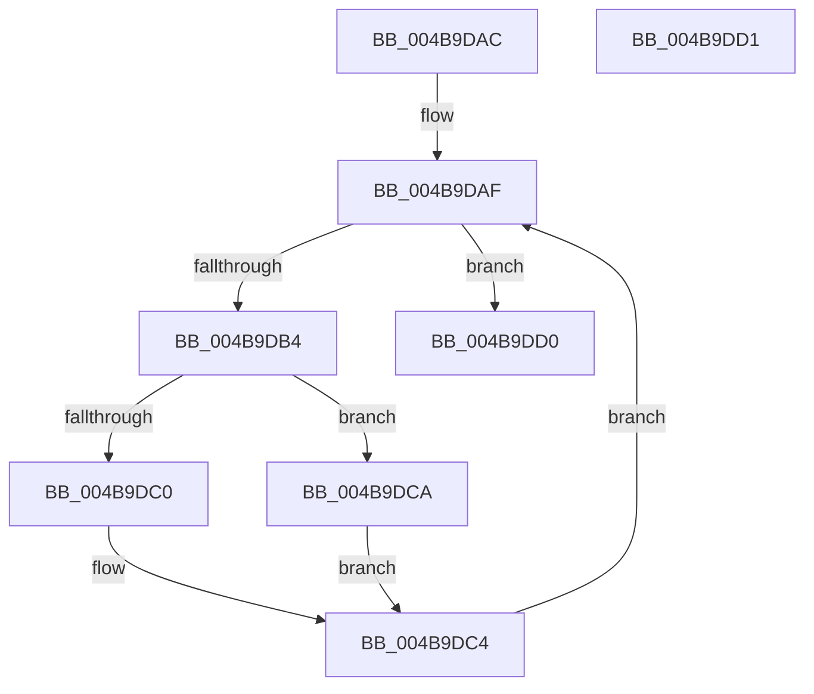

# PnpUpdateExtensionFlags

- RVA: `0x004B9DAC`–`0x004B9DD2` (길이 `38` bytes)
- VA: `0x00000001404B9DAC`
- 실행 섹션: `.text`
- PDB 이름 있음: `예`; PDB Function 태그: `아니요`
- unwind 정보 RVA: `0x000DB714`
- 디코드: `13`개 명령, `38/38` bytes 표시
- 미해석 바이트: `0` (있으면 어셈블리에 `.byte`로 보존)

> 이 문서는 커널 이미지의 기계어와 PDB 기호를 분석해 생성했습니다. 4번과 5번은 함수 원형과 자료형을 바이너리 사용 방식에서 추정한 C 해석이며 원본 소스 복구 결과는 아닙니다.

## 1. Dependencies

- 직접 호출 지점: **0**; 고유 호출 대상: **0**
- 직접 호출자로 확인된 함수: **1**
- RIP 상대 이미지 참조: **0**

### Outgoing calls
- 직접 디코드된 call 명령이 없습니다.

### Direct callers
- [sub_006FA5FC](../6F/Unknown_function_006FA5FC.md) at `0x006FA618`

### Static image references
- 디코드된 RIP-relative 메모리 참조가 없습니다.

## 2. Other-region calls and transfers

- 다른 실행 섹션으로 향하는 call: **0**
- 별도 외부 분기/꼬리 이동을 확인하지 못했습니다.

## 3. Assembly (complete function range)

```asm
004B9DAC  48 8B 01                        mov rax, qword ptr [rcx]
004B9DAF  48 85 C0                        test rax, rax
004B9DB2  74 1C                           je 0x1404b9dd0
004B9DB4  48 8B 88 38 01 00 00            mov rcx, qword ptr [rax + 0x138]
004B9DBB  45 85 C9                        test r9d, r9d
004B9DBE  74 0A                           je 0x1404b9dca
004B9DC0  83 49 20 04                     or dword ptr [rcx + 0x20], 4
004B9DC4  48 8B 40 18                     mov rax, qword ptr [rax + 0x18]
004B9DC8  EB E5                           jmp 0x1404b9daf
004B9DCA  83 61 20 FB                     and dword ptr [rcx + 0x20], 0xfffffffb
004B9DCE  EB F4                           jmp 0x1404b9dc4
004B9DD0  C3                              ret
004B9DD1  CC                              int3
```

## 4. C-style interpretation (structured pseudocode)

```c
__int64 __fastcall PnpUpdateExtensionFlags(__int64 a1, __int64 a2, __int64 a3, int a4)
{
loc_004B9DAF:
    if (*(unsigned __int64 *)(a1) == 0) goto loc_004B9DD0;
    if (a4 == 0) goto loc_004B9DCA;
loc_004B9DC4:
    goto loc_004B9DAF;
loc_004B9DCA:
    goto loc_004B9DC4;
loc_004B9DD0:
    return *(unsigned __int64 *)(*(unsigned __int64 *)(a1) + 24);
}
```

## 5. (Beta) C Style

```c
int64_t PnpUpdateExtensionFlags(void *Arg1, int64_t Arg2, int64_t Arg3, int32_t Arg4)
{
    uint8_t *arg1 = (uint8_t *)Arg1;

loc_004B9DAF:
    if (*(uint64_t *)(arg1) == 0) goto loc_004B9DD0;
    if (Arg4 == 0) goto loc_004B9DCA;
loc_004B9DC4:
    goto loc_004B9DAF;
loc_004B9DCA:
    goto loc_004B9DC4;
loc_004B9DD0:
    return *(uint64_t *)(*(uint64_t *)(arg1) + 0x18);
}
```

### 관측된 메모리 오프셋

구조체 형식이 확인되지 않은 접근은 인자 기준의 오프셋으로만 기록했습니다.

| 기준 인자 | 오프셋 표현 | 폭 (bit) | 접근 |
|---|---:|---:|---|
| `Arg1` | `+ 0x0` | `64` | `R` |

## 6. Execution-region graph

[열기: 2D/3D 그래프와 함수 탐색 컨트롤 패널](../../../control-panel.html?section=text&rva=0x004B9DAC&view=graph)

- 2D 그래프는 위에서 아래로 흐르고, 3D 그래프는 빈 공간을 드래그해 회전합니다. Shift+드래그는 이동, 휠은 확대·축소, 함수 노드 선택은 대상 보고서 이동입니다.

### Static fallback


