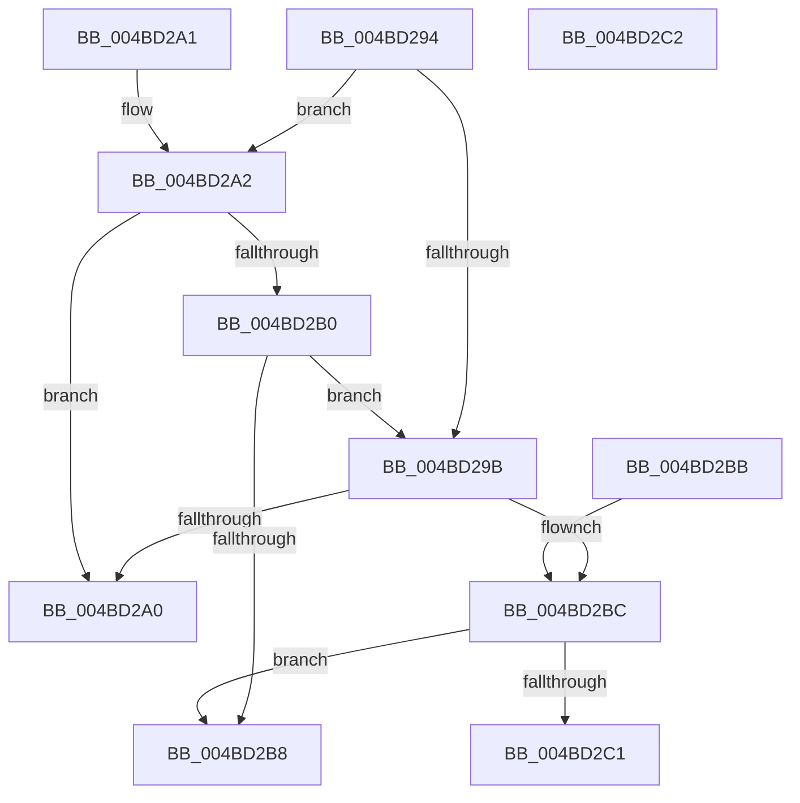

# PnpValidateMultiSzData

- RVA: `0x004BD294`–`0x004BD2C3` (길이 `47` bytes)
- VA: `0x00000001404BD294`
- 실행 섹션: `.text`
- PDB 이름 있음: `예`; PDB Function 태그: `아니요`
- unwind 정보 RVA: `0x000DB714`
- 디코드: `20`개 명령, `47/47` bytes 표시
- 미해석 바이트: `0` (있으면 어셈블리에 `.byte`로 보존)

> 이 문서는 커널 이미지의 기계어와 PDB 기호를 분석해 생성했습니다. 4번과 5번은 함수 원형과 자료형을 바이너리 사용 방식에서 추정한 C 해석이며 원본 소스 복구 결과는 아닙니다.

## 1. Dependencies

- 직접 호출 지점: **0**; 고유 호출 대상: **0**
- 직접 호출자로 확인된 함수: **7**
- RIP 상대 이미지 참조: **0**

### Outgoing calls
- 직접 디코드된 call 명령이 없습니다.

### Direct callers
- [PnpValidateRegistryMultiSz](../4D/PnpValidateRegistryMultiSz_function_004DC170.md) at `0x004DC189`
- [PnpValidateRegistryValue](../5A/PnpValidateRegistryValue_function_005A8218.md) at `0x005A8259`
- [PiDevCfgClearDeviceMigrationNode](../../page/96/PiDevCfgClearDeviceMigrationNode_function_00965780.md) at `0x00965A57`
- [PiDevCfgQueryObjectProperties](../../page/97/PiDevCfgQueryObjectProperties_function_0097776C.md) at `0x00977A20`
- [PiDevCfgQueryDeviceMigrationNode](../../page/9B/PiDevCfgQueryDeviceMigrationNode_function_009BD328.md) at `0x009BD710`
- [PiDevCfgResolveVariableDeviceProperty](../../page/AA/PiDevCfgResolveVariableDeviceProperty_function_00AA63A0.md) at `0x00AA66C9`
- [PiDevCfgResolveMultiSzValue](../../page/AB/PiDevCfgResolveMultiSzValue_function_00AB6894.md) at `0x00AB6903`

### Static image references
- 디코드된 RIP-relative 메모리 참조가 없습니다.

## 2. Other-region calls and transfers

- 다른 실행 섹션으로 향하는 call: **0**
- 별도 외부 분기/꼬리 이동을 확인하지 못했습니다.

## 3. Assembly (complete function range)

```asm
004BD294  33 C0                           xor eax, eax
004BD296  83 FA 04                        cmp edx, 4
004BD299  73 07                           jae 0x1404bd2a2
004BD29B  83 FA 02                        cmp edx, 2
004BD29E  74 1C                           je 0x1404bd2bc
004BD2A0  C3                              ret
004BD2A1  CC                              int3
004BD2A2  44 8B C2                        mov r8d, edx
004BD2A5  49 D1 E8                        shr r8, 1
004BD2A8  66 42 39 44 41 FE               cmp word ptr [rcx + r8*2 - 2], ax
004BD2AE  75 F0                           jne 0x1404bd2a0
004BD2B0  66 42 39 44 41 FC               cmp word ptr [rcx + r8*2 - 4], ax
004BD2B6  75 E3                           jne 0x1404bd29b
004BD2B8  B0 01                           mov al, 1
004BD2BA  C3                              ret
004BD2BB  CC                              int3
004BD2BC  66 39 01                        cmp word ptr [rcx], ax
004BD2BF  74 F7                           je 0x1404bd2b8
004BD2C1  C3                              ret
004BD2C2  CC                              int3
```

## 4. C-style interpretation (structured pseudocode)

```c
__int64 __fastcall PnpValidateMultiSzData(__int64 a1, int a2)
{
    __int64 result;

    result = 0;
    if (a2 >= 4) goto loc_004BD2A2;
loc_004BD29B:
    if (a2 == 2) goto loc_004BD2BC;
loc_004BD2A0:
    return result;
loc_004BD2A2:
    a3 = ((unsigned int)(a2)) >> (1);
    if ((*(unsigned __int16 *)(a1 + a3 * 2 - 2)) != 0) goto loc_004BD2A0;
    if ((*(unsigned __int16 *)(a1 + a3 * 2 - 4)) != 0) goto loc_004BD29B;
loc_004BD2B8:
    return 1;
loc_004BD2BC:
    if ((*(unsigned __int16 *)(a1)) == 1) goto loc_004BD2B8;
    return 1;
}
```

## 5. (Beta) C Style

```c
int64_t PnpValidateMultiSzData(void *Arg1, int32_t Arg2)
{
    uint8_t *arg1 = (uint8_t *)Arg1;

    int64_t result;

    result = 0;
    if (Arg2 >= 4) goto loc_004BD2A2;
loc_004BD29B:
    if (Arg2 == 2) goto loc_004BD2BC;
loc_004BD2A0:
    return result;
loc_004BD2A2:
    a3 = ((uint32_t)(Arg2)) >> (1);
    if ((*(uint16_t *)(arg1 + a3 * 2 - 0x2)) != 0) goto loc_004BD2A0;
    if ((*(uint16_t *)(arg1 + a3 * 2 - 0x4)) != 0) goto loc_004BD29B;
loc_004BD2B8:
    return 1;
loc_004BD2BC:
    if ((*(uint16_t *)(arg1)) == 1) goto loc_004BD2B8;
    return 1;
}
```

### 관측된 메모리 오프셋

구조체 형식이 확인되지 않은 접근은 인자 기준의 오프셋으로만 기록했습니다.

| 기준 인자 | 오프셋 표현 | 폭 (bit) | 접근 |
|---|---:|---:|---|
| `Arg1` | `- 0x4 + r8*2` | `16` | `R` |
| `Arg1` | `- 0x2 + r8*2` | `16` | `R` |
| `Arg1` | `+ 0x0` | `16` | `R` |

## 6. Execution-region graph

[열기: 2D/3D 그래프와 함수 탐색 컨트롤 패널](../../../control-panel.html?section=text&rva=0x004BD294&view=graph)

- 2D 그래프는 위에서 아래로 흐르고, 3D 그래프는 빈 공간을 드래그해 회전합니다. Shift+드래그는 이동, 휠은 확대·축소, 함수 노드 선택은 대상 보고서 이동입니다.

### Static fallback


