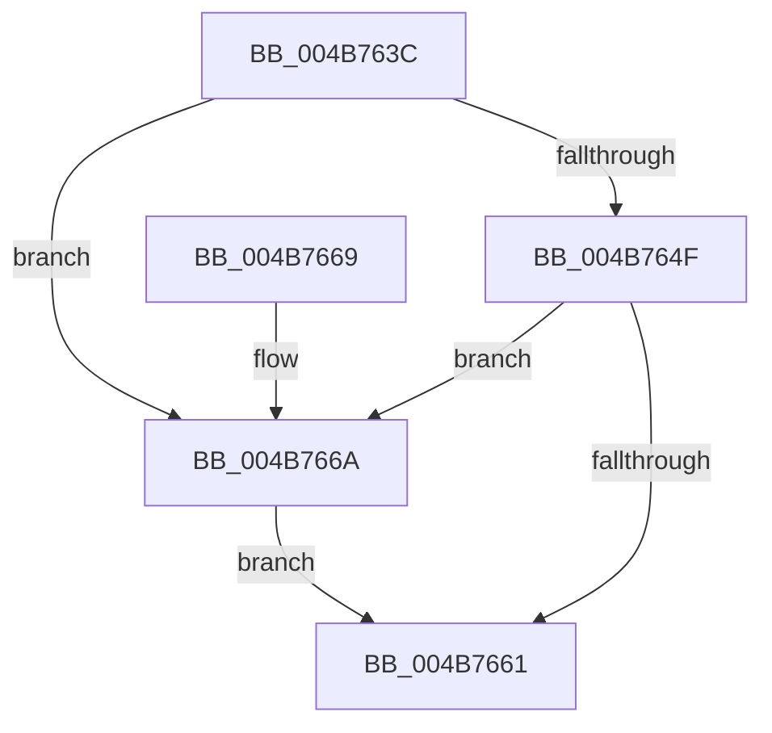

# PnpValidateRegistryString

- RVA: `0x004B763C`–`0x004B766F` (길이 `51` bytes)
- VA: `0x00000001404B763C`
- 실행 섹션: `.text`
- PDB 이름 있음: `예`; PDB Function 태그: `아니요`
- unwind 정보 RVA: `0x0009FDFC`
- 디코드: `17`개 명령, `51/51` bytes 표시
- 미해석 바이트: `0` (있으면 어셈블리에 `.byte`로 보존)

> 이 문서는 커널 이미지의 기계어와 PDB 기호를 분석해 생성했습니다. 4번과 5번은 함수 원형과 자료형을 바이너리 사용 방식에서 추정한 C 해석이며 원본 소스 복구 결과는 아닙니다.

## 1. Dependencies

- 직접 호출 지점: **1**; 고유 호출 대상: **1**
- 직접 호출자로 확인된 함수: **9**
- RIP 상대 이미지 참조: **0**

### Outgoing calls
- `0x004B7658` → [PnpValidateStringData](PnpValidateStringData_function_004B7678.md) (function, `0x004B7678`)

### Direct callers
- [PiDevCfgQueryMinWhcpVersion](../../page/73/PiDevCfgQueryMinWhcpVersion_function_00735204.md) at `0x0073528F`
- [PiDevCfgQueryPolicyStringList](../../page/73/PiDevCfgQueryPolicyStringList_function_00735358.md) at `0x00735533`
- [PiDevCfgResolveVariableFormatString](../../page/73/PiDevCfgResolveVariableFormatString_function_00735AB0.md) at `0x00735B1D`
- [PiDevCfgResolveVariableKeyValue](../../page/73/PiDevCfgResolveVariableKeyValue_function_007361B0.md) at `0x0073621E`
- [PiDevCfgResolveVariableSwitchCase](../../page/73/PiDevCfgResolveVariableSwitchCase_function_00736390.md) at `0x007363F0`
- [PiDevCfgResolveVariableSwitchCase](../../page/73/PiDevCfgResolveVariableSwitchCase_function_00736390.md) at `0x00736481`
- [PiDevCfgResolveVariableSwitchCase](../../page/73/PiDevCfgResolveVariableSwitchCase_function_00736390.md) at `0x00736524`
- [PiDevCfgBuildIndirectString](../../page/97/PiDevCfgBuildIndirectString_function_0097A890.md) at `0x0097A9D8`
- [PiDevCfgResolveVariable](../../page/A8/PiDevCfgResolveVariable_function_00A81AB8.md) at `0x00A81C2E`
- [PiDevCfgResolveVariableDeviceProperty](../../page/AA/PiDevCfgResolveVariableDeviceProperty_function_00AA63A0.md) at `0x00AA6428`
- [PiDevCfgResolveVariableKeyHandle](../../page/AB/PiDevCfgResolveVariableKeyHandle_function_00AB2A24.md) at `0x00AB2AB7`
- [PiDevCfgResolveVariableKeyHandle](../../page/AB/PiDevCfgResolveVariableKeyHandle_function_00AB2A24.md) at `0x00AB2D03`

### Static image references
- 디코드된 RIP-relative 메모리 참조가 없습니다.

## 2. Other-region calls and transfers

- 다른 실행 섹션으로 향하는 call: **0**
- 별도 외부 분기/꼬리 이동을 확인하지 못했습니다.

## 3. Assembly (complete function range)

```asm
004B763C  48 83 EC 28                     sub rsp, 0x28
004B7640  41 B9 01 00 00 00               mov r9d, 1
004B7646  48 8B D1                        mov rdx, rcx
004B7649  44 39 49 04                     cmp dword ptr [rcx + 4], r9d
004B764D  75 1B                           jne 0x1404b766a
004B764F  8B 49 08                        mov ecx, dword ptr [rcx + 8]
004B7652  48 03 CA                        add rcx, rdx
004B7655  8B 52 0C                        mov edx, dword ptr [rdx + 0xc]
004B7658  E8 1B 00 00 00                  call 0x1404b7678
004B765D  84 C0                           test al, al
004B765F  74 09                           je 0x1404b766a
004B7661  41 8A C1                        mov al, r9b
004B7664  48 83 C4 28                     add rsp, 0x28
004B7668  C3                              ret
004B7669  CC                              int3
004B766A  45 32 C9                        xor r9b, r9b
004B766D  EB F2                           jmp 0x1404b7661
```

## 4. C-style interpretation (structured pseudocode)

```c
__int64 __fastcall PnpValidateRegistryString(__int64 a1)
{
    __int64 result;
    __int64 v_rsp;

    v_rsp = (v_rsp) - (40);
    if ((*(unsigned int *)(a1 + 4)) != 1) goto loc_004B766A;
    a1 = ((unsigned int)(*(unsigned int *)(a1 + 8))) + (a1);
    result = PnpValidateStringData(a1, (unsigned int)(*(unsigned int *)(a1 + 12)), a3, 1);
    if ((unsigned __int8)(result) == 0) goto loc_004B766A;
loc_004B7661:
    v_rsp = (v_rsp) + (40);
    return 1;
loc_004B766A:
    a4 = 0;
    goto loc_004B7661;
}
```

## 5. (Beta) C Style

```c
int64_t PnpValidateRegistryString(void *Arg1)
{
    uint8_t *arg1 = (uint8_t *)Arg1;

    int64_t result;
    int64_t local_rsp;

    local_rsp = (local_rsp) - (40);
    if ((*(uint32_t *)(arg1 + 0x4)) != 1) goto loc_004B766A;
    Arg1 = ((uint32_t)(*(uint32_t *)(arg1 + 0x8))) + (Arg1);
    result = PnpValidateStringData(Arg1, (uint32_t)(*(uint32_t *)(arg1 + 0xC)), a3, 1);
    if ((uint8_t)(result) == 0) goto loc_004B766A;
loc_004B7661:
    local_rsp = (local_rsp) + (40);
    return 1;
loc_004B766A:
    a4 = 0;
    goto loc_004B7661;
}
```

### 관측된 메모리 오프셋

구조체 형식이 확인되지 않은 접근은 인자 기준의 오프셋으로만 기록했습니다.

| 기준 인자 | 오프셋 표현 | 폭 (bit) | 접근 |
|---|---:|---:|---|
| `Arg1` | `+ 0x4` | `32` | `R` |
| `Arg1` | `+ 0x8` | `32` | `R` |
| `Arg1` | `+ 0xC` | `32` | `R` |

## 6. Execution-region graph

[열기: 2D/3D 그래프와 함수 탐색 컨트롤 패널](../../../control-panel.html?section=text&rva=0x004B763C&view=graph)

- 2D 그래프는 위에서 아래로 흐르고, 3D 그래프는 빈 공간을 드래그해 회전합니다. Shift+드래그는 이동, 휠은 확대·축소, 함수 노드 선택은 대상 보고서 이동입니다.

### Static fallback


