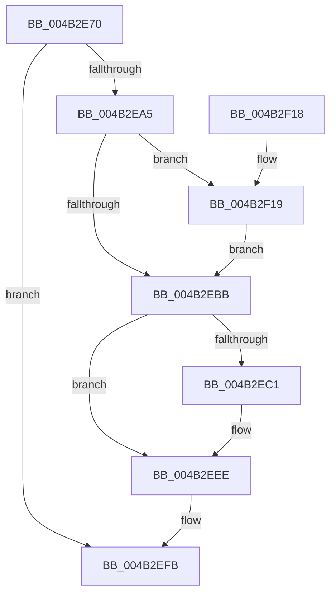

# PoFxPowerControl

- RVA: `0x004B2E70`–`0x004B2F1F` (길이 `175` bytes)
- VA: `0x00000001404B2E70`
- 실행 섹션: `.text`
- PDB 이름 있음: `예`; PDB Function 태그: `아니요`
- unwind 정보 RVA: `0x000B9754`
- 디코드: `48`개 명령, `175/175` bytes 표시
- 미해석 바이트: `0` (있으면 어셈블리에 `.byte`로 보존)

> 이 문서는 커널 이미지의 기계어와 PDB 기호를 분석해 생성했습니다. 4번과 5번은 함수 원형과 자료형을 바이너리 사용 방식에서 추정한 C 해석이며 원본 소스 복구 결과는 아닙니다.

## 1. Dependencies

- 직접 호출 지점: **3**; 고유 호출 대상: **3**
- 직접 호출자로 확인된 함수: **1**
- RIP 상대 이미지 참조: **0**

### Outgoing calls
- `0x004B2E9A` → [PopFxTryReferenceDevice](../2C/PopFxTryReferenceDevice_function_002C0628.md) (function, `0x002C0628`)
- `0x004B2EE7` → [PopPluginRequestPowerControl](PopPluginRequestPowerControl_function_004B2F28.md) (function, `0x004B2F28`)
- `0x004B2EF6` → [PopFxDereferenceDevice](../27/PopFxDereferenceDevice_function_0027038C.md) (function, `0x0027038C`)

### Direct callers
- [DifPoFxPowerControlWrapper](../63/DifPoFxPowerControlWrapper_function_006396B0.md) at `0x006397D8`

### Static image references
- 디코드된 RIP-relative 메모리 참조가 없습니다.

## 2. Other-region calls and transfers

- 다른 실행 섹션으로 향하는 call: **0**
- 별도 외부 분기/꼬리 이동을 확인하지 못했습니다.

## 3. Assembly (complete function range)

```asm
004B2E70  48 8B C4                        mov rax, rsp
004B2E73  48 89 58 08                     mov qword ptr [rax + 8], rbx
004B2E77  48 89 68 10                     mov qword ptr [rax + 0x10], rbp
004B2E7B  48 89 70 18                     mov qword ptr [rax + 0x18], rsi
004B2E7F  48 89 78 20                     mov qword ptr [rax + 0x20], rdi
004B2E83  41 56                           push r14
004B2E85  48 83 EC 40                     sub rsp, 0x40
004B2E89  4C 8B F2                        mov r14, rdx
004B2E8C  49 8B F1                        mov rsi, r9
004B2E8F  BA 01 00 00 00                  mov edx, 1
004B2E94  49 8B E8                        mov rbp, r8
004B2E97  48 8B F9                        mov rdi, rcx
004B2E9A  E8 89 D7 E0 FF                  call 0x1402c0628
004B2E9F  8B D8                           mov ebx, eax
004B2EA1  85 C0                           test eax, eax
004B2EA3  78 56                           js 0x1404b2efb
004B2EA5  48 8B 84 24 80 00 00 00         mov rax, qword ptr [rsp + 0x80]
004B2EAD  BB BB 00 00 C0                  mov ebx, 0xc00000bb
004B2EB2  48 8B 4F 38                     mov rcx, qword ptr [rdi + 0x38]
004B2EB6  48 85 C0                        test rax, rax
004B2EB9  75 5E                           jne 0x1404b2f19
004B2EBB  80 79 7C 00                     cmp byte ptr [rcx + 0x7c], 0
004B2EBF  74 2D                           je 0x1404b2eee
004B2EC1  48 8B 49 20                     mov rcx, qword ptr [rcx + 0x20]
004B2EC5  4C 8B CE                        mov r9, rsi
004B2EC8  48 89 44 24 30                  mov qword ptr [rsp + 0x30], rax
004B2ECD  4C 8B C5                        mov r8, rbp
004B2ED0  48 8B 44 24 78                  mov rax, qword ptr [rsp + 0x78]
004B2ED5  49 8B D6                        mov rdx, r14
004B2ED8  48 89 44 24 28                  mov qword ptr [rsp + 0x28], rax
004B2EDD  48 8B 44 24 70                  mov rax, qword ptr [rsp + 0x70]
004B2EE2  48 89 44 24 20                  mov qword ptr [rsp + 0x20], rax
004B2EE7  E8 3C 00 00 00                  call 0x1404b2f28
004B2EEC  8B D8                           mov ebx, eax
004B2EEE  BA 01 00 00 00                  mov edx, 1
004B2EF3  48 8B CF                        mov rcx, rdi
004B2EF6  E8 91 D4 DB FF                  call 0x14027038c
004B2EFB  48 8B 6C 24 58                  mov rbp, qword ptr [rsp + 0x58]
004B2F00  8B C3                           mov eax, ebx
004B2F02  48 8B 5C 24 50                  mov rbx, qword ptr [rsp + 0x50]
004B2F07  48 8B 74 24 60                  mov rsi, qword ptr [rsp + 0x60]
004B2F0C  48 8B 7C 24 68                  mov rdi, qword ptr [rsp + 0x68]
004B2F11  48 83 C4 40                     add rsp, 0x40
004B2F15  41 5E                           pop r14
004B2F17  C3                              ret
004B2F18  CC                              int3
004B2F19  48 83 20 00                     and qword ptr [rax], 0
004B2F1D  EB 9C                           jmp 0x1404b2ebb
```

## 4. C-style interpretation (structured pseudocode)

```c
__int64 __fastcall PoFxPowerControl(__int64 a1, __int64 a2, __int64 a3, __int64 a4, __int64 a5, __int64 a6, __int64 a7)
{
    __int64 result;
    __int64 v_rbx;
    __int64 v_rsp;
    unsigned __int64 v_stack_m18;
    unsigned __int64 v_stack_m20;
    unsigned __int64 v_stack_m28;
    unsigned __int64 v_stack_p10;
    unsigned __int64 v_stack_p18;
    unsigned __int64 v_stack_p20;
    unsigned __int64 v_stack_p8;

    *(unsigned __int64 *)(v_rsp + 8) = v_rbx;
    *(unsigned __int64 *)(v_rsp + 16) = v_rbp;
    *(unsigned __int64 *)(v_rsp + 24) = v_rsi;
    *(unsigned __int64 *)(v_rsp + 32) = v_rdi;
    v_rsp = (v_rsp) - (64);
    result = PopFxTryReferenceDevice(a1, 1, a3, a4);
    if (sign_flag) goto loc_004B2EFB;
    if (a7 != 0) goto loc_004B2F19;
loc_004B2EBB:
    result = a7;
    v_rbx = (unsigned int)(0xC00000BBULL);
    if ((*(unsigned __int8 *)(*(unsigned __int64 *)(a1 + 56) + 124)) != 0) {
        a1 = *(unsigned __int64 *)(*(unsigned __int64 *)(a1 + 56) + 32);
        a4 = a4;
        v_stack_m18 = a7;
        a3 = a3;
        result = a6;
        a2 = a2;
        v_stack_m20 = result;
        result = a5;
        v_stack_m28 = result;
        result = PopPluginRequestPowerControl(a1, a2, a3, a4);
        v_rbx = (unsigned int)(result);
    }
    result = PopFxDereferenceDevice(a1, 1, a3, a4);
loc_004B2EFB:
    v_rsp = (v_rsp) + (64);
    return (unsigned int)((unsigned int)(v_rbx));
loc_004B2F19:
    goto loc_004B2EBB;
}
```

## 5. (Beta) C Style

```c
int64_t PoFxPowerControl(void *Arg1, int64_t Arg2, int64_t Arg3, int64_t Arg4, int64_t Arg5, int64_t Arg6, int64_t Arg7)
{
    uint8_t *arg1 = (uint8_t *)Arg1;

    int64_t result;
    int64_t local_rbx;
    int64_t local_rsp;
    uint64_t v_stack_m18;
    uint64_t v_stack_m20;
    uint64_t v_stack_m28;
    uint64_t v_stack_p10;
    uint64_t v_stack_p18;
    uint64_t v_stack_p20;
    uint64_t v_stack_p8;

    *(uint64_t *)(local_rsp + 0x8) = local_rbx;
    *(uint64_t *)(local_rsp + 0x10) = local_rbp;
    *(uint64_t *)(local_rsp + 0x18) = local_rsi;
    *(uint64_t *)(local_rsp + 0x20) = local_rdi;
    local_rsp = (local_rsp) - (64);
    result = PopFxTryReferenceDevice(Arg1, 1, Arg3, Arg4);
    if (sign_flag) goto loc_004B2EFB;
    if (Arg7 != 0) goto loc_004B2F19;
loc_004B2EBB:
    result = Arg7;
    local_rbx = (uint32_t)(0xC00000BBULL);
    if ((*(uint8_t *)(*(uint64_t *)(arg1 + 0x38) + 0x7C)) != 0) {
        Arg1 = *(uint64_t *)(*(uint64_t *)(arg1 + 0x38) + 0x20);
        Arg4 = Arg4;
        v_stack_m18 = Arg7;
        Arg3 = Arg3;
        result = Arg6;
        Arg2 = Arg2;
        v_stack_m20 = result;
        result = Arg5;
        v_stack_m28 = result;
        result = PopPluginRequestPowerControl(Arg1, Arg2, Arg3, Arg4);
        local_rbx = (uint32_t)(result);
    }
    result = PopFxDereferenceDevice(Arg1, 1, Arg3, Arg4);
loc_004B2EFB:
    local_rsp = (local_rsp) + (64);
    return (uint32_t)((uint32_t)(local_rbx));
loc_004B2F19:
    goto loc_004B2EBB;
}
```

### 관측된 메모리 오프셋

구조체 형식이 확인되지 않은 접근은 인자 기준의 오프셋으로만 기록했습니다.

| 기준 인자 | 오프셋 표현 | 폭 (bit) | 접근 |
|---|---:|---:|---|
| `Arg1` | `+ 0x38` | `64` | `R` |

## 6. Execution-region graph

[열기: 2D/3D 그래프와 함수 탐색 컨트롤 패널](../../../control-panel.html?section=text&rva=0x004B2E70&view=graph)

- 2D 그래프는 위에서 아래로 흐르고, 3D 그래프는 빈 공간을 드래그해 회전합니다. Shift+드래그는 이동, 휠은 확대·축소, 함수 노드 선택은 대상 보고서 이동입니다.

### Static fallback


