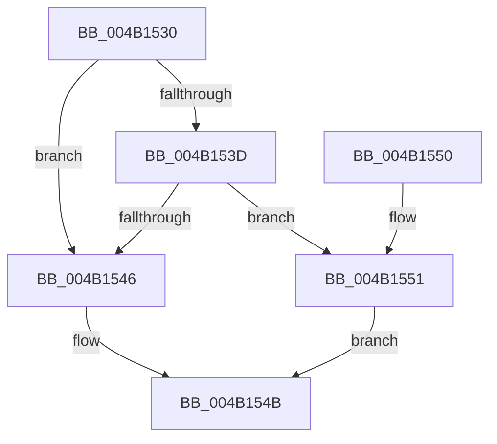

# PoFxProcessorNotification

- RVA: `0x004B1530`–`0x004B1567` (길이 `55` bytes)
- VA: `0x00000001404B1530`
- 실행 섹션: `.text`
- PDB 이름 있음: `예`; PDB Function 태그: `아니요`
- unwind 정보 RVA: `0x00068370`
- 디코드: `18`개 명령, `55/55` bytes 표시
- 미해석 바이트: `0` (있으면 어셈블리에 `.byte`로 보존)

> 이 문서는 커널 이미지의 기계어와 PDB 기호를 분석해 생성했습니다. 4번과 5번은 함수 원형과 자료형을 바이너리 사용 방식에서 추정한 C 해석이며 원본 소스 복구 결과는 아닙니다.

## 1. Dependencies

- 직접 호출 지점: **1**; 고유 호출 대상: **1**
- 직접 호출자로 확인된 함수: **0**
- RIP 상대 이미지 참조: **0**

### Outgoing calls
- `0x004B1555` → [guard_dispatch_icall](../6B/guard_dispatch_icall_function_006BAAD0.md) (function, `0x006BAAD0`)

### Direct callers
- 이 함수 시작 RVA로 연결되는 직접 call은 확인되지 않았습니다. 간접 호출은 완전히 역산할 수 없습니다.

### Static image references
- 디코드된 RIP-relative 메모리 참조가 없습니다.

## 2. Other-region calls and transfers

- 다른 실행 섹션으로 향하는 call: **0**
- 별도 외부 분기/꼬리 이동을 확인하지 못했습니다.

## 3. Assembly (complete function range)

```asm
004B1530  48 83 EC 28                     sub rsp, 0x28
004B1534  48 8B 41 40                     mov rax, qword ptr [rcx + 0x40]
004B1538  48 85 C0                        test rax, rax
004B153B  74 09                           je 0x1404b1546
004B153D  48 8B 40 68                     mov rax, qword ptr [rax + 0x68]
004B1541  48 85 C0                        test rax, rax
004B1544  75 0B                           jne 0x1404b1551
004B1546  B8 02 00 00 C0                  mov eax, 0xc0000002
004B154B  48 83 C4 28                     add rsp, 0x28
004B154F  C3                              ret
004B1550  CC                              int3
004B1551  48 8B 49 48                     mov rcx, qword ptr [rcx + 0x48]
004B1555  E8 76 95 20 00                  call 0x1406baad0
004B155A  F6 D8                           neg al
004B155C  1B C0                           sbb eax, eax
004B155E  F7 D0                           not eax
004B1560  25 BB 00 00 C0                  and eax, 0xc00000bb
004B1565  EB E4                           jmp 0x1404b154b
```

## 4. C-style interpretation (structured pseudocode)

```c
__int64 __fastcall PoFxProcessorNotification(__int64 a1)
{
    __int64 result;
    __int64 v_rsp;

    v_rsp = (v_rsp) - (40);
    if (*(unsigned __int64 *)(a1 + 64) == 0) goto loc_004B1546;
    if (*(unsigned __int64 *)(*(unsigned __int64 *)(a1 + 64) + 104) != 0) goto loc_004B1551;
loc_004B1546:
loc_004B154B:
    v_rsp = (v_rsp) + (40);
    return (unsigned int)(0xC0000002ULL);
loc_004B1551:
    result = guard_dispatch_icall(*(unsigned __int64 *)(a1 + 72), a2, a3, a4);
    result = (unsigned __int8)(-(result));
    result = (unsigned int)(~(result));
    result = (unsigned int)((result) & (0xC00000BBULL));
    goto loc_004B154B;
}
```

## 5. (Beta) C Style

```c
int64_t PoFxProcessorNotification(void *Arg1)
{
    uint8_t *arg1 = (uint8_t *)Arg1;

    int64_t result;
    int64_t local_rsp;

    local_rsp = (local_rsp) - (40);
    if (*(uint64_t *)(arg1 + 0x40) == 0) goto loc_004B1546;
    if (*(uint64_t *)(*(uint64_t *)(arg1 + 0x40) + 0x68) != 0) goto loc_004B1551;
loc_004B1546:
loc_004B154B:
    local_rsp = (local_rsp) + (40);
    return (uint32_t)(0xC0000002ULL);
loc_004B1551:
    result = guard_dispatch_icall(*(uint64_t *)(arg1 + 0x48), a2, a3, a4);
    result = (uint8_t)(-(result));
    result = (uint32_t)(~(result));
    result = (uint32_t)((result) & (0xC00000BBULL));
    goto loc_004B154B;
}
```

### 관측된 메모리 오프셋

구조체 형식이 확인되지 않은 접근은 인자 기준의 오프셋으로만 기록했습니다.

| 기준 인자 | 오프셋 표현 | 폭 (bit) | 접근 |
|---|---:|---:|---|
| `Arg1` | `+ 0x40` | `64` | `R` |
| `Arg1` | `+ 0x48` | `64` | `R` |

## 6. Execution-region graph

[열기: 2D/3D 그래프와 함수 탐색 컨트롤 패널](../../../control-panel.html?section=text&rva=0x004B1530&view=graph)

- 2D 그래프는 위에서 아래로 흐르고, 3D 그래프는 빈 공간을 드래그해 회전합니다. Shift+드래그는 이동, 휠은 확대·축소, 함수 노드 선택은 대상 보고서 이동입니다.

### Static fallback


