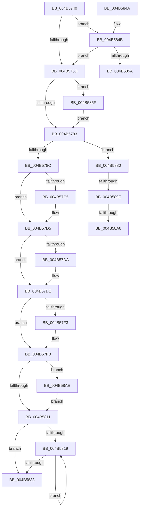

# PoFxStartDevicePowerManagement

- RVA: `0x004B5740`–`0x004B58CC` (길이 `396` bytes)
- VA: `0x00000001404B5740`
- 실행 섹션: `.text`
- PDB 이름 있음: `예`; PDB Function 태그: `예`
- unwind 정보 RVA: `0x000BA238`
- 디코드: `102`개 명령, `396/396` bytes 표시
- 미해석 바이트: `0` (있으면 어셈블리에 `.byte`로 보존)

> 이 문서는 커널 이미지의 기계어와 PDB 기호를 분석해 생성했습니다. 4번과 5번은 함수 원형과 자료형을 바이너리 사용 방식에서 추정한 C 해석이며 원본 소스 복구 결과는 아닙니다.

## 1. Dependencies

- 직접 호출 지점: **11**; 고유 호출 대상: **11**
- 직접 호출자로 확인된 함수: **6**
- RIP 상대 이미지 참조: **3**

### Outgoing calls
- `0x004B5771` → [PopPepDeviceStarted](PopPepDeviceStarted_function_004B58D4.md) (function, `0x004B58D4`)
- `0x004B57AC` → [KeAbPreAcquire](../21/KeAbPreAcquire_function_00210230.md) (function, `0x00210230`)
- `0x004B57D0` → [ExfAcquirePushLockSharedEx](../21/ExfAcquirePushLockSharedEx_function_0021044C.md) (function, `0x0021044C`)
- `0x004B57F6` → [ExfReleasePushLockShared](../26/ExfReleasePushLockShared_function_00263440.md) (function, `0x00263440`)
- `0x004B57FE` → [KeAbPostRelease](../2E/KeAbPostRelease_function_002E1600.md) (function, `0x002E1600`)
- `0x004B5803` → [KeLeaveCriticalRegion](../25/KeLeaveCriticalRegion_function_0025D8B0.md) (function, `0x0025D8B0`)
- `0x004B5824` → [PoFxIdleComponent](../2C/PoFxIdleComponent_function_002C01A0.md) (function, `0x002C01A0`)
- `0x004B5876` → [guard_dispatch_icall](../6B/guard_dispatch_icall_function_006BAAD0.md) (function, `0x006BAAD0`)
- `0x004B5884` → [ExAcquireSpinLockExclusive](../24/ExAcquireSpinLockExclusive_function_00248690.md) (function, `0x00248690`)
- `0x004B58BA` → [PopFxActivateDevice](../4A/PopFxActivateDevice_function_004A0DC8.md) (function, `0x004A0DC8`)
- `0x004B58C2` → [PopFxIncrementDeviceSleepCount](../49/PopFxIncrementDeviceSleepCount_function_0049C040.md) (function, `0x0049C040`)

### Direct callers
- [HalpTimerInitPowerManagement](../54/HalpTimerInitPowerManagement_function_00549298.md) at `0x0054937D`
- [HalpDmaInitPowerManagement](../55/HalpDmaInitPowerManagement_function_005530E0.md) at `0x005531A6`
- [HalpInterruptInitPowerManagement](../55/HalpInterruptInitPowerManagement_function_005577F8.md) at `0x005578CE`
- [DifPoFxStartDevicePowerManagementWrapper](../63/DifPoFxStartDevicePowerManagementWrapper_function_0063A150.md) at `0x0063A216`
- [PoFxEnableDStateReporting](../../page/75/PoFxEnableDStateReporting_function_007586A0.md) at `0x00758745`
- [PoFxRegisterDebugger](../../init/C4/PoFxRegisterDebugger_function_00C434E0.md) at `0x00C43739`

### Static image references
- `0x004B5756` → RVA `0x00E676AC` (`.data`; read)
- `0x004B5795` → RVA `0x00F0E408` (`.data`; read)
- `0x004B57DE` → RVA `0x00E676B4` (`.data`; read)

## 2. Other-region calls and transfers

- 다른 실행 섹션으로 향하는 call: **0**
- call이 아닌 외부 분기/꼬리 이동: **4**
  - `0x004B585A` → [sub_006FBB10](../6F/Unknown_function_006FBB10.md) (`tail-transfer`)
  - `0x004B5898` → [sub_006FBB10 + 0x65](../6F/Unknown_function_006FBB10.md) (`tail-transfer`)
  - `0x004B58A0` → [sub_006FBB10 + 0x9A](../6F/Unknown_function_006FBB10.md) (`tail-transfer`)
  - `0x004B58A9` → [sub_006FBB10 + 0x9A](../6F/Unknown_function_006FBB10.md) (`tail-transfer`)

## 3. Assembly (complete function range)

```asm
004B5740  48 89 5C 24 18                  mov qword ptr [rsp + 0x18], rbx
004B5745  48 89 6C 24 20                  mov qword ptr [rsp + 0x20], rbp
004B574A  56                              push rsi
004B574B  57                              push rdi
004B574C  41 54                           push r12
004B574E  41 56                           push r14
004B5750  41 57                           push r15
004B5752  48 83 EC 20                     sub rsp, 0x20
004B5756  8B 05 50 1F 9B 00               mov eax, dword ptr [rip + 0x9b1f50]
004B575C  33 FF                           xor edi, edi
004B575E  48 8B 59 30                     mov rbx, qword ptr [rcx + 0x30]
004B5762  48 8B F1                        mov rsi, rcx
004B5765  85 C0                           test eax, eax
004B5767  0F 84 DE 00 00 00               je 0x1404b584b
004B576D  48 8B 4E 38                     mov rcx, qword ptr [rsi + 0x38]
004B5771  E8 5E 01 00 00                  call 0x1404b58d4
004B5776  48 8B 4E 40                     mov rcx, qword ptr [rsi + 0x40]
004B577A  48 85 C9                        test rcx, rcx
004B577D  0F 85 DC 00 00 00               jne 0x1404b585f
004B5783  48 85 DB                        test rbx, rbx
004B5786  0F 85 F4 00 00 00               jne 0x1404b5880
004B578C  65 48 8B 04 25 88 01 00 00      mov rax, qword ptr gs:[0x188]
004B5795  4C 8D 35 6C 8C A5 00            lea r14, [rip + 0xa58c6c]
004B579C  45 33 C0                        xor r8d, r8d
004B579F  33 D2                           xor edx, edx
004B57A1  49 8B CE                        mov rcx, r14
004B57A4  66 FF 88 E4 01 00 00            dec word ptr [rax + 0x1e4]
004B57AB  90                              nop
004B57AC  E8 7F AA D5 FF                  call 0x140210230
004B57B1  48 8B E8                        mov rbp, rax
004B57B4  33 C0                           xor eax, eax
004B57B6  44 8D 78 11                     lea r15d, [rax + 0x11]
004B57BA  F0 4C 0F B1 3D 45 8C A5 00      lock cmpxchg qword ptr [rip + 0xa58c45], r15
004B57C3  74 10                           je 0x1404b57d5
004B57C5  4D 8B CE                        mov r9, r14
004B57C8  4C 8B C5                        mov r8, rbp
004B57CB  33 D2                           xor edx, edx
004B57CD  49 8B CE                        mov rcx, r14
004B57D0  E8 77 AC D5 FF                  call 0x14021044c
004B57D5  48 85 ED                        test rbp, rbp
004B57D8  74 04                           je 0x1404b57de
004B57DA  C6 45 0A 01                     mov byte ptr [rbp + 0xa], 1
004B57DE  40 8A 2D CF 1E 9B 00            mov bpl, byte ptr [rip + 0x9b1ecf]
004B57E5  49 8B C7                        mov rax, r15
004B57E8  F0 48 0F B1 3D 17 8C A5 00      lock cmpxchg qword ptr [rip + 0xa58c17], rdi
004B57F1  74 08                           je 0x1404b57fb
004B57F3  49 8B CE                        mov rcx, r14
004B57F6  E8 45 DC DA FF                  call 0x140263440
004B57FB  49 8B CE                        mov rcx, r14
004B57FE  E8 FD BD E2 FF                  call 0x1402e1600
004B5803  E8 A8 80 DA FF                  call 0x14025d8b0
004B5808  40 84 ED                        test bpl, bpl
004B580B  0F 85 9D 00 00 00               jne 0x1404b58ae
004B5811  39 BE 64 03 00 00               cmp dword ptr [rsi + 0x364], edi
004B5817  76 1A                           jbe 0x1404b5833
004B5819  41 B8 01 00 00 00               mov r8d, 1
004B581F  8B D7                           mov edx, edi
004B5821  48 8B CE                        mov rcx, rsi
004B5824  E8 77 A9 E0 FF                  call 0x1402c01a0
004B5829  FF C7                           inc edi
004B582B  3B BE 64 03 00 00               cmp edi, dword ptr [rsi + 0x364]
004B5831  72 E6                           jb 0x1404b5819
004B5833  48 8B 5C 24 60                  mov rbx, qword ptr [rsp + 0x60]
004B5838  48 8B 6C 24 68                  mov rbp, qword ptr [rsp + 0x68]
004B583D  48 83 C4 20                     add rsp, 0x20
004B5841  41 5F                           pop r15
004B5843  41 5E                           pop r14
004B5845  41 5C                           pop r12
004B5847  5F                              pop rdi
004B5848  5E                              pop rsi
004B5849  C3                              ret
004B584A  CC                              int3
004B584B  44 8B F7                        mov r14d, edi
004B584E  39 B9 64 03 00 00               cmp dword ptr [rcx + 0x364], edi
004B5854  0F 86 13 FF FF FF               jbe 0x1404b576d
004B585A  E9 B1 62 24 00                  jmp 0x1406fbb10
004B585F  48 8B 46 48                     mov rax, qword ptr [rsi + 0x48]
004B5863  48 8D 54 24 50                  lea rdx, [rsp + 0x50]
004B5868  48 89 44 24 50                  mov qword ptr [rsp + 0x50], rax
004B586D  48 8B 41 60                     mov rax, qword ptr [rcx + 0x60]
004B5871  B9 12 00 00 00                  mov ecx, 0x12
004B5876  E8 55 52 20 00                  call 0x1406baad0
004B587B  E9 03 FF FF FF                  jmp 0x1404b5783
004B5880  48 8D 4B 58                     lea rcx, [rbx + 0x58]
004B5884  E8 07 2E D9 FF                  call 0x140248690
004B5889  8B 53 78                        mov edx, dword ptr [rbx + 0x78]
004B588C  44 8A E0                        mov r12b, al
004B588F  8B 8E 60 03 00 00               mov ecx, dword ptr [rsi + 0x360]
004B5895  F6 C1 01                        test cl, 1
004B5898  0F 84 D7 62 24 00               je 0x1406fbb75
004B589E  85 D2                           test edx, edx
004B58A0  0F 84 04 63 24 00               je 0x1406fbbaa
004B58A6  89 7B 78                        mov dword ptr [rbx + 0x78], edi
004B58A9  E9 FC 62 24 00                  jmp 0x1406fbbaa
004B58AE  48 8B 5B 20                     mov rbx, qword ptr [rbx + 0x20]
004B58B2  45 33 C0                        xor r8d, r8d
004B58B5  48 8B CB                        mov rcx, rbx
004B58B8  33 D2                           xor edx, edx
004B58BA  E8 09 B5 FE FF                  call 0x1404a0dc8
004B58BF  48 8B CB                        mov rcx, rbx
004B58C2  E8 79 67 FE FF                  call 0x14049c040
004B58C7  E9 45 FF FF FF                  jmp 0x1404b5811
```

## 4. C-style interpretation (structured pseudocode)

```c
__int64 __fastcall PoFxStartDevicePowerManagement(__int64 a1, int a2, int a3)
{
    __int64 result;
    __int64 v_rdi;
    __int64 v_rsp;
    unsigned __int64 v_stack_p18;
    unsigned __int64 v_stack_p20;
    unsigned __int64 v_stack_p50;

    v_stack_p18 = v_rbx;
    v_stack_p20 = v_rbp;
    v_rsp = (v_rsp) - (32);
    v_rdi = 0;
    if ((unsigned int)((unsigned int)(*(unsigned int *)(v_rip + 10166096))) == 0) goto loc_004B584B;
loc_004B576D:
    result = PopPepDeviceStarted(*(unsigned __int64 *)(a1 + 56), a2, a3, a4);
    if (*(unsigned __int64 *)(a1 + 64) != 0) goto loc_004B585F;
loc_004B5783:
    if (*(unsigned __int64 *)(a1 + 48) != 0) goto loc_004B5880;
    a3 = 0;
    a2 = 0;
    result = KeAbPreAcquire(v_rip + 10849388, a2, a3, a4);
    result = 0;
    if (!(condition_is_equal)) {
        a4 = v_rip + 10849388;
        a3 = 0;
        a2 = 0;
        a1 = v_rip + 10849388;
        result = ExfAcquirePushLockSharedEx(a1, a2, a3, a4);
    }
    if (result != 0) {
        *(unsigned __int8 *)(result + 10) = 1;
    }
    result = result + 17;
    if (result != 0) {
        a1 = v_rip + 10849388;
        result = ExfReleasePushLockShared(a1, a2, a3, a4);
    }
    result = KeAbPostRelease(v_rip + 10849388, a2, a3, a4);
    result = KeLeaveCriticalRegion(v_rip + 10849388, a2, a3, a4);
    if ((unsigned __int8)(*(unsigned __int8 *)(v_rip + 10165967)) != 0) goto loc_004B58AE;
loc_004B5811:
    if ((*(unsigned int *)(a1 + 868)) <= 0) goto loc_004B5833;
loc_004B5819:
    result = PoFxIdleComponent(a1, 0, 1, a4);
    v_rdi = (unsigned int)((v_rdi) + 1);
    if (((unsigned int)(v_rdi)) < (*(unsigned int *)(a1 + 868))) goto loc_004B5819;
loc_004B5833:
    v_rsp = (v_rsp) + (32);
    return result;
loc_004B584B:
    if ((*(unsigned int *)(a1 + 868)) <= ((unsigned int)(v_rdi))) goto loc_004B576D;
loc_004B585F:
    v_stack_p50 = *(unsigned __int64 *)(a1 + 72);
    result = guard_dispatch_icall(18, v_stack_p50, 1, a4);
    goto loc_004B5783;
loc_004B5880:
    result = ExAcquireSpinLockExclusive(v_stack_p18 + 88, v_stack_p50, 1, a4);
    *(unsigned int *)(v_stack_p18 + 120) = (unsigned int)(v_rdi);
loc_004B58AE:
    a3 = 0;
    a2 = 0;
    result = PopFxActivateDevice(*(unsigned __int64 *)(v_stack_p18 + 32), a2, a3, a4);
    result = PopFxIncrementDeviceSleepCount(*(unsigned __int64 *)(v_stack_p18 + 32), a2, a3, a4);
    goto loc_004B5811;
}
```

## 5. (Beta) C Style

```c
int64_t PoFxStartDevicePowerManagement(void *Arg1, int32_t Arg2, int32_t Arg3)
{
    uint8_t *arg1 = (uint8_t *)Arg1;

    int64_t result;
    int64_t local_rdi;
    int64_t local_rsp;
    uint64_t v_stack_p18;
    uint64_t v_stack_p20;
    uint64_t v_stack_p50;

    v_stack_p18 = local_rbx;
    v_stack_p20 = local_rbp;
    local_rsp = (local_rsp) - (32);
    local_rdi = 0;
    if ((uint32_t)((uint32_t)(*(uint32_t *)(v_rip + 0x9B1F50))) == 0) goto loc_004B584B;
loc_004B576D:
    result = PopPepDeviceStarted(*(uint64_t *)(arg1 + 0x38), Arg2, Arg3, a4);
    if (*(uint64_t *)(arg1 + 0x40) != 0) goto loc_004B585F;
loc_004B5783:
    if (*(uint64_t *)(arg1 + 0x30) != 0) goto loc_004B5880;
    Arg3 = 0;
    Arg2 = 0;
    result = KeAbPreAcquire(v_rip + 10849388, Arg2, Arg3, a4);
    result = 0;
    if (!(condition_is_equal)) {
        a4 = v_rip + 10849388;
        Arg3 = 0;
        Arg2 = 0;
        Arg1 = v_rip + 10849388;
        result = ExfAcquirePushLockSharedEx(Arg1, Arg2, Arg3, a4);
    }
    if (result != 0) {
        *(uint8_t *)(result + 0xA) = 1;
    }
    result = result + 17;
    if (result != 0) {
        Arg1 = v_rip + 10849388;
        result = ExfReleasePushLockShared(Arg1, Arg2, Arg3, a4);
    }
    result = KeAbPostRelease(v_rip + 10849388, Arg2, Arg3, a4);
    result = KeLeaveCriticalRegion(v_rip + 10849388, Arg2, Arg3, a4);
    if ((uint8_t)(*(uint8_t *)(v_rip + 0x9B1ECF)) != 0) goto loc_004B58AE;
loc_004B5811:
    if ((*(uint32_t *)(arg1 + 0x364)) <= 0) goto loc_004B5833;
loc_004B5819:
    result = PoFxIdleComponent(Arg1, 0, 1, a4);
    local_rdi = (uint32_t)((local_rdi) + 1);
    if (((uint32_t)(local_rdi)) < (*(uint32_t *)(arg1 + 0x364))) goto loc_004B5819;
loc_004B5833:
    local_rsp = (local_rsp) + (32);
    return result;
loc_004B584B:
    if ((*(uint32_t *)(arg1 + 0x364)) <= ((uint32_t)(local_rdi))) goto loc_004B576D;
loc_004B585F:
    v_stack_p50 = *(uint64_t *)(arg1 + 0x48);
    result = guard_dispatch_icall(18, v_stack_p50, 1, a4);
    goto loc_004B5783;
loc_004B5880:
    result = ExAcquireSpinLockExclusive(v_stack_p18 + 88, v_stack_p50, 1, a4);
    *(uint32_t *)(v_stack_p18 + 0x78) = (uint32_t)(local_rdi);
loc_004B58AE:
    Arg3 = 0;
    Arg2 = 0;
    result = PopFxActivateDevice(*(uint64_t *)(v_stack_p18 + 0x20), Arg2, Arg3, a4);
    result = PopFxIncrementDeviceSleepCount(*(uint64_t *)(v_stack_p18 + 0x20), Arg2, Arg3, a4);
    goto loc_004B5811;
}
```

### 관측된 메모리 오프셋

구조체 형식이 확인되지 않은 접근은 인자 기준의 오프셋으로만 기록했습니다.

| 기준 인자 | 오프셋 표현 | 폭 (bit) | 접근 |
|---|---:|---:|---|
| `Arg1` | `+ 0x30` | `64` | `R` |
| `Arg1` | `+ 0x38` | `64` | `R` |
| `Arg1` | `+ 0x40` | `64` | `R` |
| `Arg1` | `+ 0x48` | `64` | `R` |
| `Arg1` | `+ 0x360` | `32` | `R` |
| `Arg1` | `+ 0x364` | `32` | `R` |

## 6. Execution-region graph

[열기: 2D/3D 그래프와 함수 탐색 컨트롤 패널](../../../control-panel.html?section=text&rva=0x004B5740&view=graph)

- 2D 그래프는 위에서 아래로 흐르고, 3D 그래프는 빈 공간을 드래그해 회전합니다. Shift+드래그는 이동, 휠은 확대·축소, 함수 노드 선택은 대상 보고서 이동입니다.

### Static fallback


