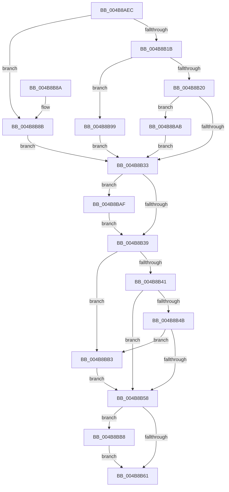

# PopActionRetrieveInitialState

- RVA: `0x004B8AEC`–`0x004B8BC6` (길이 `218` bytes)
- VA: `0x00000001404B8AEC`
- 실행 섹션: `.text`
- PDB 이름 있음: `예`; PDB Function 태그: `아니요`
- unwind 정보 RVA: `0x000BB054`
- 디코드: `66`개 명령, `218/218` bytes 표시
- 미해석 바이트: `0` (있으면 어셈블리에 `.byte`로 보존)

> 이 문서는 커널 이미지의 기계어와 PDB 기호를 분석해 생성했습니다. 4번과 5번은 함수 원형과 자료형을 바이너리 사용 방식에서 추정한 C 해석이며 원본 소스 복구 결과는 아닙니다.

## 1. Dependencies

- 직접 호출 지점: **2**; 고유 호출 대상: **2**
- 직접 호출자로 확인된 함수: **1**
- RIP 상대 이미지 참조: **5**

### Outgoing calls
- `0x004B8B58` → [PopFastS4Check](../../page/AA/PopFastS4Check_function_00AAF5A4.md) (function, `0x00AAF5A4`)
- `0x004B8BA4` → [PopVerifySystemPowerState](../../page/A9/PopVerifySystemPowerState_function_00A9537C.md) (function, `0x00A9537C`)

### Direct callers
- [PopTransitionSystemPowerStateEx](../../pagelk/B7/PopTransitionSystemPowerStateEx_function_00B7E8C0.md) at `0x00B7EBFC`

### Static image references
- `0x004B8B07` → RVA `0x00F0BD44` (`.data`; read)
- `0x004B8B20` → RVA `0x00F0CE68` (`.data`; read)
- `0x004B8B41` → RVA `0x00F0BD4C` (`.data`; read)
- `0x004B8B4B` → RVA `0x00F0BD54` (`.data`; read)
- `0x004B8BBC` → RVA `0x00F0BD4C` (`.data`; read/write)

## 2. Other-region calls and transfers

- 다른 실행 섹션으로 향하는 call: **2**
  - `0x004B8B58` → [PopFastS4Check](../../page/AA/PopFastS4Check_function_00AAF5A4.md) (`.text` → `PAGE`)
  - `0x004B8BA4` → [PopVerifySystemPowerState](../../page/A9/PopVerifySystemPowerState_function_00A9537C.md) (`.text` → `PAGE`)
- 별도 외부 분기/꼬리 이동을 확인하지 못했습니다.

## 3. Assembly (complete function range)

```asm
004B8AEC  48 89 5C 24 08                  mov qword ptr [rsp + 8], rbx
004B8AF1  48 89 74 24 10                  mov qword ptr [rsp + 0x10], rsi
004B8AF6  48 89 7C 24 18                  mov qword ptr [rsp + 0x18], rdi
004B8AFB  41 56                           push r14
004B8AFD  48 83 EC 20                     sub rsp, 0x20
004B8B01  48 8B D9                        mov rbx, rcx
004B8B04  49 8B F1                        mov rsi, r9
004B8B07  8B 0D 37 32 A5 00               mov ecx, dword ptr [rip + 0xa53237]
004B8B0D  4D 8B F0                        mov r14, r8
004B8B10  48 8B FA                        mov rdi, rdx
004B8B13  8D 41 FC                        lea eax, [rcx - 4]
004B8B16  83 F8 02                        cmp eax, 2
004B8B19  76 70                           jbe 0x1404b8b8b
004B8B1B  83 F9 07                        cmp ecx, 7
004B8B1E  74 79                           je 0x1404b8b99
004B8B20  48 8B 0D 41 43 A5 00            mov rcx, qword ptr [rip + 0xa54341]
004B8B27  8B 41 48                        mov eax, dword ptr [rcx + 0x48]
004B8B2A  89 02                           mov dword ptr [rdx], eax
004B8B2C  8B 41 44                        mov eax, dword ptr [rcx + 0x44]
004B8B2F  3B 03                           cmp eax, dword ptr [rbx]
004B8B31  7F 78                           jg 0x1404b8bab
004B8B33  8B 03                           mov eax, dword ptr [rbx]
004B8B35  3B 07                           cmp eax, dword ptr [rdi]
004B8B37  7F 76                           jg 0x1404b8baf
004B8B39  C6 06 01                        mov byte ptr [rsi], 1
004B8B3C  83 3B 06                        cmp dword ptr [rbx], 6
004B8B3F  74 72                           je 0x1404b8bb3
004B8B41  8B 05 05 32 A5 00               mov eax, dword ptr [rip + 0xa53205]
004B8B47  85 C0                           test eax, eax
004B8B49  79 0D                           jns 0x1404b8b58
004B8B4B  8B 05 03 32 A5 00               mov eax, dword ptr [rip + 0xa53203]
004B8B51  FF C8                           dec eax
004B8B53  83 F8 01                        cmp eax, 1
004B8B56  76 5B                           jbe 0x1404b8bb3
004B8B58  E8 47 6A 5F 00                  call 0x140aaf5a4
004B8B5D  84 C0                           test al, al
004B8B5F  75 57                           jne 0x1404b8bb8
004B8B61  F7 05 E1 31 A5 00 00 00 00 10   test dword ptr [rip + 0xa531e1], 0x10000000
004B8B6B  48 0F 44 DF                     cmove rbx, rdi
004B8B6F  8B 03                           mov eax, dword ptr [rbx]
004B8B71  41 89 06                        mov dword ptr [r14], eax
004B8B74  48 8B 5C 24 30                  mov rbx, qword ptr [rsp + 0x30]
004B8B79  48 8B 74 24 38                  mov rsi, qword ptr [rsp + 0x38]
004B8B7E  48 8B 7C 24 40                  mov rdi, qword ptr [rsp + 0x40]
004B8B83  48 83 C4 20                     add rsp, 0x20
004B8B87  41 5E                           pop r14
004B8B89  C3                              ret
004B8B8A  CC                              int3
004B8B8B  C7 03 06 00 00 00               mov dword ptr [rbx], 6
004B8B91  C7 02 06 00 00 00               mov dword ptr [rdx], 6
004B8B97  EB 9A                           jmp 0x1404b8b33
004B8B99  C7 02 05 00 00 00               mov dword ptr [rdx], 5
004B8B9F  48 8B CF                        mov rcx, rdi
004B8BA2  33 D2                           xor edx, edx
004B8BA4  E8 D3 C7 5D 00                  call 0x140a9537c
004B8BA9  EB 88                           jmp 0x1404b8b33
004B8BAB  89 03                           mov dword ptr [rbx], eax
004B8BAD  EB 84                           jmp 0x1404b8b33
004B8BAF  89 07                           mov dword ptr [rdi], eax
004B8BB1  EB 86                           jmp 0x1404b8b39
004B8BB3  C6 06 00                        mov byte ptr [rsi], 0
004B8BB6  EB A0                           jmp 0x1404b8b58
004B8BB8  8B 07                           mov eax, dword ptr [rdi]
004B8BBA  89 03                           mov dword ptr [rbx], eax
004B8BBC  0F BA 35 88 31 A5 00 1C         btr dword ptr [rip + 0xa53188], 0x1c
004B8BC4  EB 9B                           jmp 0x1404b8b61
```

## 4. C-style interpretation (structured pseudocode)

```c
__int64 __fastcall PopActionRetrieveInitialState(__int64 a1, __int64 a2, __int64 a3, __int64 a4)
{
    __int64 result;
    __int64 v_rsp;
    unsigned __int64 v_stack_p10;
    unsigned __int64 v_stack_p18;
    unsigned __int64 v_stack_p8;

    v_stack_p8 = v_rbx;
    v_stack_p10 = v_rsi;
    v_stack_p18 = v_rdi;
    v_rsp = (v_rsp) - (32);
    if (((unsigned int)((unsigned int)(*(unsigned int *)(v_rip + 10826295)) - 4)) <= 2) goto loc_004B8B8B;
    if (((unsigned int)((unsigned int)(*(unsigned int *)(v_rip + 10826295)))) == 7) goto loc_004B8B99;
    *(unsigned int *)(a2) = (unsigned int)((unsigned int)(*(unsigned int *)(*(unsigned __int64 *)(v_rip + 10830657) + 72)));
    if (((unsigned int)((unsigned int)(*(unsigned int *)(*(unsigned __int64 *)(v_rip + 10830657) + 68)))) > (*(unsigned int *)(a1))) goto loc_004B8BAB;
loc_004B8B33:
    if (((unsigned int)((unsigned int)(*(unsigned int *)(a1)))) > (*(unsigned int *)(a2))) goto loc_004B8BAF;
loc_004B8B39:
    *(unsigned __int8 *)(a4) = 1;
    if ((*(unsigned int *)(a1)) == 6) goto loc_004B8BB3;
    if (!sign_flag) goto loc_004B8B58;
    result = (unsigned int)(((unsigned int)(*(unsigned int *)(v_rip + 10826243))) - 1);
    if (((unsigned int)(result)) <= 1) goto loc_004B8BB3;
loc_004B8B58:
    result = PopFastS4Check(*(unsigned __int64 *)(v_rip + 10830657), a2, a3, a4);
    if ((unsigned __int8)(result) != 0) goto loc_004B8BB8;
loc_004B8B61:
    if (((*(unsigned int *)(v_rip + 10826209)) & (0x10000000ULL)) == 0) { a1 = a2; }
    *(unsigned int *)(a3) = (unsigned int)((unsigned int)(*(unsigned int *)(a1)));
    v_rsp = (v_rsp) + (32);
    return (unsigned int)(*(unsigned int *)(a1));
loc_004B8B8B:
    *(unsigned int *)(v_stack_p8) = 6;
    *(unsigned int *)(a2) = 6;
    goto loc_004B8B33;
loc_004B8B99:
    *(unsigned int *)(a2) = 5;
    a2 = 0;
    result = PopVerifySystemPowerState(v_stack_p18, a2, a3, a4);
    goto loc_004B8B33;
loc_004B8BAB:
    *(unsigned int *)(v_stack_p8) = (unsigned int)(result);
    goto loc_004B8B33;
loc_004B8BAF:
    *(unsigned int *)(v_stack_p18) = (unsigned int)(result);
    goto loc_004B8B39;
loc_004B8BB3:
    *(unsigned __int8 *)(v_stack_p10) = 0;
    goto loc_004B8B58;
loc_004B8BB8:
    *(unsigned int *)(v_stack_p8) = (unsigned int)((unsigned int)(*(unsigned int *)(v_stack_p18)));
    goto loc_004B8B61;
}
```

## 5. (Beta) C Style

```c
int64_t PopActionRetrieveInitialState(void *Arg1, void *Arg2, void *Arg3, void *Arg4)
{
    uint8_t *arg1 = (uint8_t *)Arg1;
    uint8_t *arg2 = (uint8_t *)Arg2;
    uint8_t *arg3 = (uint8_t *)Arg3;
    uint8_t *arg4 = (uint8_t *)Arg4;

    int64_t result;
    int64_t local_rsp;
    uint64_t v_stack_p10;
    uint64_t v_stack_p18;
    uint64_t v_stack_p8;

    v_stack_p8 = local_rbx;
    v_stack_p10 = local_rsi;
    v_stack_p18 = local_rdi;
    local_rsp = (local_rsp) - (32);
    if (((uint32_t)((uint32_t)(*(uint32_t *)(v_rip + 0xA53237)) - 4)) <= 2) goto loc_004B8B8B;
    if (((uint32_t)((uint32_t)(*(uint32_t *)(v_rip + 0xA53237)))) == 7) goto loc_004B8B99;
    *(uint32_t *)(arg2) = (uint32_t)((uint32_t)(*(uint32_t *)(*(uint64_t *)(v_rip + 0xA54341) + 0x48)));
    if (((uint32_t)((uint32_t)(*(uint32_t *)(*(uint64_t *)(v_rip + 0xA54341) + 0x44)))) > (*(uint32_t *)(arg1))) goto loc_004B8BAB;
loc_004B8B33:
    if (((uint32_t)((uint32_t)(*(uint32_t *)(arg1)))) > (*(uint32_t *)(arg2))) goto loc_004B8BAF;
loc_004B8B39:
    *(uint8_t *)(arg4) = 1;
    if ((*(uint32_t *)(arg1)) == 6) goto loc_004B8BB3;
    if (!sign_flag) goto loc_004B8B58;
    result = (uint32_t)(((uint32_t)(*(uint32_t *)(v_rip + 0xA53203))) - 1);
    if (((uint32_t)(result)) <= 1) goto loc_004B8BB3;
loc_004B8B58:
    result = PopFastS4Check(*(uint64_t *)(v_rip + 0xA54341), Arg2, Arg3, Arg4);
    if ((uint8_t)(result) != 0) goto loc_004B8BB8;
loc_004B8B61:
    if (((*(uint32_t *)(v_rip + 0xA531E1)) & (0x10000000ULL)) == 0) { Arg1 = Arg2; }
    *(uint32_t *)(arg3) = (uint32_t)((uint32_t)(*(uint32_t *)(arg1)));
    local_rsp = (local_rsp) + (32);
    return (uint32_t)(*(uint32_t *)(arg1));
loc_004B8B8B:
    *(uint32_t *)(v_stack_p8) = 6;
    *(uint32_t *)(arg2) = 6;
    goto loc_004B8B33;
loc_004B8B99:
    *(uint32_t *)(arg2) = 5;
    Arg2 = 0;
    result = PopVerifySystemPowerState(v_stack_p18, Arg2, Arg3, Arg4);
    goto loc_004B8B33;
loc_004B8BAB:
    *(uint32_t *)(v_stack_p8) = (uint32_t)(result);
    goto loc_004B8B33;
loc_004B8BAF:
    *(uint32_t *)(v_stack_p18) = (uint32_t)(result);
    goto loc_004B8B39;
loc_004B8BB3:
    *(uint8_t *)(v_stack_p10) = 0;
    goto loc_004B8B58;
loc_004B8BB8:
    *(uint32_t *)(v_stack_p8) = (uint32_t)((uint32_t)(*(uint32_t *)(v_stack_p18)));
    goto loc_004B8B61;
}
```

### 관측된 메모리 오프셋

구조체 형식이 확인되지 않은 접근은 인자 기준의 오프셋으로만 기록했습니다.

| 기준 인자 | 오프셋 표현 | 폭 (bit) | 접근 |
|---|---:|---:|---|
| `Arg1` | `+ 0x0` | `32` | `R` |
| `Arg1` | `+ 0x0` | `32` | `W` |
| `Arg2` | `+ 0x0` | `32` | `R` |
| `Arg2` | `+ 0x0` | `32` | `W` |
| `Arg3` | `+ 0x0` | `32` | `W` |
| `Arg4` | `+ 0x0` | `8` | `W` |

## 6. Execution-region graph

[열기: 2D/3D 그래프와 함수 탐색 컨트롤 패널](../../../control-panel.html?section=text&rva=0x004B8AEC&view=graph)

- 2D 그래프는 위에서 아래로 흐르고, 3D 그래프는 빈 공간을 드래그해 회전합니다. Shift+드래그는 이동, 휠은 확대·축소, 함수 노드 선택은 대상 보고서 이동입니다.

### Static fallback


