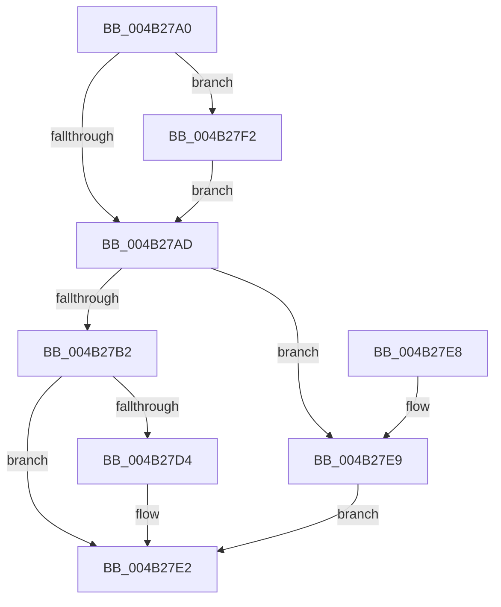

# PopBsdHandleRequest

- RVA: `0x004B27A0`–`0x004B27F9` (길이 `89` bytes)
- VA: `0x00000001404B27A0`
- 실행 섹션: `.text`
- PDB 이름 있음: `예`; PDB Function 태그: `아니요`
- unwind 정보 RVA: `0x00070B1C`
- 디코드: `27`개 명령, `89/89` bytes 표시
- 미해석 바이트: `0` (있으면 어셈블리에 `.byte`로 보존)

> 이 문서는 커널 이미지의 기계어와 PDB 기호를 분석해 생성했습니다. 4번과 5번은 함수 원형과 자료형을 바이너리 사용 방식에서 추정한 C 해석이며 원본 소스 복구 결과는 아닙니다.

## 1. Dependencies

- 직접 호출 지점: **3**; 고유 호출 대상: **3**
- 직접 호출자로 확인된 함수: **20**
- RIP 상대 이미지 참조: **4**

### Outgoing calls
- `0x004B27DD` → [ExQueueWorkItem](../2F/ExQueueWorkItem_function_002F9520.md) (function, `0x002F9520`)
- `0x004B27EB` → [PopBsdFlush](../../page/A8/PopBsdFlush_function_00A82624.md) (function, `0x00A82624`)
- `0x004B27F2` → [PopUpdateBsdPowerTransitionReferenceTime](../../page/AA/PopUpdateBsdPowerTransitionReferenceTime_function_00AA6968.md) (function, `0x00AA6968`)

### Direct callers
- [PopClearSystemShutdownMarker](../../page/70/PopClearSystemShutdownMarker_function_007030BC.md) at `0x007030DF`
- [PopClearUserShutdownMarkerWorker](../../page/75/PopClearUserShutdownMarkerWorker_function_00754030.md) at `0x0075404C`
- [PopRecordPhysicalPowerButton](../../page/75/PopRecordPhysicalPowerButton_function_00754464.md) at `0x007545CC`
- [PopRecordSleepCheckpointSource](../../page/75/PopRecordSleepCheckpointSource_function_007545F4.md) at `0x00754623`
- [PopSetCleanShutdownMarker](../../page/75/PopSetCleanShutdownMarker_function_00754644.md) at `0x00754660`
- [PopSetUserShutdownMarkerWorker](../../page/75/PopSetUserShutdownMarkerWorker_function_00754680.md) at `0x0075469C`
- [PdcPoLidReliabilityUpdateCallback](../../page/75/PdcPoLidReliabilityUpdateCallback_function_0075F110.md) at `0x0075F16F`
- [NtInitiatePowerAction](../../page/75/NtInitiatePowerAction_function_0075FCB0.md) at `0x0075FE74`
- [PopEvaluatePowerButtonSuppressionState](../../page/76/PopEvaluatePowerButtonSuppressionState_function_00765954.md) at `0x00765A31`
- [PdcPoRecordButton](../../page/76/PdcPoRecordButton_function_00769450.md) at `0x0076947B`
- [PopRecordDisplayState](../../page/A3/PopRecordDisplayState_function_00A31A08.md) at `0x00A31A36`
- [PopSetConnectedStandbyMarker](../../page/AA/PopSetConnectedStandbyMarker_function_00AA2BA0.md) at `0x00AA2C06`
- [PopRecordSleepCheckpoint](../../page/AA/PopRecordSleepCheckpoint_function_00AA3EEC.md) at `0x00AA3F0B`
- [PopSetSleepMarker](../../page/AA/PopSetSleepMarker_function_00AA86FC.md) at `0x00AA875C`
- [PopClearConnectedStandbyMarker](../../page/AB/PopClearConnectedStandbyMarker_function_00AB38D8.md) at `0x00AB393B`
- [PopRecordAcDcState](../../page/AB/PopRecordAcDcState_function_00AB96DC.md) at `0x00AB9708`
- [PopClearSleepMarker](../../page/AC/PopClearSleepMarker_function_00AC5498.md) at `0x00AC54BC`
- [PopRecordBatteryPercentage](../../page/AC/PopRecordBatteryPercentage_function_00AC5EB4.md) at `0x00AC5EE0`
- [PopRecordLidStateWorker](../../page/AC/PopRecordLidStateWorker_function_00ACD4D0.md) at `0x00ACD52F`
- [PopBatteryApplyCompositeState](../../page/AE/PopBatteryApplyCompositeState_function_00AE0CD0.md) at `0x00AE13F5`

### Static image references
- `0x004B27B2` → RVA `0x00F0EFFC` (`.data`; read)
- `0x004B27BA` → RVA `0x00F0EFFC` (`.data`; write)
- `0x004B27C5` → RVA `0x00F0F0E0` (`.data`; read/write)
- `0x004B27D6` → RVA `0x00F0F0C0` (`.data`; read)

## 2. Other-region calls and transfers

- 다른 실행 섹션으로 향하는 call: **2**
  - `0x004B27EB` → [PopBsdFlush](../../page/A8/PopBsdFlush_function_00A82624.md) (`.text` → `PAGE`)
  - `0x004B27F2` → [PopUpdateBsdPowerTransitionReferenceTime](../../page/AA/PopUpdateBsdPowerTransitionReferenceTime_function_00AA6968.md) (`.text` → `PAGE`)
- 별도 외부 분기/꼬리 이동을 확인하지 못했습니다.

## 3. Assembly (complete function range)

```asm
004B27A0  40 53                           push rbx
004B27A2  48 83 EC 20                     sub rsp, 0x20
004B27A6  8B D9                           mov ebx, ecx
004B27A8  F6 C1 01                        test cl, 1
004B27AB  75 45                           jne 0x1404b27f2
004B27AD  F6 C3 08                        test bl, 8
004B27B0  75 37                           jne 0x1404b27e9
004B27B2  8B 05 44 C8 A5 00               mov eax, dword ptr [rip + 0xa5c844]
004B27B8  0B C3                           or eax, ebx
004B27BA  89 05 3C C8 A5 00               mov dword ptr [rip + 0xa5c83c], eax
004B27C0  B8 01 00 00 00                  mov eax, 1
004B27C5  F0 0F C1 05 13 C9 A5 00         lock xadd dword ptr [rip + 0xa5c913], eax
004B27CD  FF C0                           inc eax
004B27CF  83 F8 01                        cmp eax, 1
004B27D2  75 0E                           jne 0x1404b27e2
004B27D4  8B D0                           mov edx, eax
004B27D6  48 8D 0D E3 C8 A5 00            lea rcx, [rip + 0xa5c8e3]
004B27DD  E8 3E 6D E4 FF                  call 0x1402f9520
004B27E2  48 83 C4 20                     add rsp, 0x20
004B27E6  5B                              pop rbx
004B27E7  C3                              ret
004B27E8  CC                              int3
004B27E9  8B CB                           mov ecx, ebx
004B27EB  E8 34 FE 5C 00                  call 0x140a82624
004B27F0  EB F0                           jmp 0x1404b27e2
004B27F2  E8 71 41 5F 00                  call 0x140aa6968
004B27F7  EB B4                           jmp 0x1404b27ad
```

## 4. C-style interpretation (structured pseudocode)

```c
__int64 __fastcall PopBsdHandleRequest(int a1)
{
    __int64 result;
    __int64 v_rsp;

    v_rsp = (v_rsp) - (32);
    if ((((unsigned __int8)(a1)) & (1)) != 0) goto loc_004B27F2;
loc_004B27AD:
    if ((((unsigned __int8)((unsigned int)(a1))) & (8)) != 0) goto loc_004B27E9;
    result = (unsigned int)(((unsigned int)(*(unsigned int *)(v_rip + 10864708))) | ((unsigned int)((unsigned int)(a1))));
    *(unsigned int *)(v_rip + 10864700) = (unsigned int)(result);
    result = (unsigned int)((1) + 1);
    if (((unsigned int)(result)) == 1) {
        a2 = (unsigned int)(result);
        a1 = v_rip + 10864867;
        result = ExQueueWorkItem(a1, a2, a3, a4);
    }
    v_rsp = (v_rsp) + (32);
    return result;
loc_004B27E9:
    result = PopBsdFlush((unsigned int)((unsigned int)((unsigned int)(a1))), a2, a3, a4);
    goto loc_004B27E2;
loc_004B27F2:
    result = PopUpdateBsdPowerTransitionReferenceTime((unsigned int)((unsigned int)((unsigned int)(a1))), a2, a3, a4);
    goto loc_004B27AD;
}
```

## 5. (Beta) C Style

```c
int64_t PopBsdHandleRequest(int32_t Arg1)
{
    int64_t result;
    int64_t local_rsp;

    local_rsp = (local_rsp) - (32);
    if ((((uint8_t)(Arg1)) & (1)) != 0) goto loc_004B27F2;
loc_004B27AD:
    if ((((uint8_t)((uint32_t)(Arg1))) & (8)) != 0) goto loc_004B27E9;
    result = (uint32_t)(((uint32_t)(*(uint32_t *)(v_rip + 0xA5C844))) | ((uint32_t)((uint32_t)(Arg1))));
    *(uint32_t *)(v_rip + 0xA5C83C) = (uint32_t)(result);
    result = (uint32_t)((1) + 1);
    if (((uint32_t)(result)) == 1) {
        a2 = (uint32_t)(result);
        Arg1 = v_rip + 10864867;
        result = ExQueueWorkItem(Arg1, a2, a3, a4);
    }
    local_rsp = (local_rsp) + (32);
    return result;
loc_004B27E9:
    result = PopBsdFlush((uint32_t)((uint32_t)((uint32_t)(Arg1))), a2, a3, a4);
    goto loc_004B27E2;
loc_004B27F2:
    result = PopUpdateBsdPowerTransitionReferenceTime((uint32_t)((uint32_t)((uint32_t)(Arg1))), a2, a3, a4);
    goto loc_004B27AD;
}
```

## 6. Execution-region graph

[열기: 2D/3D 그래프와 함수 탐색 컨트롤 패널](../../../control-panel.html?section=text&rva=0x004B27A0&view=graph)

- 2D 그래프는 위에서 아래로 흐르고, 3D 그래프는 빈 공간을 드래그해 회전합니다. Shift+드래그는 이동, 휠은 확대·축소, 함수 노드 선택은 대상 보고서 이동입니다.

### Static fallback


