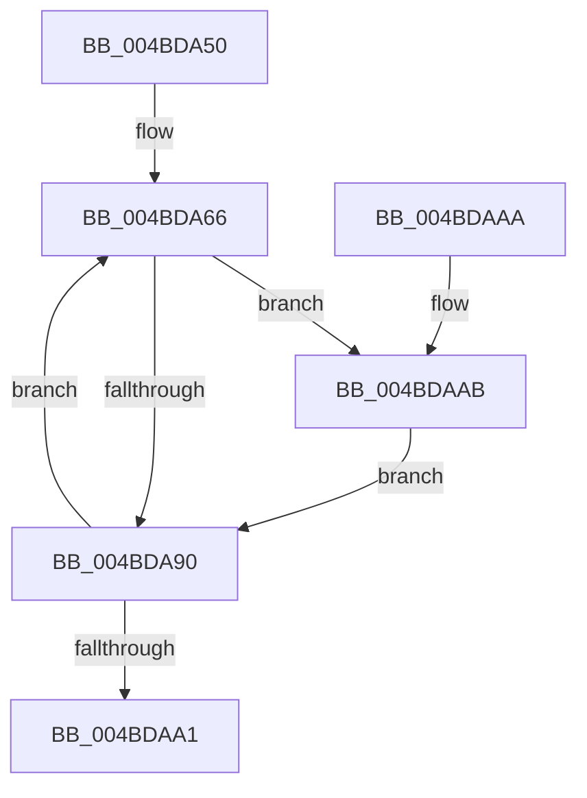

# PopDiagSnapPassiveHistogram

- RVA: `0x004BDA50`–`0x004BDAB7` (길이 `103` bytes)
- VA: `0x00000001404BDA50`
- 실행 섹션: `.text`
- PDB 이름 있음: `예`; PDB Function 태그: `아니요`
- unwind 정보 RVA: `0x000A78D8`
- 디코드: `29`개 명령, `103/103` bytes 표시
- 미해석 바이트: `0` (있으면 어셈블리에 `.byte`로 보존)

> 이 문서는 커널 이미지의 기계어와 PDB 기호를 분석해 생성했습니다. 4번과 5번은 함수 원형과 자료형을 바이너리 사용 방식에서 추정한 C 해석이며 원본 소스 복구 결과는 아닙니다.

## 1. Dependencies

- 직접 호출 지점: **0**; 고유 호출 대상: **0**
- 직접 호출자로 확인된 함수: **2**
- RIP 상대 이미지 참조: **0**

### Outgoing calls
- 직접 디코드된 call 명령이 없습니다.

### Direct callers
- [PopTraceThermalRequestPassiveHistogram](../42/PopTraceThermalRequestPassiveHistogram_function_0042FFB4.md) at `0x00430085`
- [PopTraceThermalZonePassiveHistogram](../4D/PopTraceThermalZonePassiveHistogram_function_004DDD10.md) at `0x004DDD75`

### Static image references
- 디코드된 RIP-relative 메모리 참조가 없습니다.

## 2. Other-region calls and transfers

- 다른 실행 섹션으로 향하는 call: **0**
- 별도 외부 분기/꼬리 이동을 확인하지 못했습니다.

## 3. Assembly (complete function range)

```asm
004BDA50  48 89 5C 24 08                  mov qword ptr [rsp + 8], rbx
004BDA55  45 32 C0                        xor r8b, r8b
004BDA58  4C 8D 51 18                     lea r10, [rcx + 0x18]
004BDA5C  45 33 C9                        xor r9d, r9d
004BDA5F  4C 8B DA                        mov r11, rdx
004BDA62  41 8D 59 01                     lea ebx, [r9 + 1]
004BDA66  49 8B 82 A8 00 00 00            mov rax, qword ptr [r10 + 0xa8]
004BDA6D  49 8B 0A                        mov rcx, qword ptr [r10]
004BDA70  48 2B C8                        sub rcx, rax
004BDA73  49 89 02                        mov qword ptr [r10], rax
004BDA76  48 B8 BD 42 7A E5 D5 94 BF D6   movabs rax, 0xd6bf94d5e57a42bd
004BDA80  48 F7 E1                        mul rcx
004BDA83  48 C1 EA 17                     shr rdx, 0x17
004BDA87  41 89 13                        mov dword ptr [r11], edx
004BDA8A  41 83 F9 14                     cmp r9d, 0x14
004BDA8E  72 1B                           jb 0x1404bdaab
004BDA90  44 03 CB                        add r9d, ebx
004BDA93  49 83 C2 08                     add r10, 8
004BDA97  49 83 C3 04                     add r11, 4
004BDA9B  41 83 F9 15                     cmp r9d, 0x15
004BDA9F  72 C5                           jb 0x1404bda66
004BDAA1  48 8B 5C 24 08                  mov rbx, qword ptr [rsp + 8]
004BDAA6  41 8A C0                        mov al, r8b
004BDAA9  C3                              ret
004BDAAA  CC                              int3
004BDAAB  85 D2                           test edx, edx
004BDAAD  45 0F B6 C0                     movzx r8d, r8b
004BDAB1  44 0F 45 C3                     cmovne r8d, ebx
004BDAB5  EB D9                           jmp 0x1404bda90
```

## 4. C-style interpretation (structured pseudocode)

```c
__int64 __fastcall PopDiagSnapPassiveHistogram(__int64 a1, __int64 a2, unsigned __int8 a3, int a4)
{
    __int64 v_r10;
    __int64 v_r11;
    unsigned __int64 v_stack_p8;

    v_stack_p8 = v_rbx;
    a3 = 0;
    a4 = 0;
loc_004BDA66:
    a1 = (*(unsigned __int64 *)(a1 + 24)) - (*(unsigned __int64 *)(a1 + 24 + 168));
    *(unsigned __int64 *)(a1 + 24) = *(unsigned __int64 *)(a1 + 24 + 168);
    a2 = (a2) >> (23);
    *(unsigned int *)(a2) = (unsigned int)(a2);
    if (0 < 20) goto loc_004BDAAB;
loc_004BDA90:
    a4 = (unsigned int)((a4) + ((unsigned int)(a4 + 1)));
    v_r10 = (a1 + 24) + (8);
    v_r11 = (a2) + (4);
    if (a4 < 21) goto loc_004BDA66;
    return 0;
loc_004BDAAB:
    a3 = 0;
    if ((unsigned int)(a2) != 0) { a3 = (unsigned int)(v_stack_p8); }
    goto loc_004BDA90;
}
```

## 5. (Beta) C Style

```c
int64_t PopDiagSnapPassiveHistogram(void *Arg1, void *Arg2, uint8_t Arg3, int32_t Arg4)
{
    uint8_t *arg1 = (uint8_t *)Arg1;
    uint8_t *arg2 = (uint8_t *)Arg2;

    int64_t local_r10;
    int64_t local_r11;
    uint64_t v_stack_p8;

    v_stack_p8 = local_rbx;
    Arg3 = 0;
    Arg4 = 0;
loc_004BDA66:
    Arg1 = (*(uint64_t *)(arg1 + 0x18)) - (*(uint64_t *)(arg1 + 0x18 + 0xA8));
    *(uint64_t *)(arg1 + 0x18) = *(uint64_t *)(arg1 + 0x18 + 0xA8);
    Arg2 = (Arg2) >> (23);
    *(uint32_t *)(arg2) = (uint32_t)(Arg2);
    if (0 < 20) goto loc_004BDAAB;
loc_004BDA90:
    Arg4 = (uint32_t)((Arg4) + ((uint32_t)(Arg4 + 1)));
    local_r10 = (Arg1 + 24) + (8);
    local_r11 = (Arg2) + (4);
    if (Arg4 < 21) goto loc_004BDA66;
    return 0;
loc_004BDAAB:
    Arg3 = 0;
    if ((uint32_t)(Arg2) != 0) { Arg3 = (uint32_t)(v_stack_p8); }
    goto loc_004BDA90;
}
```

### 관측된 메모리 오프셋

구조체 형식이 확인되지 않은 접근은 인자 기준의 오프셋으로만 기록했습니다.

| 기준 인자 | 오프셋 표현 | 폭 (bit) | 접근 |
|---|---:|---:|---|
| `Arg1` | `+ 0x0` | `64` | `R` |
| `Arg1` | `+ 0x0` | `64` | `W` |
| `Arg1` | `+ 0x18` | `64` | `R` |
| `Arg1` | `+ 0xA8` | `64` | `R` |
| `Arg2` | `+ 0x0` | `32` | `W` |

## 6. Execution-region graph

[열기: 2D/3D 그래프와 함수 탐색 컨트롤 패널](../../../control-panel.html?section=text&rva=0x004BDA50&view=graph)

- 2D 그래프는 위에서 아래로 흐르고, 3D 그래프는 빈 공간을 드래그해 회전합니다. Shift+드래그는 이동, 휠은 확대·축소, 함수 노드 선택은 대상 보고서 이동입니다.

### Static fallback


