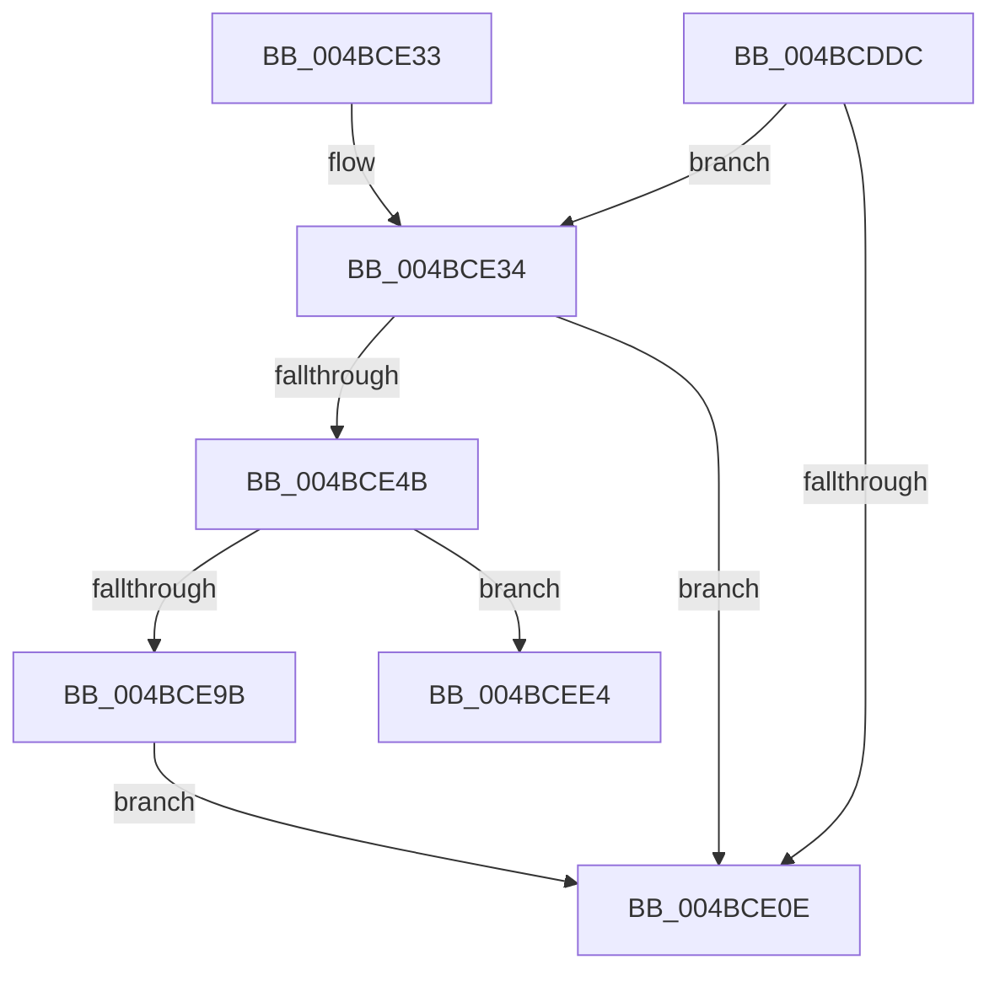

# PopDiagTraceDeepSleepConstraintRundown

- RVA: `0x004BCDDC`–`0x004BCEF1` (길이 `277` bytes)
- VA: `0x00000001404BCDDC`
- 실행 섹션: `.text`
- PDB 이름 있음: `예`; PDB Function 태그: `예`
- unwind 정보 RVA: `0x000BBCA4`
- 디코드: `58`개 명령, `277/277` bytes 표시
- 미해석 바이트: `0` (있으면 어셈블리에 `.byte`로 보존)

> 이 문서는 커널 이미지의 기계어와 PDB 기호를 분석해 생성했습니다. 4번과 5번은 함수 원형과 자료형을 바이너리 사용 방식에서 추정한 C 해석이며 원본 소스 복구 결과는 아닙니다.

## 1. Dependencies

- 직접 호출 지점: **5**; 고유 호출 대상: **5**
- 직접 호출자로 확인된 함수: **1**
- RIP 상대 이미지 참조: **6**

### Outgoing calls
- `0x004BCE19` → [_security_check_cookie](../6A/_security_check_cookie_function_006AC640.md) (function, `0x006AC640`)
- `0x004BCE42` → [EtwEventEnabled](../39/EtwEventEnabled_function_00392450.md) (function, `0x00392450`)
- `0x004BCE52` → [KeAcquireSpinLockRaiseToDpc](../20/KeAcquireSpinLockRaiseToDpc_function_00208470.md) (function, `0x00208470`)
- `0x004BCECB` → [EtwWriteEx](../25/EtwWriteEx_function_0025F0D0.md) (function, `0x0025F0D0`)
- `0x004BCEDA` → [KeReleaseSpinLock](../39/KeReleaseSpinLock_function_00392BA0.md) (function, `0x00392BA0`)

### Direct callers
- [PopDiagTraceControlCallback](../../page/A3/PopDiagTraceControlCallback_function_00A38CB0.md) at `0x00A38E21`

### Static image references
- `0x004BCDEE` → RVA `0x00E0A740` (`.data`; read)
- `0x004BCE02` → RVA `0x00E67858` (`.data`; read)
- `0x004BCE34` → RVA `0x00F0B408` (`.data`; read)
- `0x004BCE3B` → RVA `0x0001E0A0` (`.rdata`; read)
- `0x004BCE4B` → RVA `0x00F09328` (`.data`; read)
- `0x004BCE57` → RVA `0x00F09330` (`.data`; read)

## 2. Other-region calls and transfers

- 다른 실행 섹션으로 향하는 call: **0**
- call이 아닌 외부 분기/꼬리 이동: **1**
  - `0x004BCEEC` → [sub_006FC8A0](../6F/Unknown_function_006FC8A0.md) (`tail-transfer`)

## 3. Assembly (complete function range)

```asm
004BCDDC  48 89 5C 24 08                  mov qword ptr [rsp + 8], rbx
004BCDE1  48 89 74 24 10                  mov qword ptr [rsp + 0x10], rsi
004BCDE6  57                              push rdi
004BCDE7  48 81 EC 50 01 00 00            sub rsp, 0x150
004BCDEE  48 8B 05 4B D9 94 00            mov rax, qword ptr [rip + 0x94d94b]
004BCDF5  48 33 C4                        xor rax, rsp
004BCDF8  48 89 84 24 40 01 00 00         mov qword ptr [rsp + 0x140], rax
004BCE00  33 F6                           xor esi, esi
004BCE02  40 38 35 4F AA 9A 00            cmp byte ptr [rip + 0x9aaa4f], sil
004BCE09  0F B7 DE                        movzx ebx, si
004BCE0C  75 26                           jne 0x1404bce34
004BCE0E  48 8B 8C 24 40 01 00 00         mov rcx, qword ptr [rsp + 0x140]
004BCE16  48 33 CC                        xor rcx, rsp
004BCE19  E8 22 F8 1E 00                  call 0x1406ac640
004BCE1E  4C 8D 9C 24 50 01 00 00         lea r11, [rsp + 0x150]
004BCE26  49 8B 5B 10                     mov rbx, qword ptr [r11 + 0x10]
004BCE2A  49 8B 73 18                     mov rsi, qword ptr [r11 + 0x18]
004BCE2E  49 8B E3                        mov rsp, r11
004BCE31  5F                              pop rdi
004BCE32  C3                              ret
004BCE33  CC                              int3
004BCE34  48 8B 0D CD E5 A4 00            mov rcx, qword ptr [rip + 0xa4e5cd]
004BCE3B  48 8D 15 5E 12 B6 FF            lea rdx, [rip - 0x49eda2]
004BCE42  E8 09 56 ED FF                  call 0x140392450
004BCE47  84 C0                           test al, al
004BCE49  74 C3                           je 0x1404bce0e
004BCE4B  48 8D 0D D6 C4 A4 00            lea rcx, [rip + 0xa4c4d6]
004BCE52  E8 19 B6 D4 FF                  call 0x140208470
004BCE57  44 8B 05 D2 C4 A4 00            mov r8d, dword ptr [rip + 0xa4c4d2]
004BCE5E  41 BA 01 00 00 00               mov r10d, 1
004BCE64  F3 49 0F B8 D0                  popcnt rdx, r8
004BCE69  44 0F B7 CA                     movzx r9d, dx
004BCE6D  40 8A F8                        mov dil, al
004BCE70  45 03 CA                        add r9d, r10d
004BCE73  66 89 54 24 40                  mov word ptr [rsp + 0x40], dx
004BCE78  41 0F BC C8                     bsf ecx, r8d
004BCE7C  48 8D 44 24 40                  lea rax, [rsp + 0x40]
004BCE81  48 C7 84 24 88 00 00 00 02 00 00 00  mov qword ptr [rsp + 0x88], 2
004BCE8D  89 4C 24 48                     mov dword ptr [rsp + 0x48], ecx
004BCE91  48 89 84 24 80 00 00 00         mov qword ptr [rsp + 0x80], rax
004BCE99  75 49                           jne 0x1404bcee4
004BCE9B  48 8B 0D 66 E5 A4 00            mov rcx, qword ptr [rip + 0xa4e566]
004BCEA2  48 8D 84 24 80 00 00 00         lea rax, [rsp + 0x80]
004BCEAA  48 89 44 24 38                  mov qword ptr [rsp + 0x38], rax
004BCEAF  48 8D 15 EA 11 B6 FF            lea rdx, [rip - 0x49ee16]
004BCEB6  44 89 4C 24 30                  mov dword ptr [rsp + 0x30], r9d
004BCEBB  45 33 C0                        xor r8d, r8d
004BCEBE  48 89 74 24 28                  mov qword ptr [rsp + 0x28], rsi
004BCEC3  45 33 C9                        xor r9d, r9d
004BCEC6  48 89 74 24 20                  mov qword ptr [rsp + 0x20], rsi
004BCECB  E8 00 22 DA FF                  call 0x14025f0d0
004BCED0  40 8A D7                        mov dl, dil
004BCED3  48 8D 0D 4E C4 A4 00            lea rcx, [rip + 0xa4c44e]
004BCEDA  E8 C1 5C ED FF                  call 0x140392ba0
004BCEDF  E9 2A FF FF FF                  jmp 0x1404bce0e
004BCEE4  48 8B CE                        mov rcx, rsi
004BCEE7  48 8D 54 24 48                  lea rdx, [rsp + 0x48]
004BCEEC  E9 AF F9 23 00                  jmp 0x1406fc8a0
```

## 4. C-style interpretation (structured pseudocode)

```c
__int64 __fastcall PopDiagTraceDeepSleepConstraintRundown(void)
{
    __int64 result;
    __int64 v_rsi;
    __int64 v_rsp;
    unsigned int v_stack_m108;
    unsigned __int16 v_stack_m110;
    unsigned __int64 v_stack_m118;
    unsigned int v_stack_m120;
    unsigned __int64 v_stack_m128;
    unsigned __int64 v_stack_m130;
    unsigned __int64 v_stack_m18;
    unsigned __int64 v_stack_m8;
    unsigned __int64 v_stack_mC8;
    unsigned __int64 v_stack_mD0;
    unsigned __int64 v_stack_p10;
    unsigned __int64 v_stack_p8;

    v_stack_p8 = v_rbx;
    v_stack_p10 = v_rsi;
    v_rsp = (v_rsp) - (336);
    result = (*(unsigned __int64 *)(v_rip + 9754955)) ^ (v_rsp);
    v_stack_m18 = result;
    v_rsi = 0;
    if ((*(unsigned __int8 *)(v_rip + 10136143)) != 0) goto loc_004BCE34;
loc_004BCE0E:
    a1 = (v_stack_m18) ^ (v_rsp);
    result = _security_check_cookie(a1, a2, a3, a4);
    return result;
loc_004BCE34:
    result = EtwEventEnabled(*(unsigned __int64 *)(v_rip + 10806733), v_rip - 4844962, a3, a4);
    if ((unsigned __int8)(result) == 0) goto loc_004BCE0E;
    result = KeAcquireSpinLockRaiseToDpc(v_rip + 10798294, v_rip - 4844962, a3, a4);
    a4 = (unsigned int)(((unsigned __int16)(v_rip - 4844962)) + (1));
    v_stack_m110 = (unsigned __int16)(v_rip - 4844962);
    v_stack_mC8 = 2;
    v_stack_m108 = (unsigned int)(v_rip + 10798294);
    v_stack_mD0 = v_stack_m110;
    if (condition_is_not_equal) goto loc_004BCEE4;
    v_stack_m118 = v_stack_mD0;
    v_stack_m120 = (unsigned int)(a4);
    a3 = 0;
    v_stack_m128 = *(unsigned __int64 *)(v_stack_m8 + 24);
    a4 = 0;
    v_stack_m130 = *(unsigned __int64 *)(v_stack_m8 + 24);
    result = EtwWriteEx(*(unsigned __int64 *)(v_rip + 10806630), v_rip - 4845078, a3, a4);
    result = KeReleaseSpinLock(v_rip + 10798158, (unsigned __int8)((unsigned __int8)(result)), a3, a4);
    goto loc_004BCE0E;
loc_004BCEE4:
}
```

## 5. (Beta) C Style

```c
void PopDiagTraceDeepSleepConstraintRundown(void)
{
    int64_t result;
    int64_t local_rsi;
    int64_t local_rsp;
    uint32_t v_stack_m108;
    uint16_t v_stack_m110;
    uint64_t v_stack_m118;
    uint32_t v_stack_m120;
    uint64_t v_stack_m128;
    uint64_t v_stack_m130;
    uint64_t v_stack_m18;
    uint64_t v_stack_m8;
    uint64_t v_stack_mC8;
    uint64_t v_stack_mD0;
    uint64_t v_stack_p10;
    uint64_t v_stack_p8;

    v_stack_p8 = local_rbx;
    v_stack_p10 = local_rsi;
    local_rsp = (local_rsp) - (336);
    result = (*(uint64_t *)(v_rip + 0x94D94B)) ^ (local_rsp);
    v_stack_m18 = result;
    local_rsi = 0;
    if ((*(uint8_t *)(v_rip + 0x9AAA4F)) != 0) goto loc_004BCE34;
loc_004BCE0E:
    a1 = (v_stack_m18) ^ (local_rsp);
    result = _security_check_cookie(a1, a2, a3, a4);
    return result;
loc_004BCE34:
    result = EtwEventEnabled(*(uint64_t *)(v_rip + 0xA4E5CD), v_rip - 4844962, a3, a4);
    if ((uint8_t)(result) == 0) goto loc_004BCE0E;
    result = KeAcquireSpinLockRaiseToDpc(v_rip + 10798294, v_rip - 4844962, a3, a4);
    a4 = (uint32_t)(((uint16_t)(v_rip - 4844962)) + (1));
    v_stack_m110 = (uint16_t)(v_rip - 4844962);
    v_stack_mC8 = 2;
    v_stack_m108 = (uint32_t)(v_rip + 10798294);
    v_stack_mD0 = v_stack_m110;
    if (condition_is_not_equal) goto loc_004BCEE4;
    v_stack_m118 = v_stack_mD0;
    v_stack_m120 = (uint32_t)(a4);
    a3 = 0;
    v_stack_m128 = *(uint64_t *)(v_stack_m8 + 0x18);
    a4 = 0;
    v_stack_m130 = *(uint64_t *)(v_stack_m8 + 0x18);
    result = EtwWriteEx(*(uint64_t *)(v_rip + 0xA4E566), v_rip - 4845078, a3, a4);
    result = KeReleaseSpinLock(v_rip + 10798158, (uint8_t)((uint8_t)(result)), a3, a4);
    goto loc_004BCE0E;
loc_004BCEE4:
}
```

## 6. Execution-region graph

[열기: 2D/3D 그래프와 함수 탐색 컨트롤 패널](../../../control-panel.html?section=text&rva=0x004BCDDC&view=graph)

- 2D 그래프는 위에서 아래로 흐르고, 3D 그래프는 빈 공간을 드래그해 회전합니다. Shift+드래그는 이동, 휠은 확대·축소, 함수 노드 선택은 대상 보고서 이동입니다.

### Static fallback


