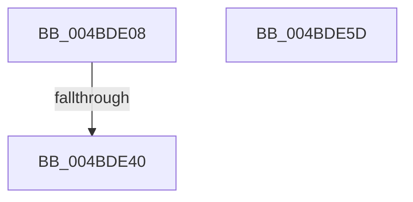

# PopDiagTraceDiskIdleCheck

- RVA: `0x004BDE08`–`0x004BDE5E` (길이 `86` bytes)
- VA: `0x00000001404BDE08`
- 실행 섹션: `.text`
- PDB 이름 있음: `예`; PDB Function 태그: `예`
- unwind 정보 RVA: `0x000BC1C8`
- 디코드: `21`개 명령, `86/86` bytes 표시
- 미해석 바이트: `0` (있으면 어셈블리에 `.byte`로 보존)

> 이 문서는 커널 이미지의 기계어와 PDB 기호를 분석해 생성했습니다. 4번과 5번은 함수 원형과 자료형을 바이너리 사용 방식에서 추정한 C 해석이며 원본 소스 복구 결과는 아닙니다.

## 1. Dependencies

- 직접 호출 지점: **1**; 고유 호출 대상: **1**
- 직접 호출자로 확인된 함수: **1**
- RIP 상대 이미지 참조: **2**

### Outgoing calls
- `0x004BDE47` → [_security_check_cookie](../6A/_security_check_cookie_function_006AC640.md) (function, `0x006AC640`)

### Direct callers
- [PopScanIdleList](../49/PopScanIdleList_function_00497F04.md) at `0x0049814A`

### Static image references
- `0x004BDE22` → RVA `0x00E0A740` (`.data`; read)
- `0x004BDE30` → RVA `0x00E67858` (`.data`; read)

## 2. Other-region calls and transfers

- 다른 실행 섹션으로 향하는 call: **0**
- call이 아닌 외부 분기/꼬리 이동: **1**
  - `0x004BDE3A` → [sub_006FCA3A](../6F/Unknown_function_006FCA3A.md) (`tail-transfer`)

## 3. Assembly (complete function range)

```asm
004BDE08  48 8B C4                        mov rax, rsp
004BDE0B  48 89 58 08                     mov qword ptr [rax + 8], rbx
004BDE0F  44 89 40 18                     mov dword ptr [rax + 0x18], r8d
004BDE13  89 50 10                        mov dword ptr [rax + 0x10], edx
004BDE16  55                              push rbp
004BDE17  48 8D 68 A1                     lea rbp, [rax - 0x5f]
004BDE1B  48 81 EC A0 00 00 00            sub rsp, 0xa0
004BDE22  48 8B 05 17 C9 94 00            mov rax, qword ptr [rip + 0x94c917]
004BDE29  48 33 C4                        xor rax, rsp
004BDE2C  48 89 45 47                     mov qword ptr [rbp + 0x47], rax
004BDE30  80 3D 21 9A 9A 00 00            cmp byte ptr [rip + 0x9a9a21], 0
004BDE37  48 8B D9                        mov rbx, rcx
004BDE3A  0F 85 FA EB 23 00               jne 0x1406fca3a
004BDE40  48 8B 4D 47                     mov rcx, qword ptr [rbp + 0x47]
004BDE44  48 33 CC                        xor rcx, rsp
004BDE47  E8 F4 E7 1E 00                  call 0x1406ac640
004BDE4C  48 8B 9C 24 B0 00 00 00         mov rbx, qword ptr [rsp + 0xb0]
004BDE54  48 81 C4 A0 00 00 00            add rsp, 0xa0
004BDE5B  5D                              pop rbp
004BDE5C  C3                              ret
004BDE5D  CC                              int3
```

## 4. C-style interpretation (structured pseudocode)

```c
__int64 __fastcall PopDiagTraceDiskIdleCheck(__int64 a1, int a2, int a3)
{
    __int64 result;
    __int64 v_rsp;
    unsigned __int64 v_stack_p8;

    *(unsigned __int64 *)(v_rsp + 8) = v_rbx;
    *(unsigned int *)(v_rsp + 24) = a3;
    *(unsigned int *)(v_rsp + 16) = a2;
    v_rsp = (v_rsp) - (160);
    result = (*(unsigned __int64 *)(v_rip + 9750807)) ^ (v_rsp);
    *(unsigned __int64 *)(v_rsp - 95 + 71) = result;
    a1 = (*(unsigned __int64 *)(v_rsp - 95 + 71)) ^ (v_rsp);
    result = _security_check_cookie(a1, a2, a3, a4);
    v_rsp = (v_rsp) + (160);
    return result;
}
```

## 5. (Beta) C Style

```c
int64_t PopDiagTraceDiskIdleCheck(int64_t Arg1, int32_t Arg2, int32_t Arg3)
{
    int64_t result;
    int64_t local_rsp;
    uint64_t v_stack_p8;

    *(uint64_t *)(local_rsp + 0x8) = local_rbx;
    *(uint32_t *)(local_rsp + 0x18) = Arg3;
    *(uint32_t *)(local_rsp + 0x10) = Arg2;
    local_rsp = (local_rsp) - (160);
    result = (*(uint64_t *)(v_rip + 0x94C917)) ^ (local_rsp);
    *(uint64_t *)(local_rsp - 0x5F + 0x47) = result;
    Arg1 = (*(uint64_t *)(local_rsp - 0x5F + 0x47)) ^ (local_rsp);
    result = _security_check_cookie(Arg1, Arg2, Arg3, a4);
    local_rsp = (local_rsp) + (160);
    return result;
}
```

## 6. Execution-region graph

[열기: 2D/3D 그래프와 함수 탐색 컨트롤 패널](../../../control-panel.html?section=text&rva=0x004BDE08&view=graph)

- 2D 그래프는 위에서 아래로 흐르고, 3D 그래프는 빈 공간을 드래그해 회전합니다. Shift+드래그는 이동, 휠은 확대·축소, 함수 노드 선택은 대상 보고서 이동입니다.

### Static fallback


