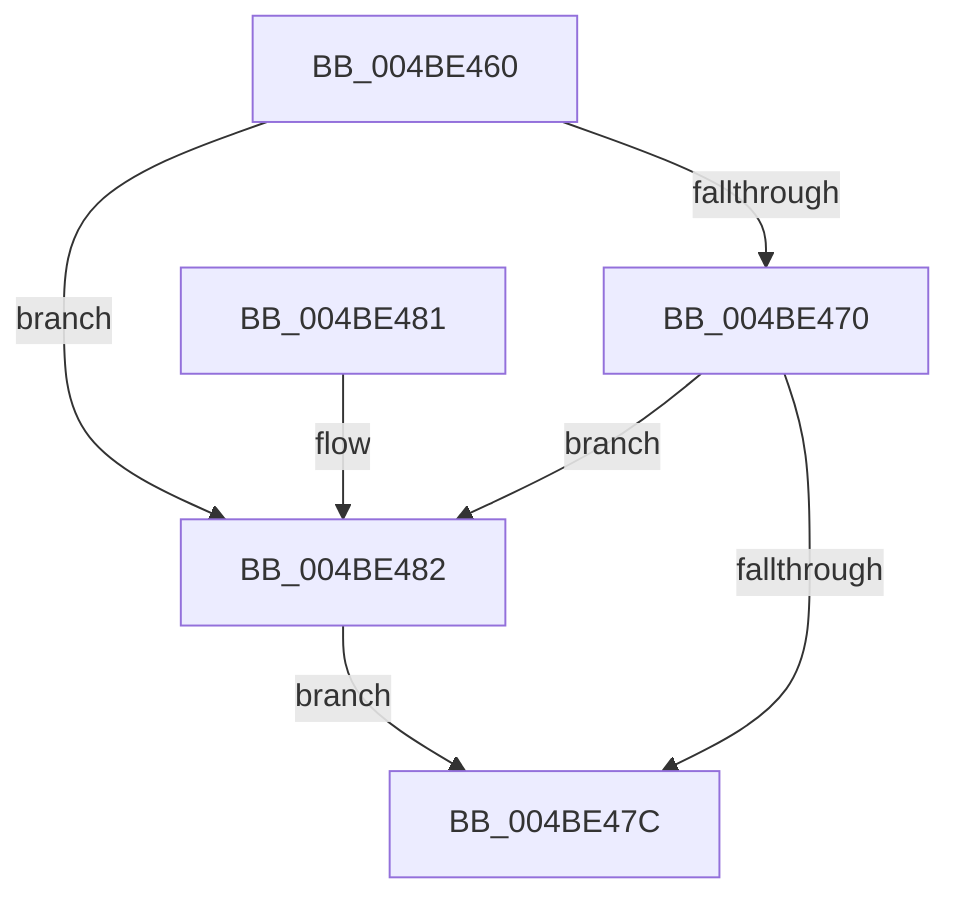

# PopDripsWatchdogTimerCallback

- RVA: `0x004BE460`–`0x004BE495` (길이 `53` bytes)
- VA: `0x00000001404BE460`
- 실행 섹션: `.text`
- PDB 이름 있음: `예`; PDB Function 태그: `아니요`
- unwind 정보 RVA: `0x00068D6C`
- 디코드: `15`개 명령, `53/53` bytes 표시
- 미해석 바이트: `0` (있으면 어셈블리에 `.byte`로 보존)

> 이 문서는 커널 이미지의 기계어와 PDB 기호를 분석해 생성했습니다. 4번과 5번은 함수 원형과 자료형을 바이너리 사용 방식에서 추정한 C 해석이며 원본 소스 복구 결과는 아닙니다.

## 1. Dependencies

- 직접 호출 지점: **1**; 고유 호출 대상: **1**
- 직접 호출자로 확인된 함수: **0**
- RIP 상대 이미지 참조: **0**

### Outgoing calls
- `0x004BE48E` → [PopQueueWorkItem](../4A/PopQueueWorkItem_function_004A20F8.md) (function, `0x004A20F8`)

### Direct callers
- 이 함수 시작 RVA로 연결되는 직접 call은 확인되지 않았습니다. 간접 호출은 완전히 역산할 수 없습니다.

### Static image references
- 디코드된 RIP-relative 메모리 참조가 없습니다.

## 2. Other-region calls and transfers

- 다른 실행 섹션으로 향하는 call: **0**
- 별도 외부 분기/꼬리 이동을 확인하지 못했습니다.

## 3. Assembly (complete function range)

```asm
004BE460  48 83 EC 28                     sub rsp, 0x28
004BE464  48 8B C1                        mov rax, rcx
004BE467  48 8D 4A 70                     lea rcx, [rdx + 0x70]
004BE46B  48 3B C1                        cmp rax, rcx
004BE46E  74 12                           je 0x1404be482
004BE470  48 8D 8A 78 01 00 00            lea rcx, [rdx + 0x178]
004BE477  48 3B C1                        cmp rax, rcx
004BE47A  74 06                           je 0x1404be482
004BE47C  48 83 C4 28                     add rsp, 0x28
004BE480  C3                              ret
004BE481  CC                              int3
004BE482  48 81 C1 88 00 00 00            add rcx, 0x88
004BE489  BA 01 00 00 00                  mov edx, 1
004BE48E  E8 65 3C FE FF                  call 0x1404a20f8
004BE493  EB E7                           jmp 0x1404be47c
```

## 4. C-style interpretation (structured pseudocode)

```c
__int64 __fastcall PopDripsWatchdogTimerCallback(__int64 a1, __int64 a2)
{
    __int64 result;
    __int64 v_rsp;

    v_rsp = (v_rsp) - (40);
    if (a1 == (a2 + 112)) goto loc_004BE482;
    if (a1 == (a2 + 376)) goto loc_004BE482;
loc_004BE47C:
    v_rsp = (v_rsp) + (40);
    return a1;
loc_004BE482:
    a1 = (a2 + 376) + (136);
    result = PopQueueWorkItem(a1, 1, a3, a4);
    goto loc_004BE47C;
}
```

## 5. (Beta) C Style

```c
int64_t PopDripsWatchdogTimerCallback(int64_t Arg1, void *Arg2)
{
    uint8_t *arg2 = (uint8_t *)Arg2;

    int64_t result;
    int64_t local_rsp;

    local_rsp = (local_rsp) - (40);
    if (Arg1 == (Arg2 + 112)) goto loc_004BE482;
    if (Arg1 == (Arg2 + 376)) goto loc_004BE482;
loc_004BE47C:
    local_rsp = (local_rsp) + (40);
    return Arg1;
loc_004BE482:
    Arg1 = (Arg2 + 376) + (136);
    result = PopQueueWorkItem(Arg1, 1, a3, a4);
    goto loc_004BE47C;
}
```

### 관측된 메모리 오프셋

구조체 형식이 확인되지 않은 접근은 인자 기준의 오프셋으로만 기록했습니다.

| 기준 인자 | 오프셋 표현 | 폭 (bit) | 접근 |
|---|---:|---:|---|
| `Arg2` | `+ 0x70` | `64` | `R` |
| `Arg2` | `+ 0x178` | `64` | `R` |

## 6. Execution-region graph

[열기: 2D/3D 그래프와 함수 탐색 컨트롤 패널](../../../control-panel.html?section=text&rva=0x004BE460&view=graph)

- 2D 그래프는 위에서 아래로 흐르고, 3D 그래프는 빈 공간을 드래그해 회전합니다. Shift+드래그는 이동, 휠은 확대·축소, 함수 노드 선택은 대상 보고서 이동입니다.

### Static fallback


