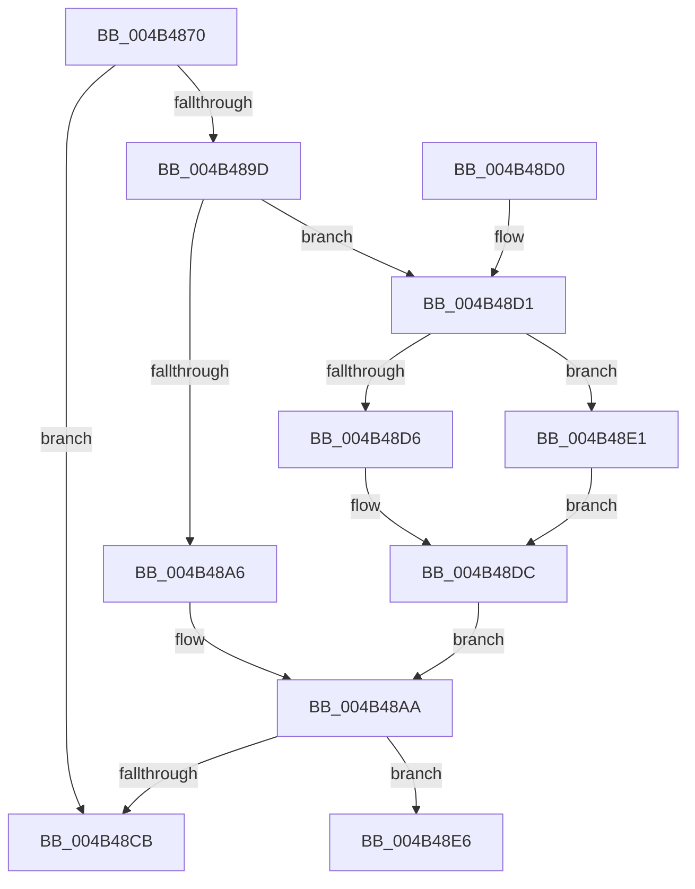

# PopEventCalloutDispatch

- RVA: `0x004B4870`–`0x004B48ED` (길이 `125` bytes)
- VA: `0x00000001404B4870`
- 실행 섹션: `.text`
- PDB 이름 있음: `예`; PDB Function 태그: `아니요`
- unwind 정보 RVA: `0x000B9F5C`
- 디코드: `34`개 명령, `125/125` bytes 표시
- 미해석 바이트: `0` (있으면 어셈블리에 `.byte`로 보존)

> 이 문서는 커널 이미지의 기계어와 PDB 기호를 분석해 생성했습니다. 4번과 5번은 함수 원형과 자료형을 바이너리 사용 방식에서 추정한 C 해석이며 원본 소스 복구 결과는 아닙니다.

## 1. Dependencies

- 직접 호출 지점: **1**; 고유 호출 대상: **1**
- 직접 호출자로 확인된 함수: **4**
- RIP 상대 이미지 참조: **1**

### Outgoing calls
- `0x004B48B4` → [PopInvokeWin32Callout](../../page/91/PopInvokeWin32Callout_function_009125F4.md) (function, `0x009125F4`)

### Direct callers
- [PopDispatchShutdownEvent](../../page/76/PopDispatchShutdownEvent_function_00765C60.md) at `0x00765CE3`
- [NtPowerInformation](../../page/95/NtPowerInformation_function_00955D80.md) at `0x00957922`
- [PopPolicyTimeChange](../../page/A2/PopPolicyTimeChange_function_00A20180.md) at `0x00A201BC`
- [PopDispatchCallout](../../page/AB/PopDispatchCallout_function_00AB91A0.md) at `0x00AB91A6`

### Static image references
- `0x004B488D` → RVA `0x00F06628` (`.data`; read)

## 2. Other-region calls and transfers

- 다른 실행 섹션으로 향하는 call: **1**
  - `0x004B48B4` → [PopInvokeWin32Callout](../../page/91/PopInvokeWin32Callout_function_009125F4.md) (`.text` → `PAGE`)
- 별도 외부 분기/꼬리 이동을 확인하지 못했습니다.

## 3. Assembly (complete function range)

```asm
004B4870  4C 8B DC                        mov r11, rsp
004B4873  48 83 EC 48                     sub rsp, 0x48
004B4877  33 C0                           xor eax, eax
004B4879  21 44 24 50                     and dword ptr [rsp + 0x50], eax
004B487D  89 44 24 24                     mov dword ptr [rsp + 0x24], eax
004B4881  49 21 43 D8                     and qword ptr [r11 - 0x28], rax
004B4885  49 21 43 E0                     and qword ptr [r11 - 0x20], rax
004B4889  21 44 24 34                     and dword ptr [rsp + 0x34], eax
004B488D  38 05 95 1D A5 00               cmp byte ptr [rip + 0xa51d95], al
004B4893  89 4C 24 30                     mov dword ptr [rsp + 0x30], ecx
004B4897  49 89 53 F0                     mov qword ptr [r11 - 0x10], rdx
004B489B  74 2E                           je 0x1404b48cb
004B489D  44 8D 40 01                     lea r8d, [rax + 1]
004B48A1  41 3B C8                        cmp ecx, r8d
004B48A4  75 2B                           jne 0x1404b48d1
004B48A6  4D 8D 4B 08                     lea r9, [r11 + 8]
004B48AA  48 8D 54 24 20                  lea rdx, [rsp + 0x20]
004B48AF  B9 03 00 00 00                  mov ecx, 3
004B48B4  E8 3B DD 45 00                  call 0x1409125f4
004B48B9  65 48 8B 04 25 88 01 00 00      mov rax, qword ptr gs:[0x188]
004B48C2  83 B8 E4 01 00 00 00            cmp dword ptr [rax + 0x1e4], 0
004B48C9  75 1B                           jne 0x1404b48e6
004B48CB  48 83 C4 48                     add rsp, 0x48
004B48CF  C3                              ret
004B48D0  CC                              int3
004B48D1  83 F9 0A                        cmp ecx, 0xa
004B48D4  74 0B                           je 0x1404b48e1
004B48D6  41 B8 02 00 00 00               mov r8d, 2
004B48DC  45 33 C9                        xor r9d, r9d
004B48DF  EB C9                           jmp 0x1404b48aa
004B48E1  45 33 C0                        xor r8d, r8d
004B48E4  EB F6                           jmp 0x1404b48dc
004B48E6  B9 20 00 00 00                  mov ecx, 0x20
004B48EB  CD 29                           int 0x29
```

## 4. C-style interpretation (structured pseudocode)

```c
__int64 __fastcall PopEventCalloutDispatch(int a1, __int64 a2)
{
    __int64 result;
    __int64 v_rsp;
    unsigned int v_stack_m14;
    unsigned int v_stack_m18;
    unsigned int v_stack_m24;
    unsigned __int64 v_stack_m28;
    unsigned int v_stack_p8;

    v_rsp = (v_rsp) - (72);
    result = 0;
    v_stack_m24 = 0;
    v_stack_m18 = a1;
    *(unsigned __int64 *)(v_rsp - 16) = a2;
    if ((*(unsigned __int8 *)(v_rip + 10821013)) == 0) goto loc_004B48CB;
    if (a1 != ((unsigned int)(result + 1))) goto loc_004B48D1;
loc_004B48AA:
    result = PopInvokeWin32Callout(3, v_stack_m28, result + 1, v_rsp + 8);
    if ((*(unsigned int *)(*(unsigned __int64 *)(gs_base + (0 + 392)) + 484)) != 0) goto loc_004B48E6;
loc_004B48CB:
    v_rsp = (v_rsp) + (72);
    return *(unsigned __int64 *)(gs_base + (0 + 392));
loc_004B48D1:
    if (3 == 10) goto loc_004B48E1;
loc_004B48DC:
    a4 = 0;
    goto loc_004B48AA;
loc_004B48E1:
    a3 = 0;
    goto loc_004B48DC;
loc_004B48E6:
    return *(unsigned __int64 *)(gs_base + (0 + 392));
}
```

## 5. (Beta) C Style

```c
int64_t PopEventCalloutDispatch(int32_t Arg1, int64_t Arg2)
{
    int64_t result;
    int64_t local_rsp;
    uint32_t v_stack_m14;
    uint32_t v_stack_m18;
    uint32_t v_stack_m24;
    uint64_t v_stack_m28;
    uint32_t v_stack_p8;

    local_rsp = (local_rsp) - (72);
    result = 0;
    v_stack_m24 = 0;
    v_stack_m18 = Arg1;
    *(uint64_t *)(local_rsp - 0x10) = Arg2;
    if ((*(uint8_t *)(v_rip + 0xA51D95)) == 0) goto loc_004B48CB;
    if (Arg1 != ((uint32_t)(result + 1))) goto loc_004B48D1;
loc_004B48AA:
    result = PopInvokeWin32Callout(3, v_stack_m28, result + 1, local_rsp + 8);
    if ((*(uint32_t *)(*(uint64_t *)(gs_base + (0 + 0x188)) + 0x1E4)) != 0) goto loc_004B48E6;
loc_004B48CB:
    local_rsp = (local_rsp) + (72);
    return *(uint64_t *)(gs_base + (0 + 0x188));
loc_004B48D1:
    if (3 == 10) goto loc_004B48E1;
loc_004B48DC:
    a4 = 0;
    goto loc_004B48AA;
loc_004B48E1:
    a3 = 0;
    goto loc_004B48DC;
loc_004B48E6:
    return *(uint64_t *)(gs_base + (0 + 0x188));
}
```

## 6. Execution-region graph

[열기: 2D/3D 그래프와 함수 탐색 컨트롤 패널](../../../control-panel.html?section=text&rva=0x004B4870&view=graph)

- 2D 그래프는 위에서 아래로 흐르고, 3D 그래프는 빈 공간을 드래그해 회전합니다. Shift+드래그는 이동, 휠은 확대·축소, 함수 노드 선택은 대상 보고서 이동입니다.

### Static fallback


