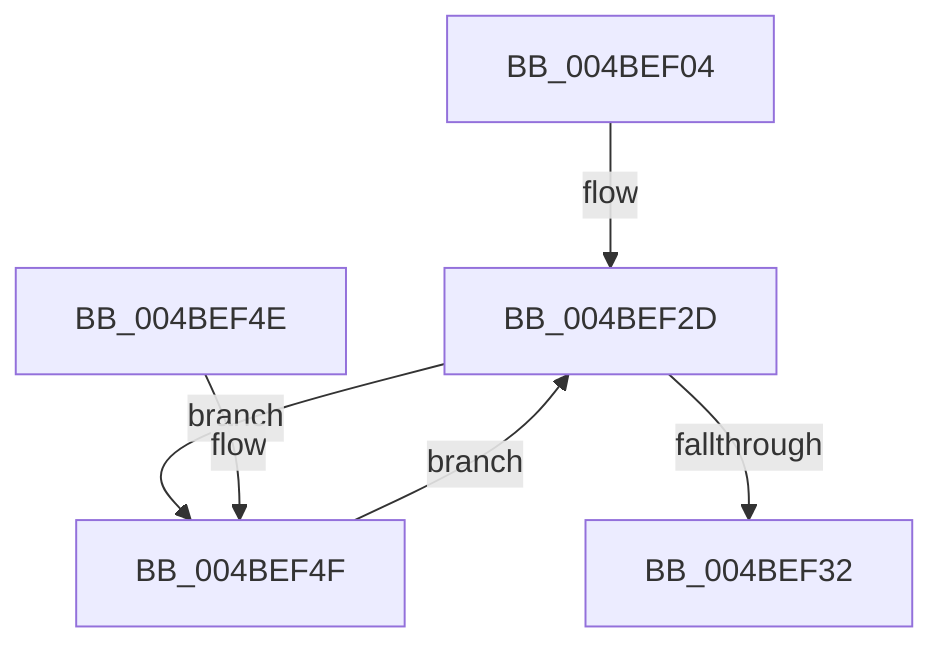

# PopFanSxEntry

- RVA: `0x004BEF04`–`0x004BEF7A` (길이 `118` bytes)
- VA: `0x00000001404BEF04`
- 실행 섹션: `.text`
- PDB 이름 있음: `예`; PDB Function 태그: `아니요`
- unwind 정보 RVA: `0x000743B0`
- 디코드: `28`개 명령, `118/118` bytes 표시
- 미해석 바이트: `0` (있으면 어셈블리에 `.byte`로 보존)

> 이 문서는 커널 이미지의 기계어와 PDB 기호를 분석해 생성했습니다. 4번과 5번은 함수 원형과 자료형을 바이너리 사용 방식에서 추정한 C 해석이며 원본 소스 복구 결과는 아닙니다.

## 1. Dependencies

- 직접 호출 지점: **5**; 고유 호출 대상: **4**
- 직접 호출자로 확인된 함수: **1**
- RIP 상대 이미지 참조: **2**

### Outgoing calls
- `0x004BEF1A` → [PopAcquireRwLockShared](../2D/PopAcquireRwLockShared_function_002D9A40.md) (function, `0x002D9A40`)
- `0x004BEF39` → [PopReleaseRwLock](../2D/PopReleaseRwLock_function_002DFBBC.md) (function, `0x002DFBBC`)
- `0x004BEF59` → [PopAcquireRwLockExclusive](../43/PopAcquireRwLockExclusive_function_00430B44.md) (function, `0x00430B44`)
- `0x004BEF61` → [PopFanUpdateStatistics](../../page/AA/PopFanUpdateStatistics_function_00AAC23C.md) (function, `0x00AAC23C`)
- `0x004BEF70` → [PopReleaseRwLock](../2D/PopReleaseRwLock_function_002DFBBC.md) (function, `0x002DFBBC`)

### Direct callers
- [PopTransitionSystemPowerStateEx](../../pagelk/B7/PopTransitionSystemPowerStateEx_function_00B7E8C0.md) at `0x00B7F0CB`

### Static image references
- `0x004BEF13` → RVA `0x00F0C900` (`.data`; read)
- `0x004BEF1F` → RVA `0x00F0CE90` (`.data`; read)

## 2. Other-region calls and transfers

- 다른 실행 섹션으로 향하는 call: **1**
  - `0x004BEF61` → [PopFanUpdateStatistics](../../page/AA/PopFanUpdateStatistics_function_00AAC23C.md) (`.text` → `PAGE`)
- 별도 외부 분기/꼬리 이동을 확인하지 못했습니다.

## 3. Assembly (complete function range)

```asm
004BEF04  48 89 5C 24 08                  mov qword ptr [rsp + 8], rbx
004BEF09  48 89 74 24 10                  mov qword ptr [rsp + 0x10], rsi
004BEF0E  57                              push rdi
004BEF0F  48 83 EC 20                     sub rsp, 0x20
004BEF13  48 8D 0D E6 D9 A4 00            lea rcx, [rip + 0xa4d9e6]
004BEF1A  E8 21 AB E1 FF                  call 0x1402d9a40
004BEF1F  48 8B 3D 6A DF A4 00            mov rdi, qword ptr [rip + 0xa4df6a]
004BEF26  48 8D 35 63 DF A4 00            lea rsi, [rip + 0xa4df63]
004BEF2D  48 3B FE                        cmp rdi, rsi
004BEF30  75 1D                           jne 0x1404bef4f
004BEF32  48 8D 0D C7 D9 A4 00            lea rcx, [rip + 0xa4d9c7]
004BEF39  E8 7E 0C E2 FF                  call 0x1402dfbbc
004BEF3E  48 8B 5C 24 30                  mov rbx, qword ptr [rsp + 0x30]
004BEF43  48 8B 74 24 38                  mov rsi, qword ptr [rsp + 0x38]
004BEF48  48 83 C4 20                     add rsp, 0x20
004BEF4C  5F                              pop rdi
004BEF4D  C3                              ret
004BEF4E  CC                              int3
004BEF4F  48 8D 9F 90 01 00 00            lea rbx, [rdi + 0x190]
004BEF56  48 8B CB                        mov rcx, rbx
004BEF59  E8 E6 1B F7 FF                  call 0x140430b44
004BEF5E  48 8B CF                        mov rcx, rdi
004BEF61  E8 D6 D2 5E 00                  call 0x140aac23c
004BEF66  48 8B CB                        mov rcx, rbx
004BEF69  C6 87 C8 00 00 00 01            mov byte ptr [rdi + 0xc8], 1
004BEF70  E8 47 0C E2 FF                  call 0x1402dfbbc
004BEF75  48 8B 3F                        mov rdi, qword ptr [rdi]
004BEF78  EB B3                           jmp 0x1404bef2d
```

## 4. C-style interpretation (structured pseudocode)

```c
__int64 __fastcall PopFanSxEntry(void)
{
    __int64 result;
    __int64 v_rsp;
    unsigned __int64 v_stack_p10;
    unsigned __int64 v_stack_p8;

    v_stack_p8 = v_rbx;
    v_stack_p10 = v_rsi;
    v_rsp = (v_rsp) - (32);
    result = PopAcquireRwLockShared(v_rip + 10803686, a2, a3, a4);
loc_004BEF2D:
    if ((*(unsigned __int64 *)(v_rip + 10805098)) != (v_rip + 10805091)) goto loc_004BEF4F;
    result = PopReleaseRwLock(v_rip + 10803655, a2, a3, a4);
    v_rsp = (v_rsp) + (32);
    return result;
loc_004BEF4F:
    result = PopAcquireRwLockExclusive(*(unsigned __int64 *)(v_rip + 10805098) + 400, a2, a3, a4);
    result = PopFanUpdateStatistics(*(unsigned __int64 *)(v_rip + 10805098), a2, a3, a4);
    *(unsigned __int8 *)(*(unsigned __int64 *)(v_rip + 10805098) + 200) = 1;
    result = PopReleaseRwLock(*(unsigned __int64 *)(v_rip + 10805098) + 400, a2, a3, a4);
    goto loc_004BEF2D;
}
```

## 5. (Beta) C Style

```c
void PopFanSxEntry(void)
{
    int64_t result;
    int64_t local_rsp;
    uint64_t v_stack_p10;
    uint64_t v_stack_p8;

    v_stack_p8 = local_rbx;
    v_stack_p10 = local_rsi;
    local_rsp = (local_rsp) - (32);
    result = PopAcquireRwLockShared(v_rip + 10803686, a2, a3, a4);
loc_004BEF2D:
    if ((*(uint64_t *)(v_rip + 0xA4DF6A)) != (v_rip + 10805091)) goto loc_004BEF4F;
    result = PopReleaseRwLock(v_rip + 10803655, a2, a3, a4);
    local_rsp = (local_rsp) + (32);
    return result;
loc_004BEF4F:
    result = PopAcquireRwLockExclusive(*(uint64_t *)(v_rip + 0xA4DF6A) + 400, a2, a3, a4);
    result = PopFanUpdateStatistics(*(uint64_t *)(v_rip + 0xA4DF6A), a2, a3, a4);
    *(uint8_t *)(*(uint64_t *)(v_rip + 0xA4DF6A) + 0xC8) = 1;
    result = PopReleaseRwLock(*(uint64_t *)(v_rip + 0xA4DF6A) + 400, a2, a3, a4);
    goto loc_004BEF2D;
}
```

## 6. Execution-region graph

[열기: 2D/3D 그래프와 함수 탐색 컨트롤 패널](../../../control-panel.html?section=text&rva=0x004BEF04&view=graph)

- 2D 그래프는 위에서 아래로 흐르고, 3D 그래프는 빈 공간을 드래그해 회전합니다. Shift+드래그는 이동, 휠은 확대·축소, 함수 노드 선택은 대상 보고서 이동입니다.

### Static fallback


