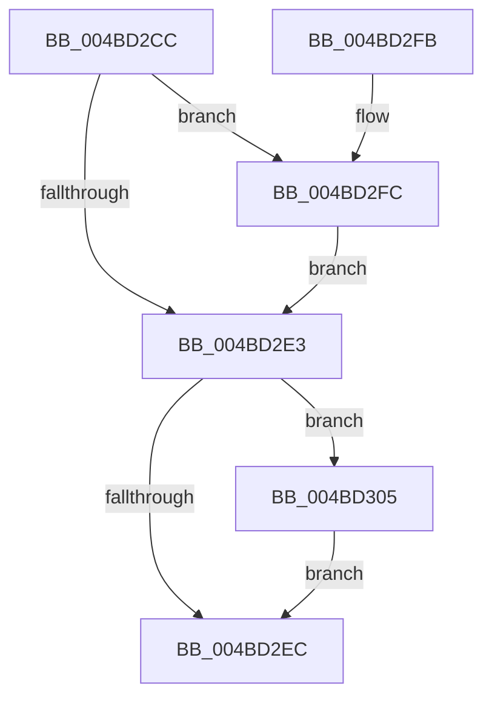

# PopFxAccumulateDeviceIRPhaseAccounting

- RVA: `0x004BD2CC`–`0x004BD30E` (길이 `66` bytes)
- VA: `0x00000001404BD2CC`
- 실행 섹션: `.text`
- PDB 이름 있음: `예`; PDB Function 태그: `아니요`
- unwind 정보 RVA: `0x000DB714`
- 디코드: `14`개 명령, `66/66` bytes 표시
- 미해석 바이트: `0` (있으면 어셈블리에 `.byte`로 보존)

> 이 문서는 커널 이미지의 기계어와 PDB 기호를 분석해 생성했습니다. 4번과 5번은 함수 원형과 자료형을 바이너리 사용 방식에서 추정한 C 해석이며 원본 소스 복구 결과는 아닙니다.

## 1. Dependencies

- 직접 호출 지점: **0**; 고유 호출 대상: **0**
- 직접 호출자로 확인된 함수: **2**
- RIP 상대 이미지 참조: **8**

### Outgoing calls
- 직접 디코드된 call 명령이 없습니다.

### Direct callers
- [PopFxEndDeviceIRPhaseAccounting](../4C/PopFxEndDeviceIRPhaseAccounting_function_004C9AB0.md) at `0x004C9AEE`
- [sub_006E05FA](../6E/Unknown_function_006E05FA.md) at `0x006E05FD`

### Static image references
- `0x004BD2CC` → RVA `0x00F0C7B0` (`.data`; read)
- `0x004BD2D3` → RVA `0x00F0C7D0` (`.data`; read/write)
- `0x004BD2DA` → RVA `0x00F0C7C0` (`.data`; read)
- `0x004BD2E3` → RVA `0x00F0C7C8` (`.data`; read)
- `0x004BD2EC` → RVA `0x00F0C7D8` (`.data`; read/write)
- `0x004BD2F2` → RVA `0x00F0C7B0` (`.data`; read/write)
- `0x004BD2FC` → RVA `0x00F0C7C0` (`.data`; write)
- `0x004BD305` → RVA `0x00F0C7C8` (`.data`; write)

## 2. Other-region calls and transfers

- 다른 실행 섹션으로 향하는 call: **0**
- 별도 외부 분기/꼬리 이동을 확인하지 못했습니다.

## 3. Assembly (complete function range)

```asm
004BD2CC  48 2B 0D DD F4 A4 00            sub rcx, qword ptr [rip + 0xa4f4dd]
004BD2D3  48 01 0D F6 F4 A4 00            add qword ptr [rip + 0xa4f4f6], rcx
004BD2DA  48 3B 0D DF F4 A4 00            cmp rcx, qword ptr [rip + 0xa4f4df]
004BD2E1  77 19                           ja 0x1404bd2fc
004BD2E3  48 3B 0D DE F4 A4 00            cmp rcx, qword ptr [rip + 0xa4f4de]
004BD2EA  72 19                           jb 0x1404bd305
004BD2EC  FF 05 E6 F4 A4 00               inc dword ptr [rip + 0xa4f4e6]
004BD2F2  48 83 25 B6 F4 A4 00 00         and qword ptr [rip + 0xa4f4b6], 0
004BD2FA  C3                              ret
004BD2FB  CC                              int3
004BD2FC  48 89 0D BD F4 A4 00            mov qword ptr [rip + 0xa4f4bd], rcx
004BD303  EB DE                           jmp 0x1404bd2e3
004BD305  48 89 0D BC F4 A4 00            mov qword ptr [rip + 0xa4f4bc], rcx
004BD30C  EB DE                           jmp 0x1404bd2ec
```

## 4. C-style interpretation (structured pseudocode)

```c
void __fastcall PopFxAccumulateDeviceIRPhaseAccounting(__int64 a1)
{
    a1 = (a1) - (*(unsigned __int64 *)(v_rip + 10810589));
    if (a1 > (*(unsigned __int64 *)(v_rip + 10810591))) goto loc_004BD2FC;
loc_004BD2E3:
    if (a1 < (*(unsigned __int64 *)(v_rip + 10810590))) goto loc_004BD305;
loc_004BD2EC:
    return;
loc_004BD2FC:
    *(unsigned __int64 *)(v_rip + 10810557) = a1;
    goto loc_004BD2E3;
loc_004BD305:
    *(unsigned __int64 *)(v_rip + 10810556) = a1;
    goto loc_004BD2EC;
}
```

## 5. (Beta) C Style

```c
void PopFxAccumulateDeviceIRPhaseAccounting(int64_t Arg1)
{
    Arg1 = (Arg1) - (*(uint64_t *)(v_rip + 0xA4F4DD));
    if (Arg1 > (*(uint64_t *)(v_rip + 0xA4F4DF))) goto loc_004BD2FC;
loc_004BD2E3:
    if (Arg1 < (*(uint64_t *)(v_rip + 0xA4F4DE))) goto loc_004BD305;
loc_004BD2EC:
    return;
loc_004BD2FC:
    *(uint64_t *)(v_rip + 0xA4F4BD) = Arg1;
    goto loc_004BD2E3;
loc_004BD305:
    *(uint64_t *)(v_rip + 0xA4F4BC) = Arg1;
    goto loc_004BD2EC;
}
```

## 6. Execution-region graph

[열기: 2D/3D 그래프와 함수 탐색 컨트롤 패널](../../../control-panel.html?section=text&rva=0x004BD2CC&view=graph)

- 2D 그래프는 위에서 아래로 흐르고, 3D 그래프는 빈 공간을 드래그해 회전합니다. Shift+드래그는 이동, 휠은 확대·축소, 함수 노드 선택은 대상 보고서 이동입니다.

### Static fallback


