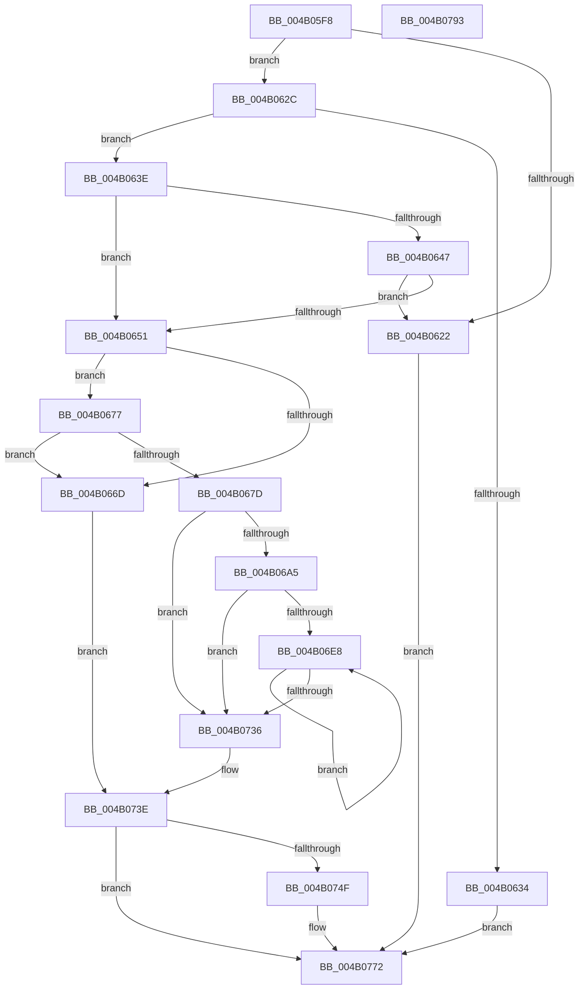

# PopFxClearDeviceConstraints

- RVA: `0x004B05F8`–`0x004B0794` (길이 `412` bytes)
- VA: `0x00000001404B05F8`
- 실행 섹션: `.text`
- PDB 이름 있음: `예`; PDB Function 태그: `아니요`
- unwind 정보 RVA: `0x0008A668`
- 디코드: `107`개 명령, `412/412` bytes 표시
- 미해석 바이트: `0` (있으면 어셈블리에 `.byte`로 보존)

> 이 문서는 커널 이미지의 기계어와 PDB 기호를 분석해 생성했습니다. 4번과 5번은 함수 원형과 자료형을 바이너리 사용 방식에서 추정한 C 해석이며 원본 소스 복구 결과는 아닙니다.

## 1. Dependencies

- 직접 호출 지점: **13**; 고유 호출 대상: **10**
- 직접 호출자로 확인된 함수: **1**
- RIP 상대 이미지 참조: **1**

### Outgoing calls
- `0x004B0618` → [PpmGetDeepSleepPlatformStateIndex](PpmGetDeepSleepPlatformStateIndex_function_004B09F0.md) (function, `0x004B09F0`)
- `0x004B0659` → [PopFxReferenceDevice](../2B/PopFxReferenceDevice_function_002BFD9C.md) (function, `0x002BFD9C`)
- `0x004B068D` → [PopFxActivateDevice](../4A/PopFxActivateDevice_function_004A0DC8.md) (function, `0x004A0DC8`)
- `0x004B0696` → [PopPepClearDripsDeviceVetoMask](../5D/PopPepClearDripsDeviceVetoMask_function_005DC8C4.md) (function, `0x005DC8C4`)
- `0x004B06AF` → [KeAcquireSpinLockRaiseToDpc](../20/KeAcquireSpinLockRaiseToDpc_function_00208470.md) (function, `0x00208470`)
- `0x004B06BB` → [PopFxReinitializeAccountingInstance](PopFxReinitializeAccountingInstance_function_004B0960.md) (function, `0x004B0960`)
- `0x004B06D7` → [KeReleaseSpinLock](../39/KeReleaseSpinLock_function_00392BA0.md) (function, `0x00392BA0`)
- `0x004B0700` → [KeAcquireSpinLockRaiseToDpc](../20/KeAcquireSpinLockRaiseToDpc_function_00208470.md) (function, `0x00208470`)
- `0x004B070C` → [PopFxReinitializeAccountingInstance](PopFxReinitializeAccountingInstance_function_004B0960.md) (function, `0x004B0960`)
- `0x004B0725` → [KeReleaseSpinLock](../39/KeReleaseSpinLock_function_00392BA0.md) (function, `0x00392BA0`)
- `0x004B0739` → [PoFxIdleDevice](../48/PoFxIdleDevice_function_00483EE8.md) (function, `0x00483EE8`)
- `0x004B0746` → [PopFxDereferenceDevice](../27/PopFxDereferenceDevice_function_0027038C.md) (function, `0x0027038C`)
- `0x004B076D` → [ZwUpdateWnfStateData](../6B/ZwUpdateWnfStateData_function_006B0D10.md) (function, `0x006B0D10`)

### Direct callers
- [PopPowerInformationInternal](../../page/A8/PopPowerInformationInternal_function_00A8B7C0.md) at `0x00A8C98A`

### Static image references
- `0x004B0754` → RVA `0x0001E230` (`.rdata`; read)

## 2. Other-region calls and transfers

- 다른 실행 섹션으로 향하는 call: **0**
- 별도 외부 분기/꼬리 이동을 확인하지 못했습니다.

## 3. Assembly (complete function range)

```asm
004B05F8  48 8B C4                        mov rax, rsp
004B05FB  48 89 58 08                     mov qword ptr [rax + 8], rbx
004B05FF  48 89 68 10                     mov qword ptr [rax + 0x10], rbp
004B0603  48 89 70 18                     mov qword ptr [rax + 0x18], rsi
004B0607  48 89 78 20                     mov qword ptr [rax + 0x20], rdi
004B060B  41 54                           push r12
004B060D  41 56                           push r14
004B060F  41 57                           push r15
004B0611  48 83 EC 40                     sub rsp, 0x40
004B0615  48 8B E9                        mov rbp, rcx
004B0618  E8 D3 03 00 00                  call 0x1404b09f0
004B061D  83 F8 FF                        cmp eax, -1
004B0620  75 0A                           jne 0x1404b062c
004B0622  BE 01 00 00 C0                  mov esi, 0xc0000001
004B0627  E9 46 01 00 00                  jmp 0x1404b0772
004B062C  45 33 E4                        xor r12d, r12d
004B062F  48 85 ED                        test rbp, rbp
004B0632  75 0A                           jne 0x1404b063e
004B0634  BE 0D 00 00 C0                  mov esi, 0xc000000d
004B0639  E9 34 01 00 00                  jmp 0x1404b0772
004B063E  48 8B 45 40                     mov rax, qword ptr [rbp + 0x40]
004B0642  48 85 C0                        test rax, rax
004B0645  74 0A                           je 0x1404b0651
004B0647  8B 40 18                        mov eax, dword ptr [rax + 0x18]
004B064A  48 0F BA E0 1B                  bt rax, 0x1b
004B064F  73 D1                           jae 0x1404b0622
004B0651  BA 02 00 00 00                  mov edx, 2
004B0656  48 8B CD                        mov rcx, rbp
004B0659  E8 3E F7 E0 FF                  call 0x1402bfd9c
004B065E  33 C0                           xor eax, eax
004B0660  F0 44 0F B1 A5 60 03 00 00      lock cmpxchg dword ptr [rbp + 0x360], r12d
004B0669  A8 10                           test al, 0x10
004B066B  75 0A                           jne 0x1404b0677
004B066D  BE 01 00 00 C0                  mov esi, 0xc0000001
004B0672  E9 C7 00 00 00                  jmp 0x1404b073e
004B0677  4C 39 65 38                     cmp qword ptr [rbp + 0x38], r12
004B067B  74 F0                           je 0x1404b066d
004B067D  48 8B 45 30                     mov rax, qword ptr [rbp + 0x30]
004B0681  45 33 C0                        xor r8d, r8d
004B0684  33 D2                           xor edx, edx
004B0686  4C 8B 70 20                     mov r14, qword ptr [rax + 0x20]
004B068A  49 8B CE                        mov rcx, r14
004B068D  E8 36 07 FF FF                  call 0x1404a0dc8
004B0692  48 8B 4D 38                     mov rcx, qword ptr [rbp + 0x38]
004B0696  E8 29 C2 12 00                  call 0x1405dc8c4
004B069B  8B F0                           mov esi, eax
004B069D  85 C0                           test eax, eax
004B069F  0F 88 91 00 00 00               js 0x1404b0736
004B06A5  48 8D BD 80 02 00 00            lea rdi, [rbp + 0x280]
004B06AC  48 8B CF                        mov rcx, rdi
004B06AF  E8 BC 7D D5 FF                  call 0x140208470
004B06B4  33 D2                           xor edx, edx
004B06B6  48 8B CF                        mov rcx, rdi
004B06B9  8A D8                           mov bl, al
004B06BB  E8 A0 02 00 00                  call 0x1404b0960
004B06C0  C7 47 0C 05 00 00 00            mov dword ptr [rdi + 0xc], 5
004B06C7  F0 81 A5 60 03 00 00 EF F7 FF FF  lock and dword ptr [rbp + 0x360], 0xfffff7ef
004B06D2  8A D3                           mov dl, bl
004B06D4  48 8B CF                        mov rcx, rdi
004B06D7  E8 C4 24 EE FF                  call 0x140392ba0
004B06DC  45 8B FC                        mov r15d, r12d
004B06DF  44 39 A5 64 03 00 00            cmp dword ptr [rbp + 0x364], r12d
004B06E6  76 4E                           jbe 0x1404b0736
004B06E8  48 8B 85 68 03 00 00            mov rax, qword ptr [rbp + 0x368]
004B06EF  41 8B CF                        mov ecx, r15d
004B06F2  48 8B 3C C8                     mov rdi, qword ptr [rax + rcx*8]
004B06F6  48 81 C7 C8 00 00 00            add rdi, 0xc8
004B06FD  48 8B CF                        mov rcx, rdi
004B0700  E8 6B 7D D5 FF                  call 0x140208470
004B0705  33 D2                           xor edx, edx
004B0707  48 8B CF                        mov rcx, rdi
004B070A  8A D8                           mov bl, al
004B070C  E8 4F 02 00 00                  call 0x1404b0960
004B0711  83 4F 0C FF                     or dword ptr [rdi + 0xc], 0xffffffff
004B0715  F0 81 A5 60 03 00 00 FF FE FF FF  lock and dword ptr [rbp + 0x360], 0xfffffeff
004B0720  8A D3                           mov dl, bl
004B0722  48 8B CF                        mov rcx, rdi
004B0725  E8 76 24 EE FF                  call 0x140392ba0
004B072A  41 FF C7                        inc r15d
004B072D  44 3B BD 64 03 00 00            cmp r15d, dword ptr [rbp + 0x364]
004B0734  72 B2                           jb 0x1404b06e8
004B0736  49 8B CE                        mov rcx, r14
004B0739  E8 AA 37 FD FF                  call 0x140483ee8
004B073E  BA 02 00 00 00                  mov edx, 2
004B0743  48 8B CD                        mov rcx, rbp
004B0746  E8 41 FC DB FF                  call 0x14027038c
004B074B  85 F6                           test esi, esi
004B074D  75 23                           jne 0x1404b0772
004B074F  44 89 64 24 30                  mov dword ptr [rsp + 0x30], r12d
004B0754  48 8D 0D D5 DA B6 FF            lea rcx, [rip - 0x49252b]
004B075B  44 89 64 24 28                  mov dword ptr [rsp + 0x28], r12d
004B0760  45 33 C9                        xor r9d, r9d
004B0763  45 33 C0                        xor r8d, r8d
004B0766  4C 89 64 24 20                  mov qword ptr [rsp + 0x20], r12
004B076B  33 D2                           xor edx, edx
004B076D  E8 9E 05 20 00                  call 0x1406b0d10
004B0772  48 8B 5C 24 60                  mov rbx, qword ptr [rsp + 0x60]
004B0777  8B C6                           mov eax, esi
004B0779  48 8B 74 24 70                  mov rsi, qword ptr [rsp + 0x70]
004B077E  48 8B 6C 24 68                  mov rbp, qword ptr [rsp + 0x68]
004B0783  48 8B 7C 24 78                  mov rdi, qword ptr [rsp + 0x78]
004B0788  48 83 C4 40                     add rsp, 0x40
004B078C  41 5F                           pop r15
004B078E  41 5E                           pop r14
004B0790  41 5C                           pop r12
004B0792  C3                              ret
004B0793  CC                              int3
```

## 4. C-style interpretation (structured pseudocode)

```c
__int64 __fastcall PopFxClearDeviceConstraints(__int64 a1, __int64 a2, int a3, int a4)
{
    __int64 result;
    __int64 v_r12;
    __int64 v_r15;
    __int64 v_rdi;
    __int64 v_rsp;
    unsigned int v_stack_m28;
    unsigned int v_stack_m30;
    unsigned __int64 v_stack_m38;
    unsigned __int64 v_stack_p10;
    unsigned __int64 v_stack_p18;
    unsigned __int64 v_stack_p20;
    unsigned __int64 v_stack_p8;

    *(unsigned __int64 *)(v_rsp + 8) = v_rbx;
    *(unsigned __int64 *)(v_rsp + 16) = v_rbp;
    *(unsigned __int64 *)(v_rsp + 24) = v_rsi;
    *(unsigned __int64 *)(v_rsp + 32) = v_rdi;
    v_rsp = (v_rsp) - (64);
    result = PpmGetDeepSleepPlatformStateIndex(a1, a2, a3, a4);
    if (((unsigned int)(result)) != -1) goto loc_004B062C;
loc_004B0622:
    goto loc_004B0772;
loc_004B062C:
    v_r12 = 0;
    if (a1 != 0) goto loc_004B063E;
    goto loc_004B0772;
loc_004B063E:
    if (*(unsigned __int64 *)(a1 + 64) == 0) goto loc_004B0651;
    if (condition_is_above_or_equal) goto loc_004B0622;
loc_004B0651:
    result = PopFxReferenceDevice(a1, 2, a3, a4);
    result = 0;
    if (((0) & (16)) != 0) goto loc_004B0677;
loc_004B066D:
    goto loc_004B073E;
loc_004B0677:
    if ((*(unsigned __int64 *)(a1 + 56)) == 0) goto loc_004B066D;
    a3 = 0;
    a2 = 0;
    result = PopFxActivateDevice(*(unsigned __int64 *)(*(unsigned __int64 *)(a1 + 48) + 32), a2, a3, a4);
    result = PopPepClearDripsDeviceVetoMask(*(unsigned __int64 *)(a1 + 56), a2, a3, a4);
    if (sign_flag) goto loc_004B0736;
    result = KeAcquireSpinLockRaiseToDpc(a1 + 640, a2, a3, a4);
    a2 = 0;
    result = PopFxReinitializeAccountingInstance(a1 + 640, a2, a3, a4);
    *(unsigned int *)(a1 + 640 + 12) = 5;
    result = KeReleaseSpinLock(a1 + 640, (unsigned __int8)((unsigned __int8)(result)), a3, a4);
    if ((*(unsigned int *)(a1 + 868)) <= 0) goto loc_004B0736;
loc_004B06E8:
    v_rdi = (*(unsigned __int64 *)(*(unsigned __int64 *)(a1 + 872) + 0 * 8)) + (200);
    result = KeAcquireSpinLockRaiseToDpc(v_rdi, (unsigned __int8)((unsigned __int8)(result)), a3, a4);
    a2 = 0;
    result = PopFxReinitializeAccountingInstance(v_rdi, a2, a3, a4);
    result = KeReleaseSpinLock(v_rdi, (unsigned __int8)((unsigned __int8)(result)), a3, a4);
    v_r15 = (unsigned int)((0) + 1);
    if (((unsigned int)(v_r15)) < (*(unsigned int *)(a1 + 868))) goto loc_004B06E8;
loc_004B0736:
    result = PoFxIdleDevice(*(unsigned __int64 *)(*(unsigned __int64 *)(a1 + 48) + 32), (unsigned __int8)((unsigned __int8)(result)), a3, a4);
loc_004B073E:
    result = PopFxDereferenceDevice(a1, 2, a3, a4);
    if ((unsigned int)((unsigned int)((unsigned int)(result))) == 0) {
        v_stack_m28 = 0;
        a1 = v_rip - 4793643;
        v_stack_m30 = 0;
        a4 = 0;
        a3 = 0;
        v_stack_m38 = 0;
        a2 = 0;
        result = ZwUpdateWnfStateData(a1, a2, a3, a4);
    }
    v_rsp = (v_rsp) + (64);
    return (unsigned int)((unsigned int)((unsigned int)((unsigned int)(result))));
}
```

## 5. (Beta) C Style

```c
int64_t PopFxClearDeviceConstraints(int64_t Arg1, int64_t Arg2, int32_t Arg3, int32_t Arg4)
{
    int64_t result;
    int64_t local_r12;
    int64_t local_r15;
    int64_t local_rdi;
    int64_t local_rsp;
    uint32_t v_stack_m28;
    uint32_t v_stack_m30;
    uint64_t v_stack_m38;
    uint64_t v_stack_p10;
    uint64_t v_stack_p18;
    uint64_t v_stack_p20;
    uint64_t v_stack_p8;

    *(uint64_t *)(local_rsp + 0x8) = local_rbx;
    *(uint64_t *)(local_rsp + 0x10) = local_rbp;
    *(uint64_t *)(local_rsp + 0x18) = local_rsi;
    *(uint64_t *)(local_rsp + 0x20) = local_rdi;
    local_rsp = (local_rsp) - (64);
    result = PpmGetDeepSleepPlatformStateIndex(Arg1, Arg2, Arg3, Arg4);
    if (((uint32_t)(result)) != -1) goto loc_004B062C;
loc_004B0622:
    goto loc_004B0772;
loc_004B062C:
    local_r12 = 0;
    if (Arg1 != 0) goto loc_004B063E;
    goto loc_004B0772;
loc_004B063E:
    if (*(uint64_t *)(Arg1 + 0x40) == 0) goto loc_004B0651;
    if (condition_is_above_or_equal) goto loc_004B0622;
loc_004B0651:
    result = PopFxReferenceDevice(Arg1, 2, Arg3, Arg4);
    result = 0;
    if (((0) & (16)) != 0) goto loc_004B0677;
loc_004B066D:
    goto loc_004B073E;
loc_004B0677:
    if ((*(uint64_t *)(Arg1 + 0x38)) == 0) goto loc_004B066D;
    Arg3 = 0;
    Arg2 = 0;
    result = PopFxActivateDevice(*(uint64_t *)(*(uint64_t *)(Arg1 + 0x30) + 0x20), Arg2, Arg3, Arg4);
    result = PopPepClearDripsDeviceVetoMask(*(uint64_t *)(Arg1 + 0x38), Arg2, Arg3, Arg4);
    if (sign_flag) goto loc_004B0736;
    result = KeAcquireSpinLockRaiseToDpc(Arg1 + 640, Arg2, Arg3, Arg4);
    Arg2 = 0;
    result = PopFxReinitializeAccountingInstance(Arg1 + 640, Arg2, Arg3, Arg4);
    *(uint32_t *)(Arg1 + 0x280 + 0xC) = 5;
    result = KeReleaseSpinLock(Arg1 + 640, (uint8_t)((uint8_t)(result)), Arg3, Arg4);
    if ((*(uint32_t *)(Arg1 + 0x364)) <= 0) goto loc_004B0736;
loc_004B06E8:
    local_rdi = (*(uint64_t *)(*(uint64_t *)(Arg1 + 0x368) + 0x0 * 8)) + (200);
    result = KeAcquireSpinLockRaiseToDpc(local_rdi, (uint8_t)((uint8_t)(result)), Arg3, Arg4);
    Arg2 = 0;
    result = PopFxReinitializeAccountingInstance(local_rdi, Arg2, Arg3, Arg4);
    result = KeReleaseSpinLock(local_rdi, (uint8_t)((uint8_t)(result)), Arg3, Arg4);
    local_r15 = (uint32_t)((0) + 1);
    if (((uint32_t)(local_r15)) < (*(uint32_t *)(Arg1 + 0x364))) goto loc_004B06E8;
loc_004B0736:
    result = PoFxIdleDevice(*(uint64_t *)(*(uint64_t *)(Arg1 + 0x30) + 0x20), (uint8_t)((uint8_t)(result)), Arg3, Arg4);
loc_004B073E:
    result = PopFxDereferenceDevice(Arg1, 2, Arg3, Arg4);
    if ((uint32_t)((uint32_t)((uint32_t)(result))) == 0) {
        v_stack_m28 = 0;
        Arg1 = v_rip - 4793643;
        v_stack_m30 = 0;
        Arg4 = 0;
        Arg3 = 0;
        v_stack_m38 = 0;
        Arg2 = 0;
        result = ZwUpdateWnfStateData(Arg1, Arg2, Arg3, Arg4);
    }
    local_rsp = (local_rsp) + (64);
    return (uint32_t)((uint32_t)((uint32_t)((uint32_t)(result))));
}
```

## 6. Execution-region graph

[열기: 2D/3D 그래프와 함수 탐색 컨트롤 패널](../../../control-panel.html?section=text&rva=0x004B05F8&view=graph)

- 2D 그래프는 위에서 아래로 흐르고, 3D 그래프는 빈 공간을 드래그해 회전합니다. Shift+드래그는 이동, 휠은 확대·축소, 함수 노드 선택은 대상 보고서 이동입니다.

### Static fallback


