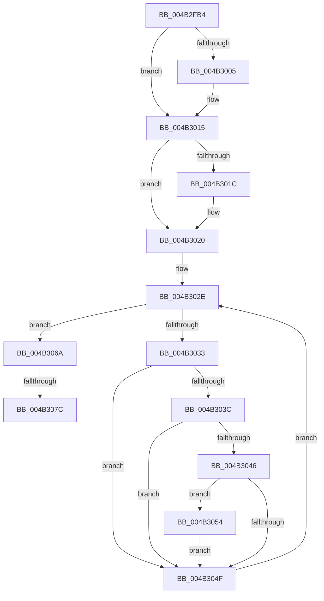

# PopFxIdleDevicesFromSx

- RVA: `0x004B2FB4`–`0x004B308A` (길이 `214` bytes)
- VA: `0x00000001404B2FB4`
- 실행 섹션: `.text`
- PDB 이름 있음: `예`; PDB Function 태그: `예`
- unwind 정보 RVA: `0x000B978C`
- 디코드: `54`개 명령, `214/214` bytes 표시
- 미해석 바이트: `0` (있으면 어셈블리에 `.byte`로 보존)

> 이 문서는 커널 이미지의 기계어와 PDB 기호를 분석해 생성했습니다. 4번과 5번은 함수 원형과 자료형을 바이너리 사용 방식에서 추정한 C 해석이며 원본 소스 복구 결과는 아닙니다.

## 1. Dependencies

- 직접 호출 지점: **4**; 고유 호출 대상: **4**
- 직접 호출자로 확인된 함수: **2**
- RIP 상대 이미지 참조: **2**

### Outgoing calls
- `0x004B2FEC` → [KeAbPreAcquire](../21/KeAbPreAcquire_function_00210230.md) (function, `0x00210230`)
- `0x004B3010` → [ExfAcquirePushLockSharedEx](../21/ExfAcquirePushLockSharedEx_function_0021044C.md) (function, `0x0021044C`)
- `0x004B3058` → [PoFxIdleDevice](../48/PoFxIdleDevice_function_00483EE8.md) (function, `0x00483EE8`)
- `0x004B307F` → [ExfReleasePushLockShared](../26/ExfReleasePushLockShared_function_00263440.md) (function, `0x00263440`)

### Direct callers
- [PoBroadcastSystemState](../../pagelk/B7/PoBroadcastSystemState_function_00B761B0.md) at `0x00B76736`
- [sub_00B80364](../../pagelk/B8/Unknown_function_00B80364.md) at `0x00B804DD`

### Static image references
- `0x004B2FD5` → RVA `0x00F0E408` (`.data`; read)
- `0x004B3020` → RVA `0x00F0E3F0` (`.data`; read)

## 2. Other-region calls and transfers

- 다른 실행 섹션으로 향하는 call: **0**
- call이 아닌 외부 분기/꼬리 이동: **2**
  - `0x004B3076` → [sub_006FB432](../6F/Unknown_function_006FB432.md) (`tail-transfer`)
  - `0x004B3085` → [sub_006FB432](../6F/Unknown_function_006FB432.md) (`tail-transfer`)

## 3. Assembly (complete function range)

```asm
004B2FB4  48 89 5C 24 08                  mov qword ptr [rsp + 8], rbx
004B2FB9  48 89 6C 24 18                  mov qword ptr [rsp + 0x18], rbp
004B2FBE  48 89 74 24 20                  mov qword ptr [rsp + 0x20], rsi
004B2FC3  57                              push rdi
004B2FC4  41 56                           push r14
004B2FC6  41 57                           push r15
004B2FC8  48 83 EC 20                     sub rsp, 0x20
004B2FCC  65 48 8B 04 25 88 01 00 00      mov rax, qword ptr gs:[0x188]
004B2FD5  48 8D 35 2C B4 A5 00            lea rsi, [rip + 0xa5b42c]
004B2FDC  45 33 C0                        xor r8d, r8d
004B2FDF  33 D2                           xor edx, edx
004B2FE1  48 8B CE                        mov rcx, rsi
004B2FE4  66 FF 88 E4 01 00 00            dec word ptr [rax + 0x1e4]
004B2FEB  90                              nop
004B2FEC  E8 3F D2 D5 FF                  call 0x140210230
004B2FF1  48 8B D8                        mov rbx, rax
004B2FF4  33 C0                           xor eax, eax
004B2FF6  44 8D 78 11                     lea r15d, [rax + 0x11]
004B2FFA  F0 4C 0F B1 3D 05 B4 A5 00      lock cmpxchg qword ptr [rip + 0xa5b405], r15
004B3003  74 10                           je 0x1404b3015
004B3005  4C 8B CE                        mov r9, rsi
004B3008  4C 8B C3                        mov r8, rbx
004B300B  33 D2                           xor edx, edx
004B300D  48 8B CE                        mov rcx, rsi
004B3010  E8 37 D4 D5 FF                  call 0x14021044c
004B3015  33 ED                           xor ebp, ebp
004B3017  48 85 DB                        test rbx, rbx
004B301A  74 04                           je 0x1404b3020
004B301C  C6 43 0A 01                     mov byte ptr [rbx + 0xa], 1
004B3020  48 8B 1D C9 B3 A5 00            mov rbx, qword ptr [rip + 0xa5b3c9]
004B3027  4C 8D 35 C2 B3 A5 00            lea r14, [rip + 0xa5b3c2]
004B302E  49 3B DE                        cmp rbx, r14
004B3031  74 37                           je 0x1404b306a
004B3033  48 8B 7B 30                     mov rdi, qword ptr [rbx + 0x30]
004B3037  48 85 FF                        test rdi, rdi
004B303A  74 13                           je 0x1404b304f
004B303C  8B 83 60 03 00 00               mov eax, dword ptr [rbx + 0x360]
004B3042  A8 01                           test al, 1
004B3044  75 09                           jne 0x1404b304f
004B3046  80 BF D8 00 00 00 01            cmp byte ptr [rdi + 0xd8], 1
004B304D  72 05                           jb 0x1404b3054
004B304F  48 8B 1B                        mov rbx, qword ptr [rbx]
004B3052  EB DA                           jmp 0x1404b302e
004B3054  48 8B 4F 20                     mov rcx, qword ptr [rdi + 0x20]
004B3058  E8 8B 0E FD FF                  call 0x140483ee8
004B305D  F0 81 A7 28 01 00 00 FF EF FF FF  lock and dword ptr [rdi + 0x128], 0xffffefff
004B3068  EB E5                           jmp 0x1404b304f
004B306A  49 8B C7                        mov rax, r15
004B306D  F0 48 0F B1 2D 92 B3 A5 00      lock cmpxchg qword ptr [rip + 0xa5b392], rbp
004B3076  0F 84 B6 83 24 00               je 0x1406fb432
004B307C  48 8B CE                        mov rcx, rsi
004B307F  E8 BC 03 DB FF                  call 0x140263440
004B3084  90                              nop
004B3085  E9 A8 83 24 00                  jmp 0x1406fb432
```

## 4. C-style interpretation (structured pseudocode)

```c
__int64 __fastcall PopFxIdleDevicesFromSx(__int64 a1, int a2, int a3)
{
    __int64 result;
    __int64 v_rbp;
    __int64 v_rsp;
    unsigned __int64 v_stack_p18;
    unsigned __int64 v_stack_p20;
    unsigned __int64 v_stack_p8;

    v_stack_p8 = v_rbx;
    v_stack_p18 = v_rbp;
    v_stack_p20 = v_rsi;
    v_rsp = (v_rsp) - (32);
    a3 = 0;
    a2 = 0;
    result = KeAbPreAcquire(v_rip + 10859564, a2, a3, a4);
    result = 0;
    if (!(condition_is_equal)) {
        a4 = v_rip + 10859564;
        a3 = 0;
        a2 = 0;
        a1 = v_rip + 10859564;
        result = ExfAcquirePushLockSharedEx(a1, a2, a3, a4);
    }
    v_rbp = 0;
    if (result != 0) {
        *(unsigned __int8 *)(result + 10) = 1;
    }
loc_004B302E:
    if ((*(unsigned __int64 *)(v_rip + 10859465)) == (v_rip + 10859458)) goto loc_004B306A;
    if (*(unsigned __int64 *)(*(unsigned __int64 *)(v_rip + 10859465) + 48) == 0) goto loc_004B304F;
    if ((((unsigned __int8)((unsigned int)(*(unsigned int *)(*(unsigned __int64 *)(v_rip + 10859465) + 864)))) & (1)) != 0) goto loc_004B304F;
    if ((*(unsigned __int8 *)(*(unsigned __int64 *)(*(unsigned __int64 *)(v_rip + 10859465) + 48) + 216)) < 1) goto loc_004B3054;
loc_004B304F:
    goto loc_004B302E;
loc_004B3054:
    result = PoFxIdleDevice(*(unsigned __int64 *)(*(unsigned __int64 *)(*(unsigned __int64 *)(v_rip + 10859465) + 48) + 32), a2, a3, a4);
    goto loc_004B304F;
loc_004B306A:
    result = ExfReleasePushLockShared(v_rip + 10859564, a2, a3, a4);
}
```

## 5. (Beta) C Style

```c
int64_t PopFxIdleDevicesFromSx(int64_t Arg1, int32_t Arg2, int32_t Arg3)
{
    int64_t result;
    int64_t local_rbp;
    int64_t local_rsp;
    uint64_t v_stack_p18;
    uint64_t v_stack_p20;
    uint64_t v_stack_p8;

    v_stack_p8 = local_rbx;
    v_stack_p18 = local_rbp;
    v_stack_p20 = local_rsi;
    local_rsp = (local_rsp) - (32);
    Arg3 = 0;
    Arg2 = 0;
    result = KeAbPreAcquire(v_rip + 10859564, Arg2, Arg3, a4);
    result = 0;
    if (!(condition_is_equal)) {
        a4 = v_rip + 10859564;
        Arg3 = 0;
        Arg2 = 0;
        Arg1 = v_rip + 10859564;
        result = ExfAcquirePushLockSharedEx(Arg1, Arg2, Arg3, a4);
    }
    local_rbp = 0;
    if (result != 0) {
        *(uint8_t *)(result + 0xA) = 1;
    }
loc_004B302E:
    if ((*(uint64_t *)(v_rip + 0xA5B3C9)) == (v_rip + 10859458)) goto loc_004B306A;
    if (*(uint64_t *)(*(uint64_t *)(v_rip + 0xA5B3C9) + 0x30) == 0) goto loc_004B304F;
    if ((((uint8_t)((uint32_t)(*(uint32_t *)(*(uint64_t *)(v_rip + 0xA5B3C9) + 0x360)))) & (1)) != 0) goto loc_004B304F;
    if ((*(uint8_t *)(*(uint64_t *)(*(uint64_t *)(v_rip + 0xA5B3C9) + 0x30) + 0xD8)) < 1) goto loc_004B3054;
loc_004B304F:
    goto loc_004B302E;
loc_004B3054:
    result = PoFxIdleDevice(*(uint64_t *)(*(uint64_t *)(*(uint64_t *)(v_rip + 0xA5B3C9) + 0x30) + 0x20), Arg2, Arg3, a4);
    goto loc_004B304F;
loc_004B306A:
    result = ExfReleasePushLockShared(v_rip + 10859564, Arg2, Arg3, a4);
}
```

## 6. Execution-region graph

[열기: 2D/3D 그래프와 함수 탐색 컨트롤 패널](../../../control-panel.html?section=text&rva=0x004B2FB4&view=graph)

- 2D 그래프는 위에서 아래로 흐르고, 3D 그래프는 빈 공간을 드래그해 회전합니다. Shift+드래그는 이동, 휠은 확대·축소, 함수 노드 선택은 대상 보고서 이동입니다.

### Static fallback


