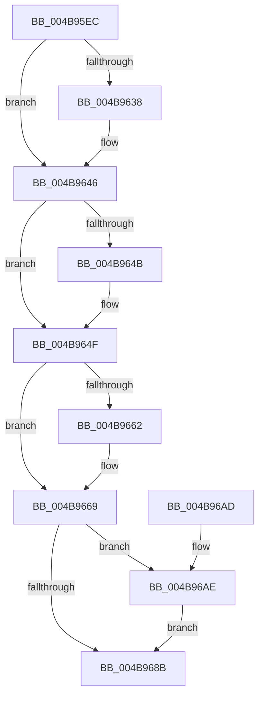

# PopFxInsertDevice

- RVA: `0x004B95EC`–`0x004B96B8` (길이 `204` bytes)
- VA: `0x00000001404B95EC`
- 실행 섹션: `.text`
- PDB 이름 있음: `예`; PDB Function 태그: `아니요`
- unwind 정보 RVA: `0x00073808`
- 디코드: `52`개 명령, `204/204` bytes 표시
- 미해석 바이트: `0` (있으면 어셈블리에 `.byte`로 보존)

> 이 문서는 커널 이미지의 기계어와 PDB 기호를 분석해 생성했습니다. 4번과 5번은 함수 원형과 자료형을 바이너리 사용 방식에서 추정한 C 해석이며 원본 소스 복구 결과는 아닙니다.

## 1. Dependencies

- 직접 호출 지점: **5**; 고유 호출 대상: **5**
- 직접 호출자로 확인된 함수: **2**
- RIP 상대 이미지 참조: **5**

### Outgoing calls
- `0x004B9627` → [KeAbPreAcquire](../21/KeAbPreAcquire_function_00210230.md) (function, `0x00210230`)
- `0x004B9641` → [ExfAcquirePushLockExclusiveEx](../20/ExfAcquirePushLockExclusiveEx_function_0020FC90.md) (function, `0x0020FC90`)
- `0x004B968E` → [KeAbPostRelease](../2E/KeAbPostRelease_function_002E1600.md) (function, `0x002E1600`)
- `0x004B9693` → [KeLeaveCriticalRegion](../25/KeLeaveCriticalRegion_function_0025D8B0.md) (function, `0x0025D8B0`)
- `0x004B96B1` → [ExfTryToWakePushLock](../26/ExfTryToWakePushLock_function_00265DD0.md) (function, `0x00265DD0`)

### Direct callers
- [PoFxRegisterCoreDevice](../../page/75/PoFxRegisterCoreDevice_function_00758800.md) at `0x007588EB`
- [PopFxRegisterDevice](../../page/75/PopFxRegisterDevice_function_00759B80.md) at `0x00759D8C`

### Static image references
- `0x004B9609` → RVA `0x00F0E408` (`.data`; read)
- `0x004B964F` → RVA `0x00F0E3F8` (`.data`; read)
- `0x004B9656` → RVA `0x00F0E3F0` (`.data`; read)
- `0x004B9673` → RVA `0x00F0E3F8` (`.data`; write)
- `0x004B967A` → RVA `0x00F0E408` (`.data`; read/write)

## 2. Other-region calls and transfers

- 다른 실행 섹션으로 향하는 call: **0**
- 별도 외부 분기/꼬리 이동을 확인하지 못했습니다.

## 3. Assembly (complete function range)

```asm
004B95EC  48 89 5C 24 08                  mov qword ptr [rsp + 8], rbx
004B95F1  48 89 6C 24 10                  mov qword ptr [rsp + 0x10], rbp
004B95F6  48 89 74 24 18                  mov qword ptr [rsp + 0x18], rsi
004B95FB  57                              push rdi
004B95FC  48 83 EC 20                     sub rsp, 0x20
004B9600  65 48 8B 04 25 88 01 00 00      mov rax, qword ptr gs:[0x188]
004B9609  48 8D 2D F8 4D A5 00            lea rbp, [rip + 0xa54df8]
004B9610  49 8B F0                        mov rsi, r8
004B9613  48 83 CB FF                     or rbx, 0xffffffffffffffff
004B9617  45 33 C0                        xor r8d, r8d
004B961A  33 D2                           xor edx, edx
004B961C  48 8B CD                        mov rcx, rbp
004B961F  66 01 98 E4 01 00 00            add word ptr [rax + 0x1e4], bx
004B9626  90                              nop
004B9627  E8 04 6C D5 FF                  call 0x140210230
004B962C  F0 48 0F BA 6D 00 00            lock bts qword ptr [rbp], 0
004B9633  48 8B F8                        mov rdi, rax
004B9636  73 0E                           jae 0x1404b9646
004B9638  4C 8B C5                        mov r8, rbp
004B963B  48 8B D0                        mov rdx, rax
004B963E  48 8B CD                        mov rcx, rbp
004B9641  E8 4A 66 D5 FF                  call 0x14020fc90
004B9646  48 85 FF                        test rdi, rdi
004B9649  74 04                           je 0x1404b964f
004B964B  C6 47 0A 01                     mov byte ptr [rdi + 0xa], 1
004B964F  48 8B 05 A2 4D A5 00            mov rax, qword ptr [rip + 0xa54da2]
004B9656  48 8D 0D 93 4D A5 00            lea rcx, [rip + 0xa54d93]
004B965D  48 39 08                        cmp qword ptr [rax], rcx
004B9660  74 07                           je 0x1404b9669
004B9662  B9 03 00 00 00                  mov ecx, 3
004B9667  CD 29                           int 0x29
004B9669  48 89 0E                        mov qword ptr [rsi], rcx
004B966C  48 89 46 08                     mov qword ptr [rsi + 8], rax
004B9670  48 89 30                        mov qword ptr [rax], rsi
004B9673  48 89 35 7E 4D A5 00            mov qword ptr [rip + 0xa54d7e], rsi
004B967A  F0 48 0F C1 1D 85 4D A5 00      lock xadd qword ptr [rip + 0xa54d85], rbx
004B9683  80 E3 06                        and bl, 6
004B9686  80 FB 02                        cmp bl, 2
004B9689  74 23                           je 0x1404b96ae
004B968B  48 8B CD                        mov rcx, rbp
004B968E  E8 6D 7F E2 FF                  call 0x1402e1600
004B9693  E8 18 42 DA FF                  call 0x14025d8b0
004B9698  48 8B 5C 24 30                  mov rbx, qword ptr [rsp + 0x30]
004B969D  48 8B 6C 24 38                  mov rbp, qword ptr [rsp + 0x38]
004B96A2  48 8B 74 24 40                  mov rsi, qword ptr [rsp + 0x40]
004B96A7  48 83 C4 20                     add rsp, 0x20
004B96AB  5F                              pop rdi
004B96AC  C3                              ret
004B96AD  CC                              int3
004B96AE  48 8B CD                        mov rcx, rbp
004B96B1  E8 1A C7 DA FF                  call 0x140265dd0
004B96B6  EB D3                           jmp 0x1404b968b
```

## 4. C-style interpretation (structured pseudocode)

```c
__int64 __fastcall PopFxInsertDevice(__int64 a1, int a2, __int64 a3)
{
    __int64 result;
    __int64 v_rbx;
    __int64 v_rsp;
    unsigned __int64 v_stack_p10;
    unsigned __int64 v_stack_p18;
    unsigned __int64 v_stack_p8;

    v_stack_p8 = v_rbx;
    v_stack_p10 = v_rbp;
    v_stack_p18 = v_rsi;
    v_rsp = (v_rsp) - (32);
    v_rbx = (v_rbx) | (-1);
    a3 = 0;
    a2 = 0;
    result = KeAbPreAcquire(v_rip + 10833400, a2, a3, a4);
    if (!(condition_is_above_or_equal)) {
        a3 = v_rip + 10833400;
        a2 = result;
        a1 = v_rip + 10833400;
        result = ExfAcquirePushLockExclusiveEx(a1, a2, a3, a4);
    }
    if (result != 0) {
        *(unsigned __int8 *)(result + 10) = 1;
    }
    if ((*(unsigned __int64 *)(*(unsigned __int64 *)(v_rip + 10833314))) != (v_rip + 10833299)) {
        a1 = 3;
    }
    *(unsigned __int64 *)(a3) = a1;
    *(unsigned __int64 *)(a3 + 8) = *(unsigned __int64 *)(v_rip + 10833314);
    *(unsigned __int64 *)(*(unsigned __int64 *)(v_rip + 10833314)) = a3;
    *(unsigned __int64 *)(v_rip + 10833278) = a3;
    v_rbx = (unsigned __int8)((v_rbx) & (6));
    if (((unsigned __int8)(v_rbx)) == 2) goto loc_004B96AE;
loc_004B968B:
    result = KeAbPostRelease(v_rip + 10833400, a2, a3, a4);
    result = KeLeaveCriticalRegion(v_rip + 10833400, a2, a3, a4);
    v_rsp = (v_rsp) + (32);
    return result;
loc_004B96AE:
    result = ExfTryToWakePushLock(v_stack_p10, a2, a3, a4);
    goto loc_004B968B;
}
```

## 5. (Beta) C Style

```c
int64_t PopFxInsertDevice(int64_t Arg1, int32_t Arg2, void *Arg3)
{
    uint8_t *arg3 = (uint8_t *)Arg3;

    int64_t result;
    int64_t local_rbx;
    int64_t local_rsp;
    uint64_t v_stack_p10;
    uint64_t v_stack_p18;
    uint64_t v_stack_p8;

    v_stack_p8 = local_rbx;
    v_stack_p10 = local_rbp;
    v_stack_p18 = local_rsi;
    local_rsp = (local_rsp) - (32);
    local_rbx = (local_rbx) | (-1);
    Arg3 = 0;
    Arg2 = 0;
    result = KeAbPreAcquire(v_rip + 10833400, Arg2, Arg3, a4);
    if (!(condition_is_above_or_equal)) {
        Arg3 = v_rip + 10833400;
        Arg2 = result;
        Arg1 = v_rip + 10833400;
        result = ExfAcquirePushLockExclusiveEx(Arg1, Arg2, Arg3, a4);
    }
    if (result != 0) {
        *(uint8_t *)(result + 0xA) = 1;
    }
    if ((*(uint64_t *)(*(uint64_t *)(v_rip + 0xA54DA2))) != (v_rip + 10833299)) {
        Arg1 = 3;
    }
    *(uint64_t *)(arg3) = Arg1;
    *(uint64_t *)(arg3 + 0x8) = *(uint64_t *)(v_rip + 0xA54DA2);
    *(void **)(*(uint64_t *)(v_rip + 0xA54DA2)) = Arg3;
    *(void **)(v_rip + 0xA54D7E) = Arg3;
    local_rbx = (uint8_t)((local_rbx) & (6));
    if (((uint8_t)(local_rbx)) == 2) goto loc_004B96AE;
loc_004B968B:
    result = KeAbPostRelease(v_rip + 10833400, Arg2, Arg3, a4);
    result = KeLeaveCriticalRegion(v_rip + 10833400, Arg2, Arg3, a4);
    local_rsp = (local_rsp) + (32);
    return result;
loc_004B96AE:
    result = ExfTryToWakePushLock(v_stack_p10, Arg2, Arg3, a4);
    goto loc_004B968B;
}
```

### 관측된 메모리 오프셋

구조체 형식이 확인되지 않은 접근은 인자 기준의 오프셋으로만 기록했습니다.

| 기준 인자 | 오프셋 표현 | 폭 (bit) | 접근 |
|---|---:|---:|---|
| `Arg3` | `+ 0x0` | `64` | `W` |
| `Arg3` | `+ 0x8` | `64` | `W` |

## 6. Execution-region graph

[열기: 2D/3D 그래프와 함수 탐색 컨트롤 패널](../../../control-panel.html?section=text&rva=0x004B95EC&view=graph)

- 2D 그래프는 위에서 아래로 흐르고, 3D 그래프는 빈 공간을 드래그해 회전합니다. Shift+드래그는 이동, 휠은 확대·축소, 함수 노드 선택은 대상 보고서 이동입니다.

### Static fallback


