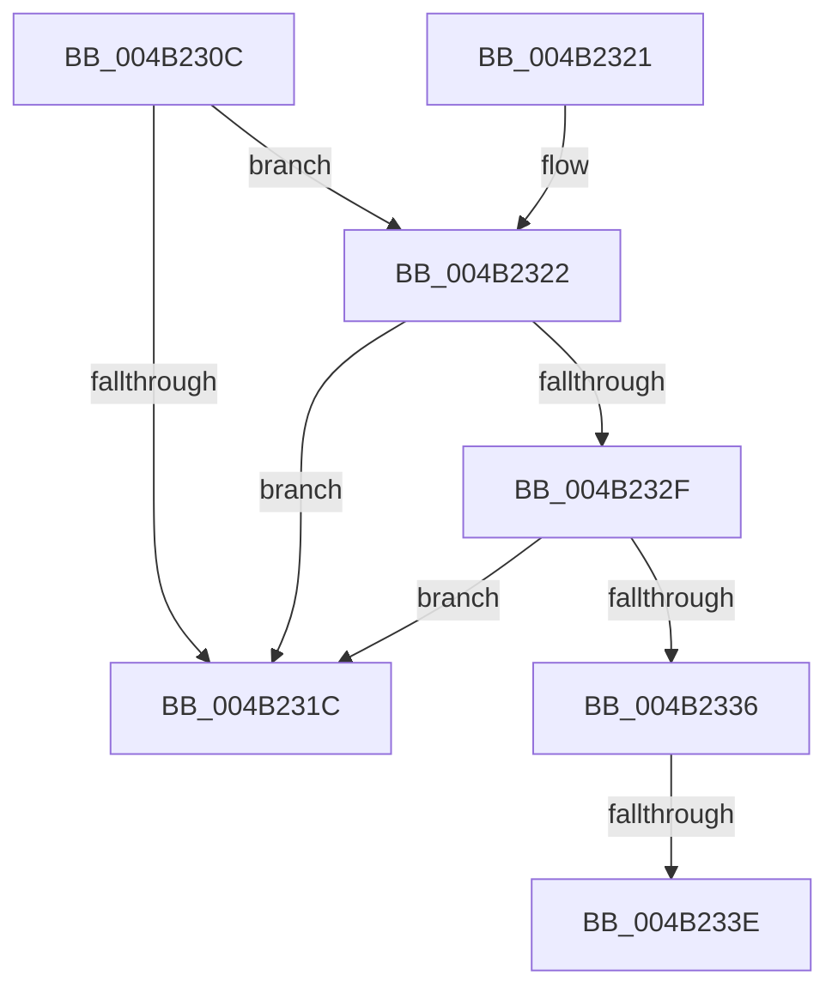

# PopFxNotifySystemStateTransition

- RVA: `0x004B230C`–`0x004B2352` (길이 `70` bytes)
- VA: `0x00000001404B230C`
- 실행 섹션: `.text`
- PDB 이름 있음: `예`; PDB Function 태그: `예`
- unwind 정보 RVA: `0x0008A250`
- 디코드: `19`개 명령, `70/70` bytes 표시
- 미해석 바이트: `0` (있으면 어셈블리에 `.byte`로 보존)

> 이 문서는 커널 이미지의 기계어와 PDB 기호를 분석해 생성했습니다. 4번과 5번은 함수 원형과 자료형을 바이너리 사용 방식에서 추정한 C 해석이며 원본 소스 복구 결과는 아닙니다.

## 1. Dependencies

- 직접 호출 지점: **0**; 고유 호출 대상: **0**
- 직접 호출자로 확인된 함수: **1**
- RIP 상대 이미지 참조: **0**

### Outgoing calls
- 직접 디코드된 call 명령이 없습니다.

### Direct callers
- [PopHandleNextState](../../pagelk/B7/PopHandleNextState_function_00B77350.md) at `0x00B7756D`
- [PopHandleNextState](../../pagelk/B7/PopHandleNextState_function_00B77350.md) at `0x00B77583`

### Static image references
- 디코드된 RIP-relative 메모리 참조가 없습니다.

## 2. Other-region calls and transfers

- 다른 실행 섹션으로 향하는 call: **0**
- call이 아닌 외부 분기/꼬리 이동: **2**
  - `0x004B2338` → [sub_006FB35E](../6F/Unknown_function_006FB35E.md) (`tail-transfer`)
  - `0x004B234D` → [sub_006FB35E + 0xF](../6F/Unknown_function_006FB35E.md) (`tail-transfer`)

## 3. Assembly (complete function range)

```asm
004B230C  48 83 EC 28                     sub rsp, 0x28
004B2310  4C 8B 89 28 8A 00 00            mov r9, qword ptr [rcx + 0x8a28]
004B2317  4D 85 C9                        test r9, r9
004B231A  75 06                           jne 0x1404b2322
004B231C  48 83 C4 28                     add rsp, 0x28
004B2320  C3                              ret
004B2321  CC                              int3
004B2322  49 8B 41 40                     mov rax, qword ptr [r9 + 0x40]
004B2326  49 8B 49 48                     mov rcx, qword ptr [r9 + 0x48]
004B232A  48 85 C0                        test rax, rax
004B232D  74 ED                           je 0x1404b231c
004B232F  48 83 78 68 00                  cmp qword ptr [rax + 0x68], 0
004B2334  74 E6                           je 0x1404b231c
004B2336  84 D2                           test dl, dl
004B2338  0F 84 20 90 24 00               je 0x1406fb35e
004B233E  44 89 44 24 30                  mov dword ptr [rsp + 0x30], r8d
004B2343  BA 27 00 00 00                  mov edx, 0x27
004B2348  4C 8D 44 24 30                  lea r8, [rsp + 0x30]
004B234D  E9 1B 90 24 00                  jmp 0x1406fb36d
```

## 4. C-style interpretation (structured pseudocode)

```c
__int64 __fastcall PopFxNotifySystemStateTransition(__int64 a1, unsigned __int8 a2, int a3)
{
    __int64 v_rsp;
    unsigned int v_stack_p30;

    v_rsp = (v_rsp) - (40);
    if (*(unsigned __int64 *)(a1 + 35368) != 0) goto loc_004B2322;
loc_004B231C:
    v_rsp = (v_rsp) + (40);
    return result;
loc_004B2322:
    if (*(unsigned __int64 *)(*(unsigned __int64 *)(a1 + 35368) + 64) == 0) goto loc_004B231C;
    if ((*(unsigned __int64 *)(*(unsigned __int64 *)(*(unsigned __int64 *)(a1 + 35368) + 64) + 104)) == 0) goto loc_004B231C;
    v_stack_p30 = a3;
}
```

## 5. (Beta) C Style

```c
int64_t PopFxNotifySystemStateTransition(void *Arg1, uint8_t Arg2, int32_t Arg3)
{
    uint8_t *arg1 = (uint8_t *)Arg1;

    int64_t local_rsp;
    uint32_t v_stack_p30;

    local_rsp = (local_rsp) - (40);
    if (*(uint64_t *)(arg1 + 0x8A28) != 0) goto loc_004B2322;
loc_004B231C:
    local_rsp = (local_rsp) + (40);
    return result;
loc_004B2322:
    if (*(uint64_t *)(*(uint64_t *)(arg1 + 0x8A28) + 0x40) == 0) goto loc_004B231C;
    if ((*(uint64_t *)(*(uint64_t *)(*(uint64_t *)(arg1 + 0x8A28) + 0x40) + 0x68)) == 0) goto loc_004B231C;
    v_stack_p30 = Arg3;
}
```

### 관측된 메모리 오프셋

구조체 형식이 확인되지 않은 접근은 인자 기준의 오프셋으로만 기록했습니다.

| 기준 인자 | 오프셋 표현 | 폭 (bit) | 접근 |
|---|---:|---:|---|
| `Arg1` | `+ 0x8A28` | `64` | `R` |

## 6. Execution-region graph

[열기: 2D/3D 그래프와 함수 탐색 컨트롤 패널](../../../control-panel.html?section=text&rva=0x004B230C&view=graph)

- 2D 그래프는 위에서 아래로 흐르고, 3D 그래프는 빈 공간을 드래그해 회전합니다. Shift+드래그는 이동, 휠은 확대·축소, 함수 노드 선택은 대상 보고서 이동입니다.

### Static fallback


