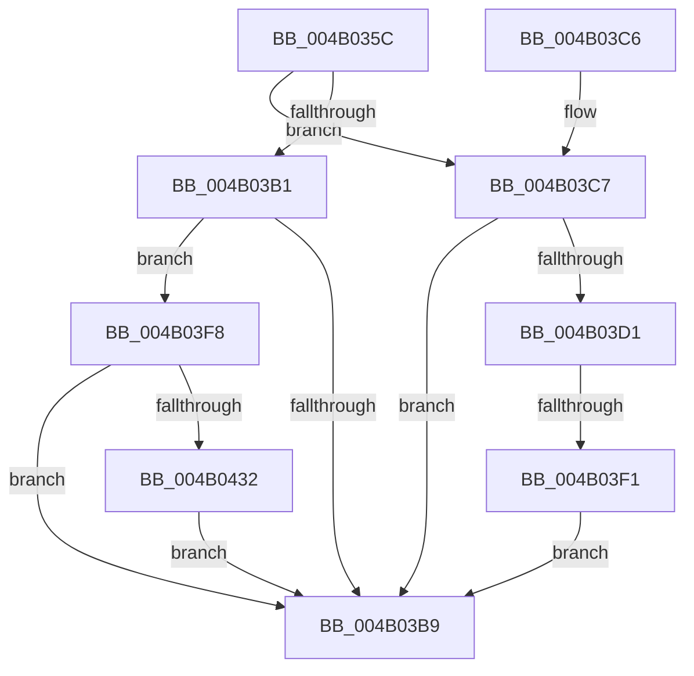

# PopFxQueryBiosDeviceName

- RVA: `0x004B035C`–`0x004B0446` (길이 `234` bytes)
- VA: `0x00000001404B035C`
- 실행 섹션: `.text`
- PDB 이름 있음: `예`; PDB Function 태그: `예`
- unwind 정보 RVA: `0x000B8908`
- 디코드: `64`개 명령, `234/234` bytes 표시
- 미해석 바이트: `0` (있으면 어셈블리에 `.byte`로 보존)

> 이 문서는 커널 이미지의 기계어와 PDB 기호를 분석해 생성했습니다. 4번과 5번은 함수 원형과 자료형을 바이너리 사용 방식에서 추정한 C 해석이며 원본 소스 복구 결과는 아닙니다.

## 1. Dependencies

- 직접 호출 지점: **3**; 고유 호출 대상: **2**
- 직접 호출자로 확인된 함수: **1**
- RIP 상대 이미지 참조: **1**

### Outgoing calls
- `0x004B03A5` → [IoGetDevicePropertyData](../../page/90/IoGetDevicePropertyData_function_009005E0.md) (function, `0x009005E0`)
- `0x004B03E0` → [ExAllocatePool2](../../poolcode/B8/ExAllocatePool2_function_00B820F0.md) (function, `0x00B820F0`)
- `0x004B0429` → [IoGetDevicePropertyData](../../page/90/IoGetDevicePropertyData_function_009005E0.md) (function, `0x009005E0`)

### Direct callers
- [PopFxFindDeviceAndAllocateUniqueId](../../page/A9/PopFxFindDeviceAndAllocateUniqueId_function_00A90D8C.md) at `0x00A90DB2`

### Static image references
- `0x004B037F` → RVA `0x0001C008` (`.rdata`; read)

## 2. Other-region calls and transfers

- 다른 실행 섹션으로 향하는 call: **3**
  - `0x004B03A5` → [IoGetDevicePropertyData](../../page/90/IoGetDevicePropertyData_function_009005E0.md) (`.text` → `PAGE`)
  - `0x004B03E0` → [ExAllocatePool2](../../poolcode/B8/ExAllocatePool2_function_00B820F0.md) (`.text` → `POOLCODE`)
  - `0x004B0429` → [IoGetDevicePropertyData](../../page/90/IoGetDevicePropertyData_function_009005E0.md) (`.text` → `PAGE`)
- call이 아닌 외부 분기/꼬리 이동: **1**
  - `0x004B03EB` → [sub_006FB214](../6F/Unknown_function_006FB214.md) (`tail-transfer`)

## 3. Assembly (complete function range)

```asm
004B035C  4C 8B DC                        mov r11, rsp
004B035F  49 89 5B 10                     mov qword ptr [r11 + 0x10], rbx
004B0363  55                              push rbp
004B0364  56                              push rsi
004B0365  57                              push rdi
004B0366  48 83 EC 40                     sub rsp, 0x40
004B036A  83 64 24 60 00                  and dword ptr [rsp + 0x60], 0
004B036F  49 8D 43 18                     lea rax, [r11 + 0x18]
004B0373  83 64 24 70 00                  and dword ptr [rsp + 0x70], 0
004B0378  48 8B F2                        mov rsi, rdx
004B037B  49 89 43 E0                     mov qword ptr [r11 - 0x20], rax
004B037F  48 8D 15 82 BC B6 FF            lea rdx, [rip - 0x49437e]
004B0386  49 8D 43 08                     lea rax, [r11 + 8]
004B038A  48 8B E9                        mov rbp, rcx
004B038D  48 8B 49 20                     mov rcx, qword ptr [rcx + 0x20]
004B0391  45 33 C9                        xor r9d, r9d
004B0394  49 89 43 D8                     mov qword ptr [r11 - 0x28], rax
004B0398  45 33 C0                        xor r8d, r8d
004B039B  49 83 63 D0 00                  and qword ptr [r11 - 0x30], 0
004B03A0  83 64 24 20 00                  and dword ptr [rsp + 0x20], 0
004B03A5  E8 36 02 45 00                  call 0x1409005e0
004B03AA  3D 23 00 00 C0                  cmp eax, 0xc0000023
004B03AF  74 16                           je 0x1404b03c7
004B03B1  33 FF                           xor edi, edi
004B03B3  33 DB                           xor ebx, ebx
004B03B5  85 C0                           test eax, eax
004B03B7  79 3F                           jns 0x1404b03f8
004B03B9  48 8B 5C 24 68                  mov rbx, qword ptr [rsp + 0x68]
004B03BE  48 83 C4 40                     add rsp, 0x40
004B03C2  5F                              pop rdi
004B03C3  5E                              pop rsi
004B03C4  5D                              pop rbp
004B03C5  C3                              ret
004B03C6  CC                              int3
004B03C7  81 7C 24 60 FE FF 00 00         cmp dword ptr [rsp + 0x60], 0xfffe
004B03CF  73 E8                           jae 0x1404b03b9
004B03D1  8B 54 24 60                     mov edx, dword ptr [rsp + 0x60]
004B03D5  B9 40 00 00 00                  mov ecx, 0x40
004B03DA  41 B8 50 46 58 4D               mov r8d, 0x4d584650
004B03E0  E8 0B 1D 6D 00                  call 0x140b820f0
004B03E5  48 8B F8                        mov rdi, rax
004B03E8  48 85 C0                        test rax, rax
004B03EB  0F 85 23 AE 24 00               jne 0x1406fb214
004B03F1  B8 9A 00 00 C0                  mov eax, 0xc000009a
004B03F6  EB C1                           jmp 0x1404b03b9
004B03F8  48 8D 4C 24 70                  lea rcx, [rsp + 0x70]
004B03FD  0F B7 C3                        movzx eax, bx
004B0400  48 89 4C 24 38                  mov qword ptr [rsp + 0x38], rcx
004B0405  48 8D 15 FC BB B6 FF            lea rdx, [rip - 0x494404]
004B040C  48 8D 4C 24 60                  lea rcx, [rsp + 0x60]
004B0411  45 33 C9                        xor r9d, r9d
004B0414  48 89 4C 24 30                  mov qword ptr [rsp + 0x30], rcx
004B0419  45 33 C0                        xor r8d, r8d
004B041C  48 8B 4D 20                     mov rcx, qword ptr [rbp + 0x20]
004B0420  48 89 7C 24 28                  mov qword ptr [rsp + 0x28], rdi
004B0425  89 44 24 20                     mov dword ptr [rsp + 0x20], eax
004B0429  E8 B2 01 45 00                  call 0x1409005e0
004B042E  85 C0                           test eax, eax
004B0430  78 87                           js 0x1404b03b9
004B0432  66 89 5E 02                     mov word ptr [rsi + 2], bx
004B0436  66 83 EB 02                     sub bx, 2
004B043A  66 89 1E                        mov word ptr [rsi], bx
004B043D  48 89 7E 08                     mov qword ptr [rsi + 8], rdi
004B0441  E9 73 FF FF FF                  jmp 0x1404b03b9
```

## 4. C-style interpretation (structured pseudocode)

```c
__int64 __fastcall PopFxQueryBiosDeviceName(__int64 a1, __int64 a2, int a3, int a4)
{
    __int64 result;
    __int64 v_rbx;
    __int64 v_rdi;
    __int64 v_rsp;
    unsigned int v_stack_m38;
    unsigned __int64 v_stack_p10;
    unsigned int v_stack_p18;
    unsigned int v_stack_p20;
    unsigned __int64 v_stack_p28;
    unsigned __int64 v_stack_p30;
    unsigned __int64 v_stack_p38;
    unsigned int v_stack_p60;
    unsigned __int64 v_stack_p70;
    unsigned int v_stack_p8;

    *(unsigned __int64 *)(v_rsp + 16) = v_rbx;
    v_rsp = (v_rsp) - (64);
    *(unsigned __int64 *)(v_rsp - 32) = v_rsp + 24;
    a4 = 0;
    *(unsigned __int64 *)(v_rsp - 40) = v_rsp + 8;
    a3 = 0;
    result = IoGetDevicePropertyData(*(unsigned __int64 *)(a1 + 32), v_rip - 4801406, a3, a4);
    if (((unsigned int)(result)) == 0xC0000023ULL) goto loc_004B03C7;
    v_rdi = 0;
    v_rbx = 0;
    if (!sign_flag) goto loc_004B03F8;
loc_004B03B9:
    v_rsp = (v_rsp) + (64);
    return result;
loc_004B03C7:
    if (v_stack_p60 >= 0xFFFEULL) goto loc_004B03B9;
    result = ExAllocatePool2(64, (unsigned int)(v_stack_p60), (unsigned int)(0x4D584650ULL), a4);
    goto loc_004B03B9;
loc_004B03F8:
    v_stack_p38 = v_stack_p70;
    a4 = 0;
    v_stack_p30 = v_stack_p60;
    a3 = 0;
    v_stack_p28 = result;
    v_stack_p20 = (unsigned int)((unsigned __int16)(v_stack_p10));
    result = IoGetDevicePropertyData(*(unsigned __int64 *)(a1 + 32), v_rip - 4801540, a3, a4);
    if (sign_flag) goto loc_004B03B9;
    *(unsigned __int16 *)(a2 + 2) = (unsigned __int16)(v_stack_p10);
    v_rbx = (unsigned __int16)((v_stack_p10) - (2));
    *(unsigned __int16 *)(a2) = (unsigned __int16)(v_rbx);
    *(unsigned __int64 *)(a2 + 8) = result;
    goto loc_004B03B9;
}
```

## 5. (Beta) C Style

```c
int64_t PopFxQueryBiosDeviceName(void *Arg1, void *Arg2, int32_t Arg3, int32_t Arg4)
{
    uint8_t *arg1 = (uint8_t *)Arg1;
    uint8_t *arg2 = (uint8_t *)Arg2;

    int64_t result;
    int64_t local_rbx;
    int64_t local_rdi;
    int64_t local_rsp;
    uint32_t v_stack_m38;
    uint64_t v_stack_p10;
    uint32_t v_stack_p18;
    uint32_t v_stack_p20;
    uint64_t v_stack_p28;
    uint64_t v_stack_p30;
    uint64_t v_stack_p38;
    uint32_t v_stack_p60;
    uint64_t v_stack_p70;
    uint32_t v_stack_p8;

    *(uint64_t *)(local_rsp + 0x10) = local_rbx;
    local_rsp = (local_rsp) - (64);
    *(uint64_t *)(local_rsp - 0x20) = local_rsp + 24;
    Arg4 = 0;
    *(uint64_t *)(local_rsp - 0x28) = local_rsp + 8;
    Arg3 = 0;
    result = IoGetDevicePropertyData(*(uint64_t *)(arg1 + 0x20), v_rip - 4801406, Arg3, Arg4);
    if (((uint32_t)(result)) == 0xC0000023ULL) goto loc_004B03C7;
    local_rdi = 0;
    local_rbx = 0;
    if (!sign_flag) goto loc_004B03F8;
loc_004B03B9:
    local_rsp = (local_rsp) + (64);
    return result;
loc_004B03C7:
    if (v_stack_p60 >= 0xFFFEULL) goto loc_004B03B9;
    result = ExAllocatePool2(64, (uint32_t)(v_stack_p60), (uint32_t)(0x4D584650ULL), Arg4);
    goto loc_004B03B9;
loc_004B03F8:
    v_stack_p38 = v_stack_p70;
    Arg4 = 0;
    v_stack_p30 = v_stack_p60;
    Arg3 = 0;
    v_stack_p28 = result;
    v_stack_p20 = (uint32_t)((uint16_t)(v_stack_p10));
    result = IoGetDevicePropertyData(*(uint64_t *)(arg1 + 0x20), v_rip - 4801540, Arg3, Arg4);
    if (sign_flag) goto loc_004B03B9;
    *(uint16_t *)(arg2 + 0x2) = (uint16_t)(v_stack_p10);
    local_rbx = (uint16_t)((v_stack_p10) - (2));
    *(uint16_t *)(arg2) = (uint16_t)(local_rbx);
    *(uint64_t *)(arg2 + 0x8) = result;
    goto loc_004B03B9;
}
```

### 관측된 메모리 오프셋

구조체 형식이 확인되지 않은 접근은 인자 기준의 오프셋으로만 기록했습니다.

| 기준 인자 | 오프셋 표현 | 폭 (bit) | 접근 |
|---|---:|---:|---|
| `Arg1` | `+ 0x20` | `64` | `R` |
| `Arg2` | `+ 0x0` | `16` | `W` |
| `Arg2` | `+ 0x2` | `16` | `W` |
| `Arg2` | `+ 0x8` | `64` | `W` |

## 6. Execution-region graph

[열기: 2D/3D 그래프와 함수 탐색 컨트롤 패널](../../../control-panel.html?section=text&rva=0x004B035C&view=graph)

- 2D 그래프는 위에서 아래로 흐르고, 3D 그래프는 빈 공간을 드래그해 회전합니다. Shift+드래그는 이동, 휠은 확대·축소, 함수 노드 선택은 대상 보고서 이동입니다.

### Static fallback


