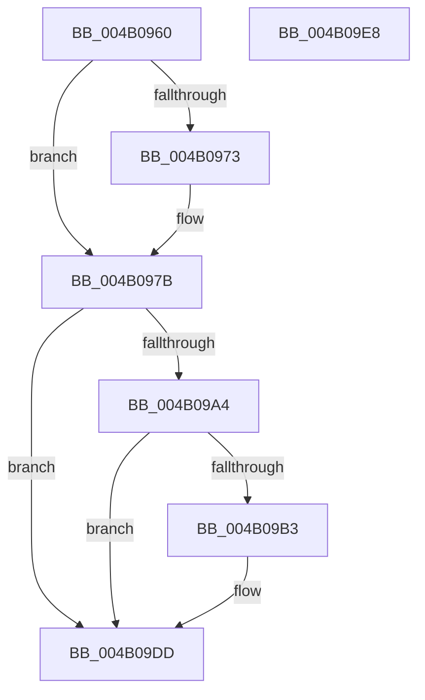

# PopFxReinitializeAccountingInstance

- RVA: `0x004B0960`–`0x004B09E9` (길이 `137` bytes)
- VA: `0x00000001404B0960`
- 실행 섹션: `.text`
- PDB 이름 있음: `예`; PDB Function 태그: `아니요`
- unwind 정보 RVA: `0x0005CAAC`
- 디코드: `36`개 명령, `137/137` bytes 표시
- 미해석 바이트: `0` (있으면 어셈블리에 `.byte`로 보존)

> 이 문서는 커널 이미지의 기계어와 PDB 기호를 분석해 생성했습니다. 4번과 5번은 함수 원형과 자료형을 바이너리 사용 방식에서 추정한 C 해석이며 원본 소스 복구 결과는 아닙니다.

## 1. Dependencies

- 직접 호출 지점: **3**; 고유 호출 대상: **2**
- 직접 호출자로 확인된 함수: **5**
- RIP 상대 이미지 참조: **6**

### Outgoing calls
- `0x004B0985` → [memset](../6C/memset_function_006C6C40.md) (function, `0x006C6C40`)
- `0x004B0997` → [memset](../6C/memset_function_006C6C40.md) (function, `0x006C6C40`)
- `0x004B09D8` → [ExQueueWorkItem](../2F/ExQueueWorkItem_function_002F9520.md) (function, `0x002F9520`)

### Direct callers
- [PopFxClearDeviceConstraints](PopFxClearDeviceConstraints_function_004B05F8.md) at `0x004B06BB`
- [PopFxClearDeviceConstraints](PopFxClearDeviceConstraints_function_004B05F8.md) at `0x004B070C`
- [PopPepUpdateDripsDeviceVetoMask](PopPepUpdateDripsDeviceVetoMask_function_004B079C.md) at `0x004B089A`
- [PopPepUpdateDripsDeviceVetoMask](PopPepUpdateDripsDeviceVetoMask_function_004B079C.md) at `0x004B092C`
- [PopPepInitializeVetoMasks](../4C/PopPepInitializeVetoMasks_function_004C9350.md) at `0x004C9614`
- [PopPepInitializeVetoMasks](../4C/PopPepInitializeVetoMasks_function_004C9350.md) at `0x004C97AC`
- [PopFxDisableBasicAccountingWorker](../5D/PopFxDisableBasicAccountingWorker_function_005D28D0.md) at `0x005D2987`
- [sub_006FBB10](../6F/Unknown_function_006FBB10.md) at `0x006FBB42`

### Static image references
- `0x004B09A9` → RVA `0x00E676AC` (`.data`; read/write)
- `0x004B09B3` → RVA `0x00F0E758` (`.data`; read/write)
- `0x004B09BB` → RVA `0x005D28D0` (`PopFxDisableBasicAccountingWorker`; read)
- `0x004B09C2` → RVA `0x00F0E740` (`.data`; read/write)
- `0x004B09CA` → RVA `0x00F0E740` (`.data`; read)
- `0x004B09D1` → RVA `0x00F0E750` (`.data`; write)

## 2. Other-region calls and transfers

- 다른 실행 섹션으로 향하는 call: **0**
- 별도 외부 분기/꼬리 이동을 확인하지 못했습니다.

## 3. Assembly (complete function range)

```asm
004B0960  48 89 5C 24 08                  mov qword ptr [rsp + 8], rbx
004B0965  57                              push rdi
004B0966  48 83 EC 20                     sub rsp, 0x20
004B096A  8B FA                           mov edi, edx
004B096C  48 8B D9                        mov rbx, rcx
004B096F  85 D2                           test edx, edx
004B0971  75 08                           jne 0x1404b097b
004B0973  48 83 61 18 00                  and qword ptr [rcx + 0x18], 0
004B0978  88 51 08                        mov byte ptr [rcx + 8], dl
004B097B  33 D2                           xor edx, edx
004B097D  48 83 C1 20                     add rcx, 0x20
004B0981  44 8D 42 60                     lea r8d, [rdx + 0x60]
004B0985  E8 B6 62 21 00                  call 0x1406c6c40
004B098A  33 D2                           xor edx, edx
004B098C  48 8D 8B 80 00 00 00            lea rcx, [rbx + 0x80]
004B0993  44 8D 42 60                     lea r8d, [rdx + 0x60]
004B0997  E8 A4 62 21 00                  call 0x1406c6c40
004B099C  89 7B 10                        mov dword ptr [rbx + 0x10], edi
004B099F  83 FF 02                        cmp edi, 2
004B09A2  75 39                           jne 0x1404b09dd
004B09A4  8D 57 FF                        lea edx, [rdi - 1]
004B09A7  8B C2                           mov eax, edx
004B09A9  87 05 FD 6C 9B 00               xchg dword ptr [rip + 0x9b6cfd], eax
004B09AF  85 C0                           test eax, eax
004B09B1  75 2A                           jne 0x1404b09dd
004B09B3  48 83 25 9D DD A5 00 00         and qword ptr [rip + 0xa5dd9d], 0
004B09BB  48 8D 05 0E 1F 12 00            lea rax, [rip + 0x121f0e]
004B09C2  48 83 25 76 DD A5 00 00         and qword ptr [rip + 0xa5dd76], 0
004B09CA  48 8D 0D 6F DD A5 00            lea rcx, [rip + 0xa5dd6f]
004B09D1  48 89 05 78 DD A5 00            mov qword ptr [rip + 0xa5dd78], rax
004B09D8  E8 43 8B E4 FF                  call 0x1402f9520
004B09DD  48 8B 5C 24 30                  mov rbx, qword ptr [rsp + 0x30]
004B09E2  48 83 C4 20                     add rsp, 0x20
004B09E6  5F                              pop rdi
004B09E7  C3                              ret
004B09E8  CC                              int3
```

## 4. C-style interpretation (structured pseudocode)

```c
__int64 __fastcall PopFxReinitializeAccountingInstance(__int64 a1, int a2)
{
    __int64 result;
    __int64 v_rsp;
    unsigned __int64 v_stack_p8;

    v_stack_p8 = v_rbx;
    v_rsp = (v_rsp) - (32);
    if (a2 == 0) {
        *(unsigned __int8 *)(a1 + 8) = (unsigned __int8)(a2);
    }
    a2 = 0;
    a1 = (a1) + (32);
    result = memset(a1, a2, a2 + 96, a4);
    a2 = 0;
    result = memset(a1 + 128, a2, a2 + 96, a4);
    *(unsigned int *)(a1 + 16) = (unsigned int)((unsigned int)(a2));
    if (((unsigned int)((unsigned int)(a2))) != 2) goto loc_004B09DD;
    result = (unsigned int)((unsigned int)((unsigned int)(a2) - 1));
    if ((unsigned int)((unsigned int)((unsigned int)((unsigned int)(a2) - 1))) == 0) {
        result = v_rip + 1187598;
        a1 = v_rip + 10870127;
        *(unsigned __int64 *)(v_rip + 10870136) = result;
        result = ExQueueWorkItem(a1, (unsigned int)(a2) - 1, a2 + 96, a4);
    }
    v_rsp = (v_rsp) + (32);
    return result;
}
```

## 5. (Beta) C Style

```c
int64_t PopFxReinitializeAccountingInstance(void *Arg1, int32_t Arg2)
{
    uint8_t *arg1 = (uint8_t *)Arg1;

    int64_t result;
    int64_t local_rsp;
    uint64_t v_stack_p8;

    v_stack_p8 = local_rbx;
    local_rsp = (local_rsp) - (32);
    if (Arg2 == 0) {
        *(uint8_t *)(arg1 + 0x8) = (uint8_t)(Arg2);
    }
    Arg2 = 0;
    Arg1 = (Arg1) + (32);
    result = memset(Arg1, Arg2, Arg2 + 96, a4);
    Arg2 = 0;
    result = memset(Arg1 + 128, Arg2, Arg2 + 96, a4);
    *(uint32_t *)(arg1 + 0x10) = (uint32_t)((uint32_t)(Arg2));
    if (((uint32_t)((uint32_t)(Arg2))) != 2) goto loc_004B09DD;
    result = (uint32_t)((uint32_t)((uint32_t)(Arg2) - 1));
    if ((uint32_t)((uint32_t)((uint32_t)((uint32_t)(Arg2) - 1))) == 0) {
        result = v_rip + 1187598;
        Arg1 = v_rip + 10870127;
        *(uint64_t *)(v_rip + 0xA5DD78) = result;
        result = ExQueueWorkItem(Arg1, (uint32_t)(Arg2) - 1, Arg2 + 96, a4);
    }
    local_rsp = (local_rsp) + (32);
    return result;
}
```

### 관측된 메모리 오프셋

구조체 형식이 확인되지 않은 접근은 인자 기준의 오프셋으로만 기록했습니다.

| 기준 인자 | 오프셋 표현 | 폭 (bit) | 접근 |
|---|---:|---:|---|
| `Arg1` | `+ 0x8` | `8` | `W` |
| `Arg1` | `+ 0x10` | `32` | `W` |
| `Arg1` | `+ 0x18` | `64` | `R/W` |
| `Arg1` | `+ 0x80` | `64` | `R` |

## 6. Execution-region graph

[열기: 2D/3D 그래프와 함수 탐색 컨트롤 패널](../../../control-panel.html?section=text&rva=0x004B0960&view=graph)

- 2D 그래프는 위에서 아래로 흐르고, 3D 그래프는 빈 공간을 드래그해 회전합니다. Shift+드래그는 이동, 휠은 확대·축소, 함수 노드 선택은 대상 보고서 이동입니다.

### Static fallback


