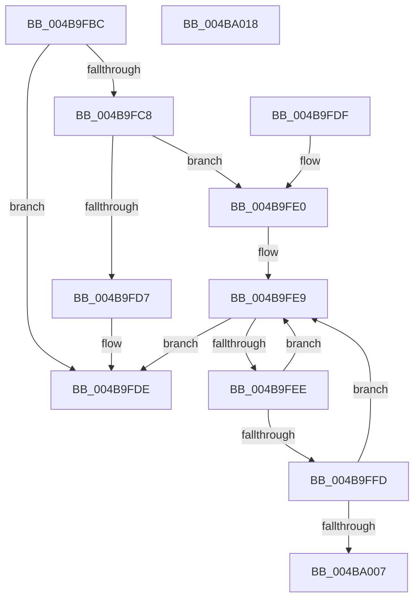

# PopFxUpdateGlobalDeviceAccountingInfo

- RVA: `0x004B9FBC`–`0x004BA019` (길이 `93` bytes)
- VA: `0x00000001404B9FBC`
- 실행 섹션: `.text`
- PDB 이름 있음: `예`; PDB Function 태그: `아니요`
- unwind 정보 RVA: `0x000DB714`
- 디코드: `24`개 명령, `93/93` bytes 표시
- 미해석 바이트: `0` (있으면 어셈블리에 `.byte`로 보존)

> 이 문서는 커널 이미지의 기계어와 PDB 기호를 분석해 생성했습니다. 4번과 5번은 함수 원형과 자료형을 바이너리 사용 방식에서 추정한 C 해석이며 원본 소스 복구 결과는 아닙니다.

## 1. Dependencies

- 직접 호출 지점: **0**; 고유 호출 대상: **0**
- 직접 호출자로 확인된 함수: **2**
- RIP 상대 이미지 참조: **4**

### Outgoing calls
- 직접 디코드된 call 명령이 없습니다.

### Direct callers
- [PopFxSetDripsBlockedByDeviceActivity](../30/PopFxSetDripsBlockedByDeviceActivity_function_00304154.md) at `0x003041CA`
- [PopFxSetGlobalDeviceAccountingEnabled](../43/PopFxSetGlobalDeviceAccountingEnabled_function_0043D678.md) at `0x0043D6C9`

### Static image references
- `0x004B9FBC` → RVA `0x00F0E6C8` (`.data`; read)
- `0x004B9FCB` → RVA `0x00F0E6D0` (`.data`; read/write)
- `0x004B9FD7` → RVA `0x00F0E6D8` (`.data`; read/write)
- `0x004B9FE2` → RVA `0x00000000` (`image boundary/outside`; read)

## 2. Other-region calls and transfers

- 다른 실행 섹션으로 향하는 call: **0**
- 별도 외부 분기/꼬리 이동을 확인하지 못했습니다.

## 3. Assembly (complete function range)

```asm
004B9FBC  48 8B 05 05 47 A5 00            mov rax, qword ptr [rip + 0xa54705]
004B9FC3  48 3B C1                        cmp rax, rcx
004B9FC6  73 16                           jae 0x1404b9fde
004B9FC8  48 2B C8                        sub rcx, rax
004B9FCB  48 01 0D FE 46 A5 00            add qword ptr [rip + 0xa546fe], rcx
004B9FD2  48 3B CA                        cmp rcx, rdx
004B9FD5  73 09                           jae 0x1404b9fe0
004B9FD7  48 01 0D FA 46 A5 00            add qword ptr [rip + 0xa546fa], rcx
004B9FDE  C3                              ret
004B9FDF  CC                              int3
004B9FE0  33 D2                           xor edx, edx
004B9FE2  4C 8D 0D 17 60 B4 FF            lea r9, [rip - 0x4b9fe9]
004B9FE9  83 FA 05                        cmp edx, 5
004B9FEC  73 F0                           jae 0x1404b9fde
004B9FEE  44 8B C2                        mov r8d, edx
004B9FF1  FF C2                           inc edx
004B9FF3  4B 3B 8C C1 D8 94 02 00         cmp rcx, qword ptr [r9 + r8*8 + 0x294d8]
004B9FFB  72 EC                           jb 0x1404b9fe9
004B9FFD  49 3B 8C D1 D8 94 02 00         cmp rcx, qword ptr [r9 + rdx*8 + 0x294d8]
004BA005  73 E2                           jae 0x1404b9fe9
004BA007  4B FF 84 C1 E0 E6 F0 00         inc qword ptr [r9 + r8*8 + 0xf0e6e0]
004BA00F  4B 01 8C C1 08 E7 F0 00         add qword ptr [r9 + r8*8 + 0xf0e708], rcx
004BA017  C3                              ret
004BA018  CC                              int3
```

## 4. C-style interpretation (structured pseudocode)

```c
__int64 __fastcall PopFxUpdateGlobalDeviceAccountingInfo(__int64 a1, __int64 a2)
{
    if ((*(unsigned __int64 *)(v_rip + 10831621)) >= a1) goto loc_004B9FDE;
    a1 = (a1) - (*(unsigned __int64 *)(v_rip + 10831621));
    if (a1 >= a2) goto loc_004B9FE0;
loc_004B9FDE:
    return *(unsigned __int64 *)(v_rip + 10831621);
loc_004B9FE0:
    a2 = 0;
loc_004B9FE9:
    if (0 >= 5) goto loc_004B9FDE;
    a2 = (unsigned int)((a2) + 1);
    if (a1 < (*(unsigned __int64 *)(v_rip - 4956137 + 0 * 8 + 169176))) goto loc_004B9FE9;
    if (a1 >= (*(unsigned __int64 *)(v_rip - 4956137 + a2 * 8 + 169176))) goto loc_004B9FE9;
    return *(unsigned __int64 *)(v_rip + 10831621);
}
```

## 5. (Beta) C Style

```c
int64_t PopFxUpdateGlobalDeviceAccountingInfo(int64_t Arg1, int64_t Arg2)
{
    if ((*(uint64_t *)(v_rip + 0xA54705)) >= Arg1) goto loc_004B9FDE;
    Arg1 = (Arg1) - (*(uint64_t *)(v_rip + 0xA54705));
    if (Arg1 >= Arg2) goto loc_004B9FE0;
loc_004B9FDE:
    return *(uint64_t *)(v_rip + 0xA54705);
loc_004B9FE0:
    Arg2 = 0;
loc_004B9FE9:
    if (0 >= 5) goto loc_004B9FDE;
    Arg2 = (uint32_t)((Arg2) + 1);
    if (Arg1 < (*(uint64_t *)(v_rip - 0x4B9FE9 + 0x0 * 8 + 0x294D8))) goto loc_004B9FE9;
    if (Arg1 >= (*(uint64_t *)(v_rip - 0x4B9FE9 + Arg2 * 8 + 0x294D8))) goto loc_004B9FE9;
    return *(uint64_t *)(v_rip + 0xA54705);
}
```

## 6. Execution-region graph

[열기: 2D/3D 그래프와 함수 탐색 컨트롤 패널](../../../control-panel.html?section=text&rva=0x004B9FBC&view=graph)

- 2D 그래프는 위에서 아래로 흐르고, 3D 그래프는 빈 공간을 드래그해 회전합니다. Shift+드래그는 이동, 휠은 확대·축소, 함수 노드 선택은 대상 보고서 이동입니다.

### Static fallback


