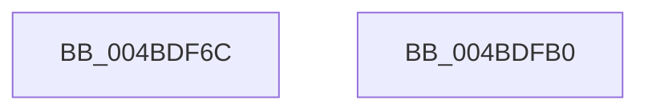

# PopGetModernStandbyTransitionReason

- RVA: `0x004BDF6C`–`0x004BDFB1` (길이 `69` bytes)
- VA: `0x00000001404BDF6C`
- 실행 섹션: `.text`
- PDB 이름 있음: `예`; PDB Function 태그: `아니요`
- unwind 정보 RVA: `0x0005CAAC`
- 디코드: `18`개 명령, `69/69` bytes 표시
- 미해석 바이트: `0` (있으면 어셈블리에 `.byte`로 보존)

> 이 문서는 커널 이미지의 기계어와 PDB 기호를 분석해 생성했습니다. 4번과 5번은 함수 원형과 자료형을 바이너리 사용 방식에서 추정한 C 해석이며 원본 소스 복구 결과는 아닙니다.

## 1. Dependencies

- 직접 호출 지점: **2**; 고유 호출 대상: **2**
- 직접 호출자로 확인된 함수: **3**
- RIP 상대 이미지 참조: **3**

### Outgoing calls
- `0x004BDF80` → [KeAcquireSpinLockRaiseToDpc](../20/KeAcquireSpinLockRaiseToDpc_function_00208470.md) (function, `0x00208470`)
- `0x004BDF9E` → [KeReleaseSpinLock](../39/KeReleaseSpinLock_function_00392BA0.md) (function, `0x00392BA0`)

### Direct callers
- [PopCaptureSleepStudyStatistics](../43/PopCaptureSleepStudyStatistics_function_004399F4.md) at `0x00439EA1`
- [PopDiagTraceSleepStudyStart](../../page/76/PopDiagTraceSleepStudyStart_function_00762FC0.md) at `0x0076304C`
- [PopIdleCsStateChanged](../../page/AD/PopIdleCsStateChanged_function_00AD9DE0.md) at `0x00AD9DF5`

### Static image references
- `0x004BDF79` → RVA `0x00E0B840` (`.data`; read)
- `0x004BDF85` → RVA `0x00E0B850` (`.data`; read)
- `0x004BDF97` → RVA `0x00E0B84C` (`.data`; read)

## 2. Other-region calls and transfers

- 다른 실행 섹션으로 향하는 call: **0**
- 별도 외부 분기/꼬리 이동을 확인하지 못했습니다.

## 3. Assembly (complete function range)

```asm
004BDF6C  48 89 5C 24 08                  mov qword ptr [rsp + 8], rbx
004BDF71  57                              push rdi
004BDF72  48 83 EC 20                     sub rsp, 0x20
004BDF76  40 8A F9                        mov dil, cl
004BDF79  48 8D 0D C0 D8 94 00            lea rcx, [rip + 0x94d8c0]
004BDF80  E8 EB A4 D4 FF                  call 0x140208470
004BDF85  8B 1D C5 D8 94 00               mov ebx, dword ptr [rip + 0x94d8c5]
004BDF8B  48 8D 0D AE D8 94 00            lea rcx, [rip + 0x94d8ae]
004BDF92  40 84 FF                        test dil, dil
004BDF95  8A D0                           mov dl, al
004BDF97  0F 45 1D AE D8 94 00            cmovne ebx, dword ptr [rip + 0x94d8ae]
004BDF9E  E8 FD 4B ED FF                  call 0x140392ba0
004BDFA3  8B C3                           mov eax, ebx
004BDFA5  48 8B 5C 24 30                  mov rbx, qword ptr [rsp + 0x30]
004BDFAA  48 83 C4 20                     add rsp, 0x20
004BDFAE  5F                              pop rdi
004BDFAF  C3                              ret
004BDFB0  CC                              int3
```

## 4. C-style interpretation (structured pseudocode)

```c
__int64 __fastcall PopGetModernStandbyTransitionReason(unsigned __int8 a1)
{
    __int64 result;
    __int64 v_rbx;
    __int64 v_rsp;
    unsigned __int64 v_stack_p8;

    v_stack_p8 = v_rbx;
    v_rsp = (v_rsp) - (32);
    result = KeAcquireSpinLockRaiseToDpc(v_rip + 9754816, a2, a3, a4);
    v_rbx = (unsigned int)(*(unsigned int *)(v_rip + 9754821));
    if (a1 != 0) { v_rbx = *(unsigned int *)(v_rip + 9754798); }
    result = KeReleaseSpinLock(v_rip + 9754798, (unsigned __int8)(result), a3, a4);
    v_rsp = (v_rsp) + (32);
    return (unsigned int)((unsigned int)(v_rbx));
}
```

## 5. (Beta) C Style

```c
int64_t PopGetModernStandbyTransitionReason(uint8_t Arg1)
{
    int64_t result;
    int64_t local_rbx;
    int64_t local_rsp;
    uint64_t v_stack_p8;

    v_stack_p8 = local_rbx;
    local_rsp = (local_rsp) - (32);
    result = KeAcquireSpinLockRaiseToDpc(v_rip + 9754816, a2, a3, a4);
    local_rbx = (uint32_t)(*(uint32_t *)(v_rip + 0x94D8C5));
    if (Arg1 != 0) { local_rbx = *(uint32_t *)(v_rip + 0x94D8AE); }
    result = KeReleaseSpinLock(v_rip + 9754798, (uint8_t)(result), a3, a4);
    local_rsp = (local_rsp) + (32);
    return (uint32_t)((uint32_t)(local_rbx));
}
```

## 6. Execution-region graph

[열기: 2D/3D 그래프와 함수 탐색 컨트롤 패널](../../../control-panel.html?section=text&rva=0x004BDF6C&view=graph)

- 2D 그래프는 위에서 아래로 흐르고, 3D 그래프는 빈 공간을 드래그해 회전합니다. Shift+드래그는 이동, 휠은 확대·축소, 함수 노드 선택은 대상 보고서 이동입니다.

### Static fallback


