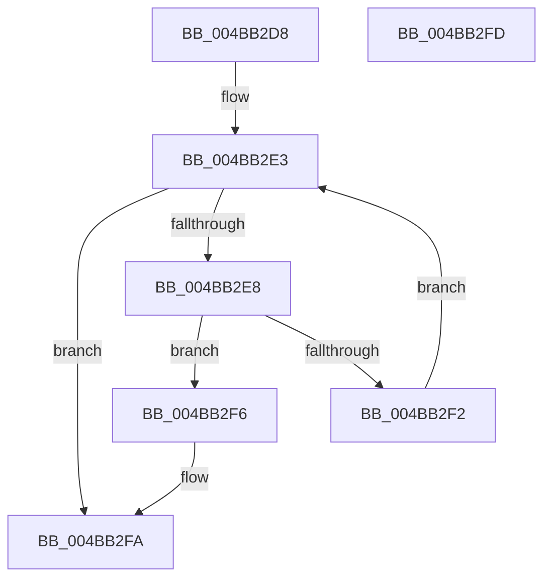

# PopGetMonitorReasonFromPowerEventId

- RVA: `0x004BB2D8`–`0x004BB2FE` (길이 `38` bytes)
- VA: `0x00000001404BB2D8`
- 실행 섹션: `.text`
- PDB 이름 있음: `예`; PDB Function 태그: `아니요`
- unwind 정보 RVA: `0x000DB714`
- 디코드: `14`개 명령, `38/38` bytes 표시
- 미해석 바이트: `0` (있으면 어셈블리에 `.byte`로 보존)

> 이 문서는 커널 이미지의 기계어와 PDB 기호를 분석해 생성했습니다. 4번과 5번은 함수 원형과 자료형을 바이너리 사용 방식에서 추정한 C 해석이며 원본 소스 복구 결과는 아닙니다.

## 1. Dependencies

- 직접 호출 지점: **0**; 고유 호출 대상: **0**
- 직접 호출자로 확인된 함수: **5**
- RIP 상대 이미지 참조: **1**

### Outgoing calls
- 직접 디코드된 call 명령이 없습니다.

### Direct callers
- [PopPowerAggregatorActiveToScreenOffStateHandler](../../page/76/PopPowerAggregatorActiveToScreenOffStateHandler_function_007642F0.md) at `0x00764320`
- [PopPowerAggregatorEngageModernStandby](../../page/76/PopPowerAggregatorEngageModernStandby_function_00764784.md) at `0x00764796`
- [PopPowerAggregatorSystemTransitionEnterStateHandler](../../page/76/PopPowerAggregatorSystemTransitionEnterStateHandler_function_007650E0.md) at `0x007650F6`
- [PopPowerAggregatorEnterScreenOff](../../page/98/PopPowerAggregatorEnterScreenOff_function_00989F38.md) at `0x0098A045`
- [PopPowerAggregatorDisplayPoweringOnStateHandler](../../page/AC/PopPowerAggregatorDisplayPoweringOnStateHandler_function_00AC1BA0.md) at `0x00AC1BD7`

### Static image references
- `0x004BB2DA` → RVA `0x00FC5A00` (`ALMOSTRO`; read)

## 2. Other-region calls and transfers

- 다른 실행 섹션으로 향하는 call: **0**
- 별도 외부 분기/꼬리 이동을 확인하지 못했습니다.

## 3. Assembly (complete function range)

```asm
004BB2D8  33 D2                           xor edx, edx
004BB2DA  4C 8D 0D 1F A7 B0 00            lea r9, [rip + 0xb0a71f]
004BB2E1  8B C2                           mov eax, edx
004BB2E3  83 F8 3A                        cmp eax, 0x3a
004BB2E6  73 12                           jae 0x1404bb2fa
004BB2E8  44 8B C0                        mov r8d, eax
004BB2EB  43 39 4C C1 04                  cmp dword ptr [r9 + r8*8 + 4], ecx
004BB2F0  74 04                           je 0x1404bb2f6
004BB2F2  FF C0                           inc eax
004BB2F4  EB ED                           jmp 0x1404bb2e3
004BB2F6  43 8B 14 C1                     mov edx, dword ptr [r9 + r8*8]
004BB2FA  8B C2                           mov eax, edx
004BB2FC  C3                              ret
004BB2FD  CC                              int3
```

## 4. C-style interpretation (structured pseudocode)

```c
__int64 __fastcall PopGetMonitorReasonFromPowerEventId(int a1, int a2)
{
    __int64 result;

    a2 = 0;
loc_004BB2E3:
    if (0 >= 58) goto loc_004BB2FA;
    if ((*(unsigned int *)(v_rip + 11577119 + 0 * 8 + 4)) == a1) goto loc_004BB2F6;
    result = (unsigned int)((0) + 1);
    goto loc_004BB2E3;
loc_004BB2F6:
loc_004BB2FA:
    return (unsigned int)((unsigned int)((unsigned int)(*(unsigned int *)(v_rip + 11577119 + 0 * 8))));
}
```

## 5. (Beta) C Style

```c
int64_t PopGetMonitorReasonFromPowerEventId(int32_t Arg1, int32_t Arg2)
{
    int64_t result;

    Arg2 = 0;
loc_004BB2E3:
    if (0 >= 58) goto loc_004BB2FA;
    if ((*(uint32_t *)(v_rip + 0xB0A71F + 0x0 * 8 + 0x4)) == Arg1) goto loc_004BB2F6;
    result = (uint32_t)((0) + 1);
    goto loc_004BB2E3;
loc_004BB2F6:
loc_004BB2FA:
    return (uint32_t)((uint32_t)((uint32_t)(*(uint32_t *)(v_rip + 0xB0A71F + 0x0 * 8))));
}
```

## 6. Execution-region graph

[열기: 2D/3D 그래프와 함수 탐색 컨트롤 패널](../../../control-panel.html?section=text&rva=0x004BB2D8&view=graph)

- 2D 그래프는 위에서 아래로 흐르고, 3D 그래프는 빈 공간을 드래그해 회전합니다. Shift+드래그는 이동, 휠은 확대·축소, 함수 노드 선택은 대상 보고서 이동입니다.

### Static fallback


