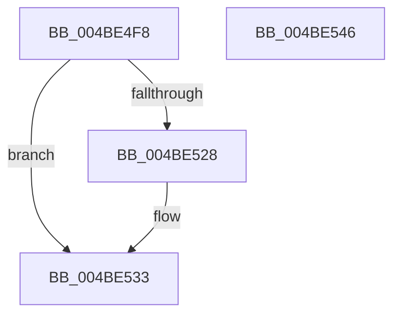

# PopGetMostRecentWakeInfo

- RVA: `0x004BE4F8`–`0x004BE547` (길이 `79` bytes)
- VA: `0x00000001404BE4F8`
- 실행 섹션: `.text`
- PDB 이름 있음: `예`; PDB Function 태그: `아니요`
- unwind 정보 RVA: `0x000697A4`
- 디코드: `21`개 명령, `79/79` bytes 표시
- 미해석 바이트: `0` (있으면 어셈블리에 `.byte`로 보존)

> 이 문서는 커널 이미지의 기계어와 PDB 기호를 분석해 생성했습니다. 4번과 5번은 함수 원형과 자료형을 바이너리 사용 방식에서 추정한 C 해석이며 원본 소스 복구 결과는 아닙니다.

## 1. Dependencies

- 직접 호출 지점: **2**; 고유 호출 대상: **2**
- 직접 호출자로 확인된 함수: **5**
- RIP 상대 이미지 참조: **3**

### Outgoing calls
- `0x004BE51B` → [KeAcquireInStackQueuedSpinLock](../27/KeAcquireInStackQueuedSpinLock_function_002757A0.md) (function, `0x002757A0`)
- `0x004BE538` → [KeReleaseInStackQueuedSpinLock](../34/KeReleaseInStackQueuedSpinLock_function_00342CE0.md) (function, `0x00342CE0`)

### Direct callers
- [PopQueryMostRecentWakeSourceInfo](../../page/75/PopQueryMostRecentWakeSourceInfo_function_0075C630.md) at `0x0075C6CE`
- [PopPowerAggregatorHandleSystemTransitionEndIntent](../../page/76/PopPowerAggregatorHandleSystemTransitionEndIntent_function_00764B30.md) at `0x00764B67`
- [PopPowerAggregatorHandleSystemTransitionEndIntent](../../page/76/PopPowerAggregatorHandleSystemTransitionEndIntent_function_00764B30.md) at `0x00764BA2`
- [PopPotsLogPowerTransitionReliability](../../page/AA/PopPotsLogPowerTransitionReliability_function_00AAE1C4.md) at `0x00AAE22A`
- [PopQueryMostRecentWakeSourceAttributes](../../page/AB/PopQueryMostRecentWakeSourceAttributes_function_00AB437C.md) at `0x00AB439D`
- [PopIsMostRecentWakeAttended](../../pagelk/B7/PopIsMostRecentWakeAttended_function_00B7D6C8.md) at `0x00B7D6D0`

### Static image references
- `0x004BE508` → RVA `0x00F0DEA8` (`.data`; read)
- `0x004BE520` → RVA `0x00F0DEA0` (`.data`; read)
- `0x004BE528` → RVA `0x00F0DE98` (`.data`; read)

## 2. Other-region calls and transfers

- 다른 실행 섹션으로 향하는 call: **0**
- 별도 외부 분기/꼬리 이동을 확인하지 못했습니다.

## 3. Assembly (complete function range)

```asm
004BE4F8  40 53                           push rbx
004BE4FA  48 83 EC 40                     sub rsp, 0x40
004BE4FE  0F 57 C0                        xorps xmm0, xmm0
004BE501  48 8D 54 24 20                  lea rdx, [rsp + 0x20]
004BE506  33 C0                           xor eax, eax
004BE508  48 8D 0D 99 F9 A4 00            lea rcx, [rip + 0xa4f999]
004BE50F  0F 11 44 24 20                  movups xmmword ptr [rsp + 0x20], xmm0
004BE514  48 89 44 24 30                  mov qword ptr [rsp + 0x30], rax
004BE519  33 DB                           xor ebx, ebx
004BE51B  E8 80 72 DB FF                  call 0x1402757a0
004BE520  39 1D 7A F9 A4 00               cmp dword ptr [rip + 0xa4f97a], ebx
004BE526  74 0B                           je 0x1404be533
004BE528  48 8B 1D 69 F9 A4 00            mov rbx, qword ptr [rip + 0xa4f969]
004BE52F  F0 FF 43 10                     lock inc dword ptr [rbx + 0x10]
004BE533  48 8D 4C 24 20                  lea rcx, [rsp + 0x20]
004BE538  E8 A3 47 E8 FF                  call 0x140342ce0
004BE53D  48 8B C3                        mov rax, rbx
004BE540  48 83 C4 40                     add rsp, 0x40
004BE544  5B                              pop rbx
004BE545  C3                              ret
004BE546  CC                              int3
```

## 4. C-style interpretation (structured pseudocode)

```c
__int64 __fastcall PopGetMostRecentWakeInfo(void)
{
    __int64 result;
    __int64 v_rbx;
    __int64 v_rsp;
    unsigned __int64 v_stack_m18;
    unsigned __int64 v_stack_m28;

    v_rsp = (v_rsp) - (64);
    result = 0;
    v_stack_m28 = v_xmm0;
    v_stack_m18 = 0;
    v_rbx = 0;
    result = KeAcquireInStackQueuedSpinLock(v_rip + 10811801, v_stack_m28, a3, a4);
    if ((*(unsigned int *)(v_rip + 10811770)) != 0) {
        v_rbx = *(unsigned __int64 *)(v_rip + 10811753);
    }
    result = KeReleaseInStackQueuedSpinLock(v_stack_m28, v_stack_m28, a3, a4);
    v_rsp = (v_rsp) + (64);
    return v_rbx;
}
```

## 5. (Beta) C Style

```c
void PopGetMostRecentWakeInfo(void)
{
    int64_t result;
    int64_t local_rbx;
    int64_t local_rsp;
    uint64_t v_stack_m18;
    uint64_t v_stack_m28;

    local_rsp = (local_rsp) - (64);
    result = 0;
    v_stack_m28 = v_xmm0;
    v_stack_m18 = 0;
    local_rbx = 0;
    result = KeAcquireInStackQueuedSpinLock(v_rip + 10811801, v_stack_m28, a3, a4);
    if ((*(uint32_t *)(v_rip + 0xA4F97A)) != 0) {
        local_rbx = *(uint64_t *)(v_rip + 0xA4F969);
    }
    result = KeReleaseInStackQueuedSpinLock(v_stack_m28, v_stack_m28, a3, a4);
    local_rsp = (local_rsp) + (64);
    return local_rbx;
}
```

## 6. Execution-region graph

[열기: 2D/3D 그래프와 함수 탐색 컨트롤 패널](../../../control-panel.html?section=text&rva=0x004BE4F8&view=graph)

- 2D 그래프는 위에서 아래로 흐르고, 3D 그래프는 빈 공간을 드래그해 회전합니다. Shift+드래그는 이동, 휠은 확대·축소, 함수 노드 선택은 대상 보고서 이동입니다.

### Static fallback


