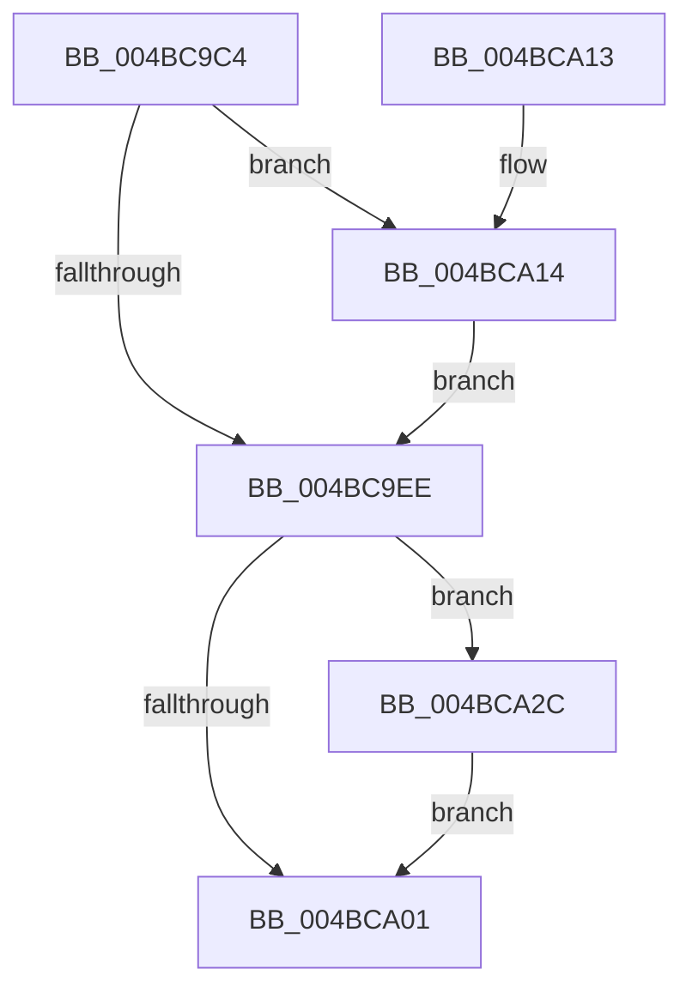

# PopIdleCancelAoAcDozeS4Timer

- RVA: `0x004BC9C4`–`0x004BCA35` (길이 `113` bytes)
- VA: `0x00000001404BC9C4`
- 실행 섹션: `.text`
- PDB 이름 있음: `예`; PDB Function 태그: `아니요`
- unwind 정보 RVA: `0x0008E15C`
- 디코드: `32`개 명령, `113/113` bytes 표시
- 미해석 바이트: `0` (있으면 어셈블리에 `.byte`로 보존)

> 이 문서는 커널 이미지의 기계어와 PDB 기호를 분석해 생성했습니다. 4번과 5번은 함수 원형과 자료형을 바이너리 사용 방식에서 추정한 C 해석이며 원본 소스 복구 결과는 아닙니다.

## 1. Dependencies

- 직접 호출 지점: **4**; 고유 호출 대상: **4**
- 직접 호출자로 확인된 함수: **5**
- RIP 상대 이미지 참조: **4**

### Outgoing calls
- `0x004BC9DE` → [KeAcquireSpinLockRaiseToDpc](../20/KeAcquireSpinLockRaiseToDpc_function_00208470.md) (function, `0x00208470`)
- `0x004BC9F8` → [KeReleaseSpinLock](../39/KeReleaseSpinLock_function_00392BA0.md) (function, `0x00392BA0`)
- `0x004BCA1D` → [KeCancelTimer2](../3A/KeCancelTimer2_function_003A01E0.md) (function, `0x003A01E0`)
- `0x004BCA2E` → [PopTraceSystemIdleS0LowPowerDozeTimerCancelled](../../page/76/PopTraceSystemIdleS0LowPowerDozeTimerCancelled_function_00763F68.md) (function, `0x00763F68`)

### Direct callers
- [PopPowerAggregatorDozeTimerWorker](../../page/76/PopPowerAggregatorDozeTimerWorker_function_00764490.md) at `0x007645B8`
- [PopUpdateSmartUserPresencePredictions](../../page/76/PopUpdateSmartUserPresencePredictions_function_0076894C.md) at `0x007689A8`
- [PopUpdateSystemIdleContext](../../page/91/PopUpdateSystemIdleContext_function_00911BB4.md) at `0x00911D0F`
- [PopIdleGlobalUserPresenceCallback](../../page/AD/PopIdleGlobalUserPresenceCallback_function_00AD89F0.md) at `0x00AD8A2B`
- [PopIdleCsStateChanged](../../page/AD/PopIdleCsStateChanged_function_00AD9DE0.md) at `0x00AD9E42`

### Static image references
- `0x004BC9D7` → RVA `0x00F08EA8` (`.data`; read)
- `0x004BC9E3` → RVA `0x00F0BC94` (`.data`; read)
- `0x004BCA16` → RVA `0x00F08EE0` (`.data`; read)
- `0x004BCA22` → RVA `0x00F0BC94` (`.data`; write)

## 2. Other-region calls and transfers

- 다른 실행 섹션으로 향하는 call: **1**
  - `0x004BCA2E` → [PopTraceSystemIdleS0LowPowerDozeTimerCancelled](../../page/76/PopTraceSystemIdleS0LowPowerDozeTimerCancelled_function_00763F68.md) (`.text` → `PAGE`)
- 별도 외부 분기/꼬리 이동을 확인하지 못했습니다.

## 3. Assembly (complete function range)

```asm
004BC9C4  48 89 5C 24 08                  mov qword ptr [rsp + 8], rbx
004BC9C9  48 89 74 24 10                  mov qword ptr [rsp + 0x10], rsi
004BC9CE  57                              push rdi
004BC9CF  48 83 EC 20                     sub rsp, 0x20
004BC9D3  8B F9                           mov edi, ecx
004BC9D5  32 DB                           xor bl, bl
004BC9D7  48 8D 0D CA C4 A4 00            lea rcx, [rip + 0xa4c4ca]
004BC9DE  E8 8D BA D4 FF                  call 0x140208470
004BC9E3  38 1D AB F2 A4 00               cmp byte ptr [rip + 0xa4f2ab], bl
004BC9E9  40 8A F0                        mov sil, al
004BC9EC  75 26                           jne 0x1404bca14
004BC9EE  40 8A D6                        mov dl, sil
004BC9F1  48 8D 0D B0 C4 A4 00            lea rcx, [rip + 0xa4c4b0]
004BC9F8  E8 A3 61 ED FF                  call 0x140392ba0
004BC9FD  84 DB                           test bl, bl
004BC9FF  75 2B                           jne 0x1404bca2c
004BCA01  48 8B 74 24 38                  mov rsi, qword ptr [rsp + 0x38]
004BCA06  8A C3                           mov al, bl
004BCA08  48 8B 5C 24 30                  mov rbx, qword ptr [rsp + 0x30]
004BCA0D  48 83 C4 20                     add rsp, 0x20
004BCA11  5F                              pop rdi
004BCA12  C3                              ret
004BCA13  CC                              int3
004BCA14  33 D2                           xor edx, edx
004BCA16  48 8D 0D C3 C4 A4 00            lea rcx, [rip + 0xa4c4c3]
004BCA1D  E8 BE 37 EE FF                  call 0x1403a01e0
004BCA22  88 1D 6C F2 A4 00               mov byte ptr [rip + 0xa4f26c], bl
004BCA28  B3 01                           mov bl, 1
004BCA2A  EB C2                           jmp 0x1404bc9ee
004BCA2C  8B CF                           mov ecx, edi
004BCA2E  E8 35 75 2A 00                  call 0x140763f68
004BCA33  EB CC                           jmp 0x1404bca01
```

## 4. C-style interpretation (structured pseudocode)

```c
__int64 __fastcall PopIdleCancelAoAcDozeS4Timer(int a1)
{
    __int64 result;
    __int64 v_rbx;
    __int64 v_rsp;
    unsigned __int64 v_stack_p10;
    unsigned __int64 v_stack_p8;

    v_stack_p8 = v_rbx;
    v_stack_p10 = v_rsi;
    v_rsp = (v_rsp) - (32);
    v_rbx = 0;
    result = KeAcquireSpinLockRaiseToDpc(v_rip + 10798282, a2, a3, a4);
    if ((*(unsigned __int8 *)(v_rip + 10810027)) != 0) goto loc_004BCA14;
loc_004BC9EE:
    result = KeReleaseSpinLock(v_rip + 10798256, (unsigned __int8)((unsigned __int8)(result)), a3, a4);
    if (0 != 0) goto loc_004BCA2C;
loc_004BCA01:
    v_rsp = (v_rsp) + (32);
    return 0;
loc_004BCA14:
    a2 = 0;
    result = KeCancelTimer2(v_rip + 10798275, a2, a3, a4);
    *(unsigned __int8 *)(v_rip + 10809964) = (unsigned __int8)(v_stack_p8);
    goto loc_004BC9EE;
loc_004BCA2C:
    result = PopTraceSystemIdleS0LowPowerDozeTimerCancelled((unsigned int)((unsigned int)((unsigned int)(a1))), a2, a3, a4);
    goto loc_004BCA01;
}
```

## 5. (Beta) C Style

```c
int64_t PopIdleCancelAoAcDozeS4Timer(int32_t Arg1)
{
    int64_t result;
    int64_t local_rbx;
    int64_t local_rsp;
    uint64_t v_stack_p10;
    uint64_t v_stack_p8;

    v_stack_p8 = local_rbx;
    v_stack_p10 = local_rsi;
    local_rsp = (local_rsp) - (32);
    local_rbx = 0;
    result = KeAcquireSpinLockRaiseToDpc(v_rip + 10798282, a2, a3, a4);
    if ((*(uint8_t *)(v_rip + 0xA4F2AB)) != 0) goto loc_004BCA14;
loc_004BC9EE:
    result = KeReleaseSpinLock(v_rip + 10798256, (uint8_t)((uint8_t)(result)), a3, a4);
    if (0 != 0) goto loc_004BCA2C;
loc_004BCA01:
    local_rsp = (local_rsp) + (32);
    return 0;
loc_004BCA14:
    a2 = 0;
    result = KeCancelTimer2(v_rip + 10798275, a2, a3, a4);
    *(uint8_t *)(v_rip + 0xA4F26C) = (uint8_t)(v_stack_p8);
    goto loc_004BC9EE;
loc_004BCA2C:
    result = PopTraceSystemIdleS0LowPowerDozeTimerCancelled((uint32_t)((uint32_t)((uint32_t)(Arg1))), a2, a3, a4);
    goto loc_004BCA01;
}
```

## 6. Execution-region graph

[열기: 2D/3D 그래프와 함수 탐색 컨트롤 패널](../../../control-panel.html?section=text&rva=0x004BC9C4&view=graph)

- 2D 그래프는 위에서 아래로 흐르고, 3D 그래프는 빈 공간을 드래그해 회전합니다. Shift+드래그는 이동, 휠은 확대·축소, 함수 노드 선택은 대상 보고서 이동입니다.

### Static fallback


