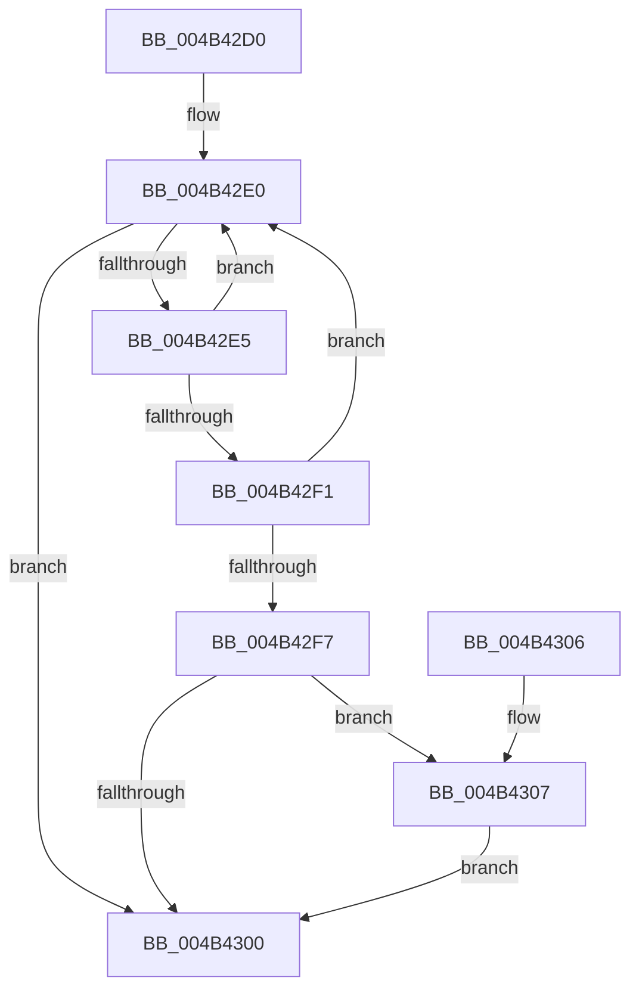

# PopIdleWakeInsertTimeInterval

- RVA: `0x004B42D0`–`0x004B430D` (길이 `61` bytes)
- VA: `0x00000001404B42D0`
- 실행 섹션: `.text`
- PDB 이름 있음: `예`; PDB Function 태그: `아니요`
- unwind 정보 RVA: `0x0009C2B4`
- 디코드: `20`개 명령, `61/61` bytes 표시
- 미해석 바이트: `0` (있으면 어셈블리에 `.byte`로 보존)

> 이 문서는 커널 이미지의 기계어와 PDB 기호를 분석해 생성했습니다. 4번과 5번은 함수 원형과 자료형을 바이너리 사용 방식에서 추정한 C 해석이며 원본 소스 복구 결과는 아닙니다.

## 1. Dependencies

- 직접 호출 지점: **0**; 고유 호출 대상: **0**
- 직접 호출자로 확인된 함수: **2**
- RIP 상대 이미지 참조: **0**

### Outgoing calls
- 직접 디코드된 call 명령이 없습니다.

### Direct callers
- [PopIdleWakeStopActiveIntervalAccounting](PopIdleWakeStopActiveIntervalAccounting_function_004B40D4.md) at `0x004B41D7`
- [PopIdleWakeStopActiveIntervalAccounting](PopIdleWakeStopActiveIntervalAccounting_function_004B40D4.md) at `0x004B4205`
- [PopIdleWakeStopActiveIntervalAccounting](PopIdleWakeStopActiveIntervalAccounting_function_004B40D4.md) at `0x004B4233`
- [PopIdleWakeStopActiveIntervalAccounting](PopIdleWakeStopActiveIntervalAccounting_function_004B40D4.md) at `0x004B425A`
- [PopIdleWakeStopActiveIntervalAccounting](PopIdleWakeStopActiveIntervalAccounting_function_004B40D4.md) at `0x004B42BD`
- [sub_006FB870](../6F/Unknown_function_006FB870.md) at `0x006FB8E2`

### Static image references
- 디코드된 RIP-relative 메모리 참조가 없습니다.

## 2. Other-region calls and transfers

- 다른 실행 섹션으로 향하는 call: **0**
- 별도 외부 분기/꼬리 이동을 확인하지 못했습니다.

## 3. Assembly (complete function range)

```asm
004B42D0  48 89 5C 24 08                  mov qword ptr [rsp + 8], rbx
004B42D5  48 8B 5C 24 28                  mov rbx, qword ptr [rsp + 0x28]
004B42DA  4D 8B D9                        mov r11, r9
004B42DD  45 33 D2                        xor r10d, r10d
004B42E0  44 3B D2                        cmp r10d, edx
004B42E3  73 1B                           jae 0x1404b4300
004B42E5  45 8B CA                        mov r9d, r10d
004B42E8  41 FF C2                        inc r10d
004B42EB  4A 3B 0C CB                     cmp rcx, qword ptr [rbx + r9*8]
004B42EF  72 EF                           jb 0x1404b42e0
004B42F1  4A 3B 0C D3                     cmp rcx, qword ptr [rbx + r10*8]
004B42F5  73 E9                           jae 0x1404b42e0
004B42F7  43 FF 04 88                     inc dword ptr [r8 + r9*4]
004B42FB  4D 85 DB                        test r11, r11
004B42FE  75 07                           jne 0x1404b4307
004B4300  48 8B 5C 24 08                  mov rbx, qword ptr [rsp + 8]
004B4305  C3                              ret
004B4306  CC                              int3
004B4307  4B 01 0C CB                     add qword ptr [r11 + r9*8], rcx
004B430B  EB F3                           jmp 0x1404b4300
```

## 4. C-style interpretation (structured pseudocode)

```c
void __fastcall PopIdleWakeInsertTimeInterval(__int64 a1, int a2, __int64 a3, __int64 a4, __int64 a5)
{
    __int64 v_r10;
    unsigned __int64 v_stack_p8;

    v_stack_p8 = v_rbx;
    v_r10 = 0;
loc_004B42E0:
    if (0 >= a2) goto loc_004B4300;
    v_r10 = (unsigned int)((v_r10) + 1);
    if (a1 < (*(unsigned __int64 *)(a5 + 0 * 8))) goto loc_004B42E0;
    if (a1 >= (*(unsigned __int64 *)(a5 + v_r10 * 8))) goto loc_004B42E0;
    if (a4 != 0) goto loc_004B4307;
loc_004B4300:
    return;
loc_004B4307:
    goto loc_004B4300;
}
```

## 5. (Beta) C Style

```c
void PopIdleWakeInsertTimeInterval(int64_t Arg1, int32_t Arg2, void *Arg3, int64_t Arg4, void *Arg5)
{
    uint8_t *arg3 = (uint8_t *)Arg3;
    uint8_t *arg5 = (uint8_t *)Arg5;

    int64_t local_r10;
    uint64_t v_stack_p8;

    v_stack_p8 = local_rbx;
    local_r10 = 0;
loc_004B42E0:
    if (0 >= Arg2) goto loc_004B4300;
    local_r10 = (uint32_t)((local_r10) + 1);
    if (Arg1 < (*(uint64_t *)(arg5 + 0x0 * 8))) goto loc_004B42E0;
    if (Arg1 >= (*(uint64_t *)(arg5 + local_r10 * 8))) goto loc_004B42E0;
    if (Arg4 != 0) goto loc_004B4307;
loc_004B4300:
    return;
loc_004B4307:
    goto loc_004B4300;
}
```

### 관측된 메모리 오프셋

구조체 형식이 확인되지 않은 접근은 인자 기준의 오프셋으로만 기록했습니다.

| 기준 인자 | 오프셋 표현 | 폭 (bit) | 접근 |
|---|---:|---:|---|
| `Arg3` | `+ 0x0 + r9*4` | `32` | `R/W` |
| `Arg5` | `+ 0x0 + r10*8` | `64` | `R` |
| `Arg5` | `+ 0x0 + r9*8` | `64` | `R` |

## 6. Execution-region graph

[열기: 2D/3D 그래프와 함수 탐색 컨트롤 패널](../../../control-panel.html?section=text&rva=0x004B42D0&view=graph)

- 2D 그래프는 위에서 아래로 흐르고, 3D 그래프는 빈 공간을 드래그해 회전합니다. Shift+드래그는 이동, 휠은 확대·축소, 함수 노드 선택은 대상 보고서 이동입니다.

### Static fallback


