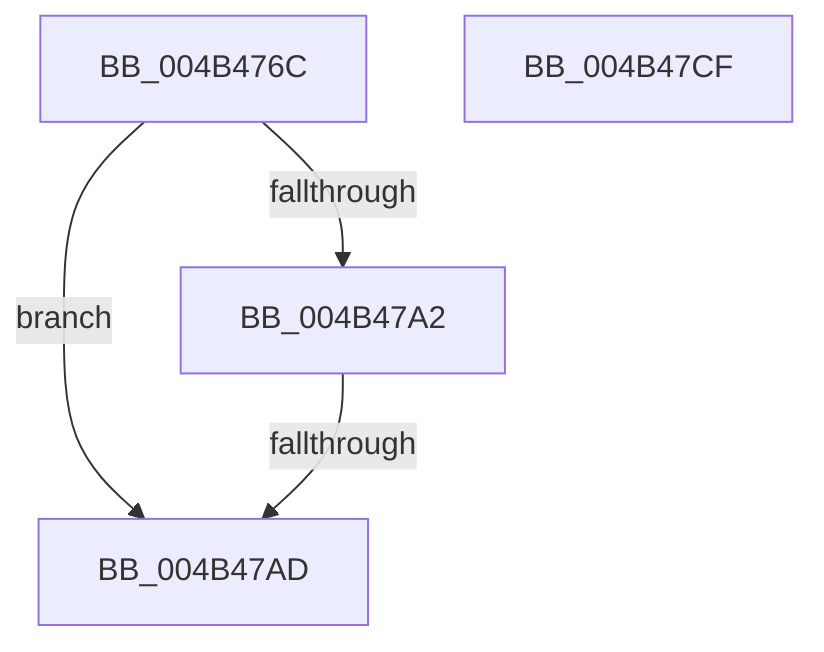

# PopIdleWakeNotifyIdleResiliencyState

- RVA: `0x004B476C`–`0x004B47D0` (길이 `100` bytes)
- VA: `0x00000001404B476C`
- 실행 섹션: `.text`
- PDB 이름 있음: `예`; PDB Function 태그: `예`
- unwind 정보 RVA: `0x000B9EA4`
- 디코드: `28`개 명령, `100/100` bytes 표시
- 미해석 바이트: `0` (있으면 어셈블리에 `.byte`로 보존)

> 이 문서는 커널 이미지의 기계어와 PDB 기호를 분석해 생성했습니다. 4번과 5번은 함수 원형과 자료형을 바이너리 사용 방식에서 추정한 C 해석이며 원본 소스 복구 결과는 아닙니다.

## 1. Dependencies

- 직접 호출 지점: **2**; 고유 호출 대상: **2**
- 직접 호출자로 확인된 함수: **1**
- RIP 상대 이미지 참조: **2**

### Outgoing calls
- `0x004B478E` → [KeAcquireSpinLockRaiseToDpc](../20/KeAcquireSpinLockRaiseToDpc_function_00208470.md) (function, `0x00208470`)
- `0x004B47B7` → [KeReleaseSpinLock](../39/KeReleaseSpinLock_function_00392BA0.md) (function, `0x00392BA0`)

### Direct callers
- [PopPdcIdleResiliencyCallback](../../page/A3/PopPdcIdleResiliencyCallback_function_00A31518.md) at `0x00A315E9`

### Static image references
- `0x004B4787` → RVA `0x00F08290` (`.data`; read)
- `0x004B4793` → RVA `0x00F08280` (`.data`; read)

## 2. Other-region calls and transfers

- 다른 실행 섹션으로 향하는 call: **0**
- call이 아닌 외부 분기/꼬리 이동: **1**
  - `0x004B47A7` → [sub_006FB870](../6F/Unknown_function_006FB870.md) (`tail-transfer`)

## 3. Assembly (complete function range)

```asm
004B476C  48 89 5C 24 08                  mov qword ptr [rsp + 8], rbx
004B4771  48 89 6C 24 18                  mov qword ptr [rsp + 0x18], rbp
004B4776  56                              push rsi
004B4777  57                              push rdi
004B4778  41 56                           push r14
004B477A  48 83 EC 30                     sub rsp, 0x30
004B477E  48 83 64 24 58 00               and qword ptr [rsp + 0x58], 0
004B4784  40 8A F1                        mov sil, cl
004B4787  48 8D 0D 02 3B A5 00            lea rcx, [rip + 0xa53b02]
004B478E  E8 DD 3C D5 FF                  call 0x140208470
004B4793  48 8B 1D E6 3A A5 00            mov rbx, qword ptr [rip + 0xa53ae6]
004B479A  44 8A F0                        mov r14b, al
004B479D  48 85 DB                        test rbx, rbx
004B47A0  74 0B                           je 0x1404b47ad
004B47A2  8B 13                           mov edx, dword ptr [rbx]
004B47A4  F6 C2 10                        test dl, 0x10
004B47A7  0F 85 C3 70 24 00               jne 0x1406fb870
004B47AD  41 8A D6                        mov dl, r14b
004B47B0  48 8D 0D D9 3A A5 00            lea rcx, [rip + 0xa53ad9]
004B47B7  E8 E4 E3 ED FF                  call 0x140392ba0
004B47BC  48 8B 5C 24 50                  mov rbx, qword ptr [rsp + 0x50]
004B47C1  48 8B 6C 24 60                  mov rbp, qword ptr [rsp + 0x60]
004B47C6  48 83 C4 30                     add rsp, 0x30
004B47CA  41 5E                           pop r14
004B47CC  5F                              pop rdi
004B47CD  5E                              pop rsi
004B47CE  C3                              ret
004B47CF  CC                              int3
```

## 4. C-style interpretation (structured pseudocode)

```c
__int64 __fastcall PopIdleWakeNotifyIdleResiliencyState(unsigned __int8 a1)
{
    __int64 result;
    __int64 v_rsp;
    unsigned __int64 v_stack_p10;
    unsigned __int64 v_stack_p18;
    unsigned __int64 v_stack_p8;

    v_stack_p8 = v_rbx;
    v_stack_p18 = v_rbp;
    v_rsp = (v_rsp) - (48);
    result = KeAcquireSpinLockRaiseToDpc(v_rip + 10828546, a2, a3, a4);
    if (*(unsigned __int64 *)(v_rip + 10828518) == 0) goto loc_004B47AD;
loc_004B47AD:
    result = KeReleaseSpinLock(v_rip + 10828505, (unsigned __int8)((unsigned __int8)(result)), a3, a4);
    v_rsp = (v_rsp) + (48);
    return result;
}
```

## 5. (Beta) C Style

```c
int64_t PopIdleWakeNotifyIdleResiliencyState(uint8_t Arg1)
{
    int64_t result;
    int64_t local_rsp;
    uint64_t v_stack_p10;
    uint64_t v_stack_p18;
    uint64_t v_stack_p8;

    v_stack_p8 = local_rbx;
    v_stack_p18 = local_rbp;
    local_rsp = (local_rsp) - (48);
    result = KeAcquireSpinLockRaiseToDpc(v_rip + 10828546, a2, a3, a4);
    if (*(uint64_t *)(v_rip + 0xA53AE6) == 0) goto loc_004B47AD;
loc_004B47AD:
    result = KeReleaseSpinLock(v_rip + 10828505, (uint8_t)((uint8_t)(result)), a3, a4);
    local_rsp = (local_rsp) + (48);
    return result;
}
```

## 6. Execution-region graph

[열기: 2D/3D 그래프와 함수 탐색 컨트롤 패널](../../../control-panel.html?section=text&rva=0x004B476C&view=graph)

- 2D 그래프는 위에서 아래로 흐르고, 3D 그래프는 빈 공간을 드래그해 회전합니다. Shift+드래그는 이동, 휠은 확대·축소, 함수 노드 선택은 대상 보고서 이동입니다.

### Static fallback


