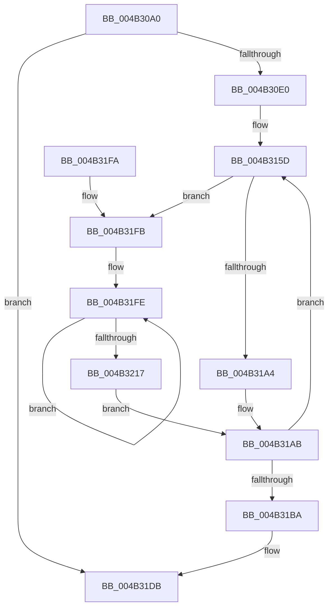

# PopIdleWakeNotifyModernStandbyEnter

- RVA: `0x004B30A0`–`0x004B3219` (길이 `377` bytes)
- VA: `0x00000001404B30A0`
- 실행 섹션: `.text`
- PDB 이름 있음: `예`; PDB Function 태그: `아니요`
- unwind 정보 RVA: `0x000B9800`
- 디코드: `81`개 명령, `377/377` bytes 표시
- 미해석 바이트: `0` (있으면 어셈블리에 `.byte`로 보존)

> 이 문서는 커널 이미지의 기계어와 PDB 기호를 분석해 생성했습니다. 4번과 5번은 함수 원형과 자료형을 바이너리 사용 방식에서 추정한 C 해석이며 원본 소스 복구 결과는 아닙니다.

## 1. Dependencies

- 직접 호출 지점: **5**; 고유 호출 대상: **4**
- 직접 호출자로 확인된 함수: **1**
- RIP 상대 이미지 참조: **5**

### Outgoing calls
- `0x004B30CD` → [ExAllocatePool2](../../poolcode/B8/ExAllocatePool2_function_00B820F0.md) (function, `0x00B820F0`)
- `0x004B316F` → [memset](../6C/memset_function_006C6C40.md) (function, `0x006C6C40`)
- `0x004B319A` → [memset](../6C/memset_function_006C6C40.md) (function, `0x006C6C40`)
- `0x004B31C1` → [KeAcquireSpinLockRaiseToDpc](../20/KeAcquireSpinLockRaiseToDpc_function_00208470.md) (function, `0x00208470`)
- `0x004B31D6` → [KeReleaseSpinLock](../39/KeReleaseSpinLock_function_00392BA0.md) (function, `0x00392BA0`)

### Direct callers
- [PopSleepstudyStartNextSession](../../page/AC/PopSleepstudyStartNextSession_function_00AC4720.md) at `0x00AC4BA4`

### Static image references
- `0x004B30E7` → RVA `0x00AA55E0` (`PopIdleWakeNotifyModernStandbyExitWorker`; read)
- `0x004B3100` → RVA `0x005DC080` (`PopIdleWakeDelayedWakeSourceReferencer`; read)
- `0x004B31BA` → RVA `0x00F08290` (`.data`; read)
- `0x004B31C8` → RVA `0x00F08280` (`.data`; write)
- `0x004B3201` → RVA `0x00F08288` (`.data`; read/write)

## 2. Other-region calls and transfers

- 다른 실행 섹션으로 향하는 call: **1**
  - `0x004B30CD` → [ExAllocatePool2](../../poolcode/B8/ExAllocatePool2_function_00B820F0.md) (`.text` → `POOLCODE`)
- 별도 외부 분기/꼬리 이동을 확인하지 못했습니다.

## 3. Assembly (complete function range)

```asm
004B30A0  48 8B C4                        mov rax, rsp
004B30A3  48 89 58 08                     mov qword ptr [rax + 8], rbx
004B30A7  48 89 68 10                     mov qword ptr [rax + 0x10], rbp
004B30AB  48 89 70 18                     mov qword ptr [rax + 0x18], rsi
004B30AF  48 89 78 20                     mov qword ptr [rax + 0x20], rdi
004B30B3  41 55                           push r13
004B30B5  41 56                           push r14
004B30B7  41 57                           push r15
004B30B9  48 83 EC 20                     sub rsp, 0x20
004B30BD  BA 20 95 00 00                  mov edx, 0x9520
004B30C2  B9 40 00 00 00                  mov ecx, 0x40
004B30C7  41 B8 50 64 69 67               mov r8d, 0x67696450
004B30CD  E8 1E F0 6C 00                  call 0x140b820f0
004B30D2  33 ED                           xor ebp, ebp
004B30D4  48 8B D8                        mov rbx, rax
004B30D7  48 85 C0                        test rax, rax
004B30DA  0F 84 FB 00 00 00               je 0x1404b31db
004B30E0  48 89 9B A8 94 00 00            mov qword ptr [rbx + 0x94a8], rbx
004B30E7  48 8D 05 F2 24 5F 00            lea rax, [rip + 0x5f24f2]
004B30EE  48 89 83 A0 94 00 00            mov qword ptr [rbx + 0x94a0], rax
004B30F5  44 8D 7D 01                     lea r15d, [rbp + 1]
004B30F9  48 89 AB 90 94 00 00            mov qword ptr [rbx + 0x9490], rbp
004B3100  48 8D 05 79 8F 12 00            lea rax, [rip + 0x128f79]
004B3107  48 89 83 D8 94 00 00            mov qword ptr [rbx + 0x94d8], rax
004B310E  48 8D BB 24 01 00 00            lea rdi, [rbx + 0x124]
004B3115  C7 83 C0 94 00 00 13 01 00 00   mov dword ptr [rbx + 0x94c0], 0x113
004B311F  48 8D 83 08 95 00 00            lea rax, [rbx + 0x9508]
004B3126  48 89 9B E0 94 00 00            mov qword ptr [rbx + 0x94e0], rbx
004B312D  44 8D 6D 20                     lea r13d, [rbp + 0x20]
004B3131  48 89 AB F8 94 00 00            mov qword ptr [rbx + 0x94f8], rbp
004B3138  8B F5                           mov esi, ebp
004B313A  48 89 AB D0 94 00 00            mov qword ptr [rbx + 0x94d0], rbp
004B3141  66 89 AB 00 95 00 00            mov word ptr [rbx + 0x9500], bp
004B3148  C6 83 02 95 00 00 06            mov byte ptr [rbx + 0x9502], 6
004B314F  44 89 BB 04 95 00 00            mov dword ptr [rbx + 0x9504], r15d
004B3156  48 89 40 08                     mov qword ptr [rax + 8], rax
004B315A  48 89 00                        mov qword ptr [rax], rax
004B315D  4C 8D B7 6C FF FF FF            lea r14, [rdi - 0x94]
004B3164  33 D2                           xor edx, edx
004B3166  49 8B CE                        mov rcx, r14
004B3169  41 B8 A0 04 00 00               mov r8d, 0x4a0
004B316F  E8 CC 3A 21 00                  call 0x1406c6c40
004B3174  48 83 C8 FF                     or rax, 0xffffffffffffffff
004B3178  48 8D 4F 04                     lea rcx, [rdi + 4]
004B317C  48 89 87 14 01 00 00            mov qword ptr [rdi + 0x114], rax
004B3183  33 D2                           xor edx, edx
004B3185  48 89 87 94 02 00 00            mov qword ptr [rdi + 0x294], rax
004B318C  41 B8 00 01 00 00               mov r8d, 0x100
004B3192  48 C7 47 FC 01 00 20 00         mov qword ptr [rdi - 4], 0x200001
004B319A  E8 A1 3A 21 00                  call 0x1406c6c40
004B319F  83 FE 0B                        cmp esi, 0xb
004B31A2  76 57                           jbe 0x1404b31fb
004B31A4  41 C7 06 82 00 00 00            mov dword ptr [r14], 0x82
004B31AB  41 03 F7                        add esi, r15d
004B31AE  48 81 C7 A0 04 00 00            add rdi, 0x4a0
004B31B5  41 3B F5                        cmp esi, r13d
004B31B8  72 A3                           jb 0x1404b315d
004B31BA  48 8D 0D CF 50 A5 00            lea rcx, [rip + 0xa550cf]
004B31C1  E8 AA 52 D5 FF                  call 0x140208470
004B31C6  8A D0                           mov dl, al
004B31C8  48 89 1D B1 50 A5 00            mov qword ptr [rip + 0xa550b1], rbx
004B31CF  48 8D 0D BA 50 A5 00            lea rcx, [rip + 0xa550ba]
004B31D6  E8 C5 F9 ED FF                  call 0x140392ba0
004B31DB  48 8B 5C 24 40                  mov rbx, qword ptr [rsp + 0x40]
004B31E0  48 8B 6C 24 48                  mov rbp, qword ptr [rsp + 0x48]
004B31E5  48 8B 74 24 50                  mov rsi, qword ptr [rsp + 0x50]
004B31EA  48 8B 7C 24 58                  mov rdi, qword ptr [rsp + 0x58]
004B31EF  48 83 C4 20                     add rsp, 0x20
004B31F3  41 5F                           pop r15
004B31F5  41 5E                           pop r14
004B31F7  41 5D                           pop r13
004B31F9  C3                              ret
004B31FA  CC                              int3
004B31FB  41 89 36                        mov dword ptr [r14], esi
004B31FE  41 8B C7                        mov eax, r15d
004B3201  F0 0F C1 05 7F 50 A5 00         lock xadd dword ptr [rip + 0xa5507f], eax
004B3209  41 03 C7                        add eax, r15d
004B320C  89 87 04 01 00 00               mov dword ptr [rdi + 0x104], eax
004B3212  83 F8 FF                        cmp eax, -1
004B3215  74 E7                           je 0x1404b31fe
004B3217  EB 92                           jmp 0x1404b31ab
```

## 4. C-style interpretation (structured pseudocode)

```c
__int64 __fastcall PopIdleWakeNotifyModernStandbyEnter(void)
{
    __int64 result;
    __int64 v_rbp;
    __int64 v_rdi;
    __int64 v_rsi;
    __int64 v_rsp;
    unsigned __int64 v_stack_p10;
    unsigned __int64 v_stack_p18;
    unsigned __int64 v_stack_p20;
    unsigned __int64 v_stack_p8;

    *(unsigned __int64 *)(v_rsp + 8) = v_rbx;
    *(unsigned __int64 *)(v_rsp + 16) = v_rbp;
    *(unsigned __int64 *)(v_rsp + 24) = v_rsi;
    *(unsigned __int64 *)(v_rsp + 32) = v_rdi;
    v_rsp = (v_rsp) - (32);
    result = ExAllocatePool2(64, (unsigned int)(0x9520ULL), (unsigned int)(0x67696450ULL), a4);
    v_rbp = 0;
    if (result == 0) goto loc_004B31DB;
    *(unsigned __int64 *)(result + 38056) = result;
    *(unsigned __int64 *)(result + 38048) = v_rip + 6235378;
    *(unsigned __int64 *)(result + 38032) = 0;
    *(unsigned __int64 *)(result + 38104) = v_rip + 1216377;
    *(unsigned int *)(result + 38080) = 275;
    *(unsigned __int64 *)(result + 38112) = result;
    *(unsigned __int64 *)(result + 38136) = 0;
    *(unsigned __int64 *)(result + 38096) = 0;
    *(unsigned __int16 *)(result + 38144) = 0;
    *(unsigned __int8 *)(result + 38146) = 6;
    *(unsigned int *)(result + 38148) = (unsigned int)(v_rbp + 1);
    *(unsigned __int64 *)(result + 38152 + 8) = result + 38152;
    *(unsigned __int64 *)(result + 38152) = result + 38152;
loc_004B315D:
    a2 = 0;
    result = memset(result + 292 - 148, a2, (unsigned int)(0x4A0ULL), a4);
    result = (result) | (-1);
    *(unsigned __int64 *)(result + 292 + 276) = result;
    a2 = 0;
    *(unsigned __int64 *)(result + 292 + 660) = result;
    *(unsigned __int64 *)(result + 292 - 4) = 0x200001ULL;
    result = memset(result + 292 + 4, a2, 256, a4);
    if (0 <= 11) goto loc_004B31FB;
    *(unsigned int *)(result + 292 - 148) = 130;
loc_004B31AB:
    v_rsi = (unsigned int)((0) + ((unsigned int)(v_rbp + 1)));
    v_rdi = (result + 292) + (0x4A0ULL);
    if (((unsigned int)(v_rsi)) < ((unsigned int)(v_rbp + 32))) goto loc_004B315D;
    result = KeAcquireSpinLockRaiseToDpc(v_rip + 10834127, a2, 256, a4);
    *(unsigned __int64 *)(v_rip + 10834097) = result;
    result = KeReleaseSpinLock(v_rip + 10834106, (unsigned __int8)(result), 256, a4);
loc_004B31DB:
    v_rsp = (v_rsp) + (32);
    return result;
loc_004B31FB:
    *(unsigned int *)(result + 292 - 148) = (unsigned int)(v_stack_p18);
loc_004B31FE:
    result = (unsigned int)(((unsigned int)((unsigned int)(v_rbp + 1))) + ((unsigned int)(v_rbp + 1)));
    *(unsigned int *)(v_stack_p20 + 260) = (unsigned int)(result);
    if (((unsigned int)(result)) == -1) goto loc_004B31FE;
    goto loc_004B31AB;
}
```

## 5. (Beta) C Style

```c
void PopIdleWakeNotifyModernStandbyEnter(void)
{
    int64_t result;
    int64_t local_rbp;
    int64_t local_rdi;
    int64_t local_rsi;
    int64_t local_rsp;
    uint64_t v_stack_p10;
    uint64_t v_stack_p18;
    uint64_t v_stack_p20;
    uint64_t v_stack_p8;

    *(uint64_t *)(local_rsp + 0x8) = local_rbx;
    *(uint64_t *)(local_rsp + 0x10) = local_rbp;
    *(uint64_t *)(local_rsp + 0x18) = local_rsi;
    *(uint64_t *)(local_rsp + 0x20) = local_rdi;
    local_rsp = (local_rsp) - (32);
    result = ExAllocatePool2(64, (uint32_t)(0x9520ULL), (uint32_t)(0x67696450ULL), a4);
    local_rbp = 0;
    if (result == 0) goto loc_004B31DB;
    *(uint64_t *)(result + 0x94A8) = result;
    *(uint64_t *)(result + 0x94A0) = v_rip + 6235378;
    *(uint64_t *)(result + 0x9490) = 0;
    *(uint64_t *)(result + 0x94D8) = v_rip + 1216377;
    *(uint32_t *)(result + 0x94C0) = 275;
    *(uint64_t *)(result + 0x94E0) = result;
    *(uint64_t *)(result + 0x94F8) = 0;
    *(uint64_t *)(result + 0x94D0) = 0;
    *(uint16_t *)(result + 0x9500) = 0;
    *(uint8_t *)(result + 0x9502) = 6;
    *(uint32_t *)(result + 0x9504) = (uint32_t)(local_rbp + 1);
    *(uint64_t *)(result + 0x9508 + 0x8) = result + 38152;
    *(uint64_t *)(result + 0x9508) = result + 38152;
loc_004B315D:
    a2 = 0;
    result = memset(result + 292 - 148, a2, (uint32_t)(0x4A0ULL), a4);
    result = (result) | (-1);
    *(uint64_t *)(result + 0x124 + 0x114) = result;
    a2 = 0;
    *(uint64_t *)(result + 0x124 + 0x294) = result;
    *(uint64_t *)(result + 0x124 - 0x4) = 0x200001ULL;
    result = memset(result + 292 + 4, a2, 256, a4);
    if (0 <= 11) goto loc_004B31FB;
    *(uint32_t *)(result + 0x124 - 0x94) = 130;
loc_004B31AB:
    local_rsi = (uint32_t)((0) + ((uint32_t)(local_rbp + 1)));
    local_rdi = (result + 292) + (0x4A0ULL);
    if (((uint32_t)(local_rsi)) < ((uint32_t)(local_rbp + 32))) goto loc_004B315D;
    result = KeAcquireSpinLockRaiseToDpc(v_rip + 10834127, a2, 256, a4);
    *(uint64_t *)(v_rip + 0xA550B1) = result;
    result = KeReleaseSpinLock(v_rip + 10834106, (uint8_t)(result), 256, a4);
loc_004B31DB:
    local_rsp = (local_rsp) + (32);
    return result;
loc_004B31FB:
    *(uint32_t *)(result + 0x124 - 0x94) = (uint32_t)(v_stack_p18);
loc_004B31FE:
    result = (uint32_t)(((uint32_t)((uint32_t)(local_rbp + 1))) + ((uint32_t)(local_rbp + 1)));
    *(uint32_t *)(v_stack_p20 + 0x104) = (uint32_t)(result);
    if (((uint32_t)(result)) == -1) goto loc_004B31FE;
    goto loc_004B31AB;
}
```

## 6. Execution-region graph

[열기: 2D/3D 그래프와 함수 탐색 컨트롤 패널](../../../control-panel.html?section=text&rva=0x004B30A0&view=graph)

- 2D 그래프는 위에서 아래로 흐르고, 3D 그래프는 빈 공간을 드래그해 회전합니다. Shift+드래그는 이동, 휠은 확대·축소, 함수 노드 선택은 대상 보고서 이동입니다.

### Static fallback


