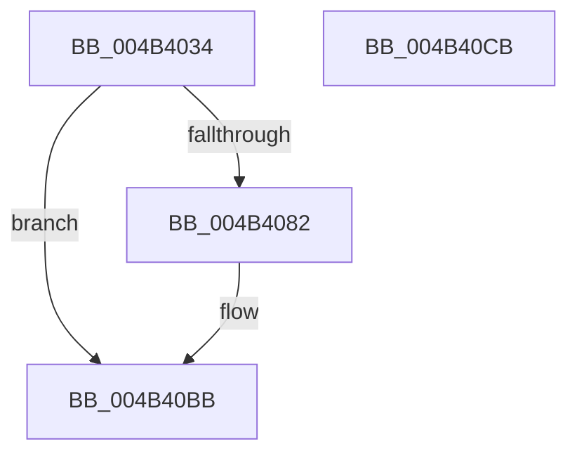

# PopIdleWakeNotifyModernStandbyExit

- RVA: `0x004B4034`–`0x004B40CC` (길이 `152` bytes)
- VA: `0x00000001404B4034`
- 실행 섹션: `.text`
- PDB 이름 있음: `예`; PDB Function 태그: `아니요`
- unwind 정보 RVA: `0x000B9DCC`
- 디코드: `34`개 명령, `152/152` bytes 표시
- 미해석 바이트: `0` (있으면 어셈블리에 `.byte`로 보존)

> 이 문서는 커널 이미지의 기계어와 PDB 기호를 분석해 생성했습니다. 4번과 5번은 함수 원형과 자료형을 바이너리 사용 방식에서 추정한 C 해석이며 원본 소스 복구 결과는 아닙니다.

## 1. Dependencies

- 직접 호출 지점: **5**; 고유 호출 대상: **5**
- 직접 호출자로 확인된 함수: **1**
- RIP 상대 이미지 참조: **4**

### Outgoing calls
- `0x004B405B` → [KeAcquireSpinLockRaiseToDpc](../20/KeAcquireSpinLockRaiseToDpc_function_00208470.md) (function, `0x00208470`)
- `0x004B4078` → [KeReleaseSpinLock](../39/KeReleaseSpinLock_function_00392BA0.md) (function, `0x00392BA0`)
- `0x004B4087` → [RtlGetInterruptTimePrecise](../20/RtlGetInterruptTimePrecise_function_0020A4C0.md) (function, `0x0020A4C0`)
- `0x004B4097` → [PopIdleWakeStopActiveIntervalAccounting](PopIdleWakeStopActiveIntervalAccounting_function_004B40D4.md) (function, `0x004B40D4`)
- `0x004B40B6` → [ExQueueWorkItem](../2F/ExQueueWorkItem_function_002F9520.md) (function, `0x002F9520`)

### Direct callers
- [PopSleepstudyStartNextSession](../../page/AC/PopSleepstudyStartNextSession_function_00AC4720.md) at `0x00AC4982`

### Static image references
- `0x004B4048` → RVA `0x00F0B6B0` (`.data`; read)
- `0x004B404F` → RVA `0x00F08290` (`.data`; read)
- `0x004B4060` → RVA `0x00F08280` (`.data`; read)
- `0x004B406E` → RVA `0x00F08280` (`.data`; read/write)

## 2. Other-region calls and transfers

- 다른 실행 섹션으로 향하는 call: **0**
- 별도 외부 분기/꼬리 이동을 확인하지 못했습니다.

## 3. Assembly (complete function range)

```asm
004B4034  48 8B C4                        mov rax, rsp
004B4037  48 89 58 10                     mov qword ptr [rax + 0x10], rbx
004B403B  48 89 70 18                     mov qword ptr [rax + 0x18], rsi
004B403F  48 89 48 08                     mov qword ptr [rax + 8], rcx
004B4043  57                              push rdi
004B4044  48 83 EC 20                     sub rsp, 0x20
004B4048  48 8B 35 61 76 A5 00            mov rsi, qword ptr [rip + 0xa57661]
004B404F  48 8D 0D 3A 42 A5 00            lea rcx, [rip + 0xa5423a]
004B4056  48 83 60 08 00                  and qword ptr [rax + 8], 0
004B405B  E8 10 44 D5 FF                  call 0x140208470
004B4060  48 8B 3D 19 42 A5 00            mov rdi, qword ptr [rip + 0xa54219]
004B4067  48 8D 0D 22 42 A5 00            lea rcx, [rip + 0xa54222]
004B406E  48 83 25 0A 42 A5 00 00         and qword ptr [rip + 0xa5420a], 0
004B4076  8A D0                           mov dl, al
004B4078  E8 23 EB ED FF                  call 0x140392ba0
004B407D  48 85 FF                        test rdi, rdi
004B4080  74 39                           je 0x1404b40bb
004B4082  48 8D 4C 24 30                  lea rcx, [rsp + 0x30]
004B4087  E8 34 64 D5 FF                  call 0x14020a4c0
004B408C  48 8B 5C 24 30                  mov rbx, qword ptr [rsp + 0x30]
004B4091  48 8B CF                        mov rcx, rdi
004B4094  48 8B D3                        mov rdx, rbx
004B4097  E8 38 00 00 00                  call 0x1404b40d4
004B409C  48 8D 8F 90 94 00 00            lea rcx, [rdi + 0x9490]
004B40A3  48 89 B7 B0 94 00 00            mov qword ptr [rdi + 0x94b0], rsi
004B40AA  BA 01 00 00 00                  mov edx, 1
004B40AF  48 89 9F B8 94 00 00            mov qword ptr [rdi + 0x94b8], rbx
004B40B6  E8 65 54 E4 FF                  call 0x1402f9520
004B40BB  48 8B 5C 24 38                  mov rbx, qword ptr [rsp + 0x38]
004B40C0  48 8B 74 24 40                  mov rsi, qword ptr [rsp + 0x40]
004B40C5  48 83 C4 20                     add rsp, 0x20
004B40C9  5F                              pop rdi
004B40CA  C3                              ret
004B40CB  CC                              int3
```

## 4. C-style interpretation (structured pseudocode)

```c
__int64 __fastcall PopIdleWakeNotifyModernStandbyExit(__int64 a1)
{
    __int64 result;
    __int64 v_rbx;
    __int64 v_rsp;
    unsigned __int64 v_stack_p10;
    unsigned __int64 v_stack_p18;
    unsigned __int64 v_stack_p8;

    *(unsigned __int64 *)(v_rsp + 16) = v_rbx;
    *(unsigned __int64 *)(v_rsp + 24) = v_rsi;
    *(unsigned __int64 *)(v_rsp + 8) = a1;
    v_rsp = (v_rsp) - (32);
    result = KeAcquireSpinLockRaiseToDpc(v_rip + 10830394, a2, a3, a4);
    result = KeReleaseSpinLock(v_rip + 10830370, (unsigned __int8)(result), a3, a4);
    if (*(unsigned __int64 *)(v_rip + 10830361) != 0) {
        a1 = v_stack_p8;
        result = RtlGetInterruptTimePrecise(a1, (unsigned __int8)(result), a3, a4);
        v_rbx = v_stack_p8;
        a1 = *(unsigned __int64 *)(v_rip + 10830361);
        a2 = v_rbx;
        result = PopIdleWakeStopActiveIntervalAccounting(a1, a2, a3, a4);
        a1 = *(unsigned __int64 *)(v_rip + 10830361) + 38032;
        *(unsigned __int64 *)(*(unsigned __int64 *)(v_rip + 10830361) + 38064) = *(unsigned __int64 *)(v_rip + 10843745);
        a2 = 1;
        *(unsigned __int64 *)(*(unsigned __int64 *)(v_rip + 10830361) + 38072) = v_rbx;
        result = ExQueueWorkItem(a1, a2, a3, a4);
    }
    v_rsp = (v_rsp) + (32);
    return result;
}
```

## 5. (Beta) C Style

```c
int64_t PopIdleWakeNotifyModernStandbyExit(int64_t Arg1)
{
    int64_t result;
    int64_t local_rbx;
    int64_t local_rsp;
    uint64_t v_stack_p10;
    uint64_t v_stack_p18;
    uint64_t v_stack_p8;

    *(uint64_t *)(local_rsp + 0x10) = local_rbx;
    *(uint64_t *)(local_rsp + 0x18) = local_rsi;
    *(uint64_t *)(local_rsp + 0x8) = Arg1;
    local_rsp = (local_rsp) - (32);
    result = KeAcquireSpinLockRaiseToDpc(v_rip + 10830394, a2, a3, a4);
    result = KeReleaseSpinLock(v_rip + 10830370, (uint8_t)(result), a3, a4);
    if (*(uint64_t *)(v_rip + 0xA54219) != 0) {
        Arg1 = v_stack_p8;
        result = RtlGetInterruptTimePrecise(Arg1, (uint8_t)(result), a3, a4);
        local_rbx = v_stack_p8;
        Arg1 = *(uint64_t *)(v_rip + 0xA54219);
        a2 = local_rbx;
        result = PopIdleWakeStopActiveIntervalAccounting(Arg1, a2, a3, a4);
        Arg1 = *(uint64_t *)(v_rip + 0xA54219) + 38032;
        *(uint64_t *)(*(uint64_t *)(v_rip + 0xA54219) + 0x94B0) = *(uint64_t *)(v_rip + 0xA57661);
        a2 = 1;
        *(uint64_t *)(*(uint64_t *)(v_rip + 0xA54219) + 0x94B8) = local_rbx;
        result = ExQueueWorkItem(Arg1, a2, a3, a4);
    }
    local_rsp = (local_rsp) + (32);
    return result;
}
```

## 6. Execution-region graph

[열기: 2D/3D 그래프와 함수 탐색 컨트롤 패널](../../../control-panel.html?section=text&rva=0x004B4034&view=graph)

- 2D 그래프는 위에서 아래로 흐르고, 3D 그래프는 빈 공간을 드래그해 회전합니다. Shift+드래그는 이동, 휠은 확대·축소, 함수 노드 선택은 대상 보고서 이동입니다.

### Static fallback


