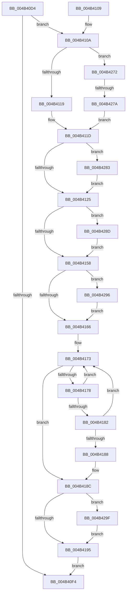

# PopIdleWakeStopActiveIntervalAccounting

- RVA: `0x004B40D4`–`0x004B42C7` (길이 `499` bytes)
- VA: `0x00000001404B40D4`
- 실행 섹션: `.text`
- PDB 이름 있음: `예`; PDB Function 태그: `예`
- unwind 정보 RVA: `0x000B9DE0`
- 디코드: `116`개 명령, `499/499` bytes 표시
- 미해석 바이트: `0` (있으면 어셈블리에 `.byte`로 보존)

> 이 문서는 커널 이미지의 기계어와 PDB 기호를 분석해 생성했습니다. 4번과 5번은 함수 원형과 자료형을 바이너리 사용 방식에서 추정한 C 해석이며 원본 소스 복구 결과는 아닙니다.

## 1. Dependencies

- 직접 호출 지점: **7**; 고유 호출 대상: **3**
- 직접 호출자로 확인된 함수: **2**
- RIP 상대 이미지 참조: **5**

### Outgoing calls
- `0x004B41A3` → [KeAddProcessorAffinityEx](../25/KeAddProcessorAffinityEx_function_0025B6F0.md) (function, `0x0025B6F0`)
- `0x004B41D7` → [PopIdleWakeInsertTimeInterval](PopIdleWakeInsertTimeInterval_function_004B42D0.md) (function, `0x004B42D0`)
- `0x004B4205` → [PopIdleWakeInsertTimeInterval](PopIdleWakeInsertTimeInterval_function_004B42D0.md) (function, `0x004B42D0`)
- `0x004B4233` → [PopIdleWakeInsertTimeInterval](PopIdleWakeInsertTimeInterval_function_004B42D0.md) (function, `0x004B42D0`)
- `0x004B425A` → [PopIdleWakeInsertTimeInterval](PopIdleWakeInsertTimeInterval_function_004B42D0.md) (function, `0x004B42D0`)
- `0x004B4268` → [memset](../6C/memset_function_006C6C40.md) (function, `0x006C6C40`)
- `0x004B42BD` → [PopIdleWakeInsertTimeInterval](PopIdleWakeInsertTimeInterval_function_004B42D0.md) (function, `0x004B42D0`)

### Direct callers
- [PopIdleWakeNotifyModernStandbyExit](PopIdleWakeNotifyModernStandbyExit_function_004B4034.md) at `0x004B4097`
- [PopIdleWakeNotifyWakeSource](../5D/PopIdleWakeNotifyWakeSource_function_005DC204.md) at `0x005DC29E`

### Static image references
- `0x004B416A` → RVA `0x00F08300` (`.data`; read)
- `0x004B41AC` → RVA `0x00E0C308` (`.data`; read)
- `0x004B41F9` → RVA `0x00E0C338` (`.data`; read)
- `0x004B420E` → RVA `0x00E0C368` (`.data`; read)
- `0x004B42A2` → RVA `0x00F082A0` (`.data`; read)

## 2. Other-region calls and transfers

- 다른 실행 섹션으로 향하는 call: **0**
- call이 아닌 외부 분기/꼬리 이동: **1**
  - `0x004B4274` → [sub_006FB85C](../6F/Unknown_function_006FB85C.md) (`tail-transfer`)

## 3. Assembly (complete function range)

```asm
004B40D4  48 89 5C 24 08                  mov qword ptr [rsp + 8], rbx
004B40D9  48 89 6C 24 10                  mov qword ptr [rsp + 0x10], rbp
004B40DE  48 89 74 24 18                  mov qword ptr [rsp + 0x18], rsi
004B40E3  57                              push rdi
004B40E4  48 83 EC 30                     sub rsp, 0x30
004B40E8  8B 01                           mov eax, dword ptr [rcx]
004B40EA  48 8B F2                        mov rsi, rdx
004B40ED  48 8B F9                        mov rdi, rcx
004B40F0  A8 10                           test al, 0x10
004B40F2  75 16                           jne 0x1404b410a
004B40F4  48 8B 5C 24 40                  mov rbx, qword ptr [rsp + 0x40]
004B40F9  48 8B 6C 24 48                  mov rbp, qword ptr [rsp + 0x48]
004B40FE  48 8B 74 24 50                  mov rsi, qword ptr [rsp + 0x50]
004B4103  48 83 C4 30                     add rsp, 0x30
004B4107  5F                              pop rdi
004B4108  C3                              ret
004B4109  CC                              int3
004B410A  48 8B CE                        mov rcx, rsi
004B410D  48 2B 4F 08                     sub rcx, qword ptr [rdi + 8]
004B4111  A8 02                           test al, 2
004B4113  0F 84 59 01 00 00               je 0x1404b4272
004B4119  48 01 4F 10                     add qword ptr [rdi + 0x10], rcx
004B411D  A8 08                           test al, 8
004B411F  0F 84 5E 01 00 00               je 0x1404b4283
004B4125  48 8B 6F 28                     mov rbp, qword ptr [rdi + 0x28]
004B4129  24 04                           and al, 4
004B412B  F6 D8                           neg al
004B412D  48 1B DB                        sbb rbx, rbx
004B4130  81 E3 80 01 00 00               and ebx, 0x180
004B4136  48 81 C3 A0 01 00 00            add rbx, 0x1a0
004B413D  48 03 DD                        add rbx, rbp
004B4140  FF 03                           inc dword ptr [rbx]
004B4142  48 8B 47 38                     mov rax, qword ptr [rdi + 0x38]
004B4146  48 01 43 18                     add qword ptr [rbx + 0x18], rax
004B414A  48 8B 47 38                     mov rax, qword ptr [rdi + 0x38]
004B414E  48 3B 43 08                     cmp rax, qword ptr [rbx + 8]
004B4152  0F 82 35 01 00 00               jb 0x1404b428d
004B4158  48 8B 47 38                     mov rax, qword ptr [rdi + 0x38]
004B415C  48 3B 43 10                     cmp rax, qword ptr [rbx + 0x10]
004B4160  0F 87 30 01 00 00               ja 0x1404b4296
004B4166  4C 8B 47 38                     mov r8, qword ptr [rdi + 0x38]
004B416A  4C 8D 0D 8F 41 A5 00            lea r9, [rip + 0xa5418f]
004B4171  33 C9                           xor ecx, ecx
004B4173  83 F9 09                        cmp ecx, 9
004B4176  73 14                           jae 0x1404b418c
004B4178  8B D1                           mov edx, ecx
004B417A  FF C1                           inc ecx
004B417C  4D 3B 04 D1                     cmp r8, qword ptr [r9 + rdx*8]
004B4180  72 F1                           jb 0x1404b4173
004B4182  4D 3B 04 C9                     cmp r8, qword ptr [r9 + rcx*8]
004B4186  73 EB                           jae 0x1404b4173
004B4188  FF 44 93 20                     inc dword ptr [rbx + rdx*4 + 0x20]
004B418C  83 3B 01                        cmp dword ptr [rbx], 1
004B418F  0F 87 0A 01 00 00               ja 0x1404b429f
004B4195  48 89 73 70                     mov qword ptr [rbx + 0x70], rsi
004B4199  48 8D 8D 90 00 00 00            lea rcx, [rbp + 0x90]
004B41A0  8B 57 40                        mov edx, dword ptr [rdi + 0x40]
004B41A3  E8 48 75 DA FF                  call 0x14025b6f0
004B41A8  48 8B 4F 18                     mov rcx, qword ptr [rdi + 0x18]
004B41AC  48 8D 05 55 81 95 00            lea rax, [rip + 0x958155]
004B41B3  48 03 4F 10                     add rcx, qword ptr [rdi + 0x10]
004B41B7  4C 8D 8B 98 00 00 00            lea r9, [rbx + 0x98]
004B41BE  48 03 4F 20                     add rcx, qword ptr [rdi + 0x20]
004B41C2  4C 8D 83 80 00 00 00            lea r8, [rbx + 0x80]
004B41C9  48 01 4B 78                     add qword ptr [rbx + 0x78], rcx
004B41CD  BA 05 00 00 00                  mov edx, 5
004B41D2  48 89 44 24 20                  mov qword ptr [rsp + 0x20], rax
004B41D7  E8 F4 00 00 00                  call 0x1404b42d0
004B41DC  48 8B 47 10                     mov rax, qword ptr [rdi + 0x10]
004B41E0  4C 8D 8B E0 00 00 00            lea r9, [rbx + 0xe0]
004B41E7  48 01 83 C0 00 00 00            add qword ptr [rbx + 0xc0], rax
004B41EE  4C 8D 83 C8 00 00 00            lea r8, [rbx + 0xc8]
004B41F5  48 8B 4F 10                     mov rcx, qword ptr [rdi + 0x10]
004B41F9  48 8D 05 38 81 95 00            lea rax, [rip + 0x958138]
004B4200  48 89 44 24 20                  mov qword ptr [rsp + 0x20], rax
004B4205  E8 C6 00 00 00                  call 0x1404b42d0
004B420A  48 8B 47 18                     mov rax, qword ptr [rdi + 0x18]
004B420E  48 8D 35 53 81 95 00            lea rsi, [rip + 0x958153]
004B4215  48 01 83 08 01 00 00            add qword ptr [rbx + 0x108], rax
004B421C  4C 8D 8B 28 01 00 00            lea r9, [rbx + 0x128]
004B4223  48 8B 4F 18                     mov rcx, qword ptr [rdi + 0x18]
004B4227  4C 8D 83 10 01 00 00            lea r8, [rbx + 0x110]
004B422E  48 89 74 24 20                  mov qword ptr [rsp + 0x20], rsi
004B4233  E8 98 00 00 00                  call 0x1404b42d0
004B4238  48 8B 47 20                     mov rax, qword ptr [rdi + 0x20]
004B423C  4C 8D 8B 68 01 00 00            lea r9, [rbx + 0x168]
004B4243  48 01 83 50 01 00 00            add qword ptr [rbx + 0x150], rax
004B424A  4C 8D 83 58 01 00 00            lea r8, [rbx + 0x158]
004B4251  48 8B 4F 20                     mov rcx, qword ptr [rdi + 0x20]
004B4255  48 89 74 24 20                  mov qword ptr [rsp + 0x20], rsi
004B425A  E8 71 00 00 00                  call 0x1404b42d0
004B425F  33 D2                           xor edx, edx
004B4261  48 8B CF                        mov rcx, rdi
004B4264  44 8D 42 48                     lea r8d, [rdx + 0x48]
004B4268  E8 D3 29 21 00                  call 0x1406c6c40
004B426D  E9 82 FE FF FF                  jmp 0x1404b40f4
004B4272  A8 01                           test al, 1
004B4274  0F 84 E2 75 24 00               je 0x1406fb85c
004B427A  48 01 4F 18                     add qword ptr [rdi + 0x18], rcx
004B427E  E9 9A FE FF FF                  jmp 0x1404b411d
004B4283  83 C8 04                        or eax, 4
004B4286  89 07                           mov dword ptr [rdi], eax
004B4288  E9 98 FE FF FF                  jmp 0x1404b4125
004B428D  48 89 43 08                     mov qword ptr [rbx + 8], rax
004B4291  E9 C2 FE FF FF                  jmp 0x1404b4158
004B4296  48 89 43 10                     mov qword ptr [rbx + 0x10], rax
004B429A  E9 C7 FE FF FF                  jmp 0x1404b4166
004B429F  45 33 C9                        xor r9d, r9d
004B42A2  48 8D 05 F7 3F A5 00            lea rax, [rip + 0xa53ff7]
004B42A9  48 8B CE                        mov rcx, rsi
004B42AC  48 89 44 24 20                  mov qword ptr [rsp + 0x20], rax
004B42B1  48 2B 4B 70                     sub rcx, qword ptr [rbx + 0x70]
004B42B5  4C 8D 43 44                     lea r8, [rbx + 0x44]
004B42B9  41 8D 51 0B                     lea edx, [r9 + 0xb]
004B42BD  E8 0E 00 00 00                  call 0x1404b42d0
004B42C2  E9 CE FE FF FF                  jmp 0x1404b4195
```

## 4. C-style interpretation (structured pseudocode)

```c
__int64 __fastcall PopIdleWakeStopActiveIntervalAccounting(__int64 a1, __int64 a2)
{
    __int64 result;
    __int64 v_rbx;
    __int64 v_rsp;
    unsigned __int64 v_stack_p10;
    unsigned __int64 v_stack_p18;
    unsigned __int64 v_stack_p20;
    unsigned __int64 v_stack_p8;

    v_stack_p8 = v_rbx;
    v_stack_p10 = v_rbp;
    v_stack_p18 = v_rsi;
    v_rsp = (v_rsp) - (48);
    if ((((unsigned __int8)((unsigned int)(*(unsigned int *)(a1)))) & (16)) != 0) goto loc_004B410A;
loc_004B40F4:
    v_rsp = (v_rsp) + (48);
    return (unsigned int)(*(unsigned int *)(a1));
loc_004B410A:
    a1 = (v_stack_p18) - (*(unsigned __int64 *)(a1 + 8));
    if ((((unsigned __int8)((unsigned int)(*(unsigned int *)(a1)))) & (2)) == 0) goto loc_004B4272;
loc_004B411D:
    if ((((unsigned __int8)((unsigned int)(*(unsigned int *)(a1)))) & (8)) == 0) goto loc_004B4283;
loc_004B4125:
    result = (unsigned __int8)(((unsigned int)(*(unsigned int *)(a1))) & (4));
    result = (unsigned __int8)(-(result));
    v_rbx = (unsigned int)((v_stack_p8) & (384));
    v_rbx = (v_rbx) + (416);
    v_rbx = (v_rbx) + (*(unsigned __int64 *)(a1 + 40));
    if ((*(unsigned __int64 *)(a1 + 56)) < (*(unsigned __int64 *)(v_rbx + 8))) goto loc_004B428D;
loc_004B4158:
    if ((*(unsigned __int64 *)(a1 + 56)) > (*(unsigned __int64 *)(v_rbx + 16))) goto loc_004B4296;
loc_004B4166:
    a1 = 0;
loc_004B4173:
    if (0 >= 9) goto loc_004B418C;
    a1 = (unsigned int)((a1) + 1);
    if ((*(unsigned __int64 *)(a1 + 56)) < (*(unsigned __int64 *)(v_rip + 10830223 + 0 * 8))) goto loc_004B4173;
    if ((*(unsigned __int64 *)(a1 + 56)) >= (*(unsigned __int64 *)(v_rip + 10830223 + a1 * 8))) goto loc_004B4173;
loc_004B418C:
    if ((*(unsigned int *)(v_rbx)) > 1) goto loc_004B429F;
loc_004B4195:
    *(unsigned __int64 *)(v_rbx + 112) = v_stack_p18;
    result = KeAddProcessorAffinityEx(*(unsigned __int64 *)(a1 + 40) + 144, (unsigned int)(*(unsigned int *)(a1 + 64)), *(unsigned __int64 *)(a1 + 56), v_rip + 10830223);
    a1 = (*(unsigned __int64 *)(a1 + 24)) + (*(unsigned __int64 *)(a1 + 16));
    a1 = (a1) + (*(unsigned __int64 *)(a1 + 32));
    v_stack_p20 = v_rip + 9797973;
    result = PopIdleWakeInsertTimeInterval(a1, 5, v_rbx + 128, v_rbx + 152);
    v_stack_p20 = v_rip + 9797944;
    result = PopIdleWakeInsertTimeInterval(*(unsigned __int64 *)(a1 + 16), 5, v_rbx + 200, v_rbx + 224);
    v_stack_p20 = v_rip + 9797971;
    result = PopIdleWakeInsertTimeInterval(*(unsigned __int64 *)(a1 + 24), 5, v_rbx + 272, v_rbx + 296);
    v_stack_p20 = v_rip + 9797971;
    result = PopIdleWakeInsertTimeInterval(*(unsigned __int64 *)(a1 + 32), 5, v_rbx + 344, v_rbx + 360);
    a2 = 0;
    result = memset(a1, a2, a2 + 72, v_rbx + 360);
    goto loc_004B40F4;
loc_004B4272:
    goto loc_004B411D;
loc_004B4283:
    result = (unsigned int)((result) | (4));
    *(unsigned int *)(a1) = (unsigned int)(result);
    goto loc_004B4125;
loc_004B428D:
    *(unsigned __int64 *)(v_rbx + 8) = result;
    goto loc_004B4158;
loc_004B4296:
    *(unsigned __int64 *)(v_rbx + 16) = result;
    goto loc_004B4166;
loc_004B429F:
    a4 = 0;
    v_stack_p20 = v_rip + 10829815;
    a1 = (v_rip + 9797971) - (*(unsigned __int64 *)(v_rbx + 112));
    result = PopIdleWakeInsertTimeInterval(a1, a4 + 11, v_rbx + 68, a4);
    goto loc_004B4195;
}
```

## 5. (Beta) C Style

```c
int64_t PopIdleWakeStopActiveIntervalAccounting(void *Arg1, int64_t Arg2)
{
    uint8_t *arg1 = (uint8_t *)Arg1;

    int64_t result;
    int64_t local_rbx;
    int64_t local_rsp;
    uint64_t v_stack_p10;
    uint64_t v_stack_p18;
    uint64_t v_stack_p20;
    uint64_t v_stack_p8;

    v_stack_p8 = local_rbx;
    v_stack_p10 = local_rbp;
    v_stack_p18 = local_rsi;
    local_rsp = (local_rsp) - (48);
    if ((((uint8_t)((uint32_t)(*(uint32_t *)(arg1)))) & (16)) != 0) goto loc_004B410A;
loc_004B40F4:
    local_rsp = (local_rsp) + (48);
    return (uint32_t)(*(uint32_t *)(arg1));
loc_004B410A:
    Arg1 = (v_stack_p18) - (*(uint64_t *)(arg1 + 0x8));
    if ((((uint8_t)((uint32_t)(*(uint32_t *)(arg1)))) & (2)) == 0) goto loc_004B4272;
loc_004B411D:
    if ((((uint8_t)((uint32_t)(*(uint32_t *)(arg1)))) & (8)) == 0) goto loc_004B4283;
loc_004B4125:
    result = (uint8_t)(((uint32_t)(*(uint32_t *)(arg1))) & (4));
    result = (uint8_t)(-(result));
    local_rbx = (uint32_t)((v_stack_p8) & (384));
    local_rbx = (local_rbx) + (416);
    local_rbx = (local_rbx) + (*(uint64_t *)(arg1 + 0x28));
    if ((*(uint64_t *)(arg1 + 0x38)) < (*(uint64_t *)(local_rbx + 0x8))) goto loc_004B428D;
loc_004B4158:
    if ((*(uint64_t *)(arg1 + 0x38)) > (*(uint64_t *)(local_rbx + 0x10))) goto loc_004B4296;
loc_004B4166:
    Arg1 = 0;
loc_004B4173:
    if (0 >= 9) goto loc_004B418C;
    Arg1 = (uint32_t)((Arg1) + 1);
    if ((*(uint64_t *)(arg1 + 0x38)) < (*(uint64_t *)(v_rip + 0xA5418F + 0x0 * 8))) goto loc_004B4173;
    if ((*(uint64_t *)(arg1 + 0x38)) >= (*(uint64_t *)(v_rip + 0xA5418F + arg1 * 8))) goto loc_004B4173;
loc_004B418C:
    if ((*(uint32_t *)(local_rbx)) > 1) goto loc_004B429F;
loc_004B4195:
    *(uint64_t *)(local_rbx + 0x70) = v_stack_p18;
    result = KeAddProcessorAffinityEx(*(uint64_t *)(arg1 + 0x28) + 144, (uint32_t)(*(uint32_t *)(arg1 + 0x40)), *(uint64_t *)(arg1 + 0x38), v_rip + 10830223);
    Arg1 = (*(uint64_t *)(arg1 + 0x18)) + (*(uint64_t *)(arg1 + 0x10));
    Arg1 = (Arg1) + (*(uint64_t *)(arg1 + 0x20));
    v_stack_p20 = v_rip + 9797973;
    result = PopIdleWakeInsertTimeInterval(Arg1, 5, local_rbx + 128, local_rbx + 152);
    v_stack_p20 = v_rip + 9797944;
    result = PopIdleWakeInsertTimeInterval(*(uint64_t *)(arg1 + 0x10), 5, local_rbx + 200, local_rbx + 224);
    v_stack_p20 = v_rip + 9797971;
    result = PopIdleWakeInsertTimeInterval(*(uint64_t *)(arg1 + 0x18), 5, local_rbx + 272, local_rbx + 296);
    v_stack_p20 = v_rip + 9797971;
    result = PopIdleWakeInsertTimeInterval(*(uint64_t *)(arg1 + 0x20), 5, local_rbx + 344, local_rbx + 360);
    Arg2 = 0;
    result = memset(Arg1, Arg2, Arg2 + 72, local_rbx + 360);
    goto loc_004B40F4;
loc_004B4272:
    goto loc_004B411D;
loc_004B4283:
    result = (uint32_t)((result) | (4));
    *(uint32_t *)(arg1) = (uint32_t)(result);
    goto loc_004B4125;
loc_004B428D:
    *(uint64_t *)(local_rbx + 0x8) = result;
    goto loc_004B4158;
loc_004B4296:
    *(uint64_t *)(local_rbx + 0x10) = result;
    goto loc_004B4166;
loc_004B429F:
    a4 = 0;
    v_stack_p20 = v_rip + 10829815;
    Arg1 = (v_rip + 9797971) - (*(uint64_t *)(local_rbx + 0x70));
    result = PopIdleWakeInsertTimeInterval(Arg1, a4 + 11, local_rbx + 68, a4);
    goto loc_004B4195;
}
```

### 관측된 메모리 오프셋

구조체 형식이 확인되지 않은 접근은 인자 기준의 오프셋으로만 기록했습니다.

| 기준 인자 | 오프셋 표현 | 폭 (bit) | 접근 |
|---|---:|---:|---|
| `Arg1` | `+ 0x0` | `32` | `R` |
| `Arg1` | `+ 0x0` | `32` | `W` |
| `Arg1` | `+ 0x8` | `64` | `R` |
| `Arg1` | `+ 0x10` | `64` | `R` |
| `Arg1` | `+ 0x10` | `64` | `R/W` |
| `Arg1` | `+ 0x18` | `64` | `R` |
| `Arg1` | `+ 0x18` | `64` | `R/W` |
| `Arg1` | `+ 0x20` | `64` | `R` |
| `Arg1` | `+ 0x28` | `64` | `R` |
| `Arg1` | `+ 0x38` | `64` | `R` |
| `Arg1` | `+ 0x40` | `32` | `R` |

## 6. Execution-region graph

[열기: 2D/3D 그래프와 함수 탐색 컨트롤 패널](../../../control-panel.html?section=text&rva=0x004B40D4&view=graph)

- 2D 그래프는 위에서 아래로 흐르고, 3D 그래프는 빈 공간을 드래그해 회전합니다. Shift+드래그는 이동, 휠은 확대·축소, 함수 노드 선택은 대상 보고서 이동입니다.

### Static fallback


