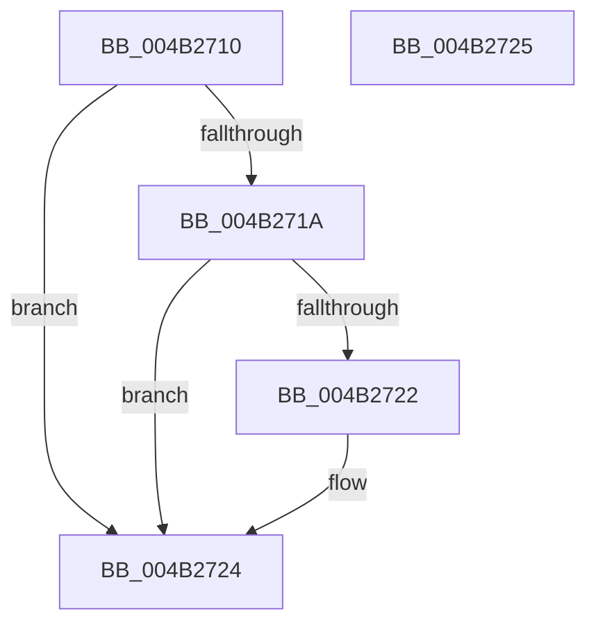

# PopInterruptSteeringEnabled

- RVA: `0x004B2710`–`0x004B2726` (길이 `22` bytes)
- VA: `0x00000001404B2710`
- 실행 섹션: `.text`
- PDB 이름 있음: `예`; PDB Function 태그: `아니요`
- unwind 정보 RVA: `0x000DB714`
- 디코드: `8`개 명령, `22/22` bytes 표시
- 미해석 바이트: `0` (있으면 어셈블리에 `.byte`로 보존)

> 이 문서는 커널 이미지의 기계어와 PDB 기호를 분석해 생성했습니다. 4번과 5번은 함수 원형과 자료형을 바이너리 사용 방식에서 추정한 C 해석이며 원본 소스 복구 결과는 아닙니다.

## 1. Dependencies

- 직접 호출 지점: **0**; 고유 호출 대상: **0**
- 직접 호출자로 확인된 함수: **1**
- RIP 상대 이미지 참조: **2**

### Outgoing calls
- 직접 디코드된 call 명령이 없습니다.

### Direct callers
- [PpmCheckReInit](../../page/A8/PpmCheckReInit_function_00A84DD8.md) at `0x00A84E7F`

### Static image references
- `0x004B2712` → RVA `0x00F10BA8` (`.data`; read)
- `0x004B271A` → RVA `0x00E67A6C` (`.data`; read)

## 2. Other-region calls and transfers

- 다른 실행 섹션으로 향하는 call: **0**
- 별도 외부 분기/꼬리 이동을 확인하지 못했습니다.

## 3. Assembly (complete function range)

```asm
004B2710  33 C0                           xor eax, eax
004B2712  38 05 90 E4 A5 00               cmp byte ptr [rip + 0xa5e490], al
004B2718  74 0A                           je 0x1404b2724
004B271A  39 05 4C 53 9B 00               cmp dword ptr [rip + 0x9b534c], eax
004B2720  75 02                           jne 0x1404b2724
004B2722  B0 01                           mov al, 1
004B2724  C3                              ret
004B2725  CC                              int3
```

## 4. C-style interpretation (structured pseudocode)

```c
__int64 __fastcall PopInterruptSteeringEnabled(void)
{
    __int64 result;

    result = 0;
    if ((*(unsigned __int8 *)(v_rip + 10871952)) == 0) goto loc_004B2724;
    if ((*(unsigned int *)(v_rip + 10179404)) == 0) {
        result = 1;
    }
    return result;
}
```

## 5. (Beta) C Style

```c
void PopInterruptSteeringEnabled(void)
{
    int64_t result;

    result = 0;
    if ((*(uint8_t *)(v_rip + 0xA5E490)) == 0) goto loc_004B2724;
    if ((*(uint32_t *)(v_rip + 0x9B534C)) == 0) {
        result = 1;
    }
    return result;
}
```

## 6. Execution-region graph

[열기: 2D/3D 그래프와 함수 탐색 컨트롤 패널](../../../control-panel.html?section=text&rva=0x004B2710&view=graph)

- 2D 그래프는 위에서 아래로 흐르고, 3D 그래프는 빈 공간을 드래그해 회전합니다. Shift+드래그는 이동, 휠은 확대·축소, 함수 노드 선택은 대상 보고서 이동입니다.

### Static fallback


