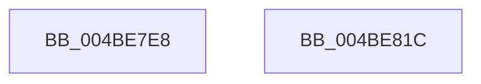

# PopLockGetDoDevicePowerState

- RVA: `0x004BE7E8`–`0x004BE81D` (길이 `53` bytes)
- VA: `0x00000001404BE7E8`
- 실행 섹션: `.text`
- PDB 이름 있음: `예`; PDB Function 태그: `아니요`
- unwind 정보 RVA: `0x0005CF00`
- 디코드: `16`개 명령, `53/53` bytes 표시
- 미해석 바이트: `0` (있으면 어셈블리에 `.byte`로 보존)

> 이 문서는 커널 이미지의 기계어와 PDB 기호를 분석해 생성했습니다. 4번과 5번은 함수 원형과 자료형을 바이너리 사용 방식에서 추정한 C 해석이며 원본 소스 복구 결과는 아닙니다.

## 1. Dependencies

- 직접 호출 지점: **2**; 고유 호출 대상: **2**
- 직접 호출자로 확인된 함수: **2**
- RIP 상대 이미지 참조: **1**

### Outgoing calls
- `0x004BE7F8` → [KeAcquireSpinLockRaiseToDpc](../20/KeAcquireSpinLockRaiseToDpc_function_00208470.md) (function, `0x00208470`)
- `0x004BE80F` → [KeReleaseSpinLock](../39/KeReleaseSpinLock_function_00392BA0.md) (function, `0x00392BA0`)

### Direct callers
- [PiControlGetDevicePowerData](../../page/A7/PiControlGetDevicePowerData_function_00A7A808.md) at `0x00A7A89A`
- [NtGetDevicePowerState](../../page/A9/NtGetDevicePowerState_function_00A9B750.md) at `0x00A9B817`

### Static image references
- `0x004BE7F1` → RVA `0x00F0CA80` (`.data`; read)

## 2. Other-region calls and transfers

- 다른 실행 섹션으로 향하는 call: **0**
- 별도 외부 분기/꼬리 이동을 확인하지 못했습니다.

## 3. Assembly (complete function range)

```asm
004BE7E8  40 53                           push rbx
004BE7EA  48 83 EC 20                     sub rsp, 0x20
004BE7EE  48 8B D9                        mov rbx, rcx
004BE7F1  48 8D 0D 88 E2 A4 00            lea rcx, [rip + 0xa4e288]
004BE7F8  E8 73 9C D4 FF                  call 0x140208470
004BE7FD  8B 5B 10                        mov ebx, dword ptr [rbx + 0x10]
004BE800  48 8D 0D 79 E2 A4 00            lea rcx, [rip + 0xa4e279]
004BE807  C1 EB 04                        shr ebx, 4
004BE80A  8A D0                           mov dl, al
004BE80C  83 E3 0F                        and ebx, 0xf
004BE80F  E8 8C 43 ED FF                  call 0x140392ba0
004BE814  8B C3                           mov eax, ebx
004BE816  48 83 C4 20                     add rsp, 0x20
004BE81A  5B                              pop rbx
004BE81B  C3                              ret
004BE81C  CC                              int3
```

## 4. C-style interpretation (structured pseudocode)

```c
__int64 __fastcall PopLockGetDoDevicePowerState(__int64 a1)
{
    __int64 result;
    __int64 v_rbx;
    __int64 v_rsp;

    v_rsp = (v_rsp) - (32);
    result = KeAcquireSpinLockRaiseToDpc(v_rip + 10805896, a2, a3, a4);
    v_rbx = (unsigned int)(((unsigned int)(*(unsigned int *)(a1 + 16))) >> (4));
    v_rbx = (unsigned int)((v_rbx) & (15));
    result = KeReleaseSpinLock(v_rip + 10805881, (unsigned __int8)(result), a3, a4);
    v_rsp = (v_rsp) + (32);
    return (unsigned int)((unsigned int)(v_rbx));
}
```

## 5. (Beta) C Style

```c
int64_t PopLockGetDoDevicePowerState(void *Arg1)
{
    uint8_t *arg1 = (uint8_t *)Arg1;

    int64_t result;
    int64_t local_rbx;
    int64_t local_rsp;

    local_rsp = (local_rsp) - (32);
    result = KeAcquireSpinLockRaiseToDpc(v_rip + 10805896, a2, a3, a4);
    local_rbx = (uint32_t)(((uint32_t)(*(uint32_t *)(arg1 + 0x10))) >> (4));
    local_rbx = (uint32_t)((local_rbx) & (15));
    result = KeReleaseSpinLock(v_rip + 10805881, (uint8_t)(result), a3, a4);
    local_rsp = (local_rsp) + (32);
    return (uint32_t)((uint32_t)(local_rbx));
}
```

### 관측된 메모리 오프셋

구조체 형식이 확인되지 않은 접근은 인자 기준의 오프셋으로만 기록했습니다.

| 기준 인자 | 오프셋 표현 | 폭 (bit) | 접근 |
|---|---:|---:|---|
| `Arg1` | `+ 0x10` | `32` | `R` |

## 6. Execution-region graph

[열기: 2D/3D 그래프와 함수 탐색 컨트롤 패널](../../../control-panel.html?section=text&rva=0x004BE7E8&view=graph)

- 2D 그래프는 위에서 아래로 흐르고, 3D 그래프는 빈 공간을 드래그해 회전합니다. Shift+드래그는 이동, 휠은 확대·축소, 함수 노드 선택은 대상 보고서 이동입니다.

### Static fallback


