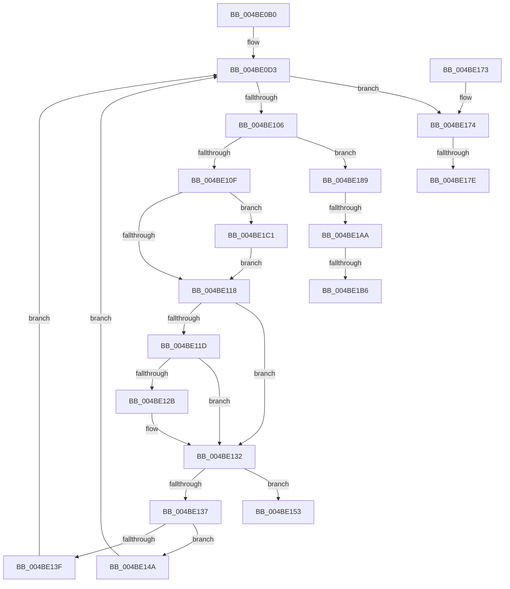

# PopNetEvaluationWorkerCallback

- RVA: `0x004BE0B0`–`0x004BE1D4` (길이 `292` bytes)
- VA: `0x00000001404BE0B0`
- 실행 섹션: `.text`
- PDB 이름 있음: `예`; PDB Function 태그: `예`
- unwind 정보 RVA: `0x000BC2AC`
- 디코드: `80`개 명령, `292/292` bytes 표시
- 미해석 바이트: `0` (있으면 어셈블리에 `.byte`로 보존)

> 이 문서는 커널 이미지의 기계어와 PDB 기호를 분석해 생성했습니다. 4번과 5번은 함수 원형과 자료형을 바이너리 사용 방식에서 추정한 C 해석이며 원본 소스 복구 결과는 아닙니다.

## 1. Dependencies

- 직접 호출 지점: **8**; 고유 호출 대상: **8**
- 직접 호출자로 확인된 함수: **0**
- RIP 상대 이미지 참조: **11**

### Outgoing calls
- `0x004BE0CE` → [PopAcquirePolicyLock](../../pagelk/B7/PopAcquirePolicyLock_function_00B783C0.md) (function, `0x00B783C0`)
- `0x004BE0F8` → [PopNetEvaluateStateMask](../../page/AB/PopNetEvaluateStateMask_function_00AB87A8.md) (function, `0x00AB87A8`)
- `0x004BE120` → [PopNetPublishWnfStateUpdate](../../page/AA/PopNetPublishWnfStateUpdate_function_00AAF544.md) (function, `0x00AAF544`)
- `0x004BE12D` → [PopNetSetResiliencyPhaseBias](../../page/AB/PopNetSetResiliencyPhaseBias_function_00ABD9F0.md) (function, `0x00ABD9F0`)
- `0x004BE143` → [PopTraceStandbyConnectivityUpdate](../../page/AD/PopTraceStandbyConnectivityUpdate_function_00AD901C.md) (function, `0x00AD901C`)
- `0x004BE159` → [PopReleasePolicyLock](../../pagelk/B7/PopReleasePolicyLock_function_00B78410.md) (function, `0x00B78410`)
- `0x004BE193` → [KeAcquireSpinLockRaiseToDpc](../20/KeAcquireSpinLockRaiseToDpc_function_00208470.md) (function, `0x00208470`)
- `0x004BE1CA` → [PopNetUpdateCsConsumptionFlags](../../page/AA/PopNetUpdateCsConsumptionFlags_function_00AA1D94.md) (function, `0x00AA1D94`)

### Direct callers
- 이 함수 시작 RVA로 연결되는 직접 call은 확인되지 않았습니다. 간접 호출은 완전히 역산할 수 없습니다.

### Static image references
- `0x004BE0D3` → RVA `0x00E678DC` (`.data`; read)
- `0x004BE0DF` → RVA `0x00E678E0` (`.data`; read)
- `0x004BE137` → RVA `0x00E67858` (`.data`; read)
- `0x004BE14A` → RVA `0x00F08870` (`.data`; write)
- `0x004BE153` → RVA `0x00F08868` (`.data`; read/write)
- `0x004BE189` → RVA `0x00F0CA58` (`.data`; read)
- `0x004BE198` → RVA `0x00F0C740` (`.data`; read)
- `0x004BE19E` → RVA `0x00E678E0` (`.data`; write)
- `0x004BE1AA` → RVA `0x00F0C76C` (`.data`; read)
- `0x004BE1B6` → RVA `0x00F0C76C` (`.data`; write)
- `0x004BE1C4` → RVA `0x00E678DC` (`.data`; write)

## 2. Other-region calls and transfers

- 다른 실행 섹션으로 향하는 call: **7**
  - `0x004BE0CE` → [PopAcquirePolicyLock](../../pagelk/B7/PopAcquirePolicyLock_function_00B783C0.md) (`.text` → `PAGELK`)
  - `0x004BE0F8` → [PopNetEvaluateStateMask](../../page/AB/PopNetEvaluateStateMask_function_00AB87A8.md) (`.text` → `PAGE`)
  - `0x004BE120` → [PopNetPublishWnfStateUpdate](../../page/AA/PopNetPublishWnfStateUpdate_function_00AAF544.md) (`.text` → `PAGE`)
  - `0x004BE12D` → [PopNetSetResiliencyPhaseBias](../../page/AB/PopNetSetResiliencyPhaseBias_function_00ABD9F0.md) (`.text` → `PAGE`)
  - `0x004BE143` → [PopTraceStandbyConnectivityUpdate](../../page/AD/PopTraceStandbyConnectivityUpdate_function_00AD901C.md) (`.text` → `PAGE`)
  - `0x004BE159` → [PopReleasePolicyLock](../../pagelk/B7/PopReleasePolicyLock_function_00B78410.md) (`.text` → `PAGELK`)
  - `0x004BE1CA` → [PopNetUpdateCsConsumptionFlags](../../page/AA/PopNetUpdateCsConsumptionFlags_function_00AA1D94.md) (`.text` → `PAGE`)
- call이 아닌 외부 분기/꼬리 이동: **5**
  - `0x004BE178` → [sub_006FCAE6](../6F/Unknown_function_006FCAE6.md) (`tail-transfer`)
  - `0x004BE184` → [sub_006FCAE6 + 0xC](../6F/Unknown_function_006FCAE6.md) (`tail-transfer`)
  - `0x004BE1A4` → [sub_006FCAE6 + 0x37](../6F/Unknown_function_006FCAE6.md) (`tail-transfer`)
  - `0x004BE1B0` → [sub_006FCAE6 + 0x37](../6F/Unknown_function_006FCAE6.md) (`tail-transfer`)
  - `0x004BE1BC` → [sub_006FCAE6 + 0x37](../6F/Unknown_function_006FCAE6.md) (`tail-transfer`)

## 3. Assembly (complete function range)

```asm
004BE0B0  48 89 5C 24 08                  mov qword ptr [rsp + 8], rbx
004BE0B5  55                              push rbp
004BE0B6  56                              push rsi
004BE0B7  57                              push rdi
004BE0B8  41 54                           push r12
004BE0BA  41 55                           push r13
004BE0BC  41 56                           push r14
004BE0BE  41 57                           push r15
004BE0C0  48 83 EC 20                     sub rsp, 0x20
004BE0C4  33 DB                           xor ebx, ebx
004BE0C6  89 5C 24 78                     mov dword ptr [rsp + 0x78], ebx
004BE0CA  89 5C 24 70                     mov dword ptr [rsp + 0x70], ebx
004BE0CE  E8 ED A2 6B 00                  call 0x140b783c0
004BE0D3  44 8B 35 02 98 9A 00            mov r14d, dword ptr [rip + 0x9a9802]
004BE0DA  48 8D 54 24 78                  lea rdx, [rsp + 0x78]
004BE0DF  44 8B 25 FA 97 9A 00            mov r12d, dword ptr [rip + 0x9a97fa]
004BE0E6  48 8D 4C 24 70                  lea rcx, [rsp + 0x70]
004BE0EB  44 8A FB                        mov r15b, bl
004BE0EE  88 5C 24 68                     mov byte ptr [rsp + 0x68], bl
004BE0F2  40 8A EB                        mov bpl, bl
004BE0F5  44 8A EB                        mov r13b, bl
004BE0F8  E8 AB A6 5F 00                  call 0x140ab87a8
004BE0FD  8B 74 24 70                     mov esi, dword ptr [rsp + 0x70]
004BE101  41 3B F6                        cmp esi, r14d
004BE104  75 6E                           jne 0x1404be174
004BE106  8B 7C 24 78                     mov edi, dword ptr [rsp + 0x78]
004BE10A  41 3B FC                        cmp edi, r12d
004BE10D  75 7A                           jne 0x1404be189
004BE10F  41 3B F6                        cmp esi, r14d
004BE112  0F 85 A9 00 00 00               jne 0x1404be1c1
004BE118  40 84 ED                        test bpl, bpl
004BE11B  74 15                           je 0x1404be132
004BE11D  41 8A CD                        mov cl, r13b
004BE120  E8 1F 14 5F 00                  call 0x140aaf544
004BE125  38 5C 24 68                     cmp byte ptr [rsp + 0x68], bl
004BE129  74 07                           je 0x1404be132
004BE12B  33 C9                           xor ecx, ecx
004BE12D  E8 BE F8 5F 00                  call 0x140abd9f0
004BE132  45 84 FF                        test r15b, r15b
004BE135  74 1C                           je 0x1404be153
004BE137  38 1D 1B 97 9A 00               cmp byte ptr [rip + 0x9a971b], bl
004BE13D  74 0B                           je 0x1404be14a
004BE13F  8B D7                           mov edx, edi
004BE141  8B CE                           mov ecx, esi
004BE143  E8 D4 AE 61 00                  call 0x140ad901c
004BE148  EB 89                           jmp 0x1404be0d3
004BE14A  C6 05 1F A7 A4 00 01            mov byte ptr [rip + 0xa4a71f], 1
004BE151  EB 80                           jmp 0x1404be0d3
004BE153  87 1D 0F A7 A4 00               xchg dword ptr [rip + 0xa4a70f], ebx
004BE159  E8 B2 A2 6B 00                  call 0x140b78410
004BE15E  48 8B 5C 24 60                  mov rbx, qword ptr [rsp + 0x60]
004BE163  48 83 C4 20                     add rsp, 0x20
004BE167  41 5F                           pop r15
004BE169  41 5E                           pop r14
004BE16B  41 5D                           pop r13
004BE16D  41 5C                           pop r12
004BE16F  5F                              pop rdi
004BE170  5E                              pop rsi
004BE171  5D                              pop rbp
004BE172  C3                              ret
004BE173  CC                              int3
004BE174  41 83 FE 02                     cmp r14d, 2
004BE178  0F 85 68 E9 23 00               jne 0x1406fcae6
004BE17E  40 B5 01                        mov bpl, 1
004BE181  44 8A ED                        mov r13b, bpl
004BE184  E9 69 E9 23 00                  jmp 0x1406fcaf2
004BE189  48 8D 0D C8 E8 A4 00            lea rcx, [rip + 0xa4e8c8]
004BE190  41 B7 01                        mov r15b, 1
004BE193  E8 D8 A2 D4 FF                  call 0x140208470
004BE198  38 1D A2 E5 A4 00               cmp byte ptr [rip + 0xa4e5a2], bl
004BE19E  89 3D 3C 97 9A 00               mov dword ptr [rip + 0x9a973c], edi
004BE1A4  0F 84 73 E9 23 00               je 0x1406fcb1d
004BE1AA  39 1D BC E5 A4 00               cmp dword ptr [rip + 0xa4e5bc], ebx
004BE1B0  0F 85 67 E9 23 00               jne 0x1406fcb1d
004BE1B6  89 3D B0 E5 A4 00               mov dword ptr [rip + 0xa4e5b0], edi
004BE1BC  E9 5C E9 23 00                  jmp 0x1406fcb1d
004BE1C1  41 B7 01                        mov r15b, 1
004BE1C4  89 35 12 97 9A 00               mov dword ptr [rip + 0x9a9712], esi
004BE1CA  E8 C5 3B 5E 00                  call 0x140aa1d94
004BE1CF  E9 44 FF FF FF                  jmp 0x1404be118
```

## 4. C-style interpretation (structured pseudocode)

```c
__int64 __fastcall PopNetEvaluationWorkerCallback(void)
{
    __int64 result;
    __int64 v_rbx;
    __int64 v_rsp;
    unsigned __int8 v_stack_p10;
    unsigned int v_stack_p18;
    unsigned int v_stack_p20;
    unsigned __int64 v_stack_p8;

    v_stack_p8 = v_rbx;
    v_rsp = (v_rsp) - (32);
    v_rbx = 0;
    v_stack_p20 = 0;
    v_stack_p18 = 0;
    result = PopAcquirePolicyLock(a1, a2, a3, a4);
loc_004BE0D3:
    v_stack_p10 = 0;
    result = PopNetEvaluateStateMask(v_stack_p18, v_stack_p20, a3, a4);
    if (((unsigned int)((unsigned int)(v_stack_p18))) != ((unsigned int)((unsigned int)(*(unsigned int *)(v_rip + 10131458))))) goto loc_004BE174;
    if (((unsigned int)((unsigned int)(v_stack_p20))) != ((unsigned int)((unsigned int)(*(unsigned int *)(v_rip + 10131450))))) goto loc_004BE189;
    if (((unsigned int)((unsigned int)(v_stack_p18))) != ((unsigned int)((unsigned int)(*(unsigned int *)(v_rip + 10131458))))) goto loc_004BE1C1;
loc_004BE118:
    if (0 == 0) goto loc_004BE132;
    result = PopNetPublishWnfStateUpdate(0, v_stack_p20, a3, a4);
    if (v_stack_p10 != 0) {
        a1 = 0;
        result = PopNetSetResiliencyPhaseBias(a1, v_stack_p20, a3, a4);
    }
    if (0 == 0) goto loc_004BE153;
    if ((*(unsigned __int8 *)(v_rip + 10131227)) == 0) goto loc_004BE14A;
    result = PopTraceStandbyConnectivityUpdate((unsigned int)((unsigned int)((unsigned int)(v_stack_p18))), (unsigned int)((unsigned int)((unsigned int)(v_stack_p20))), a3, a4);
    goto loc_004BE0D3;
loc_004BE14A:
    *(unsigned __int8 *)(v_rip + 10790687) = 1;
    goto loc_004BE0D3;
loc_004BE153:
    result = PopReleasePolicyLock((unsigned int)((unsigned int)((unsigned int)(v_stack_p18))), (unsigned int)((unsigned int)((unsigned int)(v_stack_p20))), a3, a4);
    v_rsp = (v_rsp) + (32);
    return result;
loc_004BE174:
loc_004BE189:
    result = KeAcquireSpinLockRaiseToDpc(v_rip + 10807496, (unsigned int)((unsigned int)((unsigned int)(v_stack_p20))), a3, a4);
    *(unsigned int *)(v_rip + 10131260) = (unsigned int)((unsigned int)(v_stack_p20));
    *(unsigned int *)(v_rip + 10806704) = (unsigned int)((unsigned int)(v_stack_p20));
loc_004BE1C1:
    *(unsigned int *)(v_rip + 10131218) = (unsigned int)((unsigned int)(v_stack_p18));
    result = PopNetUpdateCsConsumptionFlags(v_rip + 10807496, (unsigned int)((unsigned int)((unsigned int)(v_stack_p20))), a3, a4);
    goto loc_004BE118;
}
```

## 5. (Beta) C Style

```c
void PopNetEvaluationWorkerCallback(void)
{
    int64_t result;
    int64_t local_rbx;
    int64_t local_rsp;
    uint8_t v_stack_p10;
    uint32_t v_stack_p18;
    uint32_t v_stack_p20;
    uint64_t v_stack_p8;

    v_stack_p8 = local_rbx;
    local_rsp = (local_rsp) - (32);
    local_rbx = 0;
    v_stack_p20 = 0;
    v_stack_p18 = 0;
    result = PopAcquirePolicyLock(a1, a2, a3, a4);
loc_004BE0D3:
    v_stack_p10 = 0;
    result = PopNetEvaluateStateMask(v_stack_p18, v_stack_p20, a3, a4);
    if (((uint32_t)((uint32_t)(v_stack_p18))) != ((uint32_t)((uint32_t)(*(uint32_t *)(v_rip + 0x9A9802))))) goto loc_004BE174;
    if (((uint32_t)((uint32_t)(v_stack_p20))) != ((uint32_t)((uint32_t)(*(uint32_t *)(v_rip + 0x9A97FA))))) goto loc_004BE189;
    if (((uint32_t)((uint32_t)(v_stack_p18))) != ((uint32_t)((uint32_t)(*(uint32_t *)(v_rip + 0x9A9802))))) goto loc_004BE1C1;
loc_004BE118:
    if (0 == 0) goto loc_004BE132;
    result = PopNetPublishWnfStateUpdate(0, v_stack_p20, a3, a4);
    if (v_stack_p10 != 0) {
        a1 = 0;
        result = PopNetSetResiliencyPhaseBias(a1, v_stack_p20, a3, a4);
    }
    if (0 == 0) goto loc_004BE153;
    if ((*(uint8_t *)(v_rip + 0x9A971B)) == 0) goto loc_004BE14A;
    result = PopTraceStandbyConnectivityUpdate((uint32_t)((uint32_t)((uint32_t)(v_stack_p18))), (uint32_t)((uint32_t)((uint32_t)(v_stack_p20))), a3, a4);
    goto loc_004BE0D3;
loc_004BE14A:
    *(uint8_t *)(v_rip + 0xA4A71F) = 1;
    goto loc_004BE0D3;
loc_004BE153:
    result = PopReleasePolicyLock((uint32_t)((uint32_t)((uint32_t)(v_stack_p18))), (uint32_t)((uint32_t)((uint32_t)(v_stack_p20))), a3, a4);
    local_rsp = (local_rsp) + (32);
    return result;
loc_004BE174:
loc_004BE189:
    result = KeAcquireSpinLockRaiseToDpc(v_rip + 10807496, (uint32_t)((uint32_t)((uint32_t)(v_stack_p20))), a3, a4);
    *(uint32_t *)(v_rip + 0x9A973C) = (uint32_t)((uint32_t)(v_stack_p20));
    *(uint32_t *)(v_rip + 0xA4E5B0) = (uint32_t)((uint32_t)(v_stack_p20));
loc_004BE1C1:
    *(uint32_t *)(v_rip + 0x9A9712) = (uint32_t)((uint32_t)(v_stack_p18));
    result = PopNetUpdateCsConsumptionFlags(v_rip + 10807496, (uint32_t)((uint32_t)((uint32_t)(v_stack_p20))), a3, a4);
    goto loc_004BE118;
}
```

## 6. Execution-region graph

[열기: 2D/3D 그래프와 함수 탐색 컨트롤 패널](../../../control-panel.html?section=text&rva=0x004BE0B0&view=graph)

- 2D 그래프는 위에서 아래로 흐르고, 3D 그래프는 빈 공간을 드래그해 회전합니다. Shift+드래그는 이동, 휠은 확대·축소, 함수 노드 선택은 대상 보고서 이동입니다.

### Static fallback


