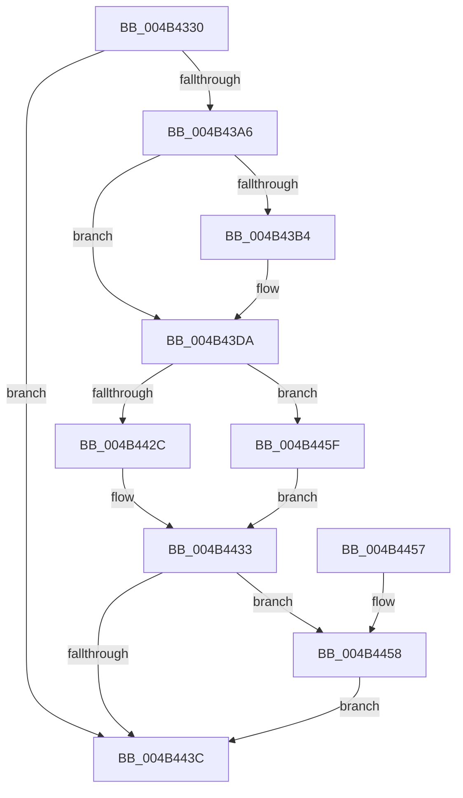

# PopOpenKey

- RVA: `0x004B4330`–`0x004B4466` (길이 `310` bytes)
- VA: `0x00000001404B4330`
- 실행 섹션: `.text`
- PDB 이름 있음: `예`; PDB Function 태그: `아니요`
- unwind 정보 RVA: `0x000B9E44`
- 디코드: `77`개 명령, `310/310` bytes 표시
- 미해석 바이트: `0` (있으면 어셈블리에 `.byte`로 보존)

> 이 문서는 커널 이미지의 기계어와 PDB 기호를 분석해 생성했습니다. 4번과 5번은 함수 원형과 자료형을 바이너리 사용 방식에서 추정한 C 해석이며 원본 소스 복구 결과는 아닙니다.

## 1. Dependencies

- 직접 호출 지점: **4**; 고유 호출 대상: **4**
- 직접 호출자로 확인된 함수: **3**
- RIP 상대 이미지 참조: **1**

### Outgoing calls
- `0x004B4397` → [ZwOpenKey](../6A/ZwOpenKey_function_006AD310.md) (function, `0x006AD310`)
- `0x004B43B7` → [wcslen](../50/wcslen_function_00501BA0.md) (function, `0x00501BA0`)
- `0x004B4421` → [ZwCreateKey](../6A/ZwCreateKey_function_006AD470.md) (function, `0x006AD470`)
- `0x004B4458` → [ZwClose](../6A/ZwClose_function_006AD2B0.md) (function, `0x006AD2B0`)

### Direct callers
- [PopOpenPowerKey](PopOpenPowerKey_function_004B4314.md) at `0x004B431F`
- [PpmInitIllegalThrottleLogging](../5C/PpmInitIllegalThrottleLogging_function_005CE39C.md) at `0x005CE3CE`
- [PopLoadResumeContext](../../page/AD/PopLoadResumeContext_function_00AD1C0C.md) at `0x00AD1C3F`

### Static image references
- `0x004B434F` → RVA `0x00FD9EF8` (`PAGEDATA`; read)

## 2. Other-region calls and transfers

- 다른 실행 섹션으로 향하는 call: **0**
- 별도 외부 분기/꼬리 이동을 확인하지 못했습니다.

## 3. Assembly (complete function range)

```asm
004B4330  48 8B C4                        mov rax, rsp
004B4333  48 89 58 08                     mov qword ptr [rax + 8], rbx
004B4337  48 89 70 10                     mov qword ptr [rax + 0x10], rsi
004B433B  48 89 78 18                     mov qword ptr [rax + 0x18], rdi
004B433F  55                              push rbp
004B4340  48 8D 68 A1                     lea rbp, [rax - 0x5f]
004B4344  48 81 EC 90 00 00 00            sub rsp, 0x90
004B434B  83 65 3B 00                     and dword ptr [rbp + 0x3b], 0
004B434F  48 8D 05 A2 5B B2 00            lea rax, [rip + 0xb25ba2]
004B4356  48 83 65 07 00                  and qword ptr [rbp + 7], 0
004B435B  4C 8D 45 1F                     lea r8, [rbp + 0x1f]
004B435F  48 83 65 7F 00                  and qword ptr [rbp + 0x7f], 0
004B4364  48 8B DA                        mov rbx, rdx
004B4367  48 83 65 27 00                  and qword ptr [rbp + 0x27], 0
004B436C  48 8B F1                        mov rsi, rcx
004B436F  0F 57 C0                        xorps xmm0, xmm0
004B4372  48 C7 45 1F 30 00 00 00         mov qword ptr [rbp + 0x1f], 0x30
004B437A  83 65 23 00                     and dword ptr [rbp + 0x23], 0
004B437E  48 8D 4D 07                     lea rcx, [rbp + 7]
004B4382  BA 1F 00 02 00                  mov edx, 0x2001f
004B4387  48 89 45 2F                     mov qword ptr [rbp + 0x2f], rax
004B438B  F3 0F 7F 45 3F                  movdqu xmmword ptr [rbp + 0x3f], xmm0
004B4390  C7 45 37 40 02 00 00            mov dword ptr [rbp + 0x37], 0x240
004B4397  E8 74 8F 1F 00                  call 0x1406ad310
004B439C  8B F8                           mov edi, eax
004B439E  85 C0                           test eax, eax
004B43A0  0F 88 96 00 00 00               js 0x1404b443c
004B43A6  48 83 65 0F 00                  and qword ptr [rbp + 0xf], 0
004B43AB  48 89 5D 17                     mov qword ptr [rbp + 0x17], rbx
004B43AF  48 85 DB                        test rbx, rbx
004B43B2  74 26                           je 0x1404b43da
004B43B4  48 8B CB                        mov rcx, rbx
004B43B7  E8 E4 D7 04 00                  call 0x140501ba0
004B43BC  48 03 C0                        add rax, rax
004B43BF  B9 FC FF 00 00                  mov ecx, 0xfffc
004B43C4  48 3D FE FF 00 00               cmp rax, 0xfffe
004B43CA  48 0F 43 C1                     cmovae rax, rcx
004B43CE  66 89 45 0F                     mov word ptr [rbp + 0xf], ax
004B43D2  66 83 C0 02                     add ax, 2
004B43D6  66 89 45 11                     mov word ptr [rbp + 0x11], ax
004B43DA  48 8B 45 07                     mov rax, qword ptr [rbp + 7]
004B43DE  4C 8D 45 1F                     lea r8, [rbp + 0x1f]
004B43E2  48 83 64 24 30 00               and qword ptr [rsp + 0x30], 0
004B43E8  48 8D 4D 7F                     lea rcx, [rbp + 0x7f]
004B43EC  83 64 24 28 00                  and dword ptr [rsp + 0x28], 0
004B43F1  0F 57 C0                        xorps xmm0, xmm0
004B43F4  48 83 64 24 20 00               and qword ptr [rsp + 0x20], 0
004B43FA  45 33 C9                        xor r9d, r9d
004B43FD  48 89 45 27                     mov qword ptr [rbp + 0x27], rax
004B4401  BA 1F 00 02 00                  mov edx, 0x2001f
004B4406  48 8D 45 0F                     lea rax, [rbp + 0xf]
004B440A  C7 45 1F 30 00 00 00            mov dword ptr [rbp + 0x1f], 0x30
004B4411  48 89 45 2F                     mov qword ptr [rbp + 0x2f], rax
004B4415  C7 45 37 40 02 00 00            mov dword ptr [rbp + 0x37], 0x240
004B441C  F3 0F 7F 45 3F                  movdqu xmmword ptr [rbp + 0x3f], xmm0
004B4421  E8 4A 90 1F 00                  call 0x1406ad470
004B4426  8B F8                           mov edi, eax
004B4428  85 C0                           test eax, eax
004B442A  78 33                           js 0x1404b445f
004B442C  48 8B 45 7F                     mov rax, qword ptr [rbp + 0x7f]
004B4430  48 89 06                        mov qword ptr [rsi], rax
004B4433  48 8B 4D 07                     mov rcx, qword ptr [rbp + 7]
004B4437  48 85 C9                        test rcx, rcx
004B443A  75 1C                           jne 0x1404b4458
004B443C  4C 8D 9C 24 90 00 00 00         lea r11, [rsp + 0x90]
004B4444  8B C7                           mov eax, edi
004B4446  49 8B 5B 10                     mov rbx, qword ptr [r11 + 0x10]
004B444A  49 8B 73 18                     mov rsi, qword ptr [r11 + 0x18]
004B444E  49 8B 7B 20                     mov rdi, qword ptr [r11 + 0x20]
004B4452  49 8B E3                        mov rsp, r11
004B4455  5D                              pop rbp
004B4456  C3                              ret
004B4457  CC                              int3
004B4458  E8 53 8E 1F 00                  call 0x1406ad2b0
004B445D  EB DD                           jmp 0x1404b443c
004B445F  48 83 65 7F 00                  and qword ptr [rbp + 0x7f], 0
004B4464  EB CD                           jmp 0x1404b4433
```

## 4. C-style interpretation (structured pseudocode)

```c
__int64 __fastcall PopOpenKey(__int64 a1, __int64 a2, __int64 a3, int a4)
{
    __int64 result;
    __int64 v_rsp;
    unsigned __int64 v_stack_m68;
    unsigned int v_stack_m70;
    unsigned __int64 v_stack_m78;
    unsigned __int64 v_stack_m8;

    *(unsigned __int64 *)(v_rsp + 8) = v_rbx;
    *(unsigned __int64 *)(v_rsp + 16) = v_rsi;
    *(unsigned __int64 *)(v_rsp + 24) = v_rdi;
    v_rsp = (v_rsp) - (144);
    *(unsigned __int64 *)(v_rsp - 95 + 31) = 48;
    *(unsigned __int64 *)(v_rsp - 95 + 47) = v_rip + 11688866;
    *(unsigned __int64 *)(v_rsp - 95 + 63) = v_xmm0;
    *(unsigned int *)(v_rsp - 95 + 55) = 576;
    result = ZwOpenKey(v_rsp - 95 + 7, (unsigned int)(0x2001FULL), v_rsp - 95 + 31, a4);
    if (sign_flag) goto loc_004B443C;
    *(unsigned __int64 *)(v_rsp - 95 + 23) = a2;
    if (a2 != 0) {
        a1 = a2;
        result = wcslen(a1, (unsigned int)(0x2001FULL), v_rsp - 95 + 31, a4);
        result = (result) + (result);
        a1 = 0xFFFCULL;
        if (result >= 0xFFFEULL) { result = a1; }
        *(unsigned __int16 *)(v_rsp - 95 + 15) = (unsigned __int16)(result);
        result = (unsigned __int16)((result) + (2));
        *(unsigned __int16 *)(v_rsp - 95 + 17) = (unsigned __int16)(result);
    }
    a4 = 0;
    *(unsigned __int64 *)(v_rsp - 95 + 39) = *(unsigned __int64 *)(v_rsp - 95 + 7);
    *(unsigned int *)(v_rsp - 95 + 31) = 48;
    *(unsigned __int64 *)(v_rsp - 95 + 47) = v_rsp - 95 + 15;
    *(unsigned int *)(v_rsp - 95 + 55) = 576;
    *(unsigned __int64 *)(v_rsp - 95 + 63) = v_xmm0;
    result = ZwCreateKey(v_rsp - 95 + 127, (unsigned int)(0x2001FULL), v_rsp - 95 + 31, a4);
    if (sign_flag) goto loc_004B445F;
    *(unsigned __int64 *)(a1) = *(unsigned __int64 *)(v_rsp - 95 + 127);
loc_004B4433:
    if (*(unsigned __int64 *)(v_rsp - 95 + 7) != 0) goto loc_004B4458;
loc_004B443C:
    return (unsigned int)((unsigned int)((unsigned int)((unsigned int)(result))));
loc_004B4458:
    result = ZwClose(*(unsigned __int64 *)(v_rsp - 95 + 7), (unsigned int)(0x2001FULL), v_rsp - 95 + 31, a4);
    goto loc_004B443C;
loc_004B445F:
    goto loc_004B4433;
}
```

## 5. (Beta) C Style

```c
int64_t PopOpenKey(void *Arg1, int64_t Arg2, int64_t Arg3, int32_t Arg4)
{
    uint8_t *arg1 = (uint8_t *)Arg1;

    int64_t result;
    int64_t local_rsp;
    uint64_t v_stack_m68;
    uint32_t v_stack_m70;
    uint64_t v_stack_m78;
    uint64_t v_stack_m8;

    *(uint64_t *)(local_rsp + 0x8) = local_rbx;
    *(uint64_t *)(local_rsp + 0x10) = local_rsi;
    *(uint64_t *)(local_rsp + 0x18) = local_rdi;
    local_rsp = (local_rsp) - (144);
    *(uint64_t *)(local_rsp - 0x5F + 0x1F) = 48;
    *(uint64_t *)(local_rsp - 0x5F + 0x2F) = v_rip + 11688866;
    *(uint64_t *)(local_rsp - 0x5F + 0x3F) = v_xmm0;
    *(uint32_t *)(local_rsp - 0x5F + 0x37) = 576;
    result = ZwOpenKey(local_rsp - 95 + 7, (uint32_t)(0x2001FULL), local_rsp - 95 + 31, Arg4);
    if (sign_flag) goto loc_004B443C;
    *(uint64_t *)(local_rsp - 0x5F + 0x17) = Arg2;
    if (Arg2 != 0) {
        Arg1 = Arg2;
        result = wcslen(Arg1, (uint32_t)(0x2001FULL), local_rsp - 95 + 31, Arg4);
        result = (result) + (result);
        Arg1 = 0xFFFCULL;
        if (result >= 0xFFFEULL) { result = Arg1; }
        *(uint16_t *)(local_rsp - 0x5F + 0xF) = (uint16_t)(result);
        result = (uint16_t)((result) + (2));
        *(uint16_t *)(local_rsp - 0x5F + 0x11) = (uint16_t)(result);
    }
    Arg4 = 0;
    *(uint64_t *)(local_rsp - 0x5F + 0x27) = *(uint64_t *)(local_rsp - 0x5F + 0x7);
    *(uint32_t *)(local_rsp - 0x5F + 0x1F) = 48;
    *(uint64_t *)(local_rsp - 0x5F + 0x2F) = local_rsp - 95 + 15;
    *(uint32_t *)(local_rsp - 0x5F + 0x37) = 576;
    *(uint64_t *)(local_rsp - 0x5F + 0x3F) = v_xmm0;
    result = ZwCreateKey(local_rsp - 95 + 127, (uint32_t)(0x2001FULL), local_rsp - 95 + 31, Arg4);
    if (sign_flag) goto loc_004B445F;
    *(uint64_t *)(arg1) = *(uint64_t *)(local_rsp - 0x5F + 0x7F);
loc_004B4433:
    if (*(uint64_t *)(local_rsp - 0x5F + 0x7) != 0) goto loc_004B4458;
loc_004B443C:
    return (uint32_t)((uint32_t)((uint32_t)((uint32_t)(result))));
loc_004B4458:
    result = ZwClose(*(uint64_t *)(local_rsp - 0x5F + 0x7), (uint32_t)(0x2001FULL), local_rsp - 95 + 31, Arg4);
    goto loc_004B443C;
loc_004B445F:
    goto loc_004B4433;
}
```

### 관측된 메모리 오프셋

구조체 형식이 확인되지 않은 접근은 인자 기준의 오프셋으로만 기록했습니다.

| 기준 인자 | 오프셋 표현 | 폭 (bit) | 접근 |
|---|---:|---:|---|
| `Arg1` | `+ 0x0` | `64` | `W` |

## 6. Execution-region graph

[열기: 2D/3D 그래프와 함수 탐색 컨트롤 패널](../../../control-panel.html?section=text&rva=0x004B4330&view=graph)

- 2D 그래프는 위에서 아래로 흐르고, 3D 그래프는 빈 공간을 드래그해 회전합니다. Shift+드래그는 이동, 휠은 확대·축소, 함수 노드 선택은 대상 보고서 이동입니다.

### Static fallback


