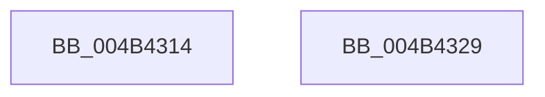

# PopOpenPowerKey

- RVA: `0x004B4314`–`0x004B432A` (길이 `22` bytes)
- VA: `0x00000001404B4314`
- 실행 섹션: `.text`
- PDB 이름 있음: `예`; PDB Function 태그: `아니요`
- unwind 정보 RVA: `0x0005C788`
- 디코드: `6`개 명령, `22/22` bytes 표시
- 미해석 바이트: `0` (있으면 어셈블리에 `.byte`로 보존)

> 이 문서는 커널 이미지의 기계어와 PDB 기호를 분석해 생성했습니다. 4번과 5번은 함수 원형과 자료형을 바이너리 사용 방식에서 추정한 C 해석이며 원본 소스 복구 결과는 아닙니다.

## 1. Dependencies

- 직접 호출 지점: **1**; 고유 호출 대상: **1**
- 직접 호출자로 확인된 함수: **8**
- RIP 상대 이미지 참조: **1**

### Outgoing calls
- `0x004B431F` → [PopOpenKey](PopOpenKey_function_004B4330.md) (function, `0x004B4330`)

### Direct callers
- [PoGetLightestSystemStateForEject](../../page/75/PoGetLightestSystemStateForEject_function_00753E30.md) at `0x00753EB4`
- [PopBatteryTestExemptPolicyRegKeyAccess](../../page/76/PopBatteryTestExemptPolicyRegKeyAccess_function_00766E04.md) at `0x00766E43`
- [PopEnableHiberFile](../../page/90/PopEnableHiberFile_function_0090F850.md) at `0x0090FA65`
- [PopResetCurrentPolicies](../../page/90/PopResetCurrentPolicies_function_0090FF64.md) at `0x0090FFB0`
- [PopApplyPolicy](../../page/91/PopApplyPolicy_function_009107B0.md) at `0x00910A05`
- [PopDiagTraceHiberStats](../../page/A7/PopDiagTraceHiberStats_function_00A72FB4.md) at `0x00A73008`
- [PopReadHiberbootPolicy](../../page/A9/PopReadHiberbootPolicy_function_00A9517C.md) at `0x00A951C3`
- [PopReadSystemAwayModePolicy](../../page/A9/PopReadSystemAwayModePolicy_function_00A9D368.md) at `0x00A9D3C1`

### Static image references
- `0x004B4318` → RVA `0x0001C4F8` (`.rdata`; read)

## 2. Other-region calls and transfers

- 다른 실행 섹션으로 향하는 call: **0**
- 별도 외부 분기/꼬리 이동을 확인하지 못했습니다.

## 3. Assembly (complete function range)

```asm
004B4314  48 83 EC 28                     sub rsp, 0x28
004B4318  48 8D 15 D9 81 B6 FF            lea rdx, [rip - 0x497e27]
004B431F  E8 0C 00 00 00                  call 0x1404b4330
004B4324  48 83 C4 28                     add rsp, 0x28
004B4328  C3                              ret
004B4329  CC                              int3
```

## 4. C-style interpretation (structured pseudocode)

```c
__int64 __fastcall PopOpenPowerKey(void)
{
    __int64 result;
    __int64 v_rsp;

    v_rsp = (v_rsp) - (40);
    result = PopOpenKey(a1, v_rip - 4816423, a3, a4);
    v_rsp = (v_rsp) + (40);
    return result;
}
```

## 5. (Beta) C Style

```c
void PopOpenPowerKey(void)
{
    int64_t result;
    int64_t local_rsp;

    local_rsp = (local_rsp) - (40);
    result = PopOpenKey(a1, v_rip - 4816423, a3, a4);
    local_rsp = (local_rsp) + (40);
    return result;
}
```

## 6. Execution-region graph

[열기: 2D/3D 그래프와 함수 탐색 컨트롤 패널](../../../control-panel.html?section=text&rva=0x004B4314&view=graph)

- 2D 그래프는 위에서 아래로 흐르고, 3D 그래프는 빈 공간을 드래그해 회전합니다. Shift+드래그는 이동, 휠은 확대·축소, 함수 노드 선택은 대상 보고서 이동입니다.

### Static fallback


