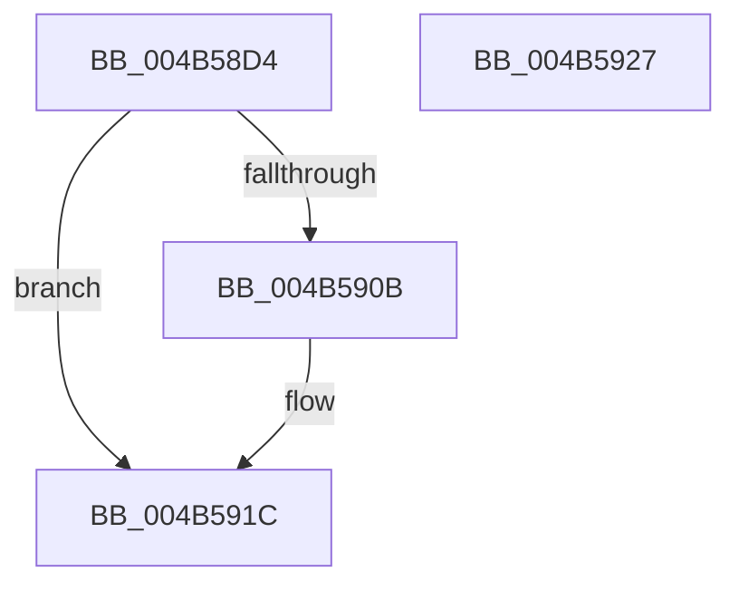

# PopPepDeviceStarted

- RVA: `0x004B58D4`–`0x004B5928` (길이 `84` bytes)
- VA: `0x00000001404B58D4`
- 실행 섹션: `.text`
- PDB 이름 있음: `예`; PDB Function 태그: `아니요`
- unwind 정보 RVA: `0x0005CAAC`
- 디코드: `22`개 명령, `84/84` bytes 표시
- 미해석 바이트: `0` (있으면 어셈블리에 `.byte`로 보존)

> 이 문서는 커널 이미지의 기계어와 PDB 기호를 분석해 생성했습니다. 4번과 5번은 함수 원형과 자료형을 바이너리 사용 방식에서 추정한 C 해석이며 원본 소스 복구 결과는 아닙니다.

## 1. Dependencies

- 직접 호출 지점: **3**; 고유 호출 대상: **3**
- 직접 호출자로 확인된 함수: **1**
- RIP 상대 이미지 참조: **2**

### Outgoing calls
- `0x004B58E5` → [ExAcquireSpinLockExclusive](../24/ExAcquireSpinLockExclusive_function_00248690.md) (function, `0x00248690`)
- `0x004B58FA` → [ExReleaseSpinLockExclusive](../2C/ExReleaseSpinLockExclusive_function_002C0EF0.md) (function, `0x002C0EF0`)
- `0x004B5917` → [PopPepInitializeVetoMasks](../4C/PopPepInitializeVetoMasks_function_004C9350.md) (function, `0x004C9350`)

### Direct callers
- [PoFxStartDevicePowerManagement](PoFxStartDevicePowerManagement_function_004B5740.md) at `0x004B5771`

### Static image references
- `0x004B58FF` → RVA `0x00FC52C8` (`ALMOSTRO`; read)
- `0x004B590B` → RVA `0x00FC6AD0` (`ALMOSTRO`; read)

## 2. Other-region calls and transfers

- 다른 실행 섹션으로 향하는 call: **0**
- 별도 외부 분기/꼬리 이동을 확인하지 못했습니다.

## 3. Assembly (complete function range)

```asm
004B58D4  48 89 5C 24 08                  mov qword ptr [rsp + 8], rbx
004B58D9  57                              push rdi
004B58DA  48 83 EC 20                     sub rsp, 0x20
004B58DE  48 8B F9                        mov rdi, rcx
004B58E1  48 83 C1 40                     add rcx, 0x40
004B58E5  E8 A6 2D D9 FF                  call 0x140248690
004B58EA  8A D0                           mov dl, al
004B58EC  C7 87 AC 00 00 00 01 00 00 00   mov dword ptr [rdi + 0xac], 1
004B58F6  48 8D 4F 40                     lea rcx, [rdi + 0x40]
004B58FA  E8 F1 B5 E0 FF                  call 0x1402c0ef0
004B58FF  48 8B 05 C2 F9 B0 00            mov rax, qword ptr [rip + 0xb0f9c2]
004B5906  48 85 C0                        test rax, rax
004B5909  74 11                           je 0x1404b591c
004B590B  48 8B 15 BE 11 B1 00            mov rdx, qword ptr [rip + 0xb111be]
004B5912  48 8B CF                        mov rcx, rdi
004B5915  8B 12                           mov edx, dword ptr [rdx]
004B5917  E8 34 3A 01 00                  call 0x1404c9350
004B591C  48 8B 5C 24 30                  mov rbx, qword ptr [rsp + 0x30]
004B5921  48 83 C4 20                     add rsp, 0x20
004B5925  5F                              pop rdi
004B5926  C3                              ret
004B5927  CC                              int3
```

## 4. C-style interpretation (structured pseudocode)

```c
__int64 __fastcall PopPepDeviceStarted(__int64 a1)
{
    __int64 result;
    __int64 v_rsp;
    unsigned __int64 v_stack_p8;

    v_stack_p8 = v_rbx;
    v_rsp = (v_rsp) - (32);
    a1 = (a1) + (64);
    result = ExAcquireSpinLockExclusive(a1, a2, a3, a4);
    *(unsigned int *)(a1 + 172) = 1;
    result = ExReleaseSpinLockExclusive(a1 + 64, (unsigned __int8)(result), a3, a4);
    result = *(unsigned __int64 *)(v_rip + 11598274);
    if (*(unsigned __int64 *)(v_rip + 11598274) != 0) {
        a2 = *(unsigned __int64 *)(v_rip + 11604414);
        a1 = a1;
        a2 = *(unsigned int *)(a2);
        result = PopPepInitializeVetoMasks(a1, a2, a3, a4);
    }
    v_rsp = (v_rsp) + (32);
    return result;
}
```

## 5. (Beta) C Style

```c
int64_t PopPepDeviceStarted(void *Arg1)
{
    uint8_t *arg1 = (uint8_t *)Arg1;

    int64_t result;
    int64_t local_rsp;
    uint64_t v_stack_p8;

    v_stack_p8 = local_rbx;
    local_rsp = (local_rsp) - (32);
    Arg1 = (Arg1) + (64);
    result = ExAcquireSpinLockExclusive(Arg1, a2, a3, a4);
    *(uint32_t *)(arg1 + 0xAC) = 1;
    result = ExReleaseSpinLockExclusive(Arg1 + 64, (uint8_t)(result), a3, a4);
    result = *(uint64_t *)(v_rip + 0xB0F9C2);
    if (*(uint64_t *)(v_rip + 0xB0F9C2) != 0) {
        a2 = *(uint64_t *)(v_rip + 0xB111BE);
        Arg1 = Arg1;
        a2 = *(uint32_t *)(a2);
        result = PopPepInitializeVetoMasks(Arg1, a2, a3, a4);
    }
    local_rsp = (local_rsp) + (32);
    return result;
}
```

### 관측된 메모리 오프셋

구조체 형식이 확인되지 않은 접근은 인자 기준의 오프셋으로만 기록했습니다.

| 기준 인자 | 오프셋 표현 | 폭 (bit) | 접근 |
|---|---:|---:|---|
| `Arg1` | `+ 0x40` | `64` | `R` |
| `Arg1` | `+ 0xAC` | `32` | `W` |

## 6. Execution-region graph

[열기: 2D/3D 그래프와 함수 탐색 컨트롤 패널](../../../control-panel.html?section=text&rva=0x004B58D4&view=graph)

- 2D 그래프는 위에서 아래로 흐르고, 3D 그래프는 빈 공간을 드래그해 회전합니다. Shift+드래그는 이동, 휠은 확대·축소, 함수 노드 선택은 대상 보고서 이동입니다.

### Static fallback


