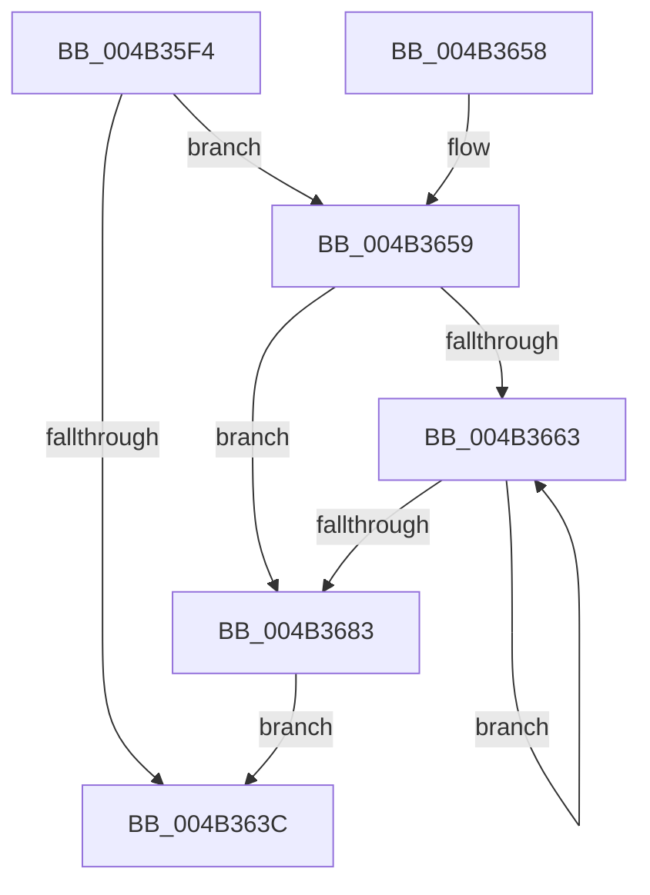

# PopPepGetComponentVetoMasks

- RVA: `0x004B35F4`–`0x004B3688` (길이 `148` bytes)
- VA: `0x00000001404B35F4`
- 실행 섹션: `.text`
- PDB 이름 있음: `예`; PDB Function 태그: `아니요`
- unwind 정보 RVA: `0x00094A88`
- 디코드: `41`개 명령, `148/148` bytes 표시
- 미해석 바이트: `0` (있으면 어셈블리에 `.byte`로 보존)

> 이 문서는 커널 이미지의 기계어와 PDB 기호를 분석해 생성했습니다. 4번과 5번은 함수 원형과 자료형을 바이너리 사용 방식에서 추정한 C 해석이며 원본 소스 복구 결과는 아닙니다.

## 1. Dependencies

- 직접 호출 지점: **2**; 고유 호출 대상: **2**
- 직접 호출자로 확인된 함수: **1**
- RIP 상대 이미지 참조: **0**

### Outgoing calls
- `0x004B3621` → [ExAcquireSpinLockShared](../24/ExAcquireSpinLockShared_function_0024DCE0.md) (function, `0x0024DCE0`)
- `0x004B3632` → [ExReleaseSpinLockShared](../2F/ExReleaseSpinLockShared_function_002F0EF0.md) (function, `0x002F0EF0`)

### Direct callers
- [PopFxTraceDeviceRegistration](../../page/A6/PopFxTraceDeviceRegistration_function_00A6F888.md) at `0x00A6FA31`

### Static image references
- 디코드된 RIP-relative 메모리 참조가 없습니다.

## 2. Other-region calls and transfers

- 다른 실행 섹션으로 향하는 call: **0**
- 별도 외부 분기/꼬리 이동을 확인하지 못했습니다.

## 3. Assembly (complete function range)

```asm
004B35F4  48 89 5C 24 08                  mov qword ptr [rsp + 8], rbx
004B35F9  48 89 6C 24 10                  mov qword ptr [rsp + 0x10], rbp
004B35FE  48 89 74 24 18                  mov qword ptr [rsp + 0x18], rsi
004B3603  57                              push rdi
004B3604  41 56                           push r14
004B3606  41 57                           push r15
004B3608  48 83 EC 20                     sub rsp, 0x20
004B360C  48 8B E9                        mov rbp, rcx
004B360F  8B C2                           mov eax, edx
004B3611  48 83 C1 40                     add rcx, 0x40
004B3615  4D 8B F8                        mov r15, r8
004B3618  4C 69 F0 D0 00 00 00            imul r14, rax, 0xd0
004B361F  33 F6                           xor esi, esi
004B3621  E8 BA A6 D9 FF                  call 0x14024dce0
004B3626  8B 9D AC 00 00 00               mov ebx, dword ptr [rbp + 0xac]
004B362C  48 8D 4D 40                     lea rcx, [rbp + 0x40]
004B3630  8A D0                           mov dl, al
004B3632  E8 B9 D8 E3 FF                  call 0x1402f0ef0
004B3637  83 FB 02                        cmp ebx, 2
004B363A  74 1D                           je 0x1404b3659
004B363C  48 8B 5C 24 40                  mov rbx, qword ptr [rsp + 0x40]
004B3641  40 8A C6                        mov al, sil
004B3644  48 8B 74 24 50                  mov rsi, qword ptr [rsp + 0x50]
004B3649  48 8B 6C 24 48                  mov rbp, qword ptr [rsp + 0x48]
004B364E  48 83 C4 20                     add rsp, 0x20
004B3652  41 5F                           pop r15
004B3654  41 5E                           pop r14
004B3656  5F                              pop rdi
004B3657  C3                              ret
004B3658  CC                              int3
004B3659  41 39 B4 2E 7C 01 00 00         cmp dword ptr [r14 + rbp + 0x17c], esi
004B3661  76 20                           jbe 0x1404b3683
004B3663  49 8B 84 2E 88 01 00 00         mov rax, qword ptr [r14 + rbp + 0x188]
004B366B  48 8D 0C 76                     lea rcx, [rsi + rsi*2]
004B366F  8B 4C C8 10                     mov ecx, dword ptr [rax + rcx*8 + 0x10]
004B3673  41 89 0C B7                     mov dword ptr [r15 + rsi*4], ecx
004B3677  FF C6                           inc esi
004B3679  41 3B B4 2E 7C 01 00 00         cmp esi, dword ptr [r14 + rbp + 0x17c]
004B3681  72 E0                           jb 0x1404b3663
004B3683  40 B6 01                        mov sil, 1
004B3686  EB B4                           jmp 0x1404b363c
```

## 4. C-style interpretation (structured pseudocode)

```c
__int64 __fastcall PopPepGetComponentVetoMasks(__int64 a1, int a2, __int64 a3)
{
    __int64 result;
    __int64 v_r14;
    __int64 v_rsi;
    __int64 v_rsp;
    unsigned __int64 v_stack_p10;
    unsigned __int64 v_stack_p18;
    unsigned __int64 v_stack_p8;

    v_stack_p8 = v_rbx;
    v_stack_p10 = v_rbp;
    v_stack_p18 = v_rsi;
    v_rsp = (v_rsp) - (32);
    a1 = (a1) + (64);
    v_r14 = (v_r14) * ((unsigned int)(a2));
    v_rsi = 0;
    result = ExAcquireSpinLockShared(a1, a2, a3, a4);
    result = ExReleaseSpinLockShared(a1 + 64, (unsigned __int8)(result), a3, a4);
    if (((unsigned int)((unsigned int)(*(unsigned int *)(a1 + 172)))) == 2) goto loc_004B3659;
loc_004B363C:
    v_rsp = (v_rsp) + (32);
    return 0;
loc_004B3659:
    if ((*(unsigned int *)(v_r14 + v_stack_p10 * 1 + 380)) <= ((unsigned int)(v_stack_p18))) goto loc_004B3683;
loc_004B3663:
    *(unsigned int *)(a3 + v_stack_p18 * 4) = (unsigned int)((unsigned int)(*(unsigned int *)(*(unsigned __int64 *)(v_r14 + v_stack_p10 * 1 + 392) + v_stack_p18 + v_stack_p18 * 2 * 8 + 16)));
    v_rsi = (unsigned int)((v_stack_p18) + 1);
    if (((unsigned int)(v_rsi)) < (*(unsigned int *)(v_r14 + v_stack_p10 * 1 + 380))) goto loc_004B3663;
loc_004B3683:
    goto loc_004B363C;
}
```

## 5. (Beta) C Style

```c
int64_t PopPepGetComponentVetoMasks(void *Arg1, int32_t Arg2, void *Arg3)
{
    uint8_t *arg1 = (uint8_t *)Arg1;
    uint8_t *arg3 = (uint8_t *)Arg3;

    int64_t result;
    int64_t local_r14;
    int64_t local_rsi;
    int64_t local_rsp;
    uint64_t v_stack_p10;
    uint64_t v_stack_p18;
    uint64_t v_stack_p8;

    v_stack_p8 = local_rbx;
    v_stack_p10 = local_rbp;
    v_stack_p18 = local_rsi;
    local_rsp = (local_rsp) - (32);
    Arg1 = (Arg1) + (64);
    local_r14 = (local_r14) * ((uint32_t)(Arg2));
    local_rsi = 0;
    result = ExAcquireSpinLockShared(Arg1, Arg2, Arg3, a4);
    result = ExReleaseSpinLockShared(Arg1 + 64, (uint8_t)(result), Arg3, a4);
    if (((uint32_t)((uint32_t)(*(uint32_t *)(arg1 + 0xAC)))) == 2) goto loc_004B3659;
loc_004B363C:
    local_rsp = (local_rsp) + (32);
    return 0;
loc_004B3659:
    if ((*(uint32_t *)(local_r14 + v_stack_p10 * 1 + 0x17C)) <= ((uint32_t)(v_stack_p18))) goto loc_004B3683;
loc_004B3663:
    *(uint32_t *)(arg3 + v_stack_p18 * 4) = (uint32_t)((uint32_t)(*(uint32_t *)(*(uint64_t *)(local_r14 + v_stack_p10 * 1 + 0x188) + v_stack_p18 + v_stack_p18 * 2 * 8 + 0x10)));
    local_rsi = (uint32_t)((v_stack_p18) + 1);
    if (((uint32_t)(local_rsi)) < (*(uint32_t *)(local_r14 + v_stack_p10 * 1 + 0x17C))) goto loc_004B3663;
loc_004B3683:
    goto loc_004B363C;
}
```

### 관측된 메모리 오프셋

구조체 형식이 확인되지 않은 접근은 인자 기준의 오프셋으로만 기록했습니다.

| 기준 인자 | 오프셋 표현 | 폭 (bit) | 접근 |
|---|---:|---:|---|
| `Arg1` | `+ 0x40` | `64` | `R` |
| `Arg1` | `+ 0xAC` | `32` | `R` |
| `Arg3` | `+ 0x0 + rsi*4` | `32` | `W` |

## 6. Execution-region graph

[열기: 2D/3D 그래프와 함수 탐색 컨트롤 패널](../../../control-panel.html?section=text&rva=0x004B35F4&view=graph)

- 2D 그래프는 위에서 아래로 흐르고, 3D 그래프는 빈 공간을 드래그해 회전합니다. Shift+드래그는 이동, 휠은 확대·축소, 함수 노드 선택은 대상 보고서 이동입니다.

### Static fallback


