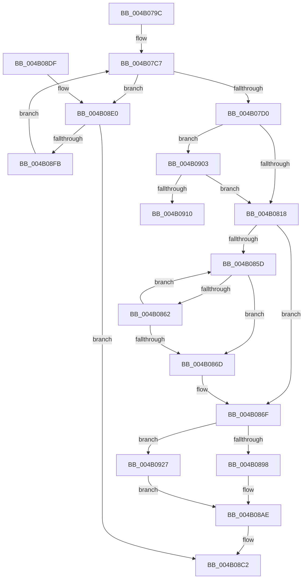

# PopPepUpdateDripsDeviceVetoMask

- RVA: `0x004B079C`–`0x004B095A` (길이 `446` bytes)
- VA: `0x00000001404B079C`
- 실행 섹션: `.text`
- PDB 이름 있음: `예`; PDB Function 태그: `예`
- unwind 정보 RVA: `0x000B8998`
- 디코드: `111`개 명령, `446/446` bytes 표시
- 미해석 바이트: `0` (있으면 어셈블리에 `.byte`로 보존)

> 이 문서는 커널 이미지의 기계어와 PDB 기호를 분석해 생성했습니다. 4번과 5번은 함수 원형과 자료형을 바이너리 사용 방식에서 추정한 C 해석이며 원본 소스 복구 결과는 아닙니다.

## 1. Dependencies

- 직접 호출 지점: **10**; 고유 호출 대상: **8**
- 직접 호출자로 확인된 함수: **1**
- RIP 상대 이미지 참조: **1**

### Outgoing calls
- `0x004B07D4` → [ExAcquireSpinLockExclusive](../24/ExAcquireSpinLockExclusive_function_00248690.md) (function, `0x00248690`)
- `0x004B0808` → [PpmGetDeepSleepPlatformStateIndex](PpmGetDeepSleepPlatformStateIndex_function_004B09F0.md) (function, `0x004B09F0`)
- `0x004B0830` → [PopPepUpdateIdleStateRefCount](../2B/PopPepUpdateIdleStateRefCount_function_002BF930.md) (function, `0x002BF930`)
- `0x004B0841` → [PopPepUpdateIdleStateRefCount](../2B/PopPepUpdateIdleStateRefCount_function_002BF930.md) (function, `0x002BF930`)
- `0x004B0887` → [KeAcquireSpinLockAtDpcLevel](../20/KeAcquireSpinLockAtDpcLevel_function_00208430.md) (function, `0x00208430`)
- `0x004B089A` → [PopFxReinitializeAccountingInstance](PopFxReinitializeAccountingInstance_function_004B0960.md) (function, `0x004B0960`)
- `0x004B08B1` → [KxReleaseSpinLock](../20/KxReleaseSpinLock_function_00206670.md) (function, `0x00206670`)
- `0x004B08BD` → [ExReleaseSpinLockExclusive](../2C/ExReleaseSpinLockExclusive_function_002C0EF0.md) (function, `0x002C0EF0`)
- `0x004B08F2` → [RtlEqualUnicodeString](../../page/93/RtlEqualUnicodeString_function_00932A20.md) (function, `0x00932A20`)
- `0x004B092C` → [PopFxReinitializeAccountingInstance](PopFxReinitializeAccountingInstance_function_004B0960.md) (function, `0x004B0960`)

### Direct callers
- [PopFxUpdateVetoMaskWork](../../page/AB/PopFxUpdateVetoMaskWork_function_00AB2800.md) at `0x00AB28DB`

### Static image references
- `0x004B07BE` → RVA `0x00E67A58` (`.data`; read)

## 2. Other-region calls and transfers

- 다른 실행 섹션으로 향하는 call: **1**
  - `0x004B08F2` → [RtlEqualUnicodeString](../../page/93/RtlEqualUnicodeString_function_00932A20.md) (`.text` → `PAGE`)
- call이 아닌 외부 분기/꼬리 이동: **1**
  - `0x004B0922` → [sub_006FB262](../6F/Unknown_function_006FB262.md) (`tail-transfer`)

## 3. Assembly (complete function range)

```asm
004B079C  48 89 5C 24 10                  mov qword ptr [rsp + 0x10], rbx
004B07A1  48 89 6C 24 18                  mov qword ptr [rsp + 0x18], rbp
004B07A6  48 89 74 24 20                  mov qword ptr [rsp + 0x20], rsi
004B07AB  57                              push rdi
004B07AC  41 54                           push r12
004B07AE  41 55                           push r13
004B07B0  41 56                           push r14
004B07B2  41 57                           push r15
004B07B4  48 83 EC 20                     sub rsp, 0x20
004B07B8  48 8B 69 38                     mov rbp, qword ptr [rcx + 0x38]
004B07BC  8B FA                           mov edi, edx
004B07BE  48 8B 1D 93 72 9B 00            mov rbx, qword ptr [rip + 0x9b7293]
004B07C5  33 F6                           xor esi, esi
004B07C7  48 85 DB                        test rbx, rbx
004B07CA  0F 85 10 01 00 00               jne 0x1404b08e0
004B07D0  48 8D 4D 40                     lea rcx, [rbp + 0x40]
004B07D4  E8 B7 7E D9 FF                  call 0x140248690
004B07D9  8B 8D 9C 00 00 00               mov ecx, dword ptr [rbp + 0x9c]
004B07DF  4C 8D B5 90 00 00 00            lea r14, [rbp + 0x90]
004B07E6  45 8B 1E                        mov r11d, dword ptr [r14]
004B07E9  44 8A E8                        mov r13b, al
004B07EC  41 89 0E                        mov dword ptr [r14], ecx
004B07EF  8B 8D A0 00 00 00               mov ecx, dword ptr [rbp + 0xa0]
004B07F5  41 89 4E 04                     mov dword ptr [r14 + 4], ecx
004B07F9  8B 8D A4 00 00 00               mov ecx, dword ptr [rbp + 0xa4]
004B07FF  41 89 4E 08                     mov dword ptr [r14 + 8], ecx
004B0803  44 89 5C 24 50                  mov dword ptr [rsp + 0x50], r11d
004B0808  E8 E3 01 00 00                  call 0x1404b09f0
004B080D  44 8B F8                        mov r15d, eax
004B0810  85 FF                           test edi, edi
004B0812  0F 85 EB 00 00 00               jne 0x1404b0903
004B0818  41 8B 3E                        mov edi, dword ptr [r14]
004B081B  48 8D 9D B8 00 00 00            lea rbx, [rbp + 0xb8]
004B0822  4C 8B CB                        mov r9, rbx
004B0825  41 B8 01 00 00 00               mov r8d, 1
004B082B  8B D7                           mov edx, edi
004B082D  41 8B CB                        mov ecx, r11d
004B0830  E8 FB F0 E0 FF                  call 0x1402bf930
004B0835  8B 4C 24 50                     mov ecx, dword ptr [rsp + 0x50]
004B0839  4C 8B CB                        mov r9, rbx
004B083C  45 33 C0                        xor r8d, r8d
004B083F  8B D7                           mov edx, edi
004B0841  E8 EA F0 E0 FF                  call 0x1402bf930
004B0846  41 8B CF                        mov ecx, r15d
004B0849  BA 01 00 00 00                  mov edx, 1
004B084E  D3 E2                           shl edx, cl
004B0850  44 0F 20 C0                     mov rax, cr8
004B0854  83 BD AC 00 00 00 02            cmp dword ptr [rbp + 0xac], 2
004B085B  75 12                           jne 0x1404b086f
004B085D  41 85 16                        test dword ptr [r14], edx
004B0860  74 0B                           je 0x1404b086d
004B0862  FF C6                           inc esi
004B0864  49 83 C6 04                     add r14, 4
004B0868  83 FE 03                        cmp esi, 3
004B086B  72 F0                           jb 0x1404b085d
004B086D  FF C6                           inc esi
004B086F  48 8B 5D 20                     mov rbx, qword ptr [rbp + 0x20]
004B0873  48 A1 08 00 00 00 80 F7 FF FF   movabs rax, qword ptr [0xfffff78000000008]
004B087D  48 81 C3 80 02 00 00            add rbx, 0x280
004B0884  48 8B CB                        mov rcx, rbx
004B0887  E8 A4 7B D5 FF                  call 0x140208430
004B088C  48 8B CB                        mov rcx, rbx
004B088F  83 FE 01                        cmp esi, 1
004B0892  0F 85 8F 00 00 00               jne 0x1404b0927
004B0898  33 D2                           xor edx, edx
004B089A  E8 C1 00 00 00                  call 0x1404b0960
004B089F  48 8B 45 20                     mov rax, qword ptr [rbp + 0x20]
004B08A3  F0 81 A0 60 03 00 00 FF F7 FF FF  lock and dword ptr [rax + 0x360], 0xfffff7ff
004B08AE  48 8B CB                        mov rcx, rbx
004B08B1  E8 BA 5D D5 FF                  call 0x140206670
004B08B6  41 8A D5                        mov dl, r13b
004B08B9  48 8D 4D 40                     lea rcx, [rbp + 0x40]
004B08BD  E8 2E 06 E1 FF                  call 0x1402c0ef0
004B08C2  48 8B 5C 24 58                  mov rbx, qword ptr [rsp + 0x58]
004B08C7  48 8B 6C 24 60                  mov rbp, qword ptr [rsp + 0x60]
004B08CC  48 8B 74 24 68                  mov rsi, qword ptr [rsp + 0x68]
004B08D1  48 83 C4 20                     add rsp, 0x20
004B08D5  41 5F                           pop r15
004B08D7  41 5E                           pop r14
004B08D9  41 5D                           pop r13
004B08DB  41 5C                           pop r12
004B08DD  5F                              pop rdi
004B08DE  C3                              ret
004B08DF  CC                              int3
004B08E0  48 8B 55 20                     mov rdx, qword ptr [rbp + 0x20]
004B08E4  48 8D 4B 08                     lea rcx, [rbx + 8]
004B08E8  48 81 C2 D8 00 00 00            add rdx, 0xd8
004B08EF  41 B0 01                        mov r8b, 1
004B08F2  E8 29 21 48 00                  call 0x140932a20
004B08F7  84 C0                           test al, al
004B08F9  75 C7                           jne 0x1404b08c2
004B08FB  48 8B 1B                        mov rbx, qword ptr [rbx]
004B08FE  E9 C4 FE FF FF                  jmp 0x1404b07c7
004B0903  44 8D 4F FF                     lea r9d, [rdi - 1]
004B0907  45 85 C9                        test r9d, r9d
004B090A  0F 84 08 FF FF FF               je 0x1404b0818
004B0910  41 8B CF                        mov ecx, r15d
004B0913  45 8B D1                        mov r10d, r9d
004B0916  41 B8 01 00 00 00               mov r8d, 1
004B091C  49 8B D6                        mov rdx, r14
004B091F  41 D3 E0                        shl r8d, cl
004B0922  E9 3B A9 24 00                  jmp 0x1406fb262
004B0927  BA 02 00 00 00                  mov edx, 2
004B092C  E8 2F 00 00 00                  call 0x1404b0960
004B0931  89 73 0C                        mov dword ptr [rbx + 0xc], esi
004B0934  48 A1 08 00 00 00 80 F7 FF FF   movabs rax, qword ptr [0xfffff78000000008]
004B093E  48 89 43 18                     mov qword ptr [rbx + 0x18], rax
004B0942  C6 43 08 01                     mov byte ptr [rbx + 8], 1
004B0946  48 8B 45 20                     mov rax, qword ptr [rbp + 0x20]
004B094A  F0 81 88 60 03 00 00 00 08 00 00  lock or dword ptr [rax + 0x360], 0x800
004B0955  E9 54 FF FF FF                  jmp 0x1404b08ae
```

## 4. C-style interpretation (structured pseudocode)

```c
__int64 __fastcall PopPepUpdateDripsDeviceVetoMask(__int64 a1, int a2)
{
    __int64 result;
    __int64 v_r14;
    __int64 v_rbx;
    __int64 v_rsi;
    __int64 v_rsp;
    unsigned __int64 v_stack_p10;
    unsigned __int64 v_stack_p18;
    unsigned __int64 v_stack_p20;
    unsigned int v_stack_p8;

    v_stack_p10 = v_rbx;
    v_stack_p18 = v_rbp;
    v_stack_p20 = v_rsi;
    v_rsp = (v_rsp) - (32);
    v_rsi = 0;
loc_004B07C7:
    if (*(unsigned __int64 *)(v_rip + 10187411) != 0) goto loc_004B08E0;
    result = ExAcquireSpinLockExclusive(*(unsigned __int64 *)(a1 + 56) + 64, a2, a3, a4);
    *(unsigned int *)(*(unsigned __int64 *)(a1 + 56) + 144) = (unsigned int)((unsigned int)(*(unsigned int *)(*(unsigned __int64 *)(a1 + 56) + 156)));
    *(unsigned int *)(*(unsigned __int64 *)(a1 + 56) + 144 + 4) = (unsigned int)((unsigned int)(*(unsigned int *)(*(unsigned __int64 *)(a1 + 56) + 160)));
    *(unsigned int *)(*(unsigned __int64 *)(a1 + 56) + 144 + 8) = (unsigned int)((unsigned int)(*(unsigned int *)(*(unsigned __int64 *)(a1 + 56) + 164)));
    v_stack_p8 = (unsigned int)((unsigned int)(*(unsigned int *)(*(unsigned __int64 *)(a1 + 56) + 144)));
    result = PpmGetDeepSleepPlatformStateIndex((unsigned int)(*(unsigned int *)(*(unsigned __int64 *)(a1 + 56) + 164)), a2, a3, a4);
    if ((unsigned int)((unsigned int)(a2)) != 0) goto loc_004B0903;
loc_004B0818:
    result = PopPepUpdateIdleStateRefCount((unsigned int)((unsigned int)((unsigned int)(*(unsigned int *)(*(unsigned __int64 *)(a1 + 56) + 144)))), (unsigned int)((unsigned int)((unsigned int)(*(unsigned int *)(*(unsigned __int64 *)(a1 + 56) + 144)))), 1, *(unsigned __int64 *)(a1 + 56) + 184);
    a3 = 0;
    result = PopPepUpdateIdleStateRefCount((unsigned int)(v_stack_p8), (unsigned int)((unsigned int)((unsigned int)(*(unsigned int *)(*(unsigned __int64 *)(a1 + 56) + 144)))), a3, *(unsigned __int64 *)(a1 + 56) + 184);
    a2 = (unsigned int)((1) << ((unsigned __int8)((unsigned int)((unsigned int)((unsigned int)((unsigned int)(result)))))));
    if ((*(unsigned int *)(*(unsigned __int64 *)(a1 + 56) + 172)) != 2) goto loc_004B086F;
loc_004B085D:
    if (((*(unsigned int *)(*(unsigned __int64 *)(a1 + 56) + 144)) & (a2)) == 0) goto loc_004B086D;
    v_rsi = (unsigned int)((v_rsi) + 1);
    v_r14 = (*(unsigned __int64 *)(a1 + 56) + 144) + (4);
    if (((unsigned int)(v_rsi)) < 3) goto loc_004B085D;
loc_004B086D:
    v_rsi = (unsigned int)((v_rsi) + 1);
loc_004B086F:
    v_rbx = (*(unsigned __int64 *)(*(unsigned __int64 *)(a1 + 56) + 32)) + (640);
    result = KeAcquireSpinLockAtDpcLevel(v_rbx, a2, a3, *(unsigned __int64 *)(a1 + 56) + 184);
    if (((unsigned int)(v_rsi)) != 1) goto loc_004B0927;
    a2 = 0;
    result = PopFxReinitializeAccountingInstance(v_rbx, a2, a3, *(unsigned __int64 *)(a1 + 56) + 184);
loc_004B08AE:
    result = KxReleaseSpinLock(v_rbx, a2, a3, *(unsigned __int64 *)(a1 + 56) + 184);
    result = ExReleaseSpinLockExclusive(*(unsigned __int64 *)(a1 + 56) + 64, (unsigned __int8)((unsigned __int8)(result)), a3, *(unsigned __int64 *)(a1 + 56) + 184);
loc_004B08C2:
    v_rsp = (v_rsp) + (32);
    return result;
loc_004B08E0:
    a2 = (*(unsigned __int64 *)(v_stack_p18 + 32)) + (216);
    result = RtlEqualUnicodeString(v_stack_p10 + 8, a2, 1, *(unsigned __int64 *)(a1 + 56) + 184);
    if ((unsigned __int8)(result) != 0) goto loc_004B08C2;
    goto loc_004B07C7;
loc_004B0903:
    if ((unsigned int)((unsigned int)(*(unsigned int *)(*(unsigned __int64 *)(a1 + 56) + 144)) - 1) == 0) goto loc_004B0818;
    a3 = (unsigned int)((1) << ((unsigned __int8)((unsigned int)((unsigned int)((unsigned int)((unsigned int)(result)))))));
loc_004B0927:
    result = PopFxReinitializeAccountingInstance((unsigned int)((unsigned int)((unsigned int)((unsigned int)(result)))), 2, a3, (unsigned int)(*(unsigned int *)(*(unsigned __int64 *)(a1 + 56) + 144)) - 1);
    *(unsigned int *)(*(unsigned __int64 *)(v_stack_p10) + 12) = (unsigned int)(v_stack_p20);
    *(unsigned __int64 *)(*(unsigned __int64 *)(v_stack_p10) + 24) = result;
    *(unsigned __int8 *)(*(unsigned __int64 *)(v_stack_p10) + 8) = 1;
    goto loc_004B08AE;
}
```

## 5. (Beta) C Style

```c
int64_t PopPepUpdateDripsDeviceVetoMask(void *Arg1, int32_t Arg2)
{
    uint8_t *arg1 = (uint8_t *)Arg1;

    int64_t result;
    int64_t local_r14;
    int64_t local_rbx;
    int64_t local_rsi;
    int64_t local_rsp;
    uint64_t v_stack_p10;
    uint64_t v_stack_p18;
    uint64_t v_stack_p20;
    uint32_t v_stack_p8;

    v_stack_p10 = local_rbx;
    v_stack_p18 = local_rbp;
    v_stack_p20 = local_rsi;
    local_rsp = (local_rsp) - (32);
    local_rsi = 0;
loc_004B07C7:
    if (*(uint64_t *)(v_rip + 0x9B7293) != 0) goto loc_004B08E0;
    result = ExAcquireSpinLockExclusive(*(uint64_t *)(arg1 + 0x38) + 64, Arg2, a3, a4);
    *(uint32_t *)(*(uint64_t *)(arg1 + 0x38) + 0x90) = (uint32_t)((uint32_t)(*(uint32_t *)(*(uint64_t *)(arg1 + 0x38) + 0x9C)));
    *(uint32_t *)(*(uint64_t *)(arg1 + 0x38) + 0x90 + 0x4) = (uint32_t)((uint32_t)(*(uint32_t *)(*(uint64_t *)(arg1 + 0x38) + 0xA0)));
    *(uint32_t *)(*(uint64_t *)(arg1 + 0x38) + 0x90 + 0x8) = (uint32_t)((uint32_t)(*(uint32_t *)(*(uint64_t *)(arg1 + 0x38) + 0xA4)));
    v_stack_p8 = (uint32_t)((uint32_t)(*(uint32_t *)(*(uint64_t *)(arg1 + 0x38) + 0x90)));
    result = PpmGetDeepSleepPlatformStateIndex((uint32_t)(*(uint32_t *)(*(uint64_t *)(arg1 + 0x38) + 0xA4)), Arg2, a3, a4);
    if ((uint32_t)((uint32_t)(Arg2)) != 0) goto loc_004B0903;
loc_004B0818:
    result = PopPepUpdateIdleStateRefCount((uint32_t)((uint32_t)((uint32_t)(*(uint32_t *)(*(uint64_t *)(arg1 + 0x38) + 0x90)))), (uint32_t)((uint32_t)((uint32_t)(*(uint32_t *)(*(uint64_t *)(arg1 + 0x38) + 0x90)))), 1, *(uint64_t *)(arg1 + 0x38) + 184);
    a3 = 0;
    result = PopPepUpdateIdleStateRefCount((uint32_t)(v_stack_p8), (uint32_t)((uint32_t)((uint32_t)(*(uint32_t *)(*(uint64_t *)(arg1 + 0x38) + 0x90)))), a3, *(uint64_t *)(arg1 + 0x38) + 184);
    Arg2 = (uint32_t)((1) << ((uint8_t)((uint32_t)((uint32_t)((uint32_t)((uint32_t)(result)))))));
    if ((*(uint32_t *)(*(uint64_t *)(arg1 + 0x38) + 0xAC)) != 2) goto loc_004B086F;
loc_004B085D:
    if (((*(uint32_t *)(*(uint64_t *)(arg1 + 0x38) + 0x90)) & (Arg2)) == 0) goto loc_004B086D;
    local_rsi = (uint32_t)((local_rsi) + 1);
    local_r14 = (*(uint64_t *)(arg1 + 0x38) + 144) + (4);
    if (((uint32_t)(local_rsi)) < 3) goto loc_004B085D;
loc_004B086D:
    local_rsi = (uint32_t)((local_rsi) + 1);
loc_004B086F:
    local_rbx = (*(uint64_t *)(*(uint64_t *)(arg1 + 0x38) + 0x20)) + (640);
    result = KeAcquireSpinLockAtDpcLevel(local_rbx, Arg2, a3, *(uint64_t *)(arg1 + 0x38) + 184);
    if (((uint32_t)(local_rsi)) != 1) goto loc_004B0927;
    Arg2 = 0;
    result = PopFxReinitializeAccountingInstance(local_rbx, Arg2, a3, *(uint64_t *)(arg1 + 0x38) + 184);
loc_004B08AE:
    result = KxReleaseSpinLock(local_rbx, Arg2, a3, *(uint64_t *)(arg1 + 0x38) + 184);
    result = ExReleaseSpinLockExclusive(*(uint64_t *)(arg1 + 0x38) + 64, (uint8_t)((uint8_t)(result)), a3, *(uint64_t *)(arg1 + 0x38) + 184);
loc_004B08C2:
    local_rsp = (local_rsp) + (32);
    return result;
loc_004B08E0:
    Arg2 = (*(uint64_t *)(v_stack_p18 + 0x20)) + (216);
    result = RtlEqualUnicodeString(v_stack_p10 + 8, Arg2, 1, *(uint64_t *)(arg1 + 0x38) + 184);
    if ((uint8_t)(result) != 0) goto loc_004B08C2;
    goto loc_004B07C7;
loc_004B0903:
    if ((uint32_t)((uint32_t)(*(uint32_t *)(*(uint64_t *)(arg1 + 0x38) + 0x90)) - 1) == 0) goto loc_004B0818;
    a3 = (uint32_t)((1) << ((uint8_t)((uint32_t)((uint32_t)((uint32_t)((uint32_t)(result)))))));
loc_004B0927:
    result = PopFxReinitializeAccountingInstance((uint32_t)((uint32_t)((uint32_t)((uint32_t)(result)))), 2, a3, (uint32_t)(*(uint32_t *)(*(uint64_t *)(arg1 + 0x38) + 0x90)) - 1);
    *(uint32_t *)(*(uint64_t *)(v_stack_p10) + 0xC) = (uint32_t)(v_stack_p20);
    *(uint64_t *)(*(uint64_t *)(v_stack_p10) + 0x18) = result;
    *(uint8_t *)(*(uint64_t *)(v_stack_p10) + 0x8) = 1;
    goto loc_004B08AE;
}
```

### 관측된 메모리 오프셋

구조체 형식이 확인되지 않은 접근은 인자 기준의 오프셋으로만 기록했습니다.

| 기준 인자 | 오프셋 표현 | 폭 (bit) | 접근 |
|---|---:|---:|---|
| `Arg1` | `+ 0x38` | `64` | `R` |

## 6. Execution-region graph

[열기: 2D/3D 그래프와 함수 탐색 컨트롤 패널](../../../control-panel.html?section=text&rva=0x004B079C&view=graph)

- 2D 그래프는 위에서 아래로 흐르고, 3D 그래프는 빈 공간을 드래그해 회전합니다. Shift+드래그는 이동, 휠은 확대·축소, 함수 노드 선택은 대상 보고서 이동입니다.

### Static fallback


