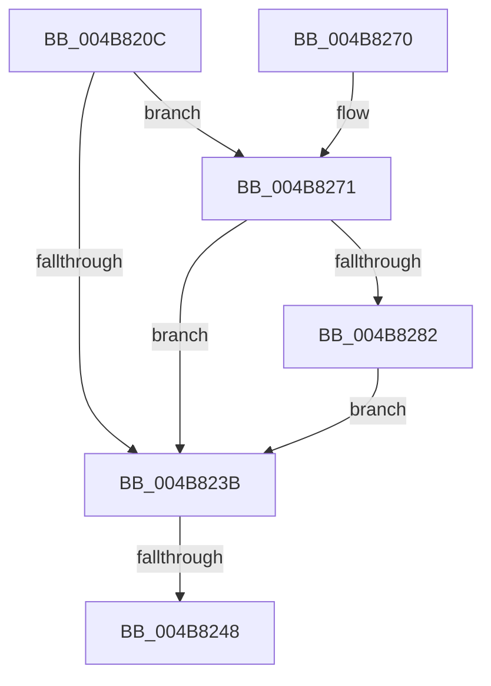

# PopPlRegisterDevice

- RVA: `0x004B820C`–`0x004B828F` (길이 `131` bytes)
- VA: `0x00000001404B820C`
- 실행 섹션: `.text`
- PDB 이름 있음: `예`; PDB Function 태그: `예`
- unwind 정보 RVA: `0x000BAD58`
- 디코드: `30`개 명령, `131/131` bytes 표시
- 미해석 바이트: `0` (있으면 어셈블리에 `.byte`로 보존)

> 이 문서는 커널 이미지의 기계어와 PDB 기호를 분석해 생성했습니다. 4번과 5번은 함수 원형과 자료형을 바이너리 사용 방식에서 추정한 C 해석이며 원본 소스 복구 결과는 아닙니다.

## 1. Dependencies

- 직접 호출 지점: **2**; 고유 호출 대상: **2**
- 직접 호출자로 확인된 함수: **2**
- RIP 상대 이미지 참조: **3**

### Outgoing calls
- `0x004B825A` → [_security_check_cookie](../6A/_security_check_cookie_function_006AC640.md) (function, `0x006AC640`)
- `0x004B8278` → [PopPlLookupDevicePowerProfile](../5D/PopPlLookupDevicePowerProfile_function_005DDAD0.md) (function, `0x005DDAD0`)

### Direct callers
- [PopPlRegisterDeviceIterator](../5D/PopPlRegisterDeviceIterator_function_005DDE20.md) at `0x005DDE52`
- [PopFxRegisterDeviceWorker](../../page/75/PopFxRegisterDeviceWorker_function_00759E20.md) at `0x0075A568`

### Static image references
- `0x004B821E` → RVA `0x00E0A740` (`.data`; read)
- `0x004B822F` → RVA `0x00F070C0` (`.data`; read)
- `0x004B823B` → RVA `0x00E07748` (`.data`; read)

## 2. Other-region calls and transfers

- 다른 실행 섹션으로 향하는 call: **0**
- call이 아닌 외부 분기/꼬리 이동: **1**
  - `0x004B8242` → [sub_006FBECE](../6F/Unknown_function_006FBECE.md) (`tail-transfer`)

## 3. Assembly (complete function range)

```asm
004B820C  48 89 5C 24 10                  mov qword ptr [rsp + 0x10], rbx
004B8211  55                              push rbp
004B8212  48 8D 6C 24 A9                  lea rbp, [rsp - 0x57]
004B8217  48 81 EC D0 00 00 00            sub rsp, 0xd0
004B821E  48 8B 05 1B 25 95 00            mov rax, qword ptr [rip + 0x95251b]
004B8225  48 33 C4                        xor rax, rsp
004B8228  48 89 45 47                     mov qword ptr [rbp + 0x47], rax
004B822C  48 8B D9                        mov rbx, rcx
004B822F  48 8B 0D 8A EE A4 00            mov rcx, qword ptr [rip + 0xa4ee8a]
004B8236  48 85 C9                        test rcx, rcx
004B8239  75 36                           jne 0x1404b8271
004B823B  83 3D 06 F5 94 00 05            cmp dword ptr [rip + 0x94f506], 5
004B8242  0F 87 86 3C 24 00               ja 0x1406fbece
004B8248  48 83 BB C8 04 00 00 00         cmp qword ptr [rbx + 0x4c8], 0
004B8250  0F 95 C0                        setne al
004B8253  48 8B 4D 47                     mov rcx, qword ptr [rbp + 0x47]
004B8257  48 33 CC                        xor rcx, rsp
004B825A  E8 E1 43 1F 00                  call 0x1406ac640
004B825F  48 8B 9C 24 E8 00 00 00         mov rbx, qword ptr [rsp + 0xe8]
004B8267  48 81 C4 D0 00 00 00            add rsp, 0xd0
004B826E  5D                              pop rbp
004B826F  C3                              ret
004B8270  CC                              int3
004B8271  48 8D 93 D8 00 00 00            lea rdx, [rbx + 0xd8]
004B8278  E8 53 58 12 00                  call 0x1405ddad0
004B827D  48 85 C0                        test rax, rax
004B8280  74 B9                           je 0x1404b823b
004B8282  48 89 58 18                     mov qword ptr [rax + 0x18], rbx
004B8286  48 89 83 C8 04 00 00            mov qword ptr [rbx + 0x4c8], rax
004B828D  EB AC                           jmp 0x1404b823b
```

## 4. C-style interpretation (structured pseudocode)

```c
__int64 __fastcall PopPlRegisterDevice(__int64 a1)
{
    __int64 result;
    __int64 v_rsp;
    unsigned __int64 v_stack_m18;
    unsigned __int64 v_stack_m5F;
    unsigned __int64 v_stack_p10;

    v_stack_p10 = v_rbx;
    v_rsp = (v_rsp) - (208);
    result = (*(unsigned __int64 *)(v_rip + 9774363)) ^ (v_rsp);
    v_stack_m18 = result;
    if (*(unsigned __int64 *)(v_rip + 10808970) != 0) goto loc_004B8271;
loc_004B823B:
    result = ((*(unsigned __int64 *)(a1 + 1224)) != 0) ? 1 : 0;
    a1 = (v_stack_m18) ^ (v_rsp);
    result = _security_check_cookie(a1, a2, a3, a4);
    v_rsp = (v_rsp) + (208);
    return result;
loc_004B8271:
    result = PopPlLookupDevicePowerProfile(a1, v_stack_p10 + 216, a3, a4);
    if (result == 0) goto loc_004B823B;
    *(unsigned __int64 *)(result + 24) = v_stack_p10;
    *(unsigned __int64 *)(v_stack_p10 + 1224) = result;
    goto loc_004B823B;
}
```

## 5. (Beta) C Style

```c
int64_t PopPlRegisterDevice(void *Arg1)
{
    uint8_t *arg1 = (uint8_t *)Arg1;

    int64_t result;
    int64_t local_rsp;
    uint64_t v_stack_m18;
    uint64_t v_stack_m5F;
    uint64_t v_stack_p10;

    v_stack_p10 = local_rbx;
    local_rsp = (local_rsp) - (208);
    result = (*(uint64_t *)(v_rip + 0x95251B)) ^ (local_rsp);
    v_stack_m18 = result;
    if (*(uint64_t *)(v_rip + 0xA4EE8A) != 0) goto loc_004B8271;
loc_004B823B:
    result = ((*(uint64_t *)(arg1 + 0x4C8)) != 0) ? 1 : 0;
    Arg1 = (v_stack_m18) ^ (local_rsp);
    result = _security_check_cookie(Arg1, a2, a3, a4);
    local_rsp = (local_rsp) + (208);
    return result;
loc_004B8271:
    result = PopPlLookupDevicePowerProfile(Arg1, v_stack_p10 + 216, a3, a4);
    if (result == 0) goto loc_004B823B;
    *(uint64_t *)(result + 0x18) = v_stack_p10;
    *(uint64_t *)(v_stack_p10 + 0x4C8) = result;
    goto loc_004B823B;
}
```

### 관측된 메모리 오프셋

구조체 형식이 확인되지 않은 접근은 인자 기준의 오프셋으로만 기록했습니다.

| 기준 인자 | 오프셋 표현 | 폭 (bit) | 접근 |
|---|---:|---:|---|
| `Arg1` | `+ 0xD8` | `64` | `R` |
| `Arg1` | `+ 0x4C8` | `64` | `R` |
| `Arg1` | `+ 0x4C8` | `64` | `W` |

## 6. Execution-region graph

[열기: 2D/3D 그래프와 함수 탐색 컨트롤 패널](../../../control-panel.html?section=text&rva=0x004B820C&view=graph)

- 2D 그래프는 위에서 아래로 흐르고, 3D 그래프는 빈 공간을 드래그해 회전합니다. Shift+드래그는 이동, 휠은 확대·축소, 함수 노드 선택은 대상 보고서 이동입니다.

### Static fallback


