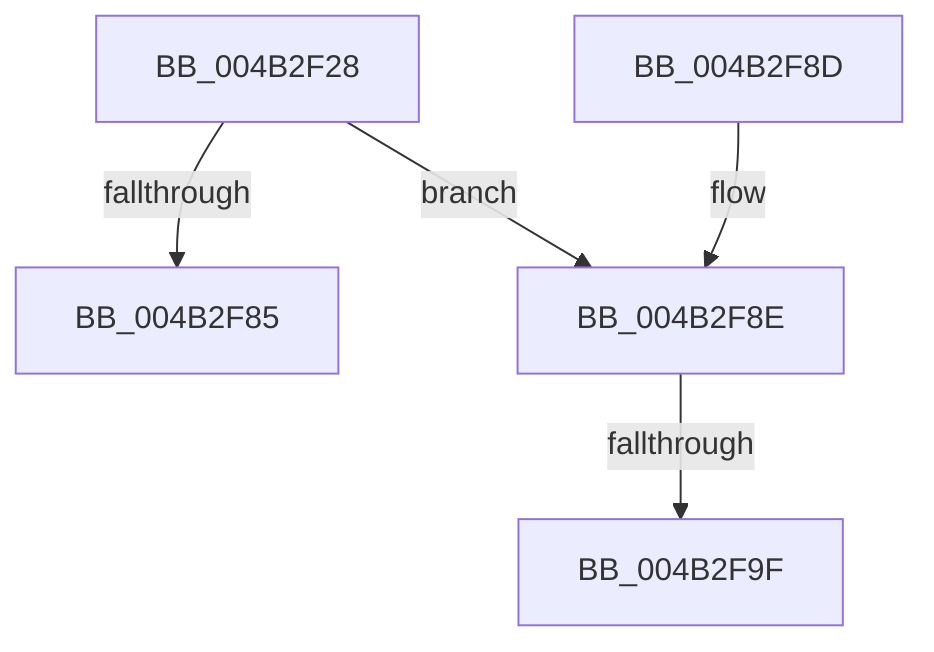

# PopPluginRequestPowerControl

- RVA: `0x004B2F28`–`0x004B2FAC` (길이 `132` bytes)
- VA: `0x00000001404B2F28`
- 실행 섹션: `.text`
- PDB 이름 있음: `예`; PDB Function 태그: `예`
- unwind 정보 RVA: `0x000B9770`
- 디코드: `33`개 명령, `132/132` bytes 표시
- 미해석 바이트: `0` (있으면 어셈블리에 `.byte`로 보존)

> 이 문서는 커널 이미지의 기계어와 PDB 기호를 분석해 생성했습니다. 4번과 5번은 함수 원형과 자료형을 바이너리 사용 방식에서 추정한 C 해석이며 원본 소스 복구 결과는 아닙니다.

## 1. Dependencies

- 직접 호출 지점: **1**; 고유 호출 대상: **1**
- 직접 호출자로 확인된 함수: **1**
- RIP 상대 이미지 참조: **0**

### Outgoing calls
- `0x004B2F7C` → [guard_dispatch_icall](../6B/guard_dispatch_icall_function_006BAAD0.md) (function, `0x006BAAD0`)

### Direct callers
- [PoFxPowerControl](PoFxPowerControl_function_004B2E70.md) at `0x004B2EE7`

### Static image references
- 디코드된 RIP-relative 메모리 참조가 없습니다.

## 2. Other-region calls and transfers

- 다른 실행 섹션으로 향하는 call: **0**
- call이 아닌 외부 분기/꼬리 이동: **2**
  - `0x004B2F99` → [sub_006FB428](../6F/Unknown_function_006FB428.md) (`tail-transfer`)
  - `0x004B2FA7` → [sub_006FB428](../6F/Unknown_function_006FB428.md) (`tail-transfer`)

## 3. Assembly (complete function range)

```asm
004B2F28  4C 8B DC                        mov r11, rsp
004B2F2B  53                              push rbx
004B2F2C  48 83 EC 60                     sub rsp, 0x60
004B2F30  48 8B 41 48                     mov rax, qword ptr [rcx + 0x48]
004B2F34  BB 02 00 00 C0                  mov ebx, 0xc0000002
004B2F39  4C 8B 51 40                     mov r10, qword ptr [rcx + 0x40]
004B2F3D  B9 0E 00 00 00                  mov ecx, 0xe
004B2F42  49 83 63 F0 00                  and qword ptr [r11 - 0x10], 0
004B2F47  49 83 63 E8 00                  and qword ptr [r11 - 0x18], 0
004B2F4C  49 89 43 B8                     mov qword ptr [r11 - 0x48], rax
004B2F50  48 8B 84 24 90 00 00 00         mov rax, qword ptr [rsp + 0x90]
004B2F58  49 89 43 D8                     mov qword ptr [r11 - 0x28], rax
004B2F5C  48 8B 84 24 98 00 00 00         mov rax, qword ptr [rsp + 0x98]
004B2F64  49 89 53 C0                     mov qword ptr [r11 - 0x40], rdx
004B2F68  49 8D 53 B8                     lea rdx, [r11 - 0x48]
004B2F6C  49 89 43 E0                     mov qword ptr [r11 - 0x20], rax
004B2F70  4D 89 43 C8                     mov qword ptr [r11 - 0x38], r8
004B2F74  4D 89 4B D0                     mov qword ptr [r11 - 0x30], r9
004B2F78  49 8B 42 60                     mov rax, qword ptr [r10 + 0x60]
004B2F7C  E8 4F 7B 20 00                  call 0x1406baad0
004B2F81  3C 01                           cmp al, 1
004B2F83  74 09                           je 0x1404b2f8e
004B2F85  8B C3                           mov eax, ebx
004B2F87  48 83 C4 60                     add rsp, 0x60
004B2F8B  5B                              pop rbx
004B2F8C  C3                              ret
004B2F8D  CC                              int3
004B2F8E  48 8B 8C 24 A0 00 00 00         mov rcx, qword ptr [rsp + 0xa0]
004B2F96  48 85 C9                        test rcx, rcx
004B2F99  0F 84 89 84 24 00               je 0x1406fb428
004B2F9F  48 8B 44 24 50                  mov rax, qword ptr [rsp + 0x50]
004B2FA4  48 89 01                        mov qword ptr [rcx], rax
004B2FA7  E9 7C 84 24 00                  jmp 0x1406fb428
```

## 4. C-style interpretation (structured pseudocode)

```c
__int64 __fastcall PopPluginRequestPowerControl(__int64 a1, __int64 a2, __int64 a3, __int64 a4, __int64 a5, __int64 a6, __int64 a7)
{
    __int64 result;
    __int64 v_rsp;
    unsigned __int64 v_stack_p50;

    v_rsp = (v_rsp) - (96);
    *(unsigned __int64 *)(v_rsp - 72) = *(unsigned __int64 *)(a1 + 72);
    *(unsigned __int64 *)(v_rsp - 40) = a5;
    *(unsigned __int64 *)(v_rsp - 64) = a2;
    *(unsigned __int64 *)(v_rsp - 32) = a6;
    *(unsigned __int64 *)(v_rsp - 56) = a3;
    *(unsigned __int64 *)(v_rsp - 48) = a4;
    result = guard_dispatch_icall(14, v_rsp - 72, a3, a4);
    if (((unsigned __int8)(result)) == 1) goto loc_004B2F8E;
    v_rsp = (v_rsp) + (96);
    return (unsigned int)((unsigned int)((unsigned int)(0xC0000002ULL)));
loc_004B2F8E:
    *(unsigned __int64 *)(a7) = v_stack_p50;
}
```

## 5. (Beta) C Style

```c
int64_t PopPluginRequestPowerControl(void *Arg1, int64_t Arg2, int64_t Arg3, int64_t Arg4, int64_t Arg5, int64_t Arg6, int64_t Arg7)
{
    uint8_t *arg1 = (uint8_t *)Arg1;

    int64_t result;
    int64_t local_rsp;
    uint64_t v_stack_p50;

    local_rsp = (local_rsp) - (96);
    *(uint64_t *)(local_rsp - 0x48) = *(uint64_t *)(arg1 + 0x48);
    *(uint64_t *)(local_rsp - 0x28) = Arg5;
    *(uint64_t *)(local_rsp - 0x40) = Arg2;
    *(uint64_t *)(local_rsp - 0x20) = Arg6;
    *(uint64_t *)(local_rsp - 0x38) = Arg3;
    *(uint64_t *)(local_rsp - 0x30) = Arg4;
    result = guard_dispatch_icall(14, local_rsp - 72, Arg3, Arg4);
    if (((uint8_t)(result)) == 1) goto loc_004B2F8E;
    local_rsp = (local_rsp) + (96);
    return (uint32_t)((uint32_t)((uint32_t)(0xC0000002ULL)));
loc_004B2F8E:
    *(uint64_t *)(Arg7) = v_stack_p50;
}
```

### 관측된 메모리 오프셋

구조체 형식이 확인되지 않은 접근은 인자 기준의 오프셋으로만 기록했습니다.

| 기준 인자 | 오프셋 표현 | 폭 (bit) | 접근 |
|---|---:|---:|---|
| `Arg1` | `+ 0x40` | `64` | `R` |
| `Arg1` | `+ 0x48` | `64` | `R` |

## 6. Execution-region graph

[열기: 2D/3D 그래프와 함수 탐색 컨트롤 패널](../../../control-panel.html?section=text&rva=0x004B2F28&view=graph)

- 2D 그래프는 위에서 아래로 흐르고, 3D 그래프는 빈 공간을 드래그해 회전합니다. Shift+드래그는 이동, 휠은 확대·축소, 함수 노드 선택은 대상 보고서 이동입니다.

### Static fallback


