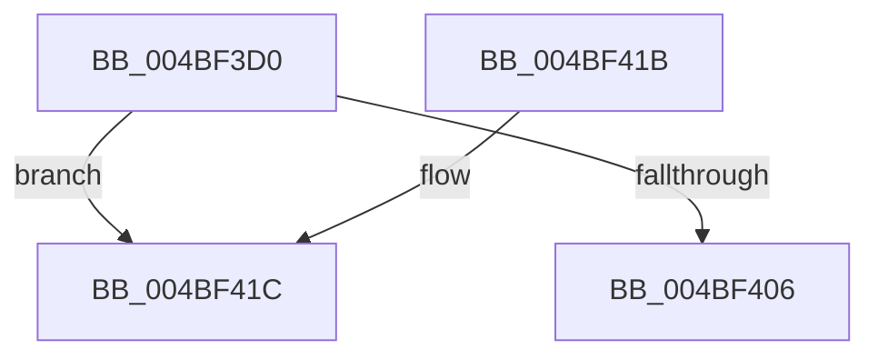

# PopPowerRequestUnrevokeRequests

- RVA: `0x004BF3D0`–`0x004BF439` (길이 `105` bytes)
- VA: `0x00000001404BF3D0`
- 실행 섹션: `.text`
- PDB 이름 있음: `예`; PDB Function 태그: `예`
- unwind 정보 RVA: `0x000BC510`
- 디코드: `27`개 명령, `105/105` bytes 표시
- 미해석 바이트: `0` (있으면 어셈블리에 `.byte`로 보존)

> 이 문서는 커널 이미지의 기계어와 PDB 기호를 분석해 생성했습니다. 4번과 5번은 함수 원형과 자료형을 바이너리 사용 방식에서 추정한 C 해석이며 원본 소스 복구 결과는 아닙니다.

## 1. Dependencies

- 직접 호출 지점: **2**; 고유 호출 대상: **2**
- 직접 호출자로 확인된 함수: **2**
- RIP 상대 이미지 참조: **4**

### Outgoing calls
- `0x004BF3F7` → [KeAcquireInStackQueuedSpinLock](../27/KeAcquireInStackQueuedSpinLock_function_002757A0.md) (function, `0x002757A0`)
- `0x004BF40B` → [KeReleaseInStackQueuedSpinLock](../34/KeReleaseInStackQueuedSpinLock_function_00342CE0.md) (function, `0x00342CE0`)

### Direct callers
- [PopPowerRequestHandleExecutionEnablementUpdate](../../page/A4/PopPowerRequestHandleExecutionEnablementUpdate_function_00A4A624.md) at `0x00A4A655`
- [PopPowerRequestNotifyTtmSessionInitialized](../../page/AD/PopPowerRequestNotifyTtmSessionInitialized_function_00AD1608.md) at `0x00AD1666`

### Static image references
- `0x004BF3E4` → RVA `0x00F0ED30` (`.data`; read)
- `0x004BF3FC` → RVA `0x00F0EE28` (`.data`; read)
- `0x004BF41E` → RVA `0x00F0ED40` (`.data`; read)
- `0x004BF42E` → RVA `0x00F0EE28` (`.data`; write)

## 2. Other-region calls and transfers

- 다른 실행 섹션으로 향하는 call: **0**
- call이 아닌 외부 분기/꼬리 이동: **1**
  - `0x004BF434` → [sub_006FCB58 + 0xD](../6F/Unknown_function_006FCB58.md) (`tail-transfer`)

## 3. Assembly (complete function range)

```asm
004BF3D0  48 89 5C 24 08                  mov qword ptr [rsp + 8], rbx
004BF3D5  57                              push rdi
004BF3D6  48 83 EC 40                     sub rsp, 0x40
004BF3DA  8B D9                           mov ebx, ecx
004BF3DC  48 8D 54 24 20                  lea rdx, [rsp + 0x20]
004BF3E1  0F 57 C0                        xorps xmm0, xmm0
004BF3E4  48 8D 0D 45 F9 A4 00            lea rcx, [rip + 0xa4f945]
004BF3EB  33 C0                           xor eax, eax
004BF3ED  0F 11 44 24 20                  movups xmmword ptr [rsp + 0x20], xmm0
004BF3F2  48 89 44 24 30                  mov qword ptr [rsp + 0x30], rax
004BF3F7  E8 A4 63 DB FF                  call 0x1402757a0
004BF3FC  8B 05 26 FA A4 00               mov eax, dword ptr [rip + 0xa4fa26]
004BF402  23 D8                           and ebx, eax
004BF404  75 16                           jne 0x1404bf41c
004BF406  48 8D 4C 24 20                  lea rcx, [rsp + 0x20]
004BF40B  E8 D0 38 E8 FF                  call 0x140342ce0
004BF410  48 8B 5C 24 50                  mov rbx, qword ptr [rsp + 0x50]
004BF415  48 83 C4 40                     add rsp, 0x40
004BF419  5F                              pop rdi
004BF41A  C3                              ret
004BF41B  CC                              int3
004BF41C  F7 D3                           not ebx
004BF41E  48 8D 3D 1B F9 A4 00            lea rdi, [rip + 0xa4f91b]
004BF425  23 C3                           and eax, ebx
004BF427  48 8B 1D 12 F9 A4 00            mov rbx, qword ptr [rip + 0xa4f912]
004BF42E  89 05 F4 F9 A4 00               mov dword ptr [rip + 0xa4f9f4], eax
004BF434  E9 2C D7 23 00                  jmp 0x1406fcb65
```

## 4. C-style interpretation (structured pseudocode)

```c
__int64 __fastcall PopPowerRequestUnrevokeRequests(int a1)
{
    __int64 result;
    __int64 v_rbx;
    __int64 v_rsp;
    unsigned __int64 v_stack_m18;
    unsigned __int64 v_stack_m28;
    unsigned __int64 v_stack_p8;

    v_stack_p8 = v_rbx;
    v_rsp = (v_rsp) - (64);
    result = 0;
    v_stack_m28 = v_xmm0;
    v_stack_m18 = 0;
    result = KeAcquireInStackQueuedSpinLock(v_rip + 10811717, v_stack_m28, a3, a4);
    v_rbx = (unsigned int)(((unsigned int)(a1)) & ((unsigned int)((unsigned int)(*(unsigned int *)(v_rip + 10811942)))));
    if (condition_is_not_equal) goto loc_004BF41C;
    result = KeReleaseInStackQueuedSpinLock(v_stack_m28, v_stack_m28, a3, a4);
    v_rsp = (v_rsp) + (64);
    return result;
loc_004BF41C:
    v_rbx = (unsigned int)(~(v_stack_p8));
    result = (unsigned int)((result) & ((unsigned int)(v_rbx)));
    *(unsigned int *)(v_rip + 10811892) = (unsigned int)(result);
}
```

## 5. (Beta) C Style

```c
int64_t PopPowerRequestUnrevokeRequests(int32_t Arg1)
{
    int64_t result;
    int64_t local_rbx;
    int64_t local_rsp;
    uint64_t v_stack_m18;
    uint64_t v_stack_m28;
    uint64_t v_stack_p8;

    v_stack_p8 = local_rbx;
    local_rsp = (local_rsp) - (64);
    result = 0;
    v_stack_m28 = v_xmm0;
    v_stack_m18 = 0;
    result = KeAcquireInStackQueuedSpinLock(v_rip + 10811717, v_stack_m28, a3, a4);
    local_rbx = (uint32_t)(((uint32_t)(Arg1)) & ((uint32_t)((uint32_t)(*(uint32_t *)(v_rip + 0xA4FA26)))));
    if (condition_is_not_equal) goto loc_004BF41C;
    result = KeReleaseInStackQueuedSpinLock(v_stack_m28, v_stack_m28, a3, a4);
    local_rsp = (local_rsp) + (64);
    return result;
loc_004BF41C:
    local_rbx = (uint32_t)(~(v_stack_p8));
    result = (uint32_t)((result) & ((uint32_t)(local_rbx)));
    *(uint32_t *)(v_rip + 0xA4F9F4) = (uint32_t)(result);
}
```

## 6. Execution-region graph

[열기: 2D/3D 그래프와 함수 탐색 컨트롤 패널](../../../control-panel.html?section=text&rva=0x004BF3D0&view=graph)

- 2D 그래프는 위에서 아래로 흐르고, 3D 그래프는 빈 공간을 드래그해 회전합니다. Shift+드래그는 이동, 휠은 확대·축소, 함수 노드 선택은 대상 보고서 이동입니다.

### Static fallback


