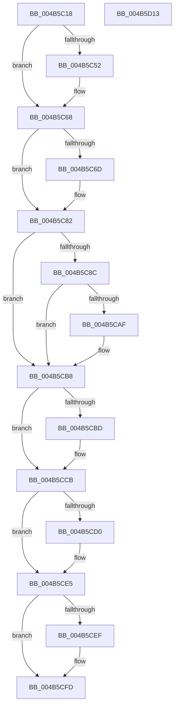

# PopPowerTransitionTimesInMs

- RVA: `0x004B5C18`–`0x004B5D14` (길이 `252` bytes)
- VA: `0x00000001404B5C18`
- 실행 섹션: `.text`
- PDB 이름 있음: `예`; PDB Function 태그: `아니요`
- unwind 정보 RVA: `0x0006F978`
- 디코드: `63`개 명령, `252/252` bytes 표시
- 미해석 바이트: `0` (있으면 어셈블리에 `.byte`로 보존)

> 이 문서는 커널 이미지의 기계어와 PDB 기호를 분석해 생성했습니다. 4번과 5번은 함수 원형과 자료형을 바이너리 사용 방식에서 추정한 C 해석이며 원본 소스 복구 결과는 아닙니다.

## 1. Dependencies

- 직접 호출 지점: **3**; 고유 호출 대상: **1**
- 직접 호출자로 확인된 함수: **2**
- RIP 상대 이미지 참조: **11**

### Outgoing calls
- `0x004B5C60` → [PopQpcTimeInMs](../../pagelk/B7/PopQpcTimeInMs_function_00B79780.md) (function, `0x00B79780`)
- `0x004B5C7B` → [PopQpcTimeInMs](../../pagelk/B7/PopQpcTimeInMs_function_00B79780.md) (function, `0x00B79780`)
- `0x004B5C9E` → [PopQpcTimeInMs](../../pagelk/B7/PopQpcTimeInMs_function_00B79780.md) (function, `0x00B79780`)

### Direct callers
- [PopCalculateWakeTimeAdjustment](../../page/75/PopCalculateWakeTimeAdjustment_function_0075C4EC.md) at `0x0075C520`
- [PopDiagTracePowerTransitionTime](../../page/A9/PopDiagTracePowerTransitionTime_function_00A9B84C.md) at `0x00A9B8C9`

### Static image references
- `0x004B5C52` → RVA `0x00F0C310` (`.data`; read)
- `0x004B5C59` → RVA `0x00F0C308` (`.data`; read)
- `0x004B5C6D` → RVA `0x00F0C330` (`.data`; read)
- `0x004B5C74` → RVA `0x00F0C328` (`.data`; read)
- `0x004B5C92` → RVA `0x00F0C348` (`.data`; read)
- `0x004B5CA6` → RVA `0x00F0C570` (`.data`; read)
- `0x004B5CAF` → RVA `0x00F0C3D0` (`.data`; read)
- `0x004B5CBD` → RVA `0x00F0C390` (`.data`; read)
- `0x004B5CD0` → RVA `0x00F0C408` (`.data`; read)
- `0x004B5CD9` → RVA `0x00F0C4E8` (`.data`; read)
- `0x004B5CEF` → RVA `0x00F0C370` (`.data`; read)

## 2. Other-region calls and transfers

- 다른 실행 섹션으로 향하는 call: **3**
  - `0x004B5C60` → [PopQpcTimeInMs](../../pagelk/B7/PopQpcTimeInMs_function_00B79780.md) (`.text` → `PAGELK`)
  - `0x004B5C7B` → [PopQpcTimeInMs](../../pagelk/B7/PopQpcTimeInMs_function_00B79780.md) (`.text` → `PAGELK`)
  - `0x004B5C9E` → [PopQpcTimeInMs](../../pagelk/B7/PopQpcTimeInMs_function_00B79780.md) (`.text` → `PAGELK`)
- 별도 외부 분기/꼬리 이동을 확인하지 못했습니다.

## 3. Assembly (complete function range)

```asm
004B5C18  48 89 5C 24 08                  mov qword ptr [rsp + 8], rbx
004B5C1D  48 89 74 24 10                  mov qword ptr [rsp + 0x10], rsi
004B5C22  48 89 7C 24 18                  mov qword ptr [rsp + 0x18], rdi
004B5C27  41 56                           push r14
004B5C29  48 83 EC 20                     sub rsp, 0x20
004B5C2D  65 48 8B 04 25 20 00 00 00      mov rax, qword ptr gs:[0x20]
004B5C36  49 8B F1                        mov rsi, r9
004B5C39  49 8B F8                        mov rdi, r8
004B5C3C  48 8B DA                        mov rbx, rdx
004B5C3F  4C 8B F1                        mov r14, rcx
004B5C42  44 8B 50 44                     mov r10d, dword ptr [rax + 0x44]
004B5C46  4D 69 DA E8 03 00 00            imul r11, r10, 0x3e8
004B5C4D  48 85 C9                        test rcx, rcx
004B5C50  74 16                           je 0x1404b5c68
004B5C52  48 8D 15 B7 66 A5 00            lea rdx, [rip + 0xa566b7]
004B5C59  48 8D 0D A8 66 A5 00            lea rcx, [rip + 0xa566a8]
004B5C60  E8 1B 3B 6C 00                  call 0x140b79780
004B5C65  41 89 06                        mov dword ptr [r14], eax
004B5C68  48 85 DB                        test rbx, rbx
004B5C6B  74 15                           je 0x1404b5c82
004B5C6D  48 8D 15 BC 66 A5 00            lea rdx, [rip + 0xa566bc]
004B5C74  48 8D 0D AD 66 A5 00            lea rcx, [rip + 0xa566ad]
004B5C7B  E8 00 3B 6C 00                  call 0x140b79780
004B5C80  89 03                           mov dword ptr [rbx], eax
004B5C82  4C 8B 54 24 50                  mov r10, qword ptr [rsp + 0x50]
004B5C87  4D 85 D2                        test r10, r10
004B5C8A  74 2C                           je 0x1404b5cb8
004B5C8C  48 83 64 24 50 00               and qword ptr [rsp + 0x50], 0
004B5C92  48 8D 15 AF 66 A5 00            lea rdx, [rip + 0xa566af]
004B5C99  48 8D 4C 24 50                  lea rcx, [rsp + 0x50]
004B5C9E  E8 DD 3A 6C 00                  call 0x140b79780
004B5CA3  41 89 02                        mov dword ptr [r10], eax
004B5CA6  83 3D C3 68 A5 00 00            cmp dword ptr [rip + 0xa568c3], 0
004B5CAD  74 09                           je 0x1404b5cb8
004B5CAF  03 05 1B 67 A5 00               add eax, dword ptr [rip + 0xa5671b]
004B5CB5  41 89 02                        mov dword ptr [r10], eax
004B5CB8  48 85 FF                        test rdi, rdi
004B5CBB  74 0E                           je 0x1404b5ccb
004B5CBD  48 8B 05 CC 66 A5 00            mov rax, qword ptr [rip + 0xa566cc]
004B5CC4  33 D2                           xor edx, edx
004B5CC6  49 F7 F3                        div r11
004B5CC9  89 07                           mov dword ptr [rdi], eax
004B5CCB  48 85 F6                        test rsi, rsi
004B5CCE  74 15                           je 0x1404b5ce5
004B5CD0  48 8B 05 31 67 A5 00            mov rax, qword ptr [rip + 0xa56731]
004B5CD7  33 D2                           xor edx, edx
004B5CD9  48 03 05 08 68 A5 00            add rax, qword ptr [rip + 0xa56808]
004B5CE0  49 F7 F3                        div r11
004B5CE3  89 06                           mov dword ptr [rsi], eax
004B5CE5  48 8B 4C 24 58                  mov rcx, qword ptr [rsp + 0x58]
004B5CEA  48 85 C9                        test rcx, rcx
004B5CED  74 0E                           je 0x1404b5cfd
004B5CEF  48 8B 05 7A 66 A5 00            mov rax, qword ptr [rip + 0xa5667a]
004B5CF6  33 D2                           xor edx, edx
004B5CF8  49 F7 F3                        div r11
004B5CFB  89 01                           mov dword ptr [rcx], eax
004B5CFD  48 8B 5C 24 30                  mov rbx, qword ptr [rsp + 0x30]
004B5D02  48 8B 74 24 38                  mov rsi, qword ptr [rsp + 0x38]
004B5D07  48 8B 7C 24 40                  mov rdi, qword ptr [rsp + 0x40]
004B5D0C  48 83 C4 20                     add rsp, 0x20
004B5D10  41 5E                           pop r14
004B5D12  C3                              ret
004B5D13  CC                              int3
```

## 4. C-style interpretation (structured pseudocode)

```c
__int64 __fastcall PopPowerTransitionTimesInMs(__int64 a1, __int64 a2, __int64 a3, __int64 a4, __int64 a5, __int64 a6)
{
    __int64 result;
    __int64 v_r11;
    __int64 v_rsp;
    unsigned __int64 v_stack_p10;
    unsigned __int64 v_stack_p18;
    unsigned __int64 v_stack_p8;

    v_stack_p8 = v_rbx;
    v_stack_p10 = v_rsi;
    v_stack_p18 = v_rdi;
    v_rsp = (v_rsp) - (32);
    v_r11 = (v_r11) * ((unsigned int)(*(unsigned int *)(*(unsigned __int64 *)(gs_base + (0 + 32)) + 68)));
    result = *(unsigned __int64 *)(gs_base + (0 + 32));
    if (a1 != 0) {
        a2 = v_rip + 10839735;
        a1 = v_rip + 10839720;
        result = PopQpcTimeInMs(a1, a2, a3, a4);
        *(unsigned int *)(a1) = (unsigned int)(result);
    }
    if (a2 != 0) {
        a2 = v_rip + 10839740;
        a1 = v_rip + 10839725;
        result = PopQpcTimeInMs(a1, a2, a3, a4);
        *(unsigned int *)(a2) = (unsigned int)(result);
    }
    if (a5 == 0) goto loc_004B5CB8;
    result = PopQpcTimeInMs(a5, v_rip + 10839727, a3, a4);
    *(unsigned int *)(a5) = (unsigned int)(result);
    if ((*(unsigned int *)(v_rip + 10840259)) != 0) {
        result = (unsigned int)((result) + (*(unsigned int *)(v_rip + 10839835)));
        *(unsigned int *)(a5) = (unsigned int)(result);
    }
    if (a3 != 0) {
        result = *(unsigned __int64 *)(v_rip + 10839756);
        a2 = 0;
        *(unsigned int *)(a3) = (unsigned int)(result);
    }
    if (a4 != 0) {
        result = *(unsigned __int64 *)(v_rip + 10839857);
        a2 = 0;
        result = (result) + (*(unsigned __int64 *)(v_rip + 10840072));
        *(unsigned int *)(a4) = (unsigned int)(result);
    }
    if (a6 != 0) {
        result = *(unsigned __int64 *)(v_rip + 10839674);
        a2 = 0;
        *(unsigned int *)(a6) = (unsigned int)(result);
    }
    v_rsp = (v_rsp) + (32);
    return result;
}
```

## 5. (Beta) C Style

```c
int64_t PopPowerTransitionTimesInMs(void *Arg1, int64_t Arg2, int64_t Arg3, int64_t Arg4, int64_t Arg5, int64_t Arg6)
{
    uint8_t *arg1 = (uint8_t *)Arg1;

    int64_t result;
    int64_t local_r11;
    int64_t local_rsp;
    uint64_t v_stack_p10;
    uint64_t v_stack_p18;
    uint64_t v_stack_p8;

    v_stack_p8 = local_rbx;
    v_stack_p10 = local_rsi;
    v_stack_p18 = local_rdi;
    local_rsp = (local_rsp) - (32);
    local_r11 = (local_r11) * ((uint32_t)(*(uint32_t *)(*(uint64_t *)(gs_base + (0 + 0x20)) + 0x44)));
    result = *(uint64_t *)(gs_base + (0 + 0x20));
    if (Arg1 != NULL) {
        Arg2 = v_rip + 10839735;
        Arg1 = v_rip + 10839720;
        result = PopQpcTimeInMs(Arg1, Arg2, Arg3, Arg4);
        *(uint32_t *)(arg1) = (uint32_t)(result);
    }
    if (Arg2 != 0) {
        Arg2 = v_rip + 10839740;
        Arg1 = v_rip + 10839725;
        result = PopQpcTimeInMs(Arg1, Arg2, Arg3, Arg4);
        *(uint32_t *)(Arg2) = (uint32_t)(result);
    }
    if (Arg5 == 0) goto loc_004B5CB8;
    result = PopQpcTimeInMs(Arg5, v_rip + 10839727, Arg3, Arg4);
    *(uint32_t *)(Arg5) = (uint32_t)(result);
    if ((*(uint32_t *)(v_rip + 0xA568C3)) != 0) {
        result = (uint32_t)((result) + (*(uint32_t *)(v_rip + 0xA5671B)));
        *(uint32_t *)(Arg5) = (uint32_t)(result);
    }
    if (Arg3 != 0) {
        result = *(uint64_t *)(v_rip + 0xA566CC);
        Arg2 = 0;
        *(uint32_t *)(Arg3) = (uint32_t)(result);
    }
    if (Arg4 != 0) {
        result = *(uint64_t *)(v_rip + 0xA56731);
        Arg2 = 0;
        result = (result) + (*(uint64_t *)(v_rip + 0xA56808));
        *(uint32_t *)(Arg4) = (uint32_t)(result);
    }
    if (Arg6 != 0) {
        result = *(uint64_t *)(v_rip + 0xA5667A);
        Arg2 = 0;
        *(uint32_t *)(Arg6) = (uint32_t)(result);
    }
    local_rsp = (local_rsp) + (32);
    return result;
}
```

### 관측된 메모리 오프셋

구조체 형식이 확인되지 않은 접근은 인자 기준의 오프셋으로만 기록했습니다.

| 기준 인자 | 오프셋 표현 | 폭 (bit) | 접근 |
|---|---:|---:|---|
| `Arg1` | `+ 0x0` | `32` | `W` |

## 6. Execution-region graph

[열기: 2D/3D 그래프와 함수 탐색 컨트롤 패널](../../../control-panel.html?section=text&rva=0x004B5C18&view=graph)

- 2D 그래프는 위에서 아래로 흐르고, 3D 그래프는 빈 공간을 드래그해 회전합니다. Shift+드래그는 이동, 휠은 확대·축소, 함수 노드 선택은 대상 보고서 이동입니다.

### Static fallback


