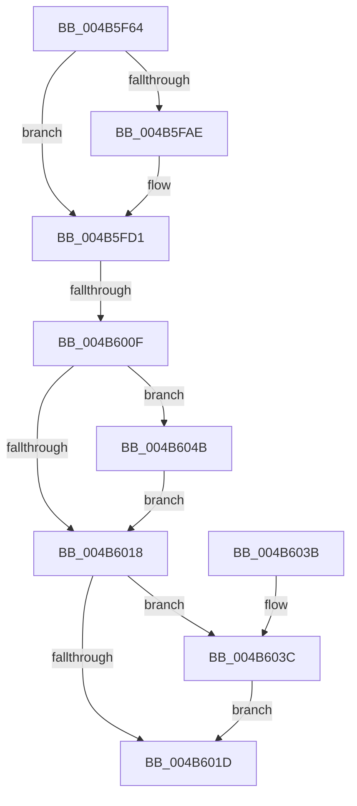

# PopReadRegKeyValue

- RVA: `0x004B5F64`–`0x004B6052` (길이 `238` bytes)
- VA: `0x00000001404B5F64`
- 실행 섹션: `.text`
- PDB 이름 있음: `예`; PDB Function 태그: `예`
- unwind 정보 RVA: `0x000BA4F8`
- 디코드: `69`개 명령, `238/238` bytes 표시
- 미해석 바이트: `0` (있으면 어셈블리에 `.byte`로 보존)

> 이 문서는 커널 이미지의 기계어와 PDB 기호를 분석해 생성했습니다. 4번과 5번은 함수 원형과 자료형을 바이너리 사용 방식에서 추정한 C 해석이며 원본 소스 복구 결과는 아닙니다.

## 1. Dependencies

- 직접 호출 지점: **4**; 고유 호출 대상: **4**
- 직접 호출자로 확인된 함수: **6**
- RIP 상대 이미지 참조: **0**

### Outgoing calls
- `0x004B5FAE` → [wcslen](../50/wcslen_function_00501BA0.md) (function, `0x00501BA0`)
- `0x004B6000` → [ZwOpenKey](../6A/ZwOpenKey_function_006AD310.md) (function, `0x006AD310`)
- `0x004B6044` → [ExFreePoolWithTag](../../poolcode/B8/ExFreePoolWithTag_function_00B82870.md) (function, `0x00B82870`)
- `0x004B604B` → [ZwClose](../6A/ZwClose_function_006AD2B0.md) (function, `0x006AD2B0`)

### Direct callers
- [PopReadUlongPowerKey](../5C/PopReadUlongPowerKey_function_005CEB5C.md) at `0x005CEB8C`
- [PopQueryRestrictedStandbyTimeoutSeconds](../../page/75/PopQueryRestrictedStandbyTimeoutSeconds_function_00754374.md) at `0x0075439F`
- [PopDiagTracePerfTrackData](../../page/A7/PopDiagTracePerfTrackData_function_00A733CC.md) at `0x00A7350E`
- [PopEsOverrideSetByGroupPolicy](../../page/AB/PopEsOverrideSetByGroupPolicy_function_00AB4284.md) at `0x00AB433F`
- [PopCheckShutdownMarker](../../init/C3/PopCheckShutdownMarker_function_00C3DAD4.md) at `0x00C3E005`
- [PopCheckShutdownMarker](../../init/C3/PopCheckShutdownMarker_function_00C3DAD4.md) at `0x00C3E030`
- [PopCheckShutdownMarker](../../init/C3/PopCheckShutdownMarker_function_00C3DAD4.md) at `0x00C3E056`
- [PopBatteryReadOscBits](../../init/C4/PopBatteryReadOscBits_function_00C422A0.md) at `0x00C422D1`
- [PopBatteryReadOscBits](../../init/C4/PopBatteryReadOscBits_function_00C422A0.md) at `0x00C42332`

### Static image references
- 디코드된 RIP-relative 메모리 참조가 없습니다.

## 2. Other-region calls and transfers

- 다른 실행 섹션으로 향하는 call: **1**
  - `0x004B6044` → [ExFreePoolWithTag](../../poolcode/B8/ExFreePoolWithTag_function_00B82870.md) (`.text` → `POOLCODE`)
- call이 아닌 외부 분기/꼬리 이동: **1**
  - `0x004B6009` → [sub_006FBC78](../6F/Unknown_function_006FBC78.md) (`tail-transfer`)

## 3. Assembly (complete function range)

```asm
004B5F64  48 89 5C 24 10                  mov qword ptr [rsp + 0x10], rbx
004B5F69  48 89 74 24 18                  mov qword ptr [rsp + 0x18], rsi
004B5F6E  55                              push rbp
004B5F6F  57                              push rdi
004B5F70  41 55                           push r13
004B5F72  41 56                           push r14
004B5F74  41 57                           push r15
004B5F76  48 8B EC                        mov rbp, rsp
004B5F79  48 81 EC 80 00 00 00            sub rsp, 0x80
004B5F80  33 C0                           xor eax, eax
004B5F82  48 89 4D C0                     mov qword ptr [rbp - 0x40], rcx
004B5F86  21 45 E4                        and dword ptr [rbp - 0x1c], eax
004B5F89  33 FF                           xor edi, edi
004B5F8B  21 45 30                        and dword ptr [rbp + 0x30], eax
004B5F8E  41 8B F1                        mov esi, r9d
004B5F91  48 21 45 B0                     and qword ptr [rbp - 0x50], rax
004B5F95  4D 8B F0                        mov r14, r8
004B5F98  48 21 45 B8                     and qword ptr [rbp - 0x48], rax
004B5F9C  44 8D 68 02                     lea r13d, [rax + 2]
004B5FA0  89 45 CC                        mov dword ptr [rbp - 0x34], eax
004B5FA3  4C 8B FA                        mov r15, rdx
004B5FA6  21 45 CC                        and dword ptr [rbp - 0x34], eax
004B5FA9  48 85 C9                        test rcx, rcx
004B5FAC  74 23                           je 0x1404b5fd1
004B5FAE  E8 ED BB 04 00                  call 0x140501ba0
004B5FB3  48 03 C0                        add rax, rax
004B5FB6  B9 FC FF 00 00                  mov ecx, 0xfffc
004B5FBB  48 3D FE FF 00 00               cmp rax, 0xfffe
004B5FC1  48 0F 43 C1                     cmovae rax, rcx
004B5FC5  66 89 45 B8                     mov word ptr [rbp - 0x48], ax
004B5FC9  66 41 03 C5                     add ax, r13w
004B5FCD  66 89 45 BA                     mov word ptr [rbp - 0x46], ax
004B5FD1  48 21 7D D0                     and qword ptr [rbp - 0x30], rdi
004B5FD5  48 8D 45 B8                     lea rax, [rbp - 0x48]
004B5FD9  0F 57 C0                        xorps xmm0, xmm0
004B5FDC  48 89 45 D8                     mov qword ptr [rbp - 0x28], rax
004B5FE0  4C 8D 45 C8                     lea r8, [rbp - 0x38]
004B5FE4  C7 45 C8 30 00 00 00            mov dword ptr [rbp - 0x38], 0x30
004B5FEB  BA 19 00 02 00                  mov edx, 0x20019
004B5FF0  C7 45 E0 40 02 00 00            mov dword ptr [rbp - 0x20], 0x240
004B5FF7  48 8D 4D B0                     lea rcx, [rbp - 0x50]
004B5FFB  F3 0F 7F 45 E8                  movdqu xmmword ptr [rbp - 0x18], xmm0
004B6000  E8 0B 73 1F 00                  call 0x1406ad310
004B6005  8B D8                           mov ebx, eax
004B6007  85 C0                           test eax, eax
004B6009  0F 89 69 5C 24 00               jns 0x1406fbc78
004B600F  48 8B 4D B0                     mov rcx, qword ptr [rbp - 0x50]
004B6013  48 85 C9                        test rcx, rcx
004B6016  75 33                           jne 0x1404b604b
004B6018  48 85 FF                        test rdi, rdi
004B601B  75 1F                           jne 0x1404b603c
004B601D  4C 8D 9C 24 80 00 00 00         lea r11, [rsp + 0x80]
004B6025  8B C3                           mov eax, ebx
004B6027  49 8B 5B 38                     mov rbx, qword ptr [r11 + 0x38]
004B602B  49 8B 73 40                     mov rsi, qword ptr [r11 + 0x40]
004B602F  49 8B E3                        mov rsp, r11
004B6032  41 5F                           pop r15
004B6034  41 5E                           pop r14
004B6036  41 5D                           pop r13
004B6038  5F                              pop rdi
004B6039  5D                              pop rbp
004B603A  C3                              ret
004B603B  CC                              int3
004B603C  BA 54 56 45 50                  mov edx, 0x50455654
004B6041  48 8B CF                        mov rcx, rdi
004B6044  E8 27 C8 6C 00                  call 0x140b82870
004B6049  EB D2                           jmp 0x1404b601d
004B604B  E8 60 72 1F 00                  call 0x1406ad2b0
004B6050  EB C6                           jmp 0x1404b6018
```

## 4. C-style interpretation (structured pseudocode)

```c
__int64 __fastcall PopReadRegKeyValue(__int64 a1, __int64 a2, __int64 a3, int a4)
{
    __int64 result;
    __int64 v_rdi;
    __int64 v_rsp;
    unsigned __int64 v_stack_m28;
    unsigned __int64 v_stack_m40;
    unsigned int v_stack_m44;
    unsigned int v_stack_m48;
    unsigned __int64 v_stack_m50;
    unsigned __int64 v_stack_m58;
    unsigned int v_stack_m5C;
    unsigned __int64 v_stack_m60;
    unsigned __int64 v_stack_m68;
    unsigned __int16 v_stack_m6E;
    unsigned __int64 v_stack_m70;
    unsigned __int64 v_stack_m78;
    unsigned __int64 v_stack_p10;
    unsigned __int64 v_stack_p18;
    unsigned int v_stack_p8;

    v_stack_p10 = v_rbx;
    v_stack_p18 = v_rsi;
    v_rsp = (v_rsp) - (128);
    result = 0;
    v_stack_m68 = a1;
    v_rdi = 0;
    v_stack_m5C = 0;
    if (a1 != 0) {
        result = wcslen(a1, a2, a3, a4);
        result = (result) + (result);
        a1 = 0xFFFCULL;
        if (result >= 0xFFFEULL) { result = a1; }
        v_stack_m70 = (unsigned __int16)(result);
        result = (unsigned __int16)((result) + ((unsigned __int16)(result + 2)));
        v_stack_m6E = (unsigned __int16)(result);
    }
    v_stack_m50 = v_stack_m70;
    v_stack_m60 = 48;
    v_stack_m48 = 576;
    v_stack_m40 = v_xmm0;
    result = ZwOpenKey(v_stack_m78, (unsigned int)(0x20019ULL), v_stack_m60, a4);
    if (v_stack_m78 != 0) goto loc_004B604B;
loc_004B6018:
    if (0 != 0) goto loc_004B603C;
loc_004B601D:
    return (unsigned int)((unsigned int)((unsigned int)((unsigned int)(result))));
loc_004B603C:
    result = ExFreePoolWithTag(0, (unsigned int)(0x50455654ULL), v_stack_m60, a4);
    goto loc_004B601D;
loc_004B604B:
    result = ZwClose(0, (unsigned int)(0x50455654ULL), v_stack_m60, a4);
    goto loc_004B6018;
}
```

## 5. (Beta) C Style

```c
int64_t PopReadRegKeyValue(int64_t Arg1, int64_t Arg2, int64_t Arg3, int32_t Arg4)
{
    int64_t result;
    int64_t local_rdi;
    int64_t local_rsp;
    uint64_t v_stack_m28;
    uint64_t v_stack_m40;
    uint32_t v_stack_m44;
    uint32_t v_stack_m48;
    uint64_t v_stack_m50;
    uint64_t v_stack_m58;
    uint32_t v_stack_m5C;
    uint64_t v_stack_m60;
    uint64_t v_stack_m68;
    uint16_t v_stack_m6E;
    uint64_t v_stack_m70;
    uint64_t v_stack_m78;
    uint64_t v_stack_p10;
    uint64_t v_stack_p18;
    uint32_t v_stack_p8;

    v_stack_p10 = local_rbx;
    v_stack_p18 = local_rsi;
    local_rsp = (local_rsp) - (128);
    result = 0;
    v_stack_m68 = Arg1;
    local_rdi = 0;
    v_stack_m5C = 0;
    if (Arg1 != 0) {
        result = wcslen(Arg1, Arg2, Arg3, Arg4);
        result = (result) + (result);
        Arg1 = 0xFFFCULL;
        if (result >= 0xFFFEULL) { result = Arg1; }
        v_stack_m70 = (uint16_t)(result);
        result = (uint16_t)((result) + ((uint16_t)(result + 2)));
        v_stack_m6E = (uint16_t)(result);
    }
    v_stack_m50 = v_stack_m70;
    v_stack_m60 = 48;
    v_stack_m48 = 576;
    v_stack_m40 = v_xmm0;
    result = ZwOpenKey(v_stack_m78, (uint32_t)(0x20019ULL), v_stack_m60, Arg4);
    if (v_stack_m78 != 0) goto loc_004B604B;
loc_004B6018:
    if (0 != 0) goto loc_004B603C;
loc_004B601D:
    return (uint32_t)((uint32_t)((uint32_t)((uint32_t)(result))));
loc_004B603C:
    result = ExFreePoolWithTag(0, (uint32_t)(0x50455654ULL), v_stack_m60, Arg4);
    goto loc_004B601D;
loc_004B604B:
    result = ZwClose(0, (uint32_t)(0x50455654ULL), v_stack_m60, Arg4);
    goto loc_004B6018;
}
```

## 6. Execution-region graph

[열기: 2D/3D 그래프와 함수 탐색 컨트롤 패널](../../../control-panel.html?section=text&rva=0x004B5F64&view=graph)

- 2D 그래프는 위에서 아래로 흐르고, 3D 그래프는 빈 공간을 드래그해 회전합니다. Shift+드래그는 이동, 휠은 확대·축소, 함수 노드 선택은 대상 보고서 이동입니다.

### Static fallback


