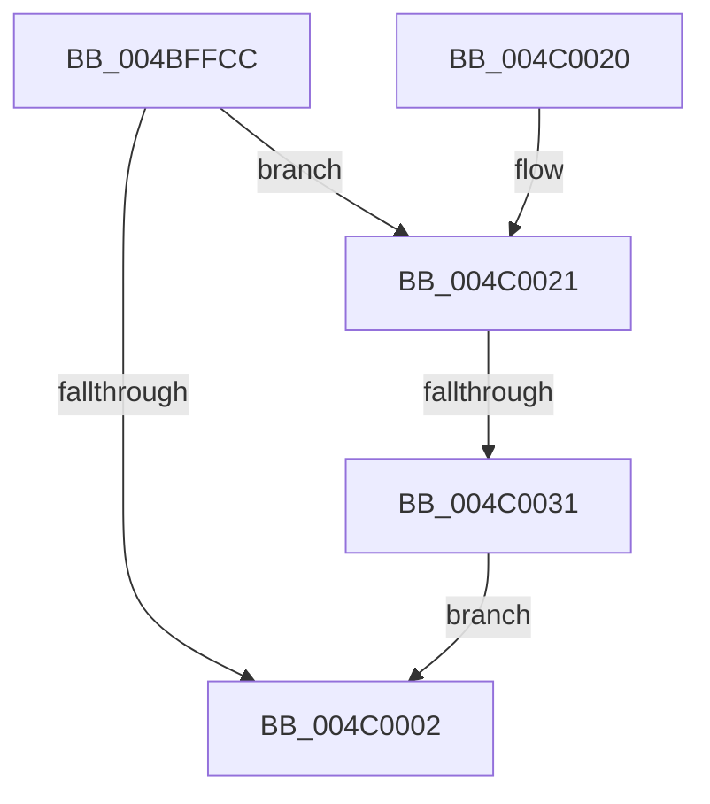

# PopSetModernStandbyTransitionReason

- RVA: `0x004BFFCC`–`0x004C0039` (길이 `109` bytes)
- VA: `0x00000001404BFFCC`
- 실행 섹션: `.text`
- PDB 이름 있음: `예`; PDB Function 태그: `예`
- unwind 정보 RVA: `0x000684A0`
- 디코드: `27`개 명령, `109/109` bytes 표시
- 미해석 바이트: `0` (있으면 어셈블리에 `.byte`로 보존)

> 이 문서는 커널 이미지의 기계어와 PDB 기호를 분석해 생성했습니다. 4번과 5번은 함수 원형과 자료형을 바이너리 사용 방식에서 추정한 C 해석이며 원본 소스 복구 결과는 아닙니다.

## 1. Dependencies

- 직접 호출 지점: **3**; 고유 호출 대상: **3**
- 직접 호출자로 확인된 함수: **1**
- RIP 상대 이미지 참조: **4**

### Outgoing calls
- `0x004BFFE5` → [RtlGetInterruptTimePrecise](../20/RtlGetInterruptTimePrecise_function_0020A4C0.md) (function, `0x0020A4C0`)
- `0x004BFFF4` → [KeAcquireSpinLockRaiseToDpc](../20/KeAcquireSpinLockRaiseToDpc_function_00208470.md) (function, `0x00208470`)
- `0x004C000B` → [KeReleaseSpinLock](../39/KeReleaseSpinLock_function_00392BA0.md) (function, `0x00392BA0`)

### Direct callers
- [PopSleepstudyStartNextSession](../../page/AC/PopSleepstudyStartNextSession_function_00AC4720.md) at `0x00AC4A60`
- [PopSleepstudyStartNextSession](../../page/AC/PopSleepstudyStartNextSession_function_00AC4720.md) at `0x00AC4C15`

### Static image references
- `0x004BFFEA` → RVA `0x00E0B840` (`.data`; read)
- `0x004BFFF9` → RVA `0x00E0B848` (`.data`; read)
- `0x004C0021` → RVA `0x00E0B848` (`.data`; write)
- `0x004C0031` → RVA `0x00E0B84C` (`.data`; write)

## 2. Other-region calls and transfers

- 다른 실행 섹션으로 향하는 call: **0**
- call이 아닌 외부 분기/꼬리 이동: **1**
  - `0x004C002B` → [sub_006FCBF6](../6F/Unknown_function_006FCBF6.md) (`tail-transfer`)

## 3. Assembly (complete function range)

```asm
004BFFCC  48 89 5C 24 08                  mov qword ptr [rsp + 8], rbx
004BFFD1  48 89 74 24 10                  mov qword ptr [rsp + 0x10], rsi
004BFFD6  57                              push rdi
004BFFD7  48 83 EC 20                     sub rsp, 0x20
004BFFDB  40 8A F9                        mov dil, cl
004BFFDE  8B DA                           mov ebx, edx
004BFFE0  48 8D 4C 24 40                  lea rcx, [rsp + 0x40]
004BFFE5  E8 D6 A4 D4 FF                  call 0x14020a4c0
004BFFEA  48 8D 0D 4F B8 94 00            lea rcx, [rip + 0x94b84f]
004BFFF1  48 8B F0                        mov rsi, rax
004BFFF4  E8 77 84 D4 FF                  call 0x140208470
004BFFF9  40 38 3D 48 B8 94 00            cmp byte ptr [rip + 0x94b848], dil
004C0000  75 1F                           jne 0x1404c0021
004C0002  8A D0                           mov dl, al
004C0004  48 8D 0D 35 B8 94 00            lea rcx, [rip + 0x94b835]
004C000B  E8 90 2B ED FF                  call 0x140392ba0
004C0010  48 8B 5C 24 30                  mov rbx, qword ptr [rsp + 0x30]
004C0015  48 8B 74 24 38                  mov rsi, qword ptr [rsp + 0x38]
004C001A  48 83 C4 20                     add rsp, 0x20
004C001E  5F                              pop rdi
004C001F  C3                              ret
004C0020  CC                              int3
004C0021  40 88 3D 20 B8 94 00            mov byte ptr [rip + 0x94b820], dil
004C0028  40 84 FF                        test dil, dil
004C002B  0F 84 C5 CB 23 00               je 0x1406fcbf6
004C0031  89 1D 15 B8 94 00               mov dword ptr [rip + 0x94b815], ebx
004C0037  EB C9                           jmp 0x1404c0002
```

## 4. C-style interpretation (structured pseudocode)

```c
__int64 __fastcall PopSetModernStandbyTransitionReason(unsigned __int8 a1, int a2)
{
    __int64 result;
    __int64 v_rsp;
    unsigned __int64 v_stack_p10;
    unsigned __int64 v_stack_p18;
    unsigned __int64 v_stack_p8;

    v_stack_p8 = v_rbx;
    v_stack_p10 = v_rsi;
    v_rsp = (v_rsp) - (32);
    result = RtlGetInterruptTimePrecise(v_stack_p18, a2, a3, a4);
    result = KeAcquireSpinLockRaiseToDpc(v_rip + 9746511, a2, a3, a4);
    if ((*(unsigned __int8 *)(v_rip + 9746504)) != a1) goto loc_004C0021;
loc_004C0002:
    result = KeReleaseSpinLock(v_rip + 9746485, (unsigned __int8)(result), a3, a4);
    v_rsp = (v_rsp) + (32);
    return result;
loc_004C0021:
    *(unsigned __int8 *)(v_rip + 9746464) = a1;
    *(unsigned int *)(v_rip + 9746453) = (unsigned int)(v_stack_p8);
    goto loc_004C0002;
}
```

## 5. (Beta) C Style

```c
int64_t PopSetModernStandbyTransitionReason(uint8_t Arg1, int32_t Arg2)
{
    int64_t result;
    int64_t local_rsp;
    uint64_t v_stack_p10;
    uint64_t v_stack_p18;
    uint64_t v_stack_p8;

    v_stack_p8 = local_rbx;
    v_stack_p10 = local_rsi;
    local_rsp = (local_rsp) - (32);
    result = RtlGetInterruptTimePrecise(v_stack_p18, Arg2, a3, a4);
    result = KeAcquireSpinLockRaiseToDpc(v_rip + 9746511, Arg2, a3, a4);
    if ((*(uint8_t *)(v_rip + 0x94B848)) != Arg1) goto loc_004C0021;
loc_004C0002:
    result = KeReleaseSpinLock(v_rip + 9746485, (uint8_t)(result), a3, a4);
    local_rsp = (local_rsp) + (32);
    return result;
loc_004C0021:
    *(uint8_t *)(v_rip + 0x94B820) = Arg1;
    *(uint32_t *)(v_rip + 0x94B815) = (uint32_t)(v_stack_p8);
    goto loc_004C0002;
}
```

## 6. Execution-region graph

[열기: 2D/3D 그래프와 함수 탐색 컨트롤 패널](../../../control-panel.html?section=text&rva=0x004BFFCC&view=graph)

- 2D 그래프는 위에서 아래로 흐르고, 3D 그래프는 빈 공간을 드래그해 회전합니다. Shift+드래그는 이동, 휠은 확대·축소, 함수 노드 선택은 대상 보고서 이동입니다.

### Static fallback


