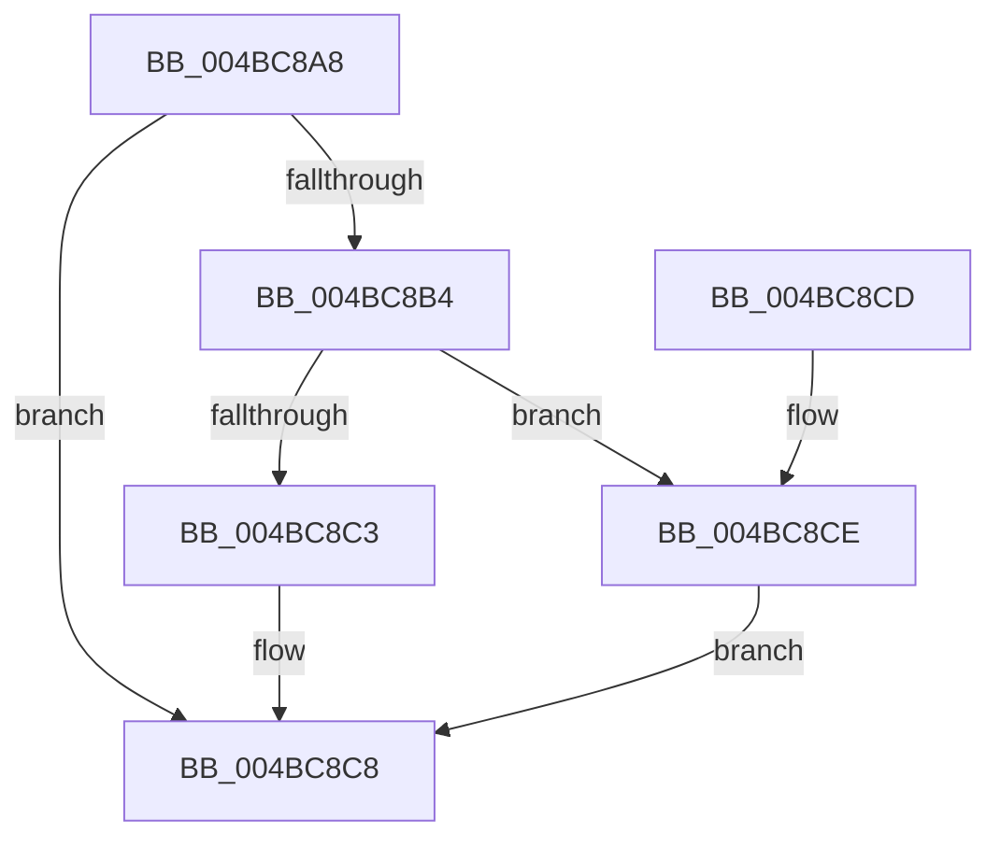

# PopSetPowerActionState

- RVA: `0x004BC8A8`–`0x004BC8D5` (길이 `45` bytes)
- VA: `0x00000001404BC8A8`
- 실행 섹션: `.text`
- PDB 이름 있음: `예`; PDB Function 태그: `아니요`
- unwind 정보 RVA: `0x0005CEE8`
- 디코드: `13`개 명령, `45/45` bytes 표시
- 미해석 바이트: `0` (있으면 어셈블리에 `.byte`로 보존)

> 이 문서는 커널 이미지의 기계어와 PDB 기호를 분석해 생성했습니다. 4번과 5번은 함수 원형과 자료형을 바이너리 사용 방식에서 추정한 C 해석이며 원본 소스 복구 결과는 아닙니다.

## 1. Dependencies

- 직접 호출 지점: **2**; 고유 호출 대상: **2**
- 직접 호출자로 확인된 함수: **4**
- RIP 상대 이미지 참조: **2**

### Outgoing calls
- `0x004BC8C3` → [PopDeepSleepSetDisengageReason](../38/PopDeepSleepSetDisengageReason_function_0038FEC4.md) (function, `0x0038FEC4`)
- `0x004BC8CE` → [PopDeepSleepClearDisengageReason](../39/PopDeepSleepClearDisengageReason_function_0039010C.md) (function, `0x0039010C`)

### Direct callers
- [PopExecutePowerAction](../../page/75/PopExecutePowerAction_function_0075E6B4.md) at `0x0075EB02`
- [PopPolicyWorkerAction](../../page/A9/PopPolicyWorkerAction_function_00A9CC40.md) at `0x00A9CCA4`
- [PopPolicyWorkerAction](../../page/A9/PopPolicyWorkerAction_function_00A9CC40.md) at `0x00A9CCEC`
- [PopPolicyWorkerAction](../../page/A9/PopPolicyWorkerAction_function_00A9CC40.md) at `0x00A9CDC1`
- [PopPolicyWorkerActionPromote](../../page/AB/PopPolicyWorkerActionPromote_function_00ABFE10.md) at `0x00ABFE86`
- [PopTransitionSystemPowerStateEx](../../pagelk/B7/PopTransitionSystemPowerStateEx_function_00B7E8C0.md) at `0x00B7EAC2`
- [PopTransitionSystemPowerStateEx](../../pagelk/B7/PopTransitionSystemPowerStateEx_function_00B7E8C0.md) at `0x00B7FB21`

### Static image references
- `0x004BC8AC` → RVA `0x00F0BD41` (`.data`; read)
- `0x004BC8B4` → RVA `0x00F0BD41` (`.data`; write)

## 2. Other-region calls and transfers

- 다른 실행 섹션으로 향하는 call: **0**
- 별도 외부 분기/꼬리 이동을 확인하지 못했습니다.

## 3. Assembly (complete function range)

```asm
004BC8A8  48 83 EC 28                     sub rsp, 0x28
004BC8AC  38 0D 8F F4 A4 00               cmp byte ptr [rip + 0xa4f48f], cl
004BC8B2  74 14                           je 0x1404bc8c8
004BC8B4  88 0D 87 F4 A4 00               mov byte ptr [rip + 0xa4f487], cl
004BC8BA  84 C9                           test cl, cl
004BC8BC  B9 05 00 00 00                  mov ecx, 5
004BC8C1  74 0B                           je 0x1404bc8ce
004BC8C3  E8 FC 35 ED FF                  call 0x14038fec4
004BC8C8  48 83 C4 28                     add rsp, 0x28
004BC8CC  C3                              ret
004BC8CD  CC                              int3
004BC8CE  E8 39 38 ED FF                  call 0x14039010c
004BC8D3  EB F3                           jmp 0x1404bc8c8
```

## 4. C-style interpretation (structured pseudocode)

```c
__int64 __fastcall PopSetPowerActionState(unsigned __int8 a1)
{
    __int64 result;
    __int64 v_rsp;

    v_rsp = (v_rsp) - (40);
    if ((*(unsigned __int8 *)(v_rip + 10810511)) == a1) goto loc_004BC8C8;
    *(unsigned __int8 *)(v_rip + 10810503) = a1;
    if (a1 == 0) goto loc_004BC8CE;
    result = PopDeepSleepSetDisengageReason(5, a2, a3, a4);
loc_004BC8C8:
    v_rsp = (v_rsp) + (40);
    return result;
loc_004BC8CE:
    result = PopDeepSleepClearDisengageReason(5, a2, a3, a4);
    goto loc_004BC8C8;
}
```

## 5. (Beta) C Style

```c
int64_t PopSetPowerActionState(uint8_t Arg1)
{
    int64_t result;
    int64_t local_rsp;

    local_rsp = (local_rsp) - (40);
    if ((*(uint8_t *)(v_rip + 0xA4F48F)) == Arg1) goto loc_004BC8C8;
    *(uint8_t *)(v_rip + 0xA4F487) = Arg1;
    if (Arg1 == 0) goto loc_004BC8CE;
    result = PopDeepSleepSetDisengageReason(5, a2, a3, a4);
loc_004BC8C8:
    local_rsp = (local_rsp) + (40);
    return result;
loc_004BC8CE:
    result = PopDeepSleepClearDisengageReason(5, a2, a3, a4);
    goto loc_004BC8C8;
}
```

## 6. Execution-region graph

[열기: 2D/3D 그래프와 함수 탐색 컨트롤 패널](../../../control-panel.html?section=text&rva=0x004BC8A8&view=graph)

- 2D 그래프는 위에서 아래로 흐르고, 3D 그래프는 빈 공간을 드래그해 회전합니다. Shift+드래그는 이동, 휠은 확대·축소, 함수 노드 선택은 대상 보고서 이동입니다.

### Static fallback


