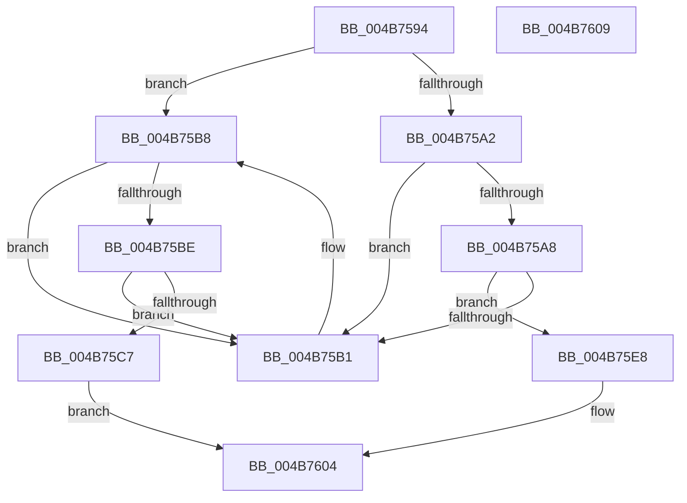

# PopUnregisterPowerSettingCallback

- RVA: `0x004B7594`–`0x004B760A` (길이 `118` bytes)
- VA: `0x00000001404B7594`
- 실행 섹션: `.text`
- PDB 이름 있음: `예`; PDB Function 태그: `아니요`
- unwind 정보 RVA: `0x0005C788`
- 디코드: `36`개 명령, `118/118` bytes 표시
- 미해석 바이트: `0` (있으면 어셈블리에 `.byte`로 보존)

> 이 문서는 커널 이미지의 기계어와 PDB 기호를 분석해 생성했습니다. 4번과 5번은 함수 원형과 자료형을 바이너리 사용 방식에서 추정한 C 해석이며 원본 소스 복구 결과는 아닙니다.

## 1. Dependencies

- 직접 호출 지점: **2**; 고유 호출 대상: **2**
- 직접 호출자로 확인된 함수: **2**
- RIP 상대 이미지 참조: **1**

### Outgoing calls
- `0x004B75E1` → [KeSetEvent](../33/KeSetEvent_function_0033F310.md) (function, `0x0033F310`)
- `0x004B75FF` → [ExFreePoolWithTag](../../poolcode/B8/ExFreePoolWithTag_function_00B82870.md) (function, `0x00B82870`)

### Direct callers
- [PopDispatchPowerSettingCallbacks](../../page/91/PopDispatchPowerSettingCallbacks_function_00916190.md) at `0x00916269`
- [PoUnregisterPowerSettingCallback](../../page/A8/PoUnregisterPowerSettingCallback_function_00A8E940.md) at `0x00A8E9C6`

### Static image references
- `0x004B75DA` → RVA `0x00F0DFA0` (`.data`; read)

## 2. Other-region calls and transfers

- 다른 실행 섹션으로 향하는 call: **1**
  - `0x004B75FF` → [ExFreePoolWithTag](../../poolcode/B8/ExFreePoolWithTag_function_00B82870.md) (`.text` → `POOLCODE`)
- 별도 외부 분기/꼬리 이동을 확인하지 못했습니다.

## 3. Assembly (complete function range)

```asm
004B7594  48 83 EC 28                     sub rsp, 0x28
004B7598  8A 41 21                        mov al, byte ptr [rcx + 0x21]
004B759B  48 8B 11                        mov rdx, qword ptr [rcx]
004B759E  84 C0                           test al, al
004B75A0  75 16                           jne 0x1404b75b8
004B75A2  48 39 4A 08                     cmp qword ptr [rdx + 8], rcx
004B75A6  75 09                           jne 0x1404b75b1
004B75A8  48 8B 41 08                     mov rax, qword ptr [rcx + 8]
004B75AC  48 39 08                        cmp qword ptr [rax], rcx
004B75AF  74 37                           je 0x1404b75e8
004B75B1  B9 03 00 00 00                  mov ecx, 3
004B75B6  CD 29                           int 0x29
004B75B8  48 39 4A 08                     cmp qword ptr [rdx + 8], rcx
004B75BC  75 F3                           jne 0x1404b75b1
004B75BE  48 8B 41 08                     mov rax, qword ptr [rcx + 8]
004B75C2  48 39 08                        cmp qword ptr [rax], rcx
004B75C5  75 EA                           jne 0x1404b75b1
004B75C7  48 89 10                        mov qword ptr [rax], rdx
004B75CA  45 33 C0                        xor r8d, r8d
004B75CD  48 89 42 08                     mov qword ptr [rdx + 8], rax
004B75D1  33 D2                           xor edx, edx
004B75D3  48 89 49 08                     mov qword ptr [rcx + 8], rcx
004B75D7  48 89 09                        mov qword ptr [rcx], rcx
004B75DA  48 8D 0D BF 69 A5 00            lea rcx, [rip + 0xa569bf]
004B75E1  E8 2A 7D E8 FF                  call 0x14033f310
004B75E6  EB 1C                           jmp 0x1404b7604
004B75E8  48 89 10                        mov qword ptr [rax], rdx
004B75EB  48 89 42 08                     mov qword ptr [rdx + 8], rax
004B75EF  BA 50 53 65 74                  mov edx, 0x74655350
004B75F4  48 89 49 08                     mov qword ptr [rcx + 8], rcx
004B75F8  48 89 09                        mov qword ptr [rcx], rcx
004B75FB  83 61 10 00                     and dword ptr [rcx + 0x10], 0
004B75FF  E8 6C B2 6C 00                  call 0x140b82870
004B7604  48 83 C4 28                     add rsp, 0x28
004B7608  C3                              ret
004B7609  CC                              int3
```

## 4. C-style interpretation (structured pseudocode)

```c
__int64 __fastcall PopUnregisterPowerSettingCallback(__int64 a1, __int64 a2, int a3)
{
    __int64 result;
    __int64 v_rsp;

    v_rsp = (v_rsp) - (40);
    if ((unsigned __int8)(*(unsigned __int8 *)(a1 + 33)) != 0) goto loc_004B75B8;
    if ((*(unsigned __int64 *)(*(unsigned __int64 *)(a1) + 8)) != a1) goto loc_004B75B1;
    if ((*(unsigned __int64 *)(*(unsigned __int64 *)(a1 + 8))) == a1) goto loc_004B75E8;
loc_004B75B1:
loc_004B75B8:
    if ((*(unsigned __int64 *)(*(unsigned __int64 *)(a1) + 8)) != 3) goto loc_004B75B1;
    if ((*(unsigned __int64 *)(*(unsigned __int64 *)(3 + 8))) != 3) goto loc_004B75B1;
    *(unsigned __int64 *)(*(unsigned __int64 *)(3 + 8)) = *(unsigned __int64 *)(a1);
    a3 = 0;
    *(unsigned __int64 *)(*(unsigned __int64 *)(a1) + 8) = *(unsigned __int64 *)(3 + 8);
    a2 = 0;
    *(unsigned __int64 *)(3 + 8) = 3;
    *(unsigned __int64 *)(3) = 3;
    result = KeSetEvent(v_rip + 10840511, a2, a3, a4);
    goto loc_004B7604;
loc_004B75E8:
    *(unsigned __int64 *)(result) = 0;
    *(unsigned __int64 *)(a2 + 8) = result;
    *(unsigned __int64 *)(v_rip + 10840511 + 8) = v_rip + 10840511;
    *(unsigned __int64 *)(v_rip + 10840511) = v_rip + 10840511;
    result = ExFreePoolWithTag(v_rip + 10840511, (unsigned int)(0x74655350ULL), a3, a4);
loc_004B7604:
    v_rsp = (v_rsp) + (40);
    return result;
}
```

## 5. (Beta) C Style

```c
int64_t PopUnregisterPowerSettingCallback(void *Arg1, int64_t Arg2, int32_t Arg3)
{
    uint8_t *arg1 = (uint8_t *)Arg1;

    int64_t result;
    int64_t local_rsp;

    local_rsp = (local_rsp) - (40);
    if ((uint8_t)(*(uint8_t *)(arg1 + 0x21)) != 0) goto loc_004B75B8;
    if ((*(uint64_t *)(*(uint64_t *)(arg1) + 0x8)) != Arg1) goto loc_004B75B1;
    if ((*(uint64_t *)(*(uint64_t *)(arg1 + 0x8))) == Arg1) goto loc_004B75E8;
loc_004B75B1:
loc_004B75B8:
    if ((*(uint64_t *)(*(uint64_t *)(arg1) + 0x8)) != 3) goto loc_004B75B1;
    if ((*(uint64_t *)(*(uint64_t *)(3 + 0x8))) != 3) goto loc_004B75B1;
    *(uint64_t *)(*(uint64_t *)(3 + 0x8)) = *(uint64_t *)(arg1);
    Arg3 = 0;
    *(uint64_t *)(*(uint64_t *)(arg1) + 0x8) = *(uint64_t *)(3 + 0x8);
    Arg2 = 0;
    *(uint64_t *)(3 + 0x8) = 3;
    *(uint64_t *)(3) = 3;
    result = KeSetEvent(v_rip + 10840511, Arg2, Arg3, a4);
    goto loc_004B7604;
loc_004B75E8:
    *(uint64_t *)(result) = 0;
    *(uint64_t *)(Arg2 + 0x8) = result;
    *(uint64_t *)(v_rip + 0xA569BF + 0x8) = v_rip + 10840511;
    *(uint64_t *)(v_rip + 0xA569BF) = v_rip + 10840511;
    result = ExFreePoolWithTag(v_rip + 10840511, (uint32_t)(0x74655350ULL), Arg3, a4);
loc_004B7604:
    local_rsp = (local_rsp) + (40);
    return result;
}
```

### 관측된 메모리 오프셋

구조체 형식이 확인되지 않은 접근은 인자 기준의 오프셋으로만 기록했습니다.

| 기준 인자 | 오프셋 표현 | 폭 (bit) | 접근 |
|---|---:|---:|---|
| `Arg1` | `+ 0x0` | `64` | `R` |
| `Arg1` | `+ 0x0` | `64` | `W` |
| `Arg1` | `+ 0x8` | `64` | `R` |
| `Arg1` | `+ 0x8` | `64` | `W` |
| `Arg1` | `+ 0x10` | `32` | `R/W` |
| `Arg1` | `+ 0x21` | `8` | `R` |

## 6. Execution-region graph

[열기: 2D/3D 그래프와 함수 탐색 컨트롤 패널](../../../control-panel.html?section=text&rva=0x004B7594&view=graph)

- 2D 그래프는 위에서 아래로 흐르고, 3D 그래프는 빈 공간을 드래그해 회전합니다. Shift+드래그는 이동, 휠은 확대·축소, 함수 노드 선택은 대상 보고서 이동입니다.

### Static fallback


