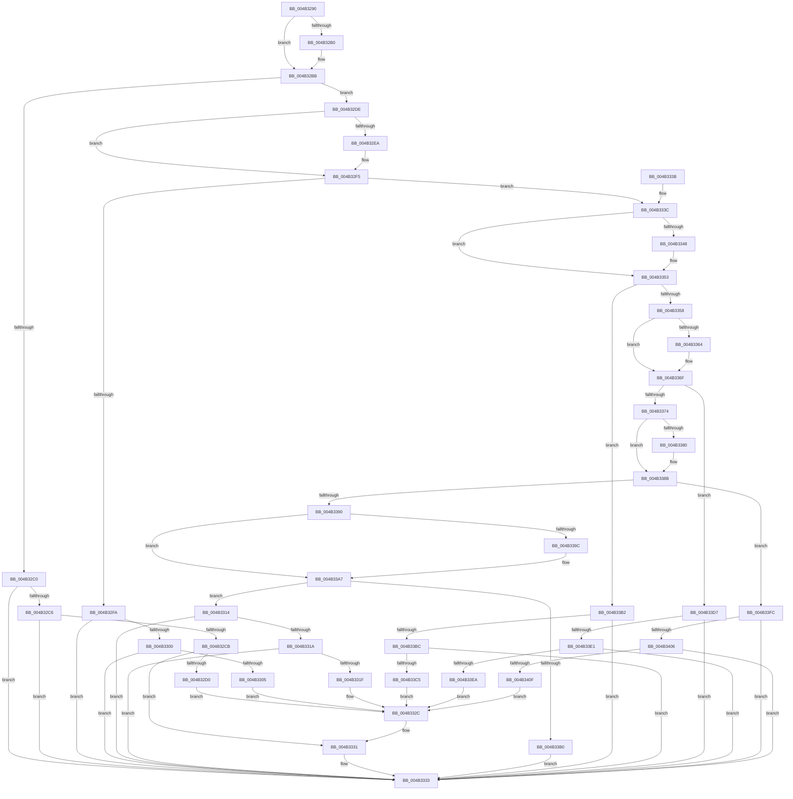

# PopVideoBrightnessSettingsCallback

- RVA: `0x004B3290`–`0x004B3421` (길이 `401` bytes)
- VA: `0x00000001404B3290`
- 실행 섹션: `.text`
- PDB 이름 있음: `예`; PDB Function 태그: `아니요`
- unwind 정보 RVA: `0x000B98BC`
- 디코드: `104`개 명령, `401/401` bytes 표시
- 미해석 바이트: `0` (있으면 어셈블리에 `.byte`로 보존)

> 이 문서는 커널 이미지의 기계어와 PDB 기호를 분석해 생성했습니다. 4번과 5번은 함수 원형과 자료형을 바이너리 사용 방식에서 추정한 C 해석이며 원본 소스 복구 결과는 아닙니다.

## 1. Dependencies

- 직접 호출 지점: **7**; 고유 호출 대상: **2**
- 직접 호출자로 확인된 함수: **0**
- RIP 상대 이미지 참조: **18**

### Outgoing calls
- `0x004B32D0` → [PopAcquirePolicyLock](../../pagelk/B7/PopAcquirePolicyLock_function_00B783C0.md) (function, `0x00B783C0`)
- `0x004B3305` → [PopAcquirePolicyLock](../../pagelk/B7/PopAcquirePolicyLock_function_00B783C0.md) (function, `0x00B783C0`)
- `0x004B331F` → [PopAcquirePolicyLock](../../pagelk/B7/PopAcquirePolicyLock_function_00B783C0.md) (function, `0x00B783C0`)
- `0x004B332C` → [PopReleasePolicyLock](../../pagelk/B7/PopReleasePolicyLock_function_00B78410.md) (function, `0x00B78410`)
- `0x004B33C5` → [PopAcquirePolicyLock](../../pagelk/B7/PopAcquirePolicyLock_function_00B783C0.md) (function, `0x00B783C0`)
- `0x004B33EA` → [PopAcquirePolicyLock](../../pagelk/B7/PopAcquirePolicyLock_function_00B783C0.md) (function, `0x00B783C0`)
- `0x004B340F` → [PopAcquirePolicyLock](../../pagelk/B7/PopAcquirePolicyLock_function_00B783C0.md) (function, `0x00B783C0`)

### Direct callers
- 이 함수 시작 RVA로 연결되는 직접 call은 확인되지 않았습니다. 간접 호출은 완전히 역산할 수 없습니다.

### Static image references
- `0x004B329C` → RVA `0x0001C338` (`.rdata`; read)
- `0x004B32B0` → RVA `0x0001C340` (`.rdata`; read)
- `0x004B32D5` → RVA `0x00F0CECA` (`.data`; write)
- `0x004B32DE` → RVA `0x0001C348` (`.rdata`; read)
- `0x004B32EA` → RVA `0x0001C350` (`.rdata`; read)
- `0x004B330C` → RVA `0x00F0CE30` (`.data`; write)
- `0x004B3326` → RVA `0x00F0CE2C` (`.data`; write)
- `0x004B333C` → RVA `0x0001C358` (`.rdata`; read)
- `0x004B3348` → RVA `0x0001C360` (`.rdata`; read)
- `0x004B3358` → RVA `0x0001C378` (`.rdata`; read)
- `0x004B3364` → RVA `0x0001C380` (`.rdata`; read)
- `0x004B3374` → RVA `0x0001C388` (`.rdata`; read)
- `0x004B3380` → RVA `0x0001C390` (`.rdata`; read)
- `0x004B3390` → RVA `0x0001C368` (`.rdata`; read)
- `0x004B339C` → RVA `0x0001C370` (`.rdata`; read)
- `0x004B33CC` → RVA `0x00F0CE34` (`.data`; write)
- `0x004B33F1` → RVA `0x00F0CE3C` (`.data`; write)
- `0x004B3416` → RVA `0x00F0CE40` (`.data`; write)

## 2. Other-region calls and transfers

- 다른 실행 섹션으로 향하는 call: **7**
  - `0x004B32D0` → [PopAcquirePolicyLock](../../pagelk/B7/PopAcquirePolicyLock_function_00B783C0.md) (`.text` → `PAGELK`)
  - `0x004B3305` → [PopAcquirePolicyLock](../../pagelk/B7/PopAcquirePolicyLock_function_00B783C0.md) (`.text` → `PAGELK`)
  - `0x004B331F` → [PopAcquirePolicyLock](../../pagelk/B7/PopAcquirePolicyLock_function_00B783C0.md) (`.text` → `PAGELK`)
  - `0x004B332C` → [PopReleasePolicyLock](../../pagelk/B7/PopReleasePolicyLock_function_00B78410.md) (`.text` → `PAGELK`)
  - `0x004B33C5` → [PopAcquirePolicyLock](../../pagelk/B7/PopAcquirePolicyLock_function_00B783C0.md) (`.text` → `PAGELK`)
  - `0x004B33EA` → [PopAcquirePolicyLock](../../pagelk/B7/PopAcquirePolicyLock_function_00B783C0.md) (`.text` → `PAGELK`)
  - `0x004B340F` → [PopAcquirePolicyLock](../../pagelk/B7/PopAcquirePolicyLock_function_00B783C0.md) (`.text` → `PAGELK`)
- 별도 외부 분기/꼬리 이동을 확인하지 못했습니다.

## 3. Assembly (complete function range)

```asm
004B3290  40 53                           push rbx
004B3292  48 83 EC 20                     sub rsp, 0x20
004B3296  48 8B 01                        mov rax, qword ptr [rcx]
004B3299  45 8B C8                        mov r9d, r8d
004B329C  4C 8B 05 95 90 B6 FF            mov r8, qword ptr [rip - 0x496f6b]
004B32A3  48 8B DA                        mov rbx, rdx
004B32A6  BA 0D 00 00 C0                  mov edx, 0xc000000d
004B32AB  4C 2B C0                        sub r8, rax
004B32AE  75 0B                           jne 0x1404b32bb
004B32B0  4C 8B 05 89 90 B6 FF            mov r8, qword ptr [rip - 0x496f77]
004B32B7  4C 2B 41 08                     sub r8, qword ptr [rcx + 8]
004B32BB  4D 85 C0                        test r8, r8
004B32BE  75 1E                           jne 0x1404b32de
004B32C0  41 83 F9 04                     cmp r9d, 4
004B32C4  75 6D                           jne 0x1404b3333
004B32C6  48 85 DB                        test rbx, rbx
004B32C9  74 68                           je 0x1404b3333
004B32CB  44 39 03                        cmp dword ptr [rbx], r8d
004B32CE  74 61                           je 0x1404b3331
004B32D0  E8 EB 50 6C 00                  call 0x140b783c0
004B32D5  C6 05 EE 9B A5 00 01            mov byte ptr [rip + 0xa59bee], 1
004B32DC  EB 4E                           jmp 0x1404b332c
004B32DE  4C 8B 05 63 90 B6 FF            mov r8, qword ptr [rip - 0x496f9d]
004B32E5  4C 2B C0                        sub r8, rax
004B32E8  75 0B                           jne 0x1404b32f5
004B32EA  4C 8B 05 5F 90 B6 FF            mov r8, qword ptr [rip - 0x496fa1]
004B32F1  4C 2B 41 08                     sub r8, qword ptr [rcx + 8]
004B32F5  4D 85 C0                        test r8, r8
004B32F8  75 42                           jne 0x1404b333c
004B32FA  41 83 F9 04                     cmp r9d, 4
004B32FE  75 33                           jne 0x1404b3333
004B3300  48 85 DB                        test rbx, rbx
004B3303  74 2E                           je 0x1404b3333
004B3305  E8 B6 50 6C 00                  call 0x140b783c0
004B330A  8B 03                           mov eax, dword ptr [rbx]
004B330C  89 05 1E 9B A5 00               mov dword ptr [rip + 0xa59b1e], eax
004B3312  EB 18                           jmp 0x1404b332c
004B3314  41 83 F9 04                     cmp r9d, 4
004B3318  75 19                           jne 0x1404b3333
004B331A  48 85 DB                        test rbx, rbx
004B331D  74 14                           je 0x1404b3333
004B331F  E8 9C 50 6C 00                  call 0x140b783c0
004B3324  8B 03                           mov eax, dword ptr [rbx]
004B3326  89 05 00 9B A5 00               mov dword ptr [rip + 0xa59b00], eax
004B332C  E8 DF 50 6C 00                  call 0x140b78410
004B3331  33 D2                           xor edx, edx
004B3333  8B C2                           mov eax, edx
004B3335  48 83 C4 20                     add rsp, 0x20
004B3339  5B                              pop rbx
004B333A  C3                              ret
004B333B  CC                              int3
004B333C  4C 8B 05 15 90 B6 FF            mov r8, qword ptr [rip - 0x496feb]
004B3343  4C 2B C0                        sub r8, rax
004B3346  75 0B                           jne 0x1404b3353
004B3348  4C 8B 05 11 90 B6 FF            mov r8, qword ptr [rip - 0x496fef]
004B334F  4C 2B 41 08                     sub r8, qword ptr [rcx + 8]
004B3353  4D 85 C0                        test r8, r8
004B3356  74 5A                           je 0x1404b33b2
004B3358  4C 8B 05 19 90 B6 FF            mov r8, qword ptr [rip - 0x496fe7]
004B335F  4C 2B C0                        sub r8, rax
004B3362  75 0B                           jne 0x1404b336f
004B3364  4C 8B 05 15 90 B6 FF            mov r8, qword ptr [rip - 0x496feb]
004B336B  4C 2B 41 08                     sub r8, qword ptr [rcx + 8]
004B336F  4D 85 C0                        test r8, r8
004B3372  74 63                           je 0x1404b33d7
004B3374  4C 8B 05 0D 90 B6 FF            mov r8, qword ptr [rip - 0x496ff3]
004B337B  4C 2B C0                        sub r8, rax
004B337E  75 0B                           jne 0x1404b338b
004B3380  4C 8B 05 09 90 B6 FF            mov r8, qword ptr [rip - 0x496ff7]
004B3387  4C 2B 41 08                     sub r8, qword ptr [rcx + 8]
004B338B  4D 85 C0                        test r8, r8
004B338E  74 6C                           je 0x1404b33fc
004B3390  4C 8B 05 D1 8F B6 FF            mov r8, qword ptr [rip - 0x49702f]
004B3397  4C 2B C0                        sub r8, rax
004B339A  75 0B                           jne 0x1404b33a7
004B339C  4C 8B 05 CD 8F B6 FF            mov r8, qword ptr [rip - 0x497033]
004B33A3  4C 2B 41 08                     sub r8, qword ptr [rcx + 8]
004B33A7  4D 85 C0                        test r8, r8
004B33AA  0F 84 64 FF FF FF               je 0x1404b3314
004B33B0  EB 81                           jmp 0x1404b3333
004B33B2  41 83 F9 04                     cmp r9d, 4
004B33B6  0F 85 77 FF FF FF               jne 0x1404b3333
004B33BC  48 85 DB                        test rbx, rbx
004B33BF  0F 84 6E FF FF FF               je 0x1404b3333
004B33C5  E8 F6 4F 6C 00                  call 0x140b783c0
004B33CA  8B 03                           mov eax, dword ptr [rbx]
004B33CC  89 05 62 9A A5 00               mov dword ptr [rip + 0xa59a62], eax
004B33D2  E9 55 FF FF FF                  jmp 0x1404b332c
004B33D7  41 83 F9 04                     cmp r9d, 4
004B33DB  0F 85 52 FF FF FF               jne 0x1404b3333
004B33E1  48 85 DB                        test rbx, rbx
004B33E4  0F 84 49 FF FF FF               je 0x1404b3333
004B33EA  E8 D1 4F 6C 00                  call 0x140b783c0
004B33EF  8B 03                           mov eax, dword ptr [rbx]
004B33F1  89 05 45 9A A5 00               mov dword ptr [rip + 0xa59a45], eax
004B33F7  E9 30 FF FF FF                  jmp 0x1404b332c
004B33FC  41 83 F9 04                     cmp r9d, 4
004B3400  0F 85 2D FF FF FF               jne 0x1404b3333
004B3406  48 85 DB                        test rbx, rbx
004B3409  0F 84 24 FF FF FF               je 0x1404b3333
004B340F  E8 AC 4F 6C 00                  call 0x140b783c0
004B3414  8B 03                           mov eax, dword ptr [rbx]
004B3416  89 05 24 9A A5 00               mov dword ptr [rip + 0xa59a24], eax
004B341C  E9 0B FF FF FF                  jmp 0x1404b332c
```

## 4. C-style interpretation (structured pseudocode)

```c
__int64 __fastcall PopVideoBrightnessSettingsCallback(__int64 a1, __int64 a2, int a3)
{
    __int64 result;
    __int64 v_rsp;

    v_rsp = (v_rsp) - (32);
    a3 = (*(unsigned __int64 *)(v_rip - 4812651)) - (*(unsigned __int64 *)(a1));
    if (!(condition_is_not_equal)) {
        a3 = *(unsigned __int64 *)(v_rip - 4812663);
        a3 = (a3) - (*(unsigned __int64 *)(a1 + 8));
    }
    if (a3 != 0) goto loc_004B32DE;
    if (((unsigned int)((unsigned int)(a3))) != 4) goto loc_004B3333;
    if (a2 == 0) goto loc_004B3333;
    if ((*(unsigned int *)(a2)) == a3) goto loc_004B3331;
    result = PopAcquirePolicyLock(a1, (unsigned int)(0xC000000DULL), a3, (unsigned int)(a3));
    *(unsigned __int8 *)(v_rip + 10853358) = 1;
    goto loc_004B332C;
loc_004B32DE:
    a3 = (*(unsigned __int64 *)(v_rip - 4812701)) - (result);
    if (!(condition_is_not_equal)) {
        a3 = *(unsigned __int64 *)(v_rip - 4812705);
        a3 = (a3) - (*(unsigned __int64 *)(a1 + 8));
    }
    if (a3 != 0) goto loc_004B333C;
    if (((unsigned int)((unsigned int)(a3))) != 4) goto loc_004B3333;
    if (a2 == 0) goto loc_004B3333;
    result = PopAcquirePolicyLock(a1, (unsigned int)(0xC000000DULL), a3, (unsigned int)(a3));
    *(unsigned int *)(v_rip + 10853150) = (unsigned int)((unsigned int)(*(unsigned int *)(a2)));
    goto loc_004B332C;
loc_004B3314:
    if (((unsigned int)((unsigned int)(a3))) != 4) goto loc_004B3333;
    if (a2 == 0) goto loc_004B3333;
    result = PopAcquirePolicyLock(a1, (unsigned int)(0xC000000DULL), a3, (unsigned int)(a3));
    *(unsigned int *)(v_rip + 10853120) = (unsigned int)((unsigned int)(*(unsigned int *)(a2)));
loc_004B332C:
    result = PopReleasePolicyLock(a1, (unsigned int)(0xC000000DULL), a3, (unsigned int)(a3));
loc_004B3331:
    a2 = 0;
loc_004B3333:
    v_rsp = (v_rsp) + (32);
    return 0;
loc_004B333C:
    a3 = (*(unsigned __int64 *)(v_rip - 4812779)) - (0);
    if (!(condition_is_not_equal)) {
        a3 = *(unsigned __int64 *)(v_rip - 4812783);
        a3 = (a3) - (*(unsigned __int64 *)(a1 + 8));
    }
    if (a3 == 0) goto loc_004B33B2;
    a3 = (*(unsigned __int64 *)(v_rip - 4812775)) - (0);
    if (!(condition_is_not_equal)) {
        a3 = *(unsigned __int64 *)(v_rip - 4812779);
        a3 = (a3) - (*(unsigned __int64 *)(a1 + 8));
    }
    if (a3 == 0) goto loc_004B33D7;
    a3 = (*(unsigned __int64 *)(v_rip - 4812787)) - (0);
    if (!(condition_is_not_equal)) {
        a3 = *(unsigned __int64 *)(v_rip - 4812791);
        a3 = (a3) - (*(unsigned __int64 *)(a1 + 8));
    }
    if (a3 == 0) goto loc_004B33FC;
    a3 = (*(unsigned __int64 *)(v_rip - 4812847)) - (0);
    if (!(condition_is_not_equal)) {
        a3 = *(unsigned __int64 *)(v_rip - 4812851);
        a3 = (a3) - (*(unsigned __int64 *)(a1 + 8));
    }
    if (a3 == 0) goto loc_004B3314;
    goto loc_004B3333;
loc_004B33B2:
    if (((unsigned int)((unsigned int)(a3))) != 4) goto loc_004B3333;
    if (0 == 0) goto loc_004B3333;
    result = PopAcquirePolicyLock(a1, a2, a3, (unsigned int)(a3));
    *(unsigned int *)(v_rip + 10852962) = (unsigned int)((unsigned int)(*(unsigned int *)(a2)));
    goto loc_004B332C;
loc_004B33D7:
    if (((unsigned int)((unsigned int)(a3))) != 4) goto loc_004B3333;
    if (0 == 0) goto loc_004B3333;
    result = PopAcquirePolicyLock(a1, a2, a3, (unsigned int)(a3));
    *(unsigned int *)(v_rip + 10852933) = (unsigned int)((unsigned int)(*(unsigned int *)(a2)));
    goto loc_004B332C;
loc_004B33FC:
    if (((unsigned int)((unsigned int)(a3))) != 4) goto loc_004B3333;
    if (0 == 0) goto loc_004B3333;
    result = PopAcquirePolicyLock(a1, a2, a3, (unsigned int)(a3));
    *(unsigned int *)(v_rip + 10852900) = (unsigned int)((unsigned int)(*(unsigned int *)(a2)));
    goto loc_004B332C;
}
```

## 5. (Beta) C Style

```c
int64_t PopVideoBrightnessSettingsCallback(void *Arg1, int64_t Arg2, int32_t Arg3)
{
    uint8_t *arg1 = (uint8_t *)Arg1;

    int64_t result;
    int64_t local_rsp;

    local_rsp = (local_rsp) - (32);
    Arg3 = (*(uint64_t *)(v_rip - 0x496F6B)) - (*(uint64_t *)(arg1));
    if (!(condition_is_not_equal)) {
        Arg3 = *(uint64_t *)(v_rip - 0x496F77);
        Arg3 = (Arg3) - (*(uint64_t *)(arg1 + 0x8));
    }
    if (Arg3 != 0) goto loc_004B32DE;
    if (((uint32_t)((uint32_t)(Arg3))) != 4) goto loc_004B3333;
    if (Arg2 == 0) goto loc_004B3333;
    if ((*(uint32_t *)(Arg2)) == Arg3) goto loc_004B3331;
    result = PopAcquirePolicyLock(Arg1, (uint32_t)(0xC000000DULL), Arg3, (uint32_t)(Arg3));
    *(uint8_t *)(v_rip + 0xA59BEE) = 1;
    goto loc_004B332C;
loc_004B32DE:
    Arg3 = (*(uint64_t *)(v_rip - 0x496F9D)) - (result);
    if (!(condition_is_not_equal)) {
        Arg3 = *(uint64_t *)(v_rip - 0x496FA1);
        Arg3 = (Arg3) - (*(uint64_t *)(arg1 + 0x8));
    }
    if (Arg3 != 0) goto loc_004B333C;
    if (((uint32_t)((uint32_t)(Arg3))) != 4) goto loc_004B3333;
    if (Arg2 == 0) goto loc_004B3333;
    result = PopAcquirePolicyLock(Arg1, (uint32_t)(0xC000000DULL), Arg3, (uint32_t)(Arg3));
    *(uint32_t *)(v_rip + 0xA59B1E) = (uint32_t)((uint32_t)(*(uint32_t *)(Arg2)));
    goto loc_004B332C;
loc_004B3314:
    if (((uint32_t)((uint32_t)(Arg3))) != 4) goto loc_004B3333;
    if (Arg2 == 0) goto loc_004B3333;
    result = PopAcquirePolicyLock(Arg1, (uint32_t)(0xC000000DULL), Arg3, (uint32_t)(Arg3));
    *(uint32_t *)(v_rip + 0xA59B00) = (uint32_t)((uint32_t)(*(uint32_t *)(Arg2)));
loc_004B332C:
    result = PopReleasePolicyLock(Arg1, (uint32_t)(0xC000000DULL), Arg3, (uint32_t)(Arg3));
loc_004B3331:
    Arg2 = 0;
loc_004B3333:
    local_rsp = (local_rsp) + (32);
    return 0;
loc_004B333C:
    Arg3 = (*(uint64_t *)(v_rip - 0x496FEB)) - (0);
    if (!(condition_is_not_equal)) {
        Arg3 = *(uint64_t *)(v_rip - 0x496FEF);
        Arg3 = (Arg3) - (*(uint64_t *)(arg1 + 0x8));
    }
    if (Arg3 == 0) goto loc_004B33B2;
    Arg3 = (*(uint64_t *)(v_rip - 0x496FE7)) - (0);
    if (!(condition_is_not_equal)) {
        Arg3 = *(uint64_t *)(v_rip - 0x496FEB);
        Arg3 = (Arg3) - (*(uint64_t *)(arg1 + 0x8));
    }
    if (Arg3 == 0) goto loc_004B33D7;
    Arg3 = (*(uint64_t *)(v_rip - 0x496FF3)) - (0);
    if (!(condition_is_not_equal)) {
        Arg3 = *(uint64_t *)(v_rip - 0x496FF7);
        Arg3 = (Arg3) - (*(uint64_t *)(arg1 + 0x8));
    }
    if (Arg3 == 0) goto loc_004B33FC;
    Arg3 = (*(uint64_t *)(v_rip - 0x49702F)) - (0);
    if (!(condition_is_not_equal)) {
        Arg3 = *(uint64_t *)(v_rip - 0x497033);
        Arg3 = (Arg3) - (*(uint64_t *)(arg1 + 0x8));
    }
    if (Arg3 == 0) goto loc_004B3314;
    goto loc_004B3333;
loc_004B33B2:
    if (((uint32_t)((uint32_t)(Arg3))) != 4) goto loc_004B3333;
    if (0 == 0) goto loc_004B3333;
    result = PopAcquirePolicyLock(Arg1, Arg2, Arg3, (uint32_t)(Arg3));
    *(uint32_t *)(v_rip + 0xA59A62) = (uint32_t)((uint32_t)(*(uint32_t *)(Arg2)));
    goto loc_004B332C;
loc_004B33D7:
    if (((uint32_t)((uint32_t)(Arg3))) != 4) goto loc_004B3333;
    if (0 == 0) goto loc_004B3333;
    result = PopAcquirePolicyLock(Arg1, Arg2, Arg3, (uint32_t)(Arg3));
    *(uint32_t *)(v_rip + 0xA59A45) = (uint32_t)((uint32_t)(*(uint32_t *)(Arg2)));
    goto loc_004B332C;
loc_004B33FC:
    if (((uint32_t)((uint32_t)(Arg3))) != 4) goto loc_004B3333;
    if (0 == 0) goto loc_004B3333;
    result = PopAcquirePolicyLock(Arg1, Arg2, Arg3, (uint32_t)(Arg3));
    *(uint32_t *)(v_rip + 0xA59A24) = (uint32_t)((uint32_t)(*(uint32_t *)(Arg2)));
    goto loc_004B332C;
}
```

### 관측된 메모리 오프셋

구조체 형식이 확인되지 않은 접근은 인자 기준의 오프셋으로만 기록했습니다.

| 기준 인자 | 오프셋 표현 | 폭 (bit) | 접근 |
|---|---:|---:|---|
| `Arg1` | `+ 0x0` | `64` | `R` |
| `Arg1` | `+ 0x8` | `64` | `R` |

## 6. Execution-region graph

[열기: 2D/3D 그래프와 함수 탐색 컨트롤 패널](../../../control-panel.html?section=text&rva=0x004B3290&view=graph)

- 2D 그래프는 위에서 아래로 흐르고, 3D 그래프는 빈 공간을 드래그해 회전합니다. Shift+드래그는 이동, 휠은 확대·축소, 함수 노드 선택은 대상 보고서 이동입니다.

### Static fallback


