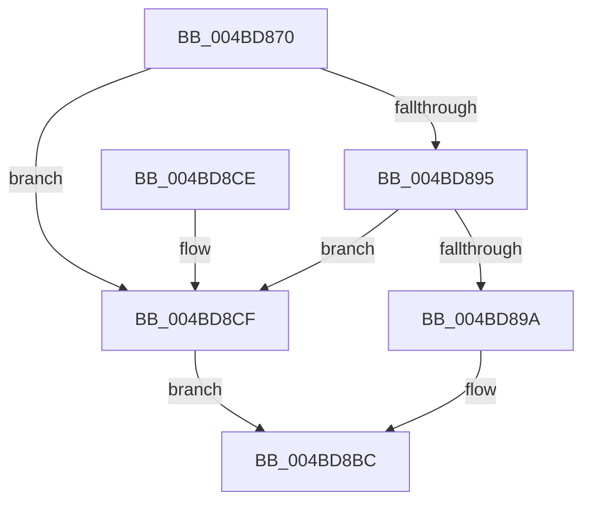

# PopWin32kPowerSettingCallback

- RVA: `0x004BD870`–`0x004BD8D6` (길이 `102` bytes)
- VA: `0x00000001404BD870`
- 실행 섹션: `.text`
- PDB 이름 있음: `예`; PDB Function 태그: `아니요`
- unwind 정보 RVA: `0x000BC0AC`
- 디코드: `27`개 명령, `102/102` bytes 표시
- 미해석 바이트: `0` (있으면 어셈블리에 `.byte`로 보존)

> 이 문서는 커널 이미지의 기계어와 PDB 기호를 분석해 생성했습니다. 4번과 5번은 함수 원형과 자료형을 바이너리 사용 방식에서 추정한 C 해석이며 원본 소스 복구 결과는 아닙니다.

## 1. Dependencies

- 직접 호출 지점: **2**; 고유 호출 대상: **2**
- 직접 호출자로 확인된 함수: **0**
- RIP 상대 이미지 참조: **1**

### Outgoing calls
- `0x004BD8B5` → [PopBroadcastSessionInfo](../../page/91/PopBroadcastSessionInfo_function_00912598.md) (function, `0x00912598`)
- `0x004BD8C4` → [_security_check_cookie](../6A/_security_check_cookie_function_006AC640.md) (function, `0x006AC640`)

### Direct callers
- 이 함수 시작 RVA로 연결되는 직접 call은 확인되지 않았습니다. 간접 호출은 완전히 역산할 수 없습니다.

### Static image references
- `0x004BD874` → RVA `0x00E0A740` (`.data`; read)

## 2. Other-region calls and transfers

- 다른 실행 섹션으로 향하는 call: **1**
  - `0x004BD8B5` → [PopBroadcastSessionInfo](../../page/91/PopBroadcastSessionInfo_function_00912598.md) (`.text` → `PAGE`)
- 별도 외부 분기/꼬리 이동을 확인하지 못했습니다.

## 3. Assembly (complete function range)

```asm
004BD870  48 83 EC 48                     sub rsp, 0x48
004BD874  48 8B 05 C5 CE 94 00            mov rax, qword ptr [rip + 0x94cec5]
004BD87B  48 33 C4                        xor rax, rsp
004BD87E  48 89 44 24 38                  mov qword ptr [rsp + 0x38], rax
004BD883  48 83 64 24 20 00               and qword ptr [rsp + 0x20], 0
004BD889  48 83 64 24 28 00               and qword ptr [rsp + 0x28], 0
004BD88F  41 83 F8 04                     cmp r8d, 4
004BD893  75 3A                           jne 0x1404bd8cf
004BD895  48 85 D2                        test rdx, rdx
004BD898  74 35                           je 0x1404bd8cf
004BD89A  0F 10 01                        movups xmm0, xmmword ptr [rcx]
004BD89D  8B 02                           mov eax, dword ptr [rdx]
004BD89F  4C 8D 44 24 20                  lea r8, [rsp + 0x20]
004BD8A4  BA 14 00 00 00                  mov edx, 0x14
004BD8A9  89 44 24 30                     mov dword ptr [rsp + 0x30], eax
004BD8AD  33 C9                           xor ecx, ecx
004BD8AF  F3 0F 7F 44 24 20               movdqu xmmword ptr [rsp + 0x20], xmm0
004BD8B5  E8 DE 4C 45 00                  call 0x140912598
004BD8BA  33 C0                           xor eax, eax
004BD8BC  48 8B 4C 24 38                  mov rcx, qword ptr [rsp + 0x38]
004BD8C1  48 33 CC                        xor rcx, rsp
004BD8C4  E8 77 ED 1E 00                  call 0x1406ac640
004BD8C9  48 83 C4 48                     add rsp, 0x48
004BD8CD  C3                              ret
004BD8CE  CC                              int3
004BD8CF  B8 0D 00 00 C0                  mov eax, 0xc000000d
004BD8D4  EB E6                           jmp 0x1404bd8bc
```

## 4. C-style interpretation (structured pseudocode)

```c
__int64 __fastcall PopWin32kPowerSettingCallback(__int64 a1, __int64 a2, int a3)
{
    __int64 result;
    __int64 v_rsp;
    unsigned __int64 v_stack_m10;
    unsigned int v_stack_m18;
    unsigned __int64 v_stack_m20;
    unsigned __int64 v_stack_m28;

    v_rsp = (v_rsp) - (72);
    result = (*(unsigned __int64 *)(v_rip + 9752261)) ^ (v_rsp);
    v_stack_m10 = result;
    if (a3 != 4) goto loc_004BD8CF;
    if (a2 == 0) goto loc_004BD8CF;
    v_stack_m18 = (unsigned int)((unsigned int)(*(unsigned int *)(a2)));
    a1 = 0;
    v_stack_m28 = v_xmm0;
    result = PopBroadcastSessionInfo(a1, 20, v_stack_m28, a4);
    result = 0;
loc_004BD8BC:
    a1 = (v_stack_m10) ^ (v_rsp);
    result = _security_check_cookie(a1, 20, v_stack_m28, a4);
    v_rsp = (v_rsp) + (72);
    return result;
loc_004BD8CF:
    goto loc_004BD8BC;
}
```

## 5. (Beta) C Style

```c
int64_t PopWin32kPowerSettingCallback(void *Arg1, int64_t Arg2, int32_t Arg3)
{
    uint8_t *arg1 = (uint8_t *)Arg1;

    int64_t result;
    int64_t local_rsp;
    uint64_t v_stack_m10;
    uint32_t v_stack_m18;
    uint64_t v_stack_m20;
    uint64_t v_stack_m28;

    local_rsp = (local_rsp) - (72);
    result = (*(uint64_t *)(v_rip + 0x94CEC5)) ^ (local_rsp);
    v_stack_m10 = result;
    if (Arg3 != 4) goto loc_004BD8CF;
    if (Arg2 == 0) goto loc_004BD8CF;
    v_stack_m18 = (uint32_t)((uint32_t)(*(uint32_t *)(Arg2)));
    Arg1 = 0;
    v_stack_m28 = v_xmm0;
    result = PopBroadcastSessionInfo(Arg1, 20, v_stack_m28, a4);
    result = 0;
loc_004BD8BC:
    Arg1 = (v_stack_m10) ^ (local_rsp);
    result = _security_check_cookie(Arg1, 20, v_stack_m28, a4);
    local_rsp = (local_rsp) + (72);
    return result;
loc_004BD8CF:
    goto loc_004BD8BC;
}
```

### 관측된 메모리 오프셋

구조체 형식이 확인되지 않은 접근은 인자 기준의 오프셋으로만 기록했습니다.

| 기준 인자 | 오프셋 표현 | 폭 (bit) | 접근 |
|---|---:|---:|---|
| `Arg1` | `+ 0x0` | `128` | `R` |

## 6. Execution-region graph

[열기: 2D/3D 그래프와 함수 탐색 컨트롤 패널](../../../control-panel.html?section=text&rva=0x004BD870&view=graph)

- 2D 그래프는 위에서 아래로 흐르고, 3D 그래프는 빈 공간을 드래그해 회전합니다. Shift+드래그는 이동, 휠은 확대·축소, 함수 노드 선택은 대상 보고서 이동입니다.

### Static fallback


