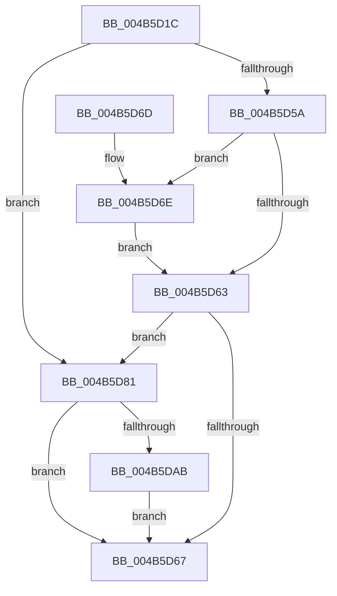

# PpmCheckArmPeriod

- RVA: `0x004B5D1C`–`0x004B5DD3` (길이 `183` bytes)
- VA: `0x00000001404B5D1C`
- 실행 섹션: `.text`
- PDB 이름 있음: `예`; PDB Function 태그: `아니요`
- unwind 정보 RVA: `0x000BA448`
- 디코드: `43`개 명령, `183/183` bytes 표시
- 미해석 바이트: `0` (있으면 어셈블리에 `.byte`로 보존)

> 이 문서는 커널 이미지의 기계어와 PDB 기호를 분석해 생성했습니다. 4번과 5번은 함수 원형과 자료형을 바이너리 사용 방식에서 추정한 C 해석이며 원본 소스 복구 결과는 아닙니다.

## 1. Dependencies

- 직접 호출 지점: **2**; 고유 호출 대상: **2**
- 직접 호출자로 확인된 함수: **1**
- RIP 상대 이미지 참조: **10**

### Outgoing calls
- `0x004B5D8A` → [PpmCheckResetProcessors](../5D/PpmCheckResetProcessors_function_005D84D0.md) (function, `0x005D84D0`)
- `0x004B5DCC` → [KeSetTimer2](../3A/KeSetTimer2_function_003A08E0.md) (function, `0x003A08E0`)

### Direct callers
- [PpmCheckReInit](../../page/A8/PpmCheckReInit_function_00A84DD8.md) at `0x00A84EBF`

### Static image references
- `0x004B5D22` → RVA `0x00E08380` (`.data`; read)
- `0x004B5D29` → RVA `0x00F0CE0C` (`.data`; read)
- `0x004B5D30` → RVA `0x00F0B250` (`.data`; read)
- `0x004B5D49` → RVA `0x00F0B3EC` (`.data`; read)
- `0x004B5D5A` → RVA `0x00F0B268` (`.data`; read)
- `0x004B5D70` → RVA `0x00F0B270` (`.data`; read/write)
- `0x004B5D79` → RVA `0x00F0B3EC` (`.data`; write)
- `0x004B5D83` → RVA `0x00F0B268` (`.data`; write)
- `0x004B5D9B` → RVA `0x00F0B3E8` (`.data`; read)
- `0x004B5DBC` → RVA `0x00F0B360` (`.data`; read)

## 2. Other-region calls and transfers

- 다른 실행 섹션으로 향하는 call: **0**
- 별도 외부 분기/꼬리 이동을 확인하지 못했습니다.

## 3. Assembly (complete function range)

```asm
004B5D1C  40 53                           push rbx
004B5D1E  48 83 EC 30                     sub rsp, 0x30
004B5D22  48 8B 15 57 26 95 00            mov rdx, qword ptr [rip + 0x952657]
004B5D29  48 63 05 DC 70 A5 00            movsxd rax, dword ptr [rip + 0xa570dc]
004B5D30  48 8B 1D 19 55 A5 00            mov rbx, qword ptr [rip + 0xa55519]
004B5D37  48 69 C8 E8 01 00 00            imul rcx, rax, 0x1e8
004B5D3E  8B 44 11 4C                     mov eax, dword ptr [rcx + rdx + 0x4c]
004B5D42  48 69 C8 10 27 00 00            imul rcx, rax, 0x2710
004B5D49  8A 05 9D 56 A5 00               mov al, byte ptr [rip + 0xa5569d]
004B5D4F  48 3B CB                        cmp rcx, rbx
004B5D52  48 0F 47 D9                     cmova rbx, rcx
004B5D56  84 C0                           test al, al
004B5D58  74 27                           je 0x1404b5d81
004B5D5A  48 3B 1D 07 55 A5 00            cmp rbx, qword ptr [rip + 0xa55507]
004B5D61  75 0B                           jne 0x1404b5d6e
004B5D63  84 C0                           test al, al
004B5D65  74 1A                           je 0x1404b5d81
004B5D67  48 83 C4 30                     add rsp, 0x30
004B5D6B  5B                              pop rbx
004B5D6C  C3                              ret
004B5D6D  CC                              int3
004B5D6E  33 C0                           xor eax, eax
004B5D70  48 87 05 F9 54 A5 00            xchg qword ptr [rip + 0xa554f9], rax
004B5D77  32 C0                           xor al, al
004B5D79  88 05 6D 56 A5 00               mov byte ptr [rip + 0xa5566d], al
004B5D7F  EB E2                           jmp 0x1404b5d63
004B5D81  33 C9                           xor ecx, ecx
004B5D83  48 89 1D DE 54 A5 00            mov qword ptr [rip + 0xa554de], rbx
004B5D8A  E8 41 27 12 00                  call 0x1405d84d0
004B5D8F  B8 01 00 00 00                  mov eax, 1
004B5D94  48 87 05 D5 54 A5 00            xchg qword ptr [rip + 0xa554d5], rax
004B5D9B  83 3D 46 56 A5 00 00            cmp dword ptr [rip + 0xa55646], 0
004B5DA2  C6 05 43 56 A5 00 01            mov byte ptr [rip + 0xa55643], 1
004B5DA9  74 BC                           je 0x1404b5d67
004B5DAB  48 83 64 24 20 00               and qword ptr [rsp + 0x20], 0
004B5DB1  4C 8D 4C 24 20                  lea r9, [rsp + 0x20]
004B5DB6  48 83 4C 24 28 FF               or qword ptr [rsp + 0x28], 0xffffffffffffffff
004B5DBC  48 8D 0D 9D 55 A5 00            lea rcx, [rip + 0xa5559d]
004B5DC3  48 8B D3                        mov rdx, rbx
004B5DC6  4C 8B C3                        mov r8, rbx
004B5DC9  48 F7 DA                        neg rdx
004B5DCC  E8 0F AB EE FF                  call 0x1403a08e0
004B5DD1  EB 94                           jmp 0x1404b5d67
```

## 4. C-style interpretation (structured pseudocode)

```c
__int64 __fastcall PpmCheckArmPeriod(void)
{
    __int64 result;
    __int64 v_rbx;
    __int64 v_rsp;
    unsigned __int64 v_stack_p20;
    unsigned __int64 v_stack_p28;

    v_rsp = (v_rsp) - (48);
    a1 = (a1) * ((int)(*(unsigned int *)(v_rip + 10842332)));
    a1 = (a1) * ((unsigned int)(*(unsigned int *)(a1 + *(unsigned __int64 *)(v_rip + 9774679) * 1 + 76)));
    v_rbx = *(unsigned __int64 *)(v_rip + 10835225);
    if (a1 > (*(unsigned __int64 *)(v_rip + 10835225))) { v_rbx = a1; }
    if ((unsigned __int8)(*(unsigned __int8 *)(v_rip + 10835613)) == 0) goto loc_004B5D81;
    if (v_rbx != (*(unsigned __int64 *)(v_rip + 10835207))) goto loc_004B5D6E;
loc_004B5D63:
    if ((unsigned __int8)(*(unsigned __int8 *)(v_rip + 10835613)) == 0) goto loc_004B5D81;
loc_004B5D67:
    v_rsp = (v_rsp) + (48);
    return *(unsigned __int8 *)(v_rip + 10835613);
loc_004B5D6E:
    result = 0;
    result = 0;
    *(unsigned __int8 *)(v_rip + 10835565) = 0;
    goto loc_004B5D63;
loc_004B5D81:
    a1 = 0;
    *(unsigned __int64 *)(v_rip + 10835166) = v_rbx;
    result = PpmCheckResetProcessors(a1, *(unsigned __int64 *)(v_rip + 9774679), a3, a4);
    *(unsigned __int8 *)(v_rip + 10835523) = 1;
    if ((*(unsigned int *)(v_rip + 10835526)) == 0) goto loc_004B5D67;
    a2 = -(v_rbx);
    result = KeSetTimer2(v_rip + 10835357, a2, v_rbx, v_stack_p20);
    goto loc_004B5D67;
}
```

## 5. (Beta) C Style

```c
void PpmCheckArmPeriod(void)
{
    int64_t result;
    int64_t local_rbx;
    int64_t local_rsp;
    uint64_t v_stack_p20;
    uint64_t v_stack_p28;

    local_rsp = (local_rsp) - (48);
    a1 = (a1) * ((int32_t)(*(uint32_t *)(v_rip + 0xA570DC)));
    a1 = (a1) * ((uint32_t)(*(uint32_t *)(a1 + *(uint64_t *)(v_rip + 0x952657) * 1 + 0x4C)));
    local_rbx = *(uint64_t *)(v_rip + 0xA55519);
    if (a1 > (*(uint64_t *)(v_rip + 0xA55519))) { local_rbx = a1; }
    if ((uint8_t)(*(uint8_t *)(v_rip + 0xA5569D)) == 0) goto loc_004B5D81;
    if (local_rbx != (*(uint64_t *)(v_rip + 0xA55507))) goto loc_004B5D6E;
loc_004B5D63:
    if ((uint8_t)(*(uint8_t *)(v_rip + 0xA5569D)) == 0) goto loc_004B5D81;
loc_004B5D67:
    local_rsp = (local_rsp) + (48);
    return *(uint8_t *)(v_rip + 0xA5569D);
loc_004B5D6E:
    result = 0;
    result = 0;
    *(uint8_t *)(v_rip + 0xA5566D) = 0;
    goto loc_004B5D63;
loc_004B5D81:
    a1 = 0;
    *(uint64_t *)(v_rip + 0xA554DE) = local_rbx;
    result = PpmCheckResetProcessors(a1, *(uint64_t *)(v_rip + 0x952657), a3, a4);
    *(uint8_t *)(v_rip + 0xA55643) = 1;
    if ((*(uint32_t *)(v_rip + 0xA55646)) == 0) goto loc_004B5D67;
    a2 = -(local_rbx);
    result = KeSetTimer2(v_rip + 10835357, a2, local_rbx, v_stack_p20);
    goto loc_004B5D67;
}
```

## 6. Execution-region graph

[열기: 2D/3D 그래프와 함수 탐색 컨트롤 패널](../../../control-panel.html?section=text&rva=0x004B5D1C&view=graph)

- 2D 그래프는 위에서 아래로 흐르고, 3D 그래프는 빈 공간을 드래그해 회전합니다. Shift+드래그는 이동, 휠은 확대·축소, 함수 노드 선택은 대상 보고서 이동입니다.

### Static fallback


